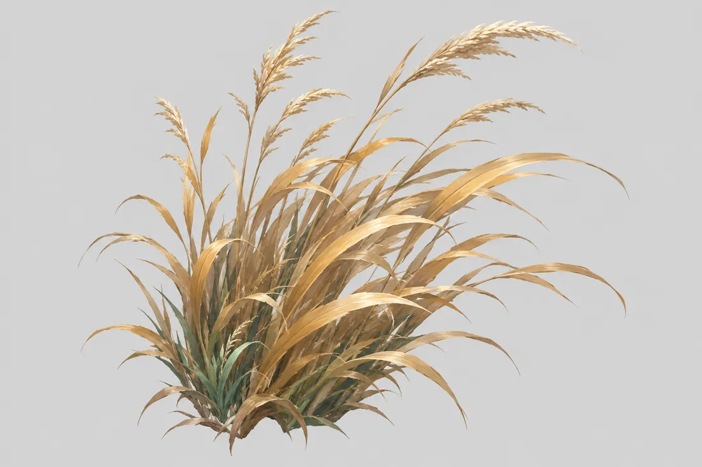
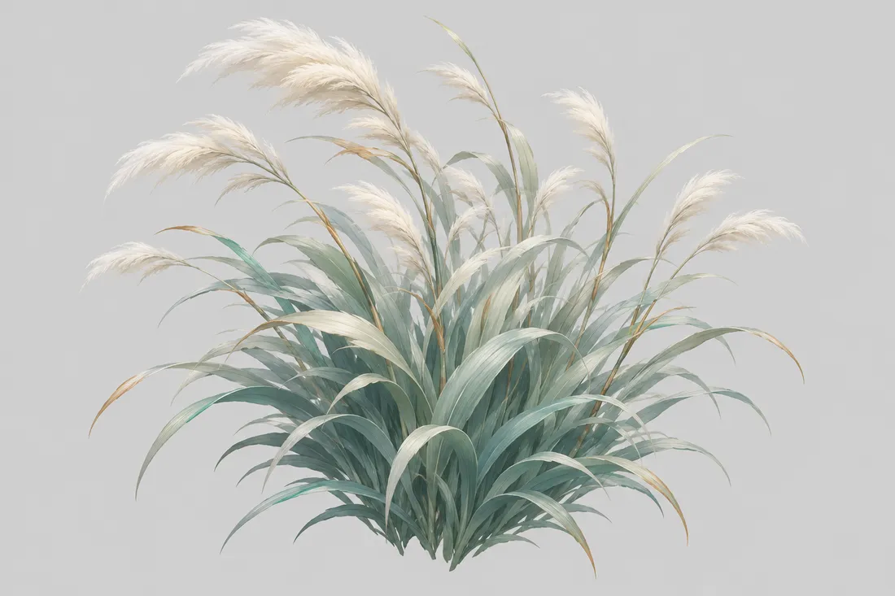
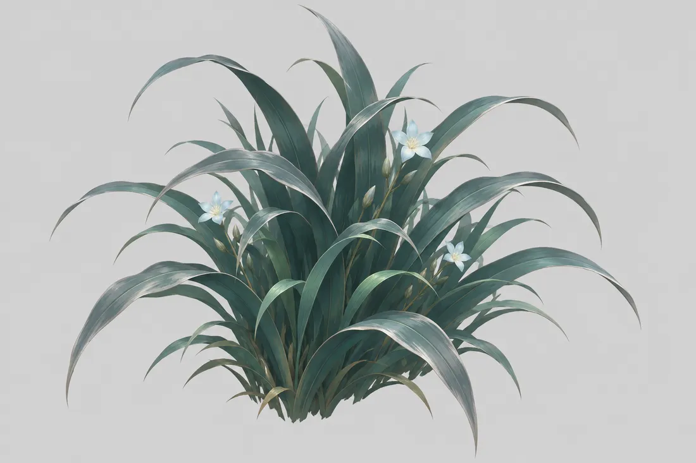
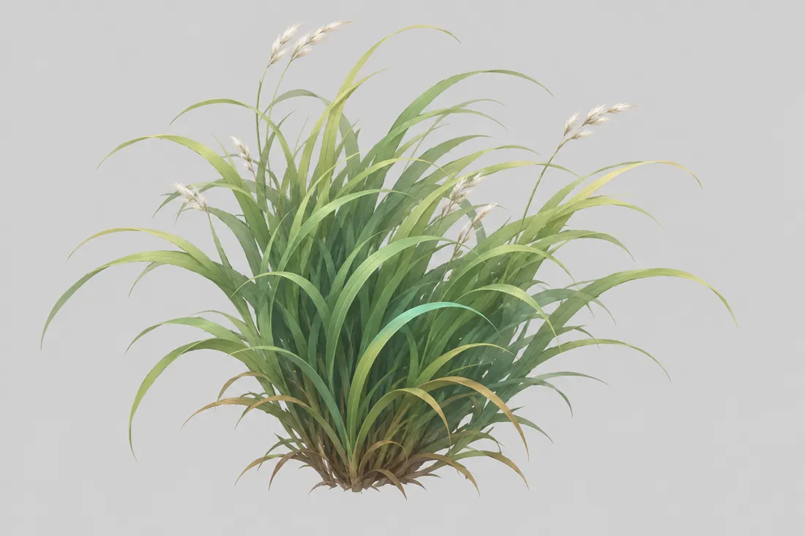

# Asset concept cho Tripo (E-0)

Bản 1 · 2026-11-16 · đi kèm `docs/EXPANSION_DESIGN.md`.

**59 asset** người dùng tự dựng trên **Tripo web** (kênh web app trong `docs/tripo-runbook.md`; không dùng credit CLI). **Mục cỏ (ưu tiên 4) không dựng trên Tripo**: worker làm thẻ cỏ alpha instanced từ ảnh concept. Mỗi mục còn lại có ảnh concept sinh bằng Codex (`node tools/codex-assets/gen.mjs concepts [id…]`, không tốn credit Tripo), prompt Tripo tiếng Anh theo `docs/art-bible.md` v3 (bán tả thực điện ảnh, sương sớm), số tam giác/texture, xương, tên file và thư mục đích trong `<DTL_ASSET_SOURCE>/`, ghi chú pipeline. Thiết kế là gốc của dự án, không chép game/truyện có sẵn.

Bản HTML xem ảnh + prompt có nút sao chép: `huong-dan-concept-asset.html` (thư mục artifact của phiên). Ảnh gốc PNG (3:2) nằm ở `<DTL_ASSET_SOURCE>/2d/concept/quai-prop/<id>.png` kèm `<id>.prompt.txt` (prompt sinh ảnh); ảnh nén WebP trong repo: `docs/asset-concepts/<id>.webp`.

## Cách dùng một mục (quy trình rút gọn)

1. Mở ảnh concept (`docs/asset-concepts/<id>.webp`).
2. Tripo web → **Image to 3D** (model **H3.1**), dùng **ảnh PNG gốc** `<DTL_ASSET_SOURCE>/2d/concept/quai-prop/<id>.png` (không dùng bản WebP nén); **nếu giao diện có ô mô tả/prompt phụ thì dán prompt Tripo của mục vào đó**, nếu không có ô thì chỉ cần ảnh. Thiết lập theo dòng "Tripo" của mục (Texture Detailed, PBR bật, Smart Low-poly bật, Polycount theo mục, quad tắt).
3. Chọn bản tốt nhất; nếu lưới nặng, dùng **Retopo** về đúng Polycount. Với asset **có xương**: rig theo cột "Xương" (cùng preset với quái/NPC hiện có, `docs/prompts/tripo.md` mục 2). Không mua animation: clip thủ tục đã có (`anim_quadruped`, `anim_biped_extra`, `anim_serpent`, `anim_human_base`).
4. Tải **GLB** về thư mục đích (cột "Thư mục"): `tripo/raw_v01.glb` (dựng hình), `lowpoly_v01.glb`, `rig_v01.glb`; chép ảnh concept đã duyệt vào `concept/concept_34_v01.png` (đúng quy ước đặt tên ở `docs/tripo-runbook.md` mục 3). Tăng `NN` khi thử lại.
5. Báo cho Claude/worker: worker tạo `assets/source/<loại>/<id>/meta.json`, chạy `tools/blender/import_tripo.py` và `pnpm assets:build`.

Giới hạn art bible mục 6 (LOD0 tam giác / texture): quái thường 5–10 nghìn (Polycount 8.000); tinh anh 10–15 nghìn (Polycount 12.000–14.000); boss một lần dựng 20.000 (tách bộ phận nếu muốn 30–50 nghìn); prop 500–5 nghìn; vũ khí 1–3 nghìn; kiến trúc: **bản Tripo chỉ là nháp**, bản cuối dựng bằng pipeline bpy (art bible mục 6). Mọi vật phát sáng (HDR dưới 2,4) do shader game làm; texture không vẽ sẵn quầng sáng.

**Ghi chú về ảnh**: ảnh concept chỉ để Tripo hiểu hình khối; chi tiết quá nhỏ (khóa, hoa văn nhỏ hơn 1% khung) không cần. Nếu Tripo cho ra chi tiết lệch, ưu tiên **hình bóng** và **màu**.

## Mục lục theo thứ tự cần

| Ưu tiên | Nhóm | Số mục |
| --- | --- | --- |
| 1 | Tinh anh (Vân Lam hiện có + bản đồ mới) | 12 |
| 2 | Boss (phó bản và ngoài trời) | 7 |
| 3 | Quái đặc trưng ba bản đồ | 12 |
| 4 | Cỏ rừng mới (thay bụi nhọn sẫm, G7) và cỏ ba bản đồ | 4 |
| 5 | Cây, đá, kiến trúc, prop môi trường ba bản đồ | 15 |
| 6 | Trang bị, kiếm, pháp bảo, bộ trang bị bậc mới | 9 |


---

## Ưu tiên 1 · Tinh anh (Vân Lam hiện có + bản đồ mới)

### `elite_xich_sa_ngo_cong` · Xích Sa Ngô Công

*(ảnh đã gỡ khỏi repo: elite_xich_sa_ngo_cong)*

| | |
| --- | --- |
| Vai trò | Tinh anh Đoạn Mạch (Hang Sa): ngô công nấp dưới cát, độc hình nón |
| Bản đồ | Đoạn Mạch Cổ Cốc (E-2) |
| Kích thước trong game | dài 6 m, thân 7 đốt |
| Tam giác (Polycount LOD0) | 12000 |
| Texture (base color / normal / ORM) | 1024/512/512 |
| Xương | Xương **serpent** theo đốt: xuất GLB tĩnh nằm trục +Z, worker E-2 dựng xương đốt bằng `tools/blender/anim_serpent.py` (không cần rig trên Tripo) |
| Thư mục đích | `<DTL_ASSET_SOURCE>/3d/quai/elite_xich_sa_ngo_cong/` (`concept/`, `tripo/`) |
| Tripo | model H3.1 (v3.1), Texture: Detailed, PBR: bật, Smart Low-poly: bật, Polycount 12000, quad tắt, GLB; texture mục tiêu base color 1024 / normal 512 / ORM 512 |

**Prompt Tripo (tiếng Anh):**

```text
an elite giant red-sand centipede about 6 meters long, segmented armored body of rust-red chitin plates with pale yellow underbelly, many short legs along the sides, two curved venom pincers, a ridge of small ochre crystals on the back, dull orange eyes, body gently curved in an S shape lying on the ground. semi-realistic stylized game asset, Chinese fantasy cultivation world, painterly PBR texture, believable anatomy, clean readable silhouette, neutral standing pose, plain background, no base, no ground, no text.
```

**Ghi chú pipeline:** Xương serpent (anim_serpent) theo đốt; chân là mesh liền đốt, lắc theo sóng thân. Không rig chân.

**Import:** `mon/elite_xich_sa_ngo_cong/tripo/raw_v01.glb` (dựng hình), `lowpoly_v01.glb` (nếu Retopo), `rig_v01.glb` (nếu có xương) → `assets/source/mon/elite_xich_sa_ngo_cong/meta.json` (`import.kind: "tripo"`, `import.source`, `size`, `yaw`, `post: anim_serpent.py`) → `pnpm assets:build` → `pnpm assets:validate` (ngân sách tam giác/texture) → khai báo trong `assets/budgets.json`/lớp ngân sách `monster`.

### `elite_ho_mach_khoi_tuong` · Hộ Mạch Khôi Tướng

*(ảnh đã gỡ khỏi repo: elite_ho_mach_khoi_tuong)*

| | |
| --- | --- |
| Vai trò | Tinh anh Đoạn Mạch (Mỏ Cũ): khôi lỗi thủ mạch, khiên và búa, phá thế |
| Bản đồ | Đoạn Mạch Cổ Cốc (E-2) |
| Kích thước trong game | cao 3,0 m |
| Tam giác (Polycount LOD0) | 14000 |
| Texture (base color / normal / ORM) | 1024/512/512 |
| Xương | Có xương, **biped**: Tripo rig biped (spec mixamo), sau đó `tools/blender/anim_biped_extra.py` |
| Thư mục đích | `<DTL_ASSET_SOURCE>/3d/quai/elite_ho_mach_khoi_tuong/` (`concept/`, `tripo/`) |
| Tripo | model H3.1 (v3.1), Texture: Detailed, PBR: bật, Smart Low-poly: bật, Polycount 14000, quad tắt, GLB; texture mục tiêu base color 1024 / normal 512 / ORM 512 |

**Prompt Tripo (tiếng Anh):**

```text
an elite vein-guardian stone-and-bronze construct about 3 meters tall, broad blocky humanoid torso made of ochre sandstone plates held by dark bronze bands, one huge rectangular tower shield on the left arm and a stone-headed hammer on the right, a hollow jade-teal glowing slit as the face, small glowing vein crystals in the chest, neutral standing pose. semi-realistic stylized game asset, Chinese fantasy cultivation world, painterly PBR texture, believable anatomy, clean readable silhouette, neutral standing pose, plain background, no base, no ground, no text.
```

**Ghi chú pipeline:** Xương biped (anim_biped_extra). Khiên là mesh liền tay trái; búa là mesh liền tay phải (không tháo rời).

**Import:** `mon/elite_ho_mach_khoi_tuong/tripo/raw_v01.glb` (dựng hình), `lowpoly_v01.glb` (nếu Retopo), `rig_v01.glb` (nếu có xương) → `assets/source/mon/elite_ho_mach_khoi_tuong/meta.json` (`import.kind: "tripo"`, `import.source`, `size`, `yaw`, `post: anim_biped_extra.py`) → `pnpm assets:build` → `pnpm assets:validate` (ngân sách tam giác/texture) → khai báo trong `assets/budgets.json`/lớp ngân sách `monster`.

### `elite_liet_cot_bao` · Liệt Cốt Báo Vương

*(ảnh đã gỡ khỏi repo: elite_liet_cot_bao)*

| | |
| --- | --- |
| Vai trò | Tinh anh Đoạn Mạch (Sa Thạch Pha): báo vồ xa, lao thẳng báo trước bằng vạch |
| Bản đồ | Đoạn Mạch Cổ Cốc (E-2) |
| Kích thước trong game | dài 2,8 m |
| Tam giác (Polycount LOD0) | 12000 |
| Texture (base color / normal / ORM) | 1024/512/512 |
| Xương | Có xương, **quadruped**: Tripo rig quadruped, sau đó `tools/blender/anim_quadruped.py` (thư viện clip chung quái bốn chân) |
| Thư mục đích | `<DTL_ASSET_SOURCE>/3d/quai/elite_liet_cot_bao/` (`concept/`, `tripo/`) |
| Tripo | model H3.1 (v3.1), Texture: Detailed, PBR: bật, Smart Low-poly: bật, Polycount 12000, quad tắt, GLB; texture mục tiêu base color 1024 / normal 512 / ORM 512 |

**Prompt Tripo (tiếng Anh):**

```text
an elite cliff leopard king about 2.8 meters long, lean muscular body, sand-ochre coat with dark rosette markings, exposed bone-white armor plates running along the spine and shoulders like cracked ribs, glowing teal-jade hairline cracks inside the bone, long tail with bone spikes, neutral four-legged standing pose. semi-realistic stylized game asset, Chinese fantasy cultivation world, painterly PBR texture, believable anatomy, clean readable silhouette, neutral standing pose, plain background, no base, no ground, no text.
```

**Ghi chú pipeline:** Xương quadruped. Cốt giáp trắng ngà là phần tối đọc được từ xa; vệt ngọc lam rất mảnh.

**Import:** `mon/elite_liet_cot_bao/tripo/raw_v01.glb` (dựng hình), `lowpoly_v01.glb` (nếu Retopo), `rig_v01.glb` (nếu có xương) → `assets/source/mon/elite_liet_cot_bao/meta.json` (`import.kind: "tripo"`, `import.source`, `size`, `yaw`, `post: anim_quadruped.py`) → `pnpm assets:build` → `pnpm assets:validate` (ngân sách tam giác/texture) → khai báo trong `assets/budgets.json`/lớp ngân sách `monster`.

### `elite_loi_van_su_vuong` · Lôi Vân Sư Vương

*(ảnh đã gỡ khỏi repo: elite_loi_van_su_vuong)*

| | |
| --- | --- |
| Vai trò | Tinh anh Vân Hải: sư tử mây sấm, vùng sét hình tròn |
| Bản đồ | Vân Hải Phù Đảo (E-3) |
| Kích thước trong game | dài 3,2 m |
| Tam giác (Polycount LOD0) | 12000 |
| Texture (base color / normal / ORM) | 1024/512/512 |
| Xương | Có xương, **quadruped**: Tripo rig quadruped, sau đó `tools/blender/anim_quadruped.py` (thư viện clip chung quái bốn chân) |
| Thư mục đích | `<DTL_ASSET_SOURCE>/3d/quai/elite_loi_van_su_vuong/` (`concept/`, `tripo/`) |
| Tripo | model H3.1 (v3.1), Texture: Detailed, PBR: bật, Smart Low-poly: bật, Polycount 12000, quad tắt, GLB; texture mục tiêu base color 1024 / normal 512 / ORM 512 |

**Prompt Tripo (tiếng Anh):**

```text
an elite storm-cloud lion king about 3.2 meters long, heavy mane made of dense grey-blue cloud-like fur with tiny pale gold lightning veins, slate-blue short coat on the body, thick paws, bright pale gold eyes, tufted tail tip, powerful chest, neutral four-legged standing pose. semi-realistic stylized game asset, Chinese fantasy cultivation world, painterly PBR texture, believable anatomy, clean readable silhouette, neutral standing pose, plain background, no base, no ground, no text.
```

**Ghi chú pipeline:** Xương quadruped. Bờm mây là mesh đặc (không trong suốt); tia sét nhỏ chỉ là vẽ trên texture, tia sét thật do VFX.

**Import:** `mon/elite_loi_van_su_vuong/tripo/raw_v01.glb` (dựng hình), `lowpoly_v01.glb` (nếu Retopo), `rig_v01.glb` (nếu có xương) → `assets/source/mon/elite_loi_van_su_vuong/meta.json` (`import.kind: "tripo"`, `import.source`, `size`, `yaw`, `post: anim_quadruped.py`) → `pnpm assets:build` → `pnpm assets:validate` (ngân sách tam giác/texture) → khai báo trong `assets/budgets.json`/lớp ngân sách `monster`.

### `elite_kinh_dien_ma_quan` · Kính Diện Ma Quân

*(ảnh đã gỡ khỏi repo: elite_kinh_dien_ma_quan)*

| | |
| --- | --- |
| Vai trò | Tinh anh Vân Hải / mini-boss phó bản Kính Nguyệt Cung: phản chiếu đạn |
| Bản đồ | Vân Hải Phù Đảo (E-3) |
| Kích thước trong game | cao 2,6 m |
| Tam giác (Polycount LOD0) | 14000 |
| Texture (base color / normal / ORM) | 1024/512/512 |
| Xương | Có xương, **biped**: Tripo rig biped (spec mixamo), sau đó `tools/blender/anim_biped_extra.py` |
| Thư mục đích | `<DTL_ASSET_SOURCE>/3d/quai/elite_kinh_dien_ma_quan/` (`concept/`, `tripo/`) |
| Tripo | model H3.1 (v3.1), Texture: Detailed, PBR: bật, Smart Low-poly: bật, Polycount 14000, quad tắt, GLB; texture mục tiêu base color 1024 / normal 512 / ORM 512 |

**Prompt Tripo (tiếng Anh):**

```text
an elite mirror-faced sentinel about 2.6 meters tall, slim humanoid in layered pale lavender-grey robes with silver-blue embroidery, a smooth polished bronze circular mirror in place of the face reflecting a soft sky, long sleeves ending in thin silver blades, a floating ring of small mirror shards around the shoulders, neutral standing pose. semi-realistic stylized game asset, Chinese fantasy cultivation world, painterly PBR texture, believable anatomy, clean readable silhouette, neutral standing pose, plain background, no base, no ground, no text.
```

**Ghi chú pipeline:** Xương biped. Gương là mặt phẳng kim loại bóng (metalness cao), game có thể gắn phản chiếu giả; mảnh gương quanh vai là mesh rời gắn xương vai.

**Import:** `mon/elite_kinh_dien_ma_quan/tripo/raw_v01.glb` (dựng hình), `lowpoly_v01.glb` (nếu Retopo), `rig_v01.glb` (nếu có xương) → `assets/source/mon/elite_kinh_dien_ma_quan/meta.json` (`import.kind: "tripo"`, `import.source`, `size`, `yaw`, `post: anim_biped_extra.py`) → `pnpm assets:build` → `pnpm assets:validate` (ngân sách tam giác/texture) → khai báo trong `assets/budgets.json`/lớp ngân sách `monster`.

### `elite_van_hac_vuong` · Tuyết Vũ Vân Hạc Vương

*(ảnh đã gỡ khỏi repo: elite_van_hac_vuong)*

| | |
| --- | --- |
| Vai trò | Tinh anh Vân Hải: hạc mây bay lơ lửng, bắn mưa lông |
| Bản đồ | Vân Hải Phù Đảo (E-3) |
| Kích thước trong game | sải cánh 7 m, lơ lửng cao 3 m |
| Tam giác (Polycount LOD0) | 12000 |
| Texture (base color / normal / ORM) | 1024/512/512 |
| Xương | **Không xương**: bay/lơ lửng bằng transform thủ tục; nếu muốn vỗ cánh, tách cánh thành mesh riêng gắn gốc |
| Thư mục đích | `<DTL_ASSET_SOURCE>/3d/quai/elite_van_hac_vuong/` (`concept/`, `tripo/`) |
| Tripo | model H3.1 (v3.1), Texture: Detailed, PBR: bật, Smart Low-poly: bật, Polycount 12000, quad tắt, GLB; texture mục tiêu base color 1024 / normal 512 / ORM 512 |

**Prompt Tripo (tiếng Anh):**

```text
an elite cloud crane king with a 7 meter wingspan, snow-white feathers shading to pale jade-blue wingtips, long slender neck and long legs trailing, a crest of fine silver feathers, a thin gold ring of mist around the neck, calm regal face, wings half spread in a gliding pose. semi-realistic stylized game asset, Chinese fantasy cultivation world, painterly PBR texture, believable anatomy, clean readable silhouette, neutral standing pose, plain background, no base, no ground, no text.
```

**Ghi chú pipeline:** Không xương: cánh vỗ theo transform thủ tục (như Kiếm Linh phát sáng). Hai cánh dựng sẵn ở tư thế lượn, hoặc tách mesh cánh nếu muốn vỗ.

**Import:** `mon/elite_van_hac_vuong/tripo/raw_v01.glb` (dựng hình), `lowpoly_v01.glb` (nếu Retopo), `rig_v01.glb` (nếu có xương) → `assets/source/mon/elite_van_hac_vuong/meta.json` (`import.kind: "tripo"`, `import.source`, `size`, `yaw`, `post: (không)`) → `pnpm assets:build` → `pnpm assets:validate` (ngân sách tam giác/texture) → khai báo trong `assets/budgets.json`/lớp ngân sách `monster`.

### `elite_cot_kiem_thong_linh` · Cốt Kiếm Thống Lĩnh

*(ảnh đã gỡ khỏi repo: elite_cot_kiem_thong_linh)*

| | |
| --- | --- |
| Vai trò | Tinh anh Cổ Thành / mini-boss Thần Tàng Điện: bộ xương cầm hai kiếm |
| Bản đồ | Thiên Khuyết Cổ Thành (E-4) |
| Kích thước trong game | cao 2,8 m |
| Tam giác (Polycount LOD0) | 14000 |
| Texture (base color / normal / ORM) | 1024/512/512 |
| Xương | Có xương, **biped**: Tripo rig biped (spec mixamo), sau đó `tools/blender/anim_biped_extra.py` |
| Thư mục đích | `<DTL_ASSET_SOURCE>/3d/quai/elite_cot_kiem_thong_linh/` (`concept/`, `tripo/`) |
| Tripo | model H3.1 (v3.1), Texture: Detailed, PBR: bật, Smart Low-poly: bật, Polycount 14000, quad tắt, GLB; texture mục tiêu base color 1024 / normal 512 / ORM 512 |

**Prompt Tripo (tiếng Anh):**

```text
an elite skeletal sword commander about 2.8 meters tall, ivory aged bones, tattered dark blue officer robe and a rusted bronze half-armor, a helm with a broken crest, a long straight sword in each hand with chipped edges, small pale cold-gold flame inside the skull eye sockets, neutral standing pose with arms slightly out. semi-realistic stylized game asset, Chinese fantasy cultivation world, painterly PBR texture, believable anatomy, clean readable silhouette, neutral standing pose, plain background, no base, no ground, no text.
```

**Ghi chú pipeline:** Xương người (anim_human_base) hoặc biped. Hai kiếm là mesh liền tay. Không máu me, tông ngà cổ.

**Import:** `mon/elite_cot_kiem_thong_linh/tripo/raw_v01.glb` (dựng hình), `lowpoly_v01.glb` (nếu Retopo), `rig_v01.glb` (nếu có xương) → `assets/source/mon/elite_cot_kiem_thong_linh/meta.json` (`import.kind: "tripo"`, `import.source`, `size`, `yaw`, `post: anim_biped_extra.py`) → `pnpm assets:build` → `pnpm assets:validate` (ngân sách tam giác/texture) → khai báo trong `assets/budgets.json`/lớp ngân sách `monster`.

### `elite_da_minh_loc_vuong` · Dạ Minh Lộc Vương

*(ảnh đã gỡ khỏi repo: elite_da_minh_loc_vuong)*

| | |
| --- | --- |
| Vai trò | Tinh anh Cổ Thành: hươu đêm, phát quầng sáng sao, húc lao |
| Bản đồ | Thiên Khuyết Cổ Thành (E-4) |
| Kích thước trong game | dài 3,0 m, cao vai 2,0 m |
| Tam giác (Polycount LOD0) | 12000 |
| Texture (base color / normal / ORM) | 1024/512/512 |
| Xương | Có xương, **quadruped**: Tripo rig quadruped, sau đó `tools/blender/anim_quadruped.py` (thư viện clip chung quái bốn chân) |
| Thư mục đích | `<DTL_ASSET_SOURCE>/3d/quai/elite_da_minh_loc_vuong/` (`concept/`, `tripo/`) |
| Tripo | model H3.1 (v3.1), Texture: Detailed, PBR: bật, Smart Low-poly: bật, Polycount 12000, quad tắt, GLB; texture mục tiêu base color 1024 / normal 512 / ORM 512 |

**Prompt Tripo (tiếng Anh):**

```text
an elite night-glow stag king about 3 meters long, deep indigo-black coat dotted with tiny pale silver star-like spots, magnificent branching antlers of pale silver crystal-wood with small glowing tips, slender powerful legs, white chest tuft, calm luminous eyes, neutral four-legged standing pose. semi-realistic stylized game asset, Chinese fantasy cultivation world, painterly PBR texture, believable anatomy, clean readable silhouette, neutral standing pose, plain background, no base, no ground, no text.
```

**Ghi chú pipeline:** Xương quadruped. Chỉ đầu mút gạc phát sáng; điểm sao là vẽ trên texture.

**Import:** `mon/elite_da_minh_loc_vuong/tripo/raw_v01.glb` (dựng hình), `lowpoly_v01.glb` (nếu Retopo), `rig_v01.glb` (nếu có xương) → `assets/source/mon/elite_da_minh_loc_vuong/meta.json` (`import.kind: "tripo"`, `import.source`, `size`, `yaw`, `post: anim_quadruped.py`) → `pnpm assets:build` → `pnpm assets:validate` (ngân sách tam giác/texture) → khai báo trong `assets/budgets.json`/lớp ngân sách `monster`.

### `elite_thach_tuong_dai_tuong` · Thạch Tượng Đại Tướng

*(ảnh đã gỡ khỏi repo: elite_thach_tuong_dai_tuong)*

| | |
| --- | --- |
| Vai trò | Tinh anh Cổ Thành: tượng đá võ tướng, quét kiếm hình nón |
| Bản đồ | Thiên Khuyết Cổ Thành (E-4) |
| Kích thước trong game | cao 3,4 m |
| Tam giác (Polycount LOD0) | 14000 |
| Texture (base color / normal / ORM) | 1024/512/512 |
| Xương | Có xương, **biped**: Tripo rig biped (spec mixamo), sau đó `tools/blender/anim_biped_extra.py` |
| Thư mục đích | `<DTL_ASSET_SOURCE>/3d/quai/elite_thach_tuong_dai_tuong/` (`concept/`, `tripo/`) |
| Tripo | model H3.1 (v3.1), Texture: Detailed, PBR: bật, Smart Low-poly: bật, Polycount 14000, quad tắt, GLB; texture mục tiêu base color 1024 / normal 512 / ORM 512 |

**Prompt Tripo (tiếng Anh):**

```text
an elite ancient stone general statue come alive, about 3.4 meters tall, dark blue-grey granite armor with carved cloud patterns, broken left shoulder guard, a weathered great sword with a broken tip, moss and hairline cracks, eyes glowing a pale cold gold, a tattered ancient banner stub tied at the waist, neutral standing pose. semi-realistic stylized game asset, Chinese fantasy cultivation world, painterly PBR texture, believable anatomy, clean readable silhouette, neutral standing pose, plain background, no base, no ground, no text.
```

**Ghi chú pipeline:** Xương biped. Kiếm là mesh liền tay phải.

**Import:** `mon/elite_thach_tuong_dai_tuong/tripo/raw_v01.glb` (dựng hình), `lowpoly_v01.glb` (nếu Retopo), `rig_v01.glb` (nếu có xương) → `assets/source/mon/elite_thach_tuong_dai_tuong/meta.json` (`import.kind: "tripo"`, `import.source`, `size`, `yaw`, `post: anim_biped_extra.py`) → `pnpm assets:build` → `pnpm assets:validate` (ngân sách tam giác/texture) → khai báo trong `assets/budgets.json`/lớp ngân sách `monster`.

### `elite_cu_nham_vien` · Cự Nham Viên

*(ảnh đã gỡ khỏi repo: elite_cu_nham_vien)*

| | |
| --- | --- |
| Vai trò | Tinh anh Vách Đá: vượn đá khổng lồ, đòn nón tinh thần |
| Bản đồ | Vân Lam |
| Kích thước trong game | cao 3,6 m khi đứng, scale 2,0 |
| Tam giác (Polycount LOD0) | 14000 |
| Texture (base color / normal / ORM) | 1024/512/512 |
| Xương | Có xương, **biped**: Tripo rig biped (spec mixamo), sau đó `tools/blender/anim_biped_extra.py` |
| Thư mục đích | `<DTL_ASSET_SOURCE>/3d/quai/elite_cu_nham_vien/` (`concept/`, `tripo/`) |
| Tripo | model H3.1 (v3.1), Texture: Detailed, PBR: bật, Smart Low-poly: bật, Polycount 14000, quad tắt, GLB; texture mục tiêu base color 1024 / normal 512 / ORM 512 |

**Prompt Tripo (tiếng Anh):**

```text
an elite giant stone ape about 3.6 meters tall standing, massive grey granite slabs on shoulders, back and forearms with moss patches, exposed mottled dark fur on the chest, knuckles dragging low, small amber eyes under a heavy brow ridge, a cracked yellow-gold crystal embedded in the chest, neutral A-pose-like standing. semi-realistic stylized game asset, Chinese fantasy cultivation world, painterly PBR texture, believable anatomy, clean readable silhouette, neutral standing pose, plain background, no base, no ground, no text.
```

**Ghi chú pipeline:** Xương vượn của Thạch Viên. Tinh thể ngực là điểm sáng duy nhất.

**Import:** `mon/elite_cu_nham_vien/tripo/raw_v01.glb` (dựng hình), `lowpoly_v01.glb` (nếu Retopo), `rig_v01.glb` (nếu có xương) → `assets/source/mon/elite_cu_nham_vien/meta.json` (`import.kind: "tripo"`, `import.source`, `size`, `yaw`, `post: anim_biped_extra.py`) → `pnpm assets:build` → `pnpm assets:validate` (ngân sách tam giác/texture) → khai báo trong `assets/budgets.json`/lớp ngân sách `monster`.

### `elite_xich_dien_ho` · Xích Diễm Hồ

*(ảnh đã gỡ khỏi repo: elite_xich_dien_ho)*

| | |
| --- | --- |
| Vai trò | Tinh anh Suối/Rừng: cáo lửa bắn 3 hỏa cầu |
| Bản đồ | Vân Lam |
| Kích thước trong game | dài 1,9 m, scale 1,5 |
| Tam giác (Polycount LOD0) | 12000 |
| Texture (base color / normal / ORM) | 1024/512/512 |
| Xương | Có xương, **quadruped**: Tripo rig quadruped, sau đó `tools/blender/anim_quadruped.py` (thư viện clip chung quái bốn chân) |
| Thư mục đích | `<DTL_ASSET_SOURCE>/3d/quai/elite_xich_dien_ho/` (`concept/`, `tripo/`) |
| Tripo | model H3.1 (v3.1), Texture: Detailed, PBR: bật, Smart Low-poly: bật, Polycount 12000, quad tắt, GLB; texture mục tiêu base color 1024 / normal 512 / ORM 512 |

**Prompt Tripo (tiếng Anh):**

```text
an elite crimson flame fox about 1.9 meters long, slender but powerful, vermilion red coat fading to gold on the chest, three bushy tails with glowing golden tips fanned behind, black socks on legs, calm predatory gaze, neutral four-legged standing pose. semi-realistic stylized game asset, Chinese fantasy cultivation world, painterly PBR texture, believable anatomy, clean readable silhouette, neutral standing pose, plain background, no base, no ground, no text.
```

**Ghi chú pipeline:** Xương cáo dùng chung với Hỏa Vân Hồ. Ba đuôi là mesh liền thân (không xương phụ), đuôi phát sáng bằng emissive nhẹ.

**Import:** `mon/elite_xich_dien_ho/tripo/raw_v01.glb` (dựng hình), `lowpoly_v01.glb` (nếu Retopo), `rig_v01.glb` (nếu có xương) → `assets/source/mon/elite_xich_dien_ho/meta.json` (`import.kind: "tripo"`, `import.source`, `size`, `yaw`, `post: anim_quadruped.py`) → `pnpm assets:build` → `pnpm assets:validate` (ngân sách tam giác/texture) → khai báo trong `assets/budgets.json`/lớp ngân sách `monster`.

### `elite_huyet_nha_lang` · Huyết Nha Lang

*(ảnh đã gỡ khỏi repo: elite_huyet_nha_lang)*

| | |
| --- | --- |
| Vai trò | Tinh anh Thung Lũng/Suối: sói đỏ máu, phun lửa hình nón |
| Bản đồ | Vân Lam |
| Kích thước trong game | dài 2,6 m, scale 1,75 so với Sói Xám |
| Tam giác (Polycount LOD0) | 12000 |
| Texture (base color / normal / ORM) | 1024/512/512 |
| Xương | Có xương, **quadruped**: Tripo rig quadruped, sau đó `tools/blender/anim_quadruped.py` (thư viện clip chung quái bốn chân) |
| Thư mục đích | `<DTL_ASSET_SOURCE>/3d/quai/elite_huyet_nha_lang/` (`concept/`, `tripo/`) |
| Tripo | model H3.1 (v3.1), Texture: Detailed, PBR: bật, Smart Low-poly: bật, Polycount 12000, quad tắt, GLB; texture mục tiêu base color 1024 / normal 512 / ORM 512 |

**Prompt Tripo (tiếng Anh):**

```text
an elite blood-fanged mountain wolf, about 2.6 meters long, hulking shoulders, dark wine-red coat with charred black saddle, long curved fangs stained ember red, glowing ember-orange cracks along the spine ridge and eyes, torn left ear, heavy scarred paws, stands in neutral four-legged pose. semi-realistic stylized game asset, Chinese fantasy cultivation world, painterly PBR texture, believable anatomy, clean readable silhouette, neutral standing pose, plain background, no base, no ground, no text.
```

**Ghi chú pipeline:** Cùng xương `anim_quadruped` với Sói Xám; khác Yêu Lang ở sống lưng gai và lớp lông đỏ sẫm. Vệt cam chỉ ở sống lưng, mắt, răng (HDR nhỏ).

**Import:** `mon/elite_huyet_nha_lang/tripo/raw_v01.glb` (dựng hình), `lowpoly_v01.glb` (nếu Retopo), `rig_v01.glb` (nếu có xương) → `assets/source/mon/elite_huyet_nha_lang/meta.json` (`import.kind: "tripo"`, `import.source`, `size`, `yaw`, `post: anim_quadruped.py`) → `pnpm assets:build` → `pnpm assets:validate` (ngân sách tam giác/texture) → khai báo trong `assets/budgets.json`/lớp ngân sách `monster`.


---

## Ưu tiên 2 · Boss (phó bản và ngoài trời)

### `boss_dia_mach_long` · Địa Mạch Long

*(ảnh đã gỡ khỏi repo: boss_dia_mach_long)*

| | |
| --- | --- |
| Vai trò | Boss ngoài trời Đoạn Mạch Cổ Cốc (4 người) |
| Bản đồ | Đoạn Mạch Cổ Cốc (E-2) |
| Kích thước trong game | dài 9 m, cao vai 3,2 m |
| Tam giác (Polycount LOD0) | 20000 |
| Texture (base color / normal / ORM) | 2048/1024/1024 |
| Xương | Có xương, **quadruped**: Tripo rig quadruped, sau đó `tools/blender/anim_quadruped.py` (thư viện clip chung quái bốn chân) |
| Thư mục đích | `<DTL_ASSET_SOURCE>/3d/boss/boss_dia_mach_long/` (`concept/`, `tripo/`) |
| Tripo | model H3.1 (v3.1), Texture: Detailed, PBR: bật, Smart Low-poly: bật, Polycount 20000, quad tắt, GLB; texture mục tiêu base color 2048 / normal 1024 / ORM 1024 |

**Prompt Tripo (tiếng Anh):**

```text
a massive ground-dragon guardian about 9 meters long, ochre and rust-red rock-plated body like cliff stone, four thick pillar legs, a horned wedge-shaped head with swept-back horns, a long heavy tail with stone spikes, glowing jade-teal vein light flowing along cracks in its back and neck like a dying river of light, moss on the shoulders, neutral four-legged standing pose. semi-realistic stylized game asset, Chinese fantasy cultivation world, painterly PBR texture, believable anatomy, clean readable silhouette, neutral standing pose, plain background, no base, no ground, no text.
```

**Ghi chú pipeline:** Xương quadruped (cỡ boss). Khe sáng ngọc lam là vẽ trên texture + emissive nhỏ; chiều sáng giảm theo máu (script).

**Import:** `boss/boss_dia_mach_long/tripo/raw_v01.glb` (dựng hình), `lowpoly_v01.glb` (nếu Retopo), `rig_v01.glb` (nếu có xương) → `assets/source/boss/boss_dia_mach_long/meta.json` (`import.kind: "tripo"`, `import.source`, `size`, `yaw`, `post: anim_quadruped.py`) → `pnpm assets:build` → `pnpm assets:validate` (ngân sách tam giác/texture) → khai báo trong `assets/budgets.json`/lớp ngân sách `boss`.

### `boss_thach_tam_khoi_vuong` · Thạch Tâm Khôi Vương

*(ảnh đã gỡ khỏi repo: boss_thach_tam_khoi_vuong)*

| | |
| --- | --- |
| Vai trò | Boss giữa phó bản Phục Mạch Quật (đợt 4) |
| Bản đồ | Đoạn Mạch Cổ Cốc (E-2) |
| Kích thước trong game | cao 5 m |
| Tam giác (Polycount LOD0) | 20000 |
| Texture (base color / normal / ORM) | 2048/1024/1024 |
| Xương | Có xương, **biped**: Tripo rig biped (spec mixamo), sau đó `tools/blender/anim_biped_extra.py` |
| Thư mục đích | `<DTL_ASSET_SOURCE>/3d/boss/boss_thach_tam_khoi_vuong/` (`concept/`, `tripo/`) |
| Tripo | model H3.1 (v3.1), Texture: Detailed, PBR: bật, Smart Low-poly: bật, Polycount 20000, quad tắt, GLB; texture mục tiêu base color 2048 / normal 1024 / ORM 1024 |

**Prompt Tripo (tiếng Anh):**

```text
a huge stone-hearted mining golem king about 5 meters tall, bulky body of ochre and rust-red rock plates joined by thick dark iron mining braces, a giant two-handed pickaxe with a crystal head, a cracked open chest cavity revealing a large glowing jade-teal heart crystal, rope and chain remnants around the waist, neutral standing pose. semi-realistic stylized game asset, Chinese fantasy cultivation world, painterly PBR texture, believable anatomy, clean readable silhouette, neutral standing pose, plain background, no base, no ground, no text.
```

**Ghi chú pipeline:** Xương biped/vượn như Kiếm Khôi. Tim ngọc ở ngực là điểm yếu (lúc mở, hiện vạch phá thế).

**Import:** `boss/boss_thach_tam_khoi_vuong/tripo/raw_v01.glb` (dựng hình), `lowpoly_v01.glb` (nếu Retopo), `rig_v01.glb` (nếu có xương) → `assets/source/boss/boss_thach_tam_khoi_vuong/meta.json` (`import.kind: "tripo"`, `import.source`, `size`, `yaw`, `post: anim_biped_extra.py`) → `pnpm assets:build` → `pnpm assets:validate` (ngân sách tam giác/texture) → khai báo trong `assets/budgets.json`/lớp ngân sách `boss`.

### `boss_thon_mach_ngo_cong_vuong` · Thôn Mạch Ngô Công Vương

*(ảnh đã gỡ khỏi repo: boss_thon_mach_ngo_cong_vuong)*

| | |
| --- | --- |
| Vai trò | Boss cuối phó bản Phục Mạch Quật |
| Bản đồ | Đoạn Mạch Cổ Cốc (E-2) |
| Kích thước trong game | dài 14 m, thân 11 đốt, đầu cao 3 m |
| Tam giác (Polycount LOD0) | 20000 |
| Texture (base color / normal / ORM) | 2048/1024/1024 |
| Xương | Xương **serpent** theo đốt: xuất GLB tĩnh nằm trục +Z, worker E-2 dựng xương đốt bằng `tools/blender/anim_serpent.py` (không cần rig trên Tripo) |
| Thư mục đích | `<DTL_ASSET_SOURCE>/3d/boss/boss_thon_mach_ngo_cong_vuong/` (`concept/`, `tripo/`) |
| Tripo | model H3.1 (v3.1), Texture: Detailed, PBR: bật, Smart Low-poly: bật, Polycount 20000, quad tắt, GLB; texture mục tiêu base color 2048 / normal 1024 / ORM 1024 |

**Prompt Tripo (tiếng Anh):**

```text
a colossal vein-devouring centipede king about 14 meters long, thick segmented armor of dark rust-brown chitin with gold-ochre edge plates, a glowing jade-teal pulsing vein-stone fused into the head and each segment ring like swallowed crystals, two huge curved mandibles, many strong legs, rearing the front third of its body up in a threatening S curve. semi-realistic stylized game asset, Chinese fantasy cultivation world, painterly PBR texture, believable anatomy, clean readable silhouette, neutral standing pose, plain background, no base, no ground, no text.
```

**Ghi chú pipeline:** Đầu có thể làm riêng và tách bộ phận để vượt giới hạn 20k. Xương serpent; 11 đốt khớp với `anim_serpent`. Tinh thạch trên thân phát sáng nhịp theo pha boss.

**Import:** `boss/boss_thon_mach_ngo_cong_vuong/tripo/raw_v01.glb` (dựng hình), `lowpoly_v01.glb` (nếu Retopo), `rig_v01.glb` (nếu có xương) → `assets/source/boss/boss_thon_mach_ngo_cong_vuong/meta.json` (`import.kind: "tripo"`, `import.source`, `size`, `yaw`, `post: anim_serpent.py`) → `pnpm assets:build` → `pnpm assets:validate` (ngân sách tam giác/texture) → khai báo trong `assets/budgets.json`/lớp ngân sách `boss`.

### `boss_van_hai_kinh_vuong` · Vân Hải Kình Vương

*(ảnh đã gỡ khỏi repo: boss_van_hai_kinh_vuong)*

| | |
| --- | --- |
| Vai trò | Boss ngoài trời Vân Hải Phù Đảo (4 người): kình ngư bay lượn |
| Bản đồ | Vân Hải Phù Đảo (E-3) |
| Kích thước trong game | dài 18 m, bay cao 12 m |
| Tam giác (Polycount LOD0) | 20000 |
| Texture (base color / normal / ORM) | 2048/1024/1024 |
| Xương | Xương **serpent** theo đốt: xuất GLB tĩnh nằm trục +Z, worker E-2 dựng xương đốt bằng `tools/blender/anim_serpent.py` (không cần rig trên Tripo) |
| Thư mục đích | `<DTL_ASSET_SOURCE>/3d/boss/boss_van_hai_kinh_vuong/` (`concept/`, `tripo/`) |
| Tripo | model H3.1 (v3.1), Texture: Detailed, PBR: bật, Smart Low-poly: bật, Polycount 20000, quad tắt, GLB; texture mục tiêu base color 2048 / normal 1024 / ORM 1024 |

**Prompt Tripo (tiếng Anh):**

```text
a colossal flying sky whale king about 18 meters long, smooth slate-blue back fading to pale cream belly, long pectoral fins like wings, weathered ancient barnacle-like pale stone growths on the head, a faint lantern-like glowing jade sac under the chin, small calm intelligent eye, a broad tail fluke, body in a gentle arc as if gliding. semi-realistic stylized game asset, Chinese fantasy cultivation world, painterly PBR texture, believable anatomy, clean readable silhouette, neutral standing pose, plain background, no base, no ground, no text.
```

**Ghi chú pipeline:** Xương serpent (thân dài). Lơ lửng bằng thủ tục, không cần chân. Vây là mesh liền thân.

**Import:** `boss/boss_van_hai_kinh_vuong/tripo/raw_v01.glb` (dựng hình), `lowpoly_v01.glb` (nếu Retopo), `rig_v01.glb` (nếu có xương) → `assets/source/boss/boss_van_hai_kinh_vuong/meta.json` (`import.kind: "tripo"`, `import.source`, `size`, `yaw`, `post: anim_serpent.py`) → `pnpm assets:build` → `pnpm assets:validate` (ngân sách tam giác/texture) → khai báo trong `assets/budgets.json`/lớp ngân sách `boss`.

### `boss_kinh_nguyet_chan_quan` · Kính Nguyệt Chân Quân

*(ảnh đã gỡ khỏi repo: boss_kinh_nguyet_chan_quan)*

| | |
| --- | --- |
| Vai trò | Boss cuối phó bản Kính Nguyệt Cung (ba bóng, một thật) |
| Bản đồ | Vân Hải Phù Đảo (E-3) |
| Kích thước trong game | cao 3,6 m |
| Tam giác (Polycount LOD0) | 20000 |
| Texture (base color / normal / ORM) | 2048/1024/1024 |
| Xương | Có xương, **biped**: Tripo rig biped (spec mixamo), sau đó `tools/blender/anim_biped_extra.py` |
| Thư mục đích | `<DTL_ASSET_SOURCE>/3d/boss/boss_kinh_nguyet_chan_quan/` (`concept/`, `tripo/`) |
| Tripo | model H3.1 (v3.1), Texture: Detailed, PBR: bật, Smart Low-poly: bật, Polycount 20000, quad tắt, GLB; texture mục tiêu base color 2048 / normal 1024 / ORM 1024 |

**Prompt Tripo (tiếng Anh):**

```text
an ancient robed moon-mirror lord about 3.6 meters tall, flowing layered silver-white and pale blue robes with long trailing sleeves, a tall crown of thin curved mirror blades, a calm pale unreadable face half hidden behind a floating circular mirror disc, a crescent-shaped long staff, soft cool teal-blue accents only, standing pose with hands lowered. semi-realistic stylized game asset, Chinese fantasy cultivation world, painterly PBR texture, believable anatomy, clean readable silhouette, neutral standing pose, plain background, no base, no ground, no text.
```

**Ghi chú pipeline:** Xương người/biped. Bốn bản sao dùng cùng model (phó bản dùng 3 bóng giả). Đĩa gương nổi là mesh rời gắn xương đầu.

**Import:** `boss/boss_kinh_nguyet_chan_quan/tripo/raw_v01.glb` (dựng hình), `lowpoly_v01.glb` (nếu Retopo), `rig_v01.glb` (nếu có xương) → `assets/source/boss/boss_kinh_nguyet_chan_quan/meta.json` (`import.kind: "tripo"`, `import.source`, `size`, `yaw`, `post: anim_biped_extra.py`) → `pnpm assets:build` → `pnpm assets:validate` (ngân sách tam giác/texture) → khai báo trong `assets/budgets.json`/lớp ngân sách `boss`.

### `boss_thien_khuyet_thu_linh` · Thiên Khuyết Thủ Linh

*(ảnh đã gỡ khỏi repo: boss_thien_khuyet_thu_linh)*

| | |
| --- | --- |
| Vai trò | Boss ngoài trời Thiên Khuyết Cổ Thành (4 người) |
| Bản đồ | Thiên Khuyết Cổ Thành (E-4) |
| Kích thước trong game | cao 8 m |
| Tam giác (Polycount LOD0) | 20000 |
| Texture (base color / normal / ORM) | 2048/1024/1024 |
| Xương | Có xương, **biped**: Tripo rig biped (spec mixamo), sau đó `tools/blender/anim_biped_extra.py` |
| Thư mục đích | `<DTL_ASSET_SOURCE>/3d/boss/boss_thien_khuyet_thu_linh/` (`concept/`, `tripo/`) |
| Tripo | model H3.1 (v3.1), Texture: Detailed, PBR: bật, Smart Low-poly: bật, Polycount 20000, quad tắt, GLB; texture mục tiêu base color 2048 / normal 1024 / ORM 1024 |

**Prompt Tripo (tiếng Anh):**

```text
a colossal temple-guardian statue god about 8 meters tall, dark blue-grey stone body carved with flowing robes and armor, a long broken stone halberd, large cracked stone halo ring floating behind its head, one half of the face worn smooth and the other half carved with a stern calm expression, ancient pale-gold inlay lines glowing faintly, moss and vines at the feet, standing pose. semi-realistic stylized game asset, Chinese fantasy cultivation world, painterly PBR texture, believable anatomy, clean readable silhouette, neutral standing pose, plain background, no base, no ground, no text.
```

**Ghi chú pipeline:** Xương biped (cỡ boss). Halo là mesh rời gắn xương đầu. Giữ cân đối để đọc được từ 60 m.

**Import:** `boss/boss_thien_khuyet_thu_linh/tripo/raw_v01.glb` (dựng hình), `lowpoly_v01.glb` (nếu Retopo), `rig_v01.glb` (nếu có xương) → `assets/source/boss/boss_thien_khuyet_thu_linh/meta.json` (`import.kind: "tripo"`, `import.source`, `size`, `yaw`, `post: anim_biped_extra.py`) → `pnpm assets:build` → `pnpm assets:validate` (ngân sách tam giác/texture) → khai báo trong `assets/budgets.json`/lớp ngân sách `boss`.

### `boss_vo_dien_than_quan` · Vô Diện Thần Quân

*(ảnh đã gỡ khỏi repo: boss_vo_dien_than_quan)*

| | |
| --- | --- |
| Vai trò | Boss cuối phó bản Thần Tàng Điện |
| Bản đồ | Thiên Khuyết Cổ Thành (E-4) |
| Kích thước trong game | cao 4,6 m |
| Tam giác (Polycount LOD0) | 20000 |
| Texture (base color / normal / ORM) | 2048/1024/1024 |
| Xương | Có xương, **biped**: Tripo rig biped (spec mixamo), sau đó `tools/blender/anim_biped_extra.py` |
| Thư mục đích | `<DTL_ASSET_SOURCE>/3d/boss/boss_vo_dien_than_quan/` (`concept/`, `tripo/`) |
| Tripo | model H3.1 (v3.1), Texture: Detailed, PBR: bật, Smart Low-poly: bật, Polycount 20000, quad tắt, GLB; texture mục tiêu base color 2048 / normal 1024 / ORM 1024 |

**Prompt Tripo (tiếng Anh):**

```text
a towering faceless spirit lord about 4.6 meters tall, an ancient ceremonial armor-robe of dark navy cloth and pale gold plates, a smooth blank ivory mask-face with no features, six thin pale arms folded in a ritual pose behind its back like a fan, a halo of broken stone-ring segments floating behind the head, a long tattered ceremonial sash, serene and cold, standing pose. semi-realistic stylized game asset, Chinese fantasy cultivation world, painterly PBR texture, believable anatomy, clean readable silhouette, neutral standing pose, plain background, no base, no ground, no text.
```

**Ghi chú pipeline:** Xương biped; sáu cánh tay phụ là mesh lấp sau lưng, nhún theo xương spine (không rig tay phụ). Vòng đá lơ lửng gắn xương đầu.

**Import:** `boss/boss_vo_dien_than_quan/tripo/raw_v01.glb` (dựng hình), `lowpoly_v01.glb` (nếu Retopo), `rig_v01.glb` (nếu có xương) → `assets/source/boss/boss_vo_dien_than_quan/meta.json` (`import.kind: "tripo"`, `import.source`, `size`, `yaw`, `post: anim_biped_extra.py`) → `pnpm assets:build` → `pnpm assets:validate` (ngân sách tam giác/texture) → khai báo trong `assets/budgets.json`/lớp ngân sách `boss`.


---

## Ưu tiên 3 · Quái đặc trưng ba bản đồ

### `mon_mach_thuong_ho_ve` · Mạch Thương Hộ Vệ

*(ảnh đã gỡ khỏi repo: mon_mach_thuong_ho_ve)*

| | |
| --- | --- |
| Vai trò | Quái người Tàng Mạch Hội (cấp 18–19): khiên húc |
| Bản đồ | Đoạn Mạch Cổ Cốc (E-2) |
| Kích thước trong game | cao 1,75 m |
| Tam giác (Polycount LOD0) | 10000 |
| Texture (base color / normal / ORM) | 1024/512/512 |
| Xương | Có xương, **người**: Tripo rig biped; dùng chung clip `anim_human_base` (retarget theo tên xương, `game/character/animLib.ts`) |
| Thư mục đích | `<DTL_ASSET_SOURCE>/3d/quai/mon_mach_thuong_ho_ve/` (`concept/`, `tripo/`) |
| Tripo | model H3.1 (v3.1), Texture: Detailed, PBR: bật, Smart Low-poly: bật, Polycount 10000, quad tắt, GLB; texture mục tiêu base color 1024 / normal 512 / ORM 512 |

**Prompt Tripo (tiếng Anh):**

```text
a mercenary vein-trader guard, human man about 1.75 meters tall, practical rust-brown and sand-yellow layered coat with a dark leather chest guard, a large round bronze shield with a plain boss, a short broad sword, a scarf over the lower face, a small jade-green stone pendant at the belt, neutral standing pose. semi-realistic stylized game asset, Chinese fantasy cultivation world, painterly PBR texture, believable anatomy, clean readable silhouette, neutral standing pose, plain background, no base, no ground, no text.
```

**Ghi chú pipeline:** Xương người, dùng `anim_human_base` (retarget theo tên xương). Không logo; phe Tàng Mạch Hội nhận ra bởi mặt nạ khăn vàng đất + ngọc xanh ở thắt lưng.

**Import:** `mon/mon_mach_thuong_ho_ve/tripo/raw_v01.glb` (dựng hình), `lowpoly_v01.glb` (nếu Retopo), `rig_v01.glb` (nếu có xương) → `assets/source/mon/mon_mach_thuong_ho_ve/meta.json` (`import.kind: "tripo"`, `import.source`, `size`, `yaw`, `post: anim_human_base (retarget)`) → `pnpm assets:build` → `pnpm assets:validate` (ngân sách tam giác/texture) → khai báo trong `assets/budgets.json`/lớp ngân sách `monster`.

### `mon_ngo_cong_au` · Ngô Công Ấu

*(ảnh đã gỡ khỏi repo: mon_ngo_cong_au)*

| | |
| --- | --- |
| Vai trò | Quái thường Hang Sa (cấp 18–19): phun độc hình nón |
| Bản đồ | Đoạn Mạch Cổ Cốc (E-2) |
| Kích thước trong game | dài 2,4 m, 5 đốt |
| Tam giác (Polycount LOD0) | 6000 |
| Texture (base color / normal / ORM) | 1024/512/512 |
| Xương | Xương **serpent** theo đốt: xuất GLB tĩnh nằm trục +Z, worker E-2 dựng xương đốt bằng `tools/blender/anim_serpent.py` (không cần rig trên Tripo) |
| Thư mục đích | `<DTL_ASSET_SOURCE>/3d/quai/mon_ngo_cong_au/` (`concept/`, `tripo/`) |
| Tripo | model H3.1 (v3.1), Texture: Detailed, PBR: bật, Smart Low-poly: bật, Polycount 6000, quad tắt, GLB; texture mục tiêu base color 1024 / normal 512 / ORM 512 |

**Prompt Tripo (tiếng Anh):**

```text
a juvenile giant centipede about 2.4 meters long, glossy rust-brown segmented body with a pale underside, short orange legs, small crystal nubs along the back, curved venom pincers, body curved in a relaxed S shape on the ground. semi-realistic stylized game asset, Chinese fantasy cultivation world, painterly PBR texture, believable anatomy, clean readable silhouette, neutral standing pose, plain background, no base, no ground, no text.
```

**Ghi chú pipeline:** Xương serpent 5 đốt. Là bản thu nhỏ của elite Xích Sa Ngô Công (cùng chất liệu để đồng bộ họ).

**Import:** `mon/mon_ngo_cong_au/tripo/raw_v01.glb` (dựng hình), `lowpoly_v01.glb` (nếu Retopo), `rig_v01.glb` (nếu có xương) → `assets/source/mon/mon_ngo_cong_au/meta.json` (`import.kind: "tripo"`, `import.source`, `size`, `yaw`, `post: anim_serpent.py`) → `pnpm assets:build` → `pnpm assets:validate` (ngân sách tam giác/texture) → khai báo trong `assets/budgets.json`/lớp ngân sách `monster`.

### `mon_khai_mach_khoi_loi` · Khai Mạch Khôi Lỗi

*(ảnh đã gỡ khỏi repo: mon_khai_mach_khoi_loi)*

| | |
| --- | --- |
| Vai trò | Quái thường Mỏ Cũ (cấp 17–19): đập đất |
| Bản đồ | Đoạn Mạch Cổ Cốc (E-2) |
| Kích thước trong game | cao 2,2 m |
| Tam giác (Polycount LOD0) | 8000 |
| Texture (base color / normal / ORM) | 1024/512/512 |
| Xương | Có xương, **biped**: Tripo rig biped (spec mixamo), sau đó `tools/blender/anim_biped_extra.py` |
| Thư mục đích | `<DTL_ASSET_SOURCE>/3d/quai/mon_khai_mach_khoi_loi/` (`concept/`, `tripo/`) |
| Tripo | model H3.1 (v3.1), Texture: Detailed, PBR: bật, Smart Low-poly: bật, Polycount 8000, quad tắt, GLB; texture mục tiêu base color 1024 / normal 512 / ORM 512 |

**Prompt Tripo (tiếng Anh):**

```text
a mining puppet construct about 2.2 meters tall, crude humanoid frame of wood and iron plates with a dull ochre sandstone torso, one arm ending in a pickaxe head and the other in a heavy clamp, a lantern-like glass eye glowing faint jade-teal, rope joints, neutral standing pose. semi-realistic stylized game asset, Chinese fantasy cultivation world, painterly PBR texture, believable anatomy, clean readable silhouette, neutral standing pose, plain background, no base, no ground, no text.
```

**Ghi chú pipeline:** Xương biped. Đơn giản, dùng làm quái số lượng lớn (bầy trong phó bản).

**Import:** `mon/mon_khai_mach_khoi_loi/tripo/raw_v01.glb` (dựng hình), `lowpoly_v01.glb` (nếu Retopo), `rig_v01.glb` (nếu có xương) → `assets/source/mon/mon_khai_mach_khoi_loi/meta.json` (`import.kind: "tripo"`, `import.source`, `size`, `yaw`, `post: anim_biped_extra.py`) → `pnpm assets:build` → `pnpm assets:validate` (ngân sách tam giác/texture) → khai báo trong `assets/budgets.json`/lớp ngân sách `monster`.

### `mon_thach_giap_te` · Thạch Giáp Tê

*(ảnh đã gỡ khỏi repo: mon_thach_giap_te)*

| | |
| --- | --- |
| Vai trò | Quái thường Sa Thạch Pha (cấp 16–17): lao thẳng báo trước |
| Bản đồ | Đoạn Mạch Cổ Cốc (E-2) |
| Kích thước trong game | dài 2,2 m |
| Tam giác (Polycount LOD0) | 8000 |
| Texture (base color / normal / ORM) | 1024/512/512 |
| Xương | Có xương, **quadruped**: Tripo rig quadruped, sau đó `tools/blender/anim_quadruped.py` (thư viện clip chung quái bốn chân) |
| Thư mục đích | `<DTL_ASSET_SOURCE>/3d/quai/mon_thach_giap_te/` (`concept/`, `tripo/`) |
| Tripo | model H3.1 (v3.1), Texture: Detailed, PBR: bật, Smart Low-poly: bật, Polycount 8000, quad tắt, GLB; texture mục tiêu base color 1024 / normal 512 / ORM 512 |

**Prompt Tripo (tiếng Anh):**

```text
a stone-armored rhinoceros about 2.2 meters long, thick grey-ochre hide with overlapping rock-like armor plates on the back and shoulders, a single thick blunt horn, small dark eyes, stout legs, neutral four-legged standing pose. semi-realistic stylized game asset, Chinese fantasy cultivation world, painterly PBR texture, believable anatomy, clean readable silhouette, neutral standing pose, plain background, no base, no ground, no text.
```

**Ghi chú pipeline:** Xương quadruped; cùng tỉ lệ với Thiết Bối Trư nhưng sừng và giáp đá.

**Import:** `mon/mon_thach_giap_te/tripo/raw_v01.glb` (dựng hình), `lowpoly_v01.glb` (nếu Retopo), `rig_v01.glb` (nếu có xương) → `assets/source/mon/mon_thach_giap_te/meta.json` (`import.kind: "tripo"`, `import.source`, `size`, `yaw`, `post: anim_quadruped.py`) → `pnpm assets:build` → `pnpm assets:validate` (ngân sách tam giác/texture) → khai báo trong `assets/budgets.json`/lớp ngân sách `monster`.

### `mon_bich_ngoc_kim_thien` · Bích Ngọc Kim Thiền

*(ảnh đã gỡ khỏi repo: mon_bich_ngoc_kim_thien)*

| | |
| --- | --- |
| Vai trò | Quái thường Vân Hải (cấp 20–23): bầy nhỏ, tự bạo nhẹ |
| Bản đồ | Vân Hải Phù Đảo (E-3) |
| Kích thước trong game | dài 0,7 m |
| Tam giác (Polycount LOD0) | 3000 |
| Texture (base color / normal / ORM) | 512/512/512 |
| Xương | **Không xương**: bay/lơ lửng bằng transform thủ tục; nếu muốn vỗ cánh, tách cánh thành mesh riêng gắn gốc |
| Thư mục đích | `<DTL_ASSET_SOURCE>/3d/quai/mon_bich_ngoc_kim_thien/` (`concept/`, `tripo/`) |
| Tripo | model H3.1 (v3.1), Texture: Detailed, PBR: bật, Smart Low-poly: bật, Polycount 3000, quad tắt, GLB; texture mục tiêu base color 512 / normal 512 / ORM 512 |

**Prompt Tripo (tiếng Anh):**

```text
a jade cicada about 0.7 meters long, translucent veined pale jade wings, a smooth deep green carapace with gold line patterns, bulging amber eyes, hovering in a small flying pose. semi-realistic stylized game asset, Chinese fantasy cultivation world, painterly PBR texture, believable anatomy, clean readable silhouette, neutral standing pose, plain background, no base, no ground, no text.
```

**Ghi chú pipeline:** Không xương; dùng nhiều (bầy 6–8), nên 3.000 tam giác là trần.

**Import:** `mon/mon_bich_ngoc_kim_thien/tripo/raw_v01.glb` (dựng hình), `lowpoly_v01.glb` (nếu Retopo), `rig_v01.glb` (nếu có xương) → `assets/source/mon/mon_bich_ngoc_kim_thien/meta.json` (`import.kind: "tripo"`, `import.source`, `size`, `yaw`, `post: (không)`) → `pnpm assets:build` → `pnpm assets:validate` (ngân sách tam giác/texture) → khai báo trong `assets/budgets.json`/lớp ngân sách `monster`.

### `mon_phu_dao_thach_quy` · Phù Đảo Thạch Quy

*(ảnh đã gỡ khỏi repo: mon_phu_dao_thach_quy)*

| | |
| --- | --- |
| Vai trò | Quái thường Vân Hải (cấp 21–22): rùa đá chậm, đòn giậm |
| Bản đồ | Vân Hải Phù Đảo (E-3) |
| Kích thước trong game | dài 2,6 m |
| Tam giác (Polycount LOD0) | 8000 |
| Texture (base color / normal / ORM) | 1024/512/512 |
| Xương | Có xương, **quadruped**: Tripo rig quadruped, sau đó `tools/blender/anim_quadruped.py` (thư viện clip chung quái bốn chân) |
| Thư mục đích | `<DTL_ASSET_SOURCE>/3d/quai/mon_phu_dao_thach_quy/` (`concept/`, `tripo/`) |
| Tripo | model H3.1 (v3.1), Texture: Detailed, PBR: bật, Smart Low-poly: bật, Polycount 8000, quad tắt, GLB; texture mục tiêu base color 1024 / normal 512 / ORM 512 |

**Prompt Tripo (tiếng Anh):**

```text
a floating-island stone tortoise about 2.6 meters long, a grey-green rock shell with a small pine tree and moss growing on its back, sturdy stumpy legs, a wrinkled old face, calm half-closed eyes, neutral four-legged standing pose. semi-realistic stylized game asset, Chinese fantasy cultivation world, painterly PBR texture, believable anatomy, clean readable silhouette, neutral standing pose, plain background, no base, no ground, no text.
```

**Ghi chú pipeline:** Xương quadruped (chậm). Cây nhỏ trên mai là mesh liền mai.

**Import:** `mon/mon_phu_dao_thach_quy/tripo/raw_v01.glb` (dựng hình), `lowpoly_v01.glb` (nếu Retopo), `rig_v01.glb` (nếu có xương) → `assets/source/mon/mon_phu_dao_thach_quy/meta.json` (`import.kind: "tripo"`, `import.source`, `size`, `yaw`, `post: anim_quadruped.py`) → `pnpm assets:build` → `pnpm assets:validate` (ngân sách tam giác/texture) → khai báo trong `assets/budgets.json`/lớp ngân sách `monster`.

### `mon_kinh_linh` · Kính Linh

*(ảnh đã gỡ khỏi repo: mon_kinh_linh)*

| | |
| --- | --- |
| Vai trò | Quái thường Vân Hải/Kính Nguyệt Cung (cấp 21–22): phản đạn khi giơ khiên |
| Bản đồ | Vân Hải Phù Đảo (E-3) |
| Kích thước trong game | cao 2,0 m |
| Tam giác (Polycount LOD0) | 8000 |
| Texture (base color / normal / ORM) | 1024/512/512 |
| Xương | Có xương, **biped**: Tripo rig biped (spec mixamo), sau đó `tools/blender/anim_biped_extra.py` |
| Thư mục đích | `<DTL_ASSET_SOURCE>/3d/quai/mon_kinh_linh/` (`concept/`, `tripo/`) |
| Tripo | model H3.1 (v3.1), Texture: Detailed, PBR: bật, Smart Low-poly: bật, Polycount 8000, quad tắt, GLB; texture mục tiêu base color 1024 / normal 512 / ORM 512 |

**Prompt Tripo (tiếng Anh):**

```text
a mirror spirit about 2 meters tall, a slender humanoid body made of overlapping pale silver glass-like shards with soft blue reflections, a smooth featureless face, one arm held up like a small mirror shield, floating slightly above the ground, neutral standing pose. semi-realistic stylized game asset, Chinese fantasy cultivation world, painterly PBR texture, believable anatomy, clean readable silhouette, neutral standing pose, plain background, no base, no ground, no text.
```

**Ghi chú pipeline:** Xương biped. Mảnh kính là mesh cứng gắn xương, không vỡ động.

**Import:** `mon/mon_kinh_linh/tripo/raw_v01.glb` (dựng hình), `lowpoly_v01.glb` (nếu Retopo), `rig_v01.glb` (nếu có xương) → `assets/source/mon/mon_kinh_linh/meta.json` (`import.kind: "tripo"`, `import.source`, `size`, `yaw`, `post: anim_biped_extra.py`) → `pnpm assets:build` → `pnpm assets:validate` (ngân sách tam giác/texture) → khai báo trong `assets/budgets.json`/lớp ngân sách `monster`.

### `mon_van_hac` · Vân Hạc

*(ảnh đã gỡ khỏi repo: mon_van_hac)*

| | |
| --- | --- |
| Vai trò | Quái thường Vân Hải (cấp 20–21): bắn đạn lông, bay thấp |
| Bản đồ | Vân Hải Phù Đảo (E-3) |
| Kích thước trong game | sải cánh 3,2 m |
| Tam giác (Polycount LOD0) | 7000 |
| Texture (base color / normal / ORM) | 1024/512/512 |
| Xương | **Không xương**: bay/lơ lửng bằng transform thủ tục; nếu muốn vỗ cánh, tách cánh thành mesh riêng gắn gốc |
| Thư mục đích | `<DTL_ASSET_SOURCE>/3d/quai/mon_van_hac/` (`concept/`, `tripo/`) |
| Tripo | model H3.1 (v3.1), Texture: Detailed, PBR: bật, Smart Low-poly: bật, Polycount 7000, quad tắt, GLB; texture mục tiêu base color 1024 / normal 512 / ORM 512 |

**Prompt Tripo (tiếng Anh):**

```text
a cloud crane about 3.2 meter wingspan, white feathers with pale grey-blue wingtips, a slim neck, long thin legs, a small pale gold crown tuft, wings half spread in a gliding pose. semi-realistic stylized game asset, Chinese fantasy cultivation world, painterly PBR texture, believable anatomy, clean readable silhouette, neutral standing pose, plain background, no base, no ground, no text.
```

**Ghi chú pipeline:** Không xương, vỗ cánh thủ tục. Bản nhỏ của Vân Hạc Vương.

**Import:** `mon/mon_van_hac/tripo/raw_v01.glb` (dựng hình), `lowpoly_v01.glb` (nếu Retopo), `rig_v01.glb` (nếu có xương) → `assets/source/mon/mon_van_hac/meta.json` (`import.kind: "tripo"`, `import.source`, `size`, `yaw`, `post: (không)`) → `pnpm assets:build` → `pnpm assets:validate` (ngân sách tam giác/texture) → khai báo trong `assets/budgets.json`/lớp ngân sách `monster`.

### `mon_co_thanh_chien_ma` · Cổ Thành Chiến Ma

*(ảnh đã gỡ khỏi repo: mon_co_thanh_chien_ma)*

| | |
| --- | --- |
| Vai trò | Quái thường Cổ Thành (cấp 26–27): ma chiến binh cầm giáo |
| Bản đồ | Thiên Khuyết Cổ Thành (E-4) |
| Kích thước trong game | cao 2,6 m |
| Tam giác (Polycount LOD0) | 9000 |
| Texture (base color / normal / ORM) | 1024/512/512 |
| Xương | Có xương, **biped**: Tripo rig biped (spec mixamo), sau đó `tools/blender/anim_biped_extra.py` |
| Thư mục đích | `<DTL_ASSET_SOURCE>/3d/quai/mon_co_thanh_chien_ma/` (`concept/`, `tripo/`) |
| Tripo | model H3.1 (v3.1), Texture: Detailed, PBR: bật, Smart Low-poly: bật, Polycount 9000, quad tắt, GLB; texture mục tiêu base color 1024 / normal 512 / ORM 512 |

**Prompt Tripo (tiếng Anh):**

```text
an ancient war demon about 2.6 meters tall, broad hunched shoulders, dark grey-violet skin cracked like old lacquer, a battered lacquered bronze half helm with two short horns, a long spear with a leaf blade, torn banner cloth hanging from the belt, dim amber eyes, neutral standing pose. semi-realistic stylized game asset, Chinese fantasy cultivation world, painterly PBR texture, believable anatomy, clean readable silhouette, neutral standing pose, plain background, no base, no ground, no text.
```

**Ghi chú pipeline:** Xương biped. Tím chỉ là sắc xám (dưới 5% khung hình, art bible 4.3).

**Import:** `mon/mon_co_thanh_chien_ma/tripo/raw_v01.glb` (dựng hình), `lowpoly_v01.glb` (nếu Retopo), `rig_v01.glb` (nếu có xương) → `assets/source/mon/mon_co_thanh_chien_ma/meta.json` (`import.kind: "tripo"`, `import.source`, `size`, `yaw`, `post: anim_biped_extra.py`) → `pnpm assets:build` → `pnpm assets:validate` (ngân sách tam giác/texture) → khai báo trong `assets/budgets.json`/lớp ngân sách `monster`.

### `mon_cot_ve_kiem_thu` · Cốt Vệ Kiếm Thủ

*(ảnh đã gỡ khỏi repo: mon_cot_ve_kiem_thu)*

| | |
| --- | --- |
| Vai trò | Quái thường Cổ Thành (cấp 25–27): xương cầm kiếm |
| Bản đồ | Thiên Khuyết Cổ Thành (E-4) |
| Kích thước trong game | cao 1,8 m |
| Tam giác (Polycount LOD0) | 9000 |
| Texture (base color / normal / ORM) | 1024/512/512 |
| Xương | Có xương, **người**: Tripo rig biped; dùng chung clip `anim_human_base` (retarget theo tên xương, `game/character/animLib.ts`) |
| Thư mục đích | `<DTL_ASSET_SOURCE>/3d/quai/mon_cot_ve_kiem_thu/` (`concept/`, `tripo/`) |
| Tripo | model H3.1 (v3.1), Texture: Detailed, PBR: bật, Smart Low-poly: bật, Polycount 9000, quad tắt, GLB; texture mục tiêu base color 1024 / normal 512 / ORM 512 |

**Prompt Tripo (tiếng Anh):**

```text
a skeletal sword guard about 1.8 meters tall, aged ivory bones, a tattered dark blue tabard over a rusted bronze breastplate, a notched straight sword, a small pale cold-gold flame in the eye sockets, neutral standing pose. semi-realistic stylized game asset, Chinese fantasy cultivation world, painterly PBR texture, believable anatomy, clean readable silhouette, neutral standing pose, plain background, no base, no ground, no text.
```

**Ghi chú pipeline:** Xương người, `anim_human_base`.

**Import:** `mon/mon_cot_ve_kiem_thu/tripo/raw_v01.glb` (dựng hình), `lowpoly_v01.glb` (nếu Retopo), `rig_v01.glb` (nếu có xương) → `assets/source/mon/mon_cot_ve_kiem_thu/meta.json` (`import.kind: "tripo"`, `import.source`, `size`, `yaw`, `post: anim_human_base (retarget)`) → `pnpm assets:build` → `pnpm assets:validate` (ngân sách tam giác/texture) → khai báo trong `assets/budgets.json`/lớp ngân sách `monster`.

### `mon_da_minh_loc` · Dạ Minh Lộc

*(ảnh đã gỡ khỏi repo: mon_da_minh_loc)*

| | |
| --- | --- |
| Vai trò | Quái thường Cổ Thành (cấp 24–25): húc đầu |
| Bản đồ | Thiên Khuyết Cổ Thành (E-4) |
| Kích thước trong game | dài 2,2 m |
| Tam giác (Polycount LOD0) | 8000 |
| Texture (base color / normal / ORM) | 1024/512/512 |
| Xương | Có xương, **quadruped**: Tripo rig quadruped, sau đó `tools/blender/anim_quadruped.py` (thư viện clip chung quái bốn chân) |
| Thư mục đích | `<DTL_ASSET_SOURCE>/3d/quai/mon_da_minh_loc/` (`concept/`, `tripo/`) |
| Tripo | model H3.1 (v3.1), Texture: Detailed, PBR: bật, Smart Low-poly: bật, Polycount 8000, quad tắt, GLB; texture mục tiêu base color 1024 / normal 512 / ORM 512 |

**Prompt Tripo (tiếng Anh):**

```text
a night-glow deer about 2.2 meters long, dark indigo coat with small pale silver spots, short simple antlers with faint pale glowing tips, slender legs, neutral four-legged standing pose. semi-realistic stylized game asset, Chinese fantasy cultivation world, painterly PBR texture, believable anatomy, clean readable silhouette, neutral standing pose, plain background, no base, no ground, no text.
```

**Ghi chú pipeline:** Xương quadruped. Bản nhỏ của Dạ Minh Lộc Vương.

**Import:** `mon/mon_da_minh_loc/tripo/raw_v01.glb` (dựng hình), `lowpoly_v01.glb` (nếu Retopo), `rig_v01.glb` (nếu có xương) → `assets/source/mon/mon_da_minh_loc/meta.json` (`import.kind: "tripo"`, `import.source`, `size`, `yaw`, `post: anim_quadruped.py`) → `pnpm assets:build` → `pnpm assets:validate` (ngân sách tam giác/texture) → khai báo trong `assets/budgets.json`/lớp ngân sách `monster`.

### `mon_thach_tuong_vo_si` · Thạch Tượng Võ Sĩ

*(ảnh đã gỡ khỏi repo: mon_thach_tuong_vo_si)*

| | |
| --- | --- |
| Vai trò | Quái thường Cổ Thành (cấp 24–25): tượng đá cận chiến |
| Bản đồ | Thiên Khuyết Cổ Thành (E-4) |
| Kích thước trong game | cao 2,4 m |
| Tam giác (Polycount LOD0) | 8000 |
| Texture (base color / normal / ORM) | 1024/512/512 |
| Xương | Có xương, **biped**: Tripo rig biped (spec mixamo), sau đó `tools/blender/anim_biped_extra.py` |
| Thư mục đích | `<DTL_ASSET_SOURCE>/3d/quai/mon_thach_tuong_vo_si/` (`concept/`, `tripo/`) |
| Tripo | model H3.1 (v3.1), Texture: Detailed, PBR: bật, Smart Low-poly: bật, Polycount 8000, quad tắt, GLB; texture mục tiêu base color 1024 / normal 512 / ORM 512 |

**Prompt Tripo (tiếng Anh):**

```text
a stone warrior statue come alive about 2.4 meters tall, dark blue-grey carved stone in simple ancient armor, a plain helm, a short stone sword and round shield, hairline cracks and moss, small pale-gold glow in the eyes, neutral standing pose. semi-realistic stylized game asset, Chinese fantasy cultivation world, painterly PBR texture, believable anatomy, clean readable silhouette, neutral standing pose, plain background, no base, no ground, no text.
```

**Ghi chú pipeline:** Xương biped. Bản nhỏ cùng ngôn ngữ với Thạch Tượng Đại Tướng.

**Import:** `mon/mon_thach_tuong_vo_si/tripo/raw_v01.glb` (dựng hình), `lowpoly_v01.glb` (nếu Retopo), `rig_v01.glb` (nếu có xương) → `assets/source/mon/mon_thach_tuong_vo_si/meta.json` (`import.kind: "tripo"`, `import.source`, `size`, `yaw`, `post: anim_biped_extra.py`) → `pnpm assets:build` → `pnpm assets:validate` (ngân sách tam giác/texture) → khai báo trong `assets/budgets.json`/lớp ngân sách `monster`.


---

## Ưu tiên 4 · Cỏ rừng mới (thay bụi nhọn sẫm, G7) và cỏ ba bản đồ

### `prop_co_hoang_coc` · Cỏ Hoang Cốc



| | |
| --- | --- |
| Vai trò | Cỏ khô Đoạn Mạch: vàng đất, thưa |
| Bản đồ | Đoạn Mạch Cổ Cốc (E-2) |
| Kích thước trong game | bụi cao 0,5–0,9 m |
| Tam giác (Polycount LOD0) | 500 |
| Texture (base color / normal / ORM) | 512 (atlas 4 bụi) |
| Xương | Không xương (mesh tĩnh) |
| Thư mục đích | `<DTL_ASSET_SOURCE>/3d/prop/prop_co_hoang_coc/` (`concept/`, `tripo/`) |
| Tripo | Không dựng trên Tripo (thẻ cỏ alpha do worker làm từ ảnh concept). |

**Không dựng trên Tripo.** Cỏ KHÔNG dựng 3D trên Tripo. Worker E-2 làm **thẻ cỏ alpha instanced** (atlas 512², tấm cắt cắt chéo, alpha cutout) từ ảnh concept này, nạp qua `game/grass.ts`; bạn không cần làm gì với mục này.

**Ghi chú pipeline:** Nạp cùng bản đồ 2. Cùng cơ chế instancing với G7.

**Import:** Worker cắt ảnh concept thành atlas thẻ cỏ alpha (`apps/client/public/`), instancing ở `game/grass.ts`; không có GLB, không `meta.json` Tripo.

### `prop_co_van_hai` · Cỏ Vân Hải



| | |
| --- | --- |
| Vai trò | Cỏ mây Phù Đảo: bạc xanh, xốp |
| Bản đồ | Vân Hải Phù Đảo (E-3) |
| Kích thước trong game | bụi cao 0,4–0,7 m |
| Tam giác (Polycount LOD0) | 500 |
| Texture (base color / normal / ORM) | 512 (atlas 4 bụi) |
| Xương | Không xương (mesh tĩnh) |
| Thư mục đích | `<DTL_ASSET_SOURCE>/3d/prop/prop_co_van_hai/` (`concept/`, `tripo/`) |
| Tripo | Không dựng trên Tripo (thẻ cỏ alpha do worker làm từ ảnh concept). |

**Không dựng trên Tripo.** Cỏ KHÔNG dựng 3D trên Tripo. Worker E-2 làm **thẻ cỏ alpha instanced** (atlas 512², tấm cắt cắt chéo, alpha cutout) từ ảnh concept này, nạp qua `game/grass.ts`; bạn không cần làm gì với mục này.

**Ghi chú pipeline:** Nạp cùng bản đồ 3. Đầu lông bông là tấm cắt nhỏ, không hạt.

**Import:** Worker cắt ảnh concept thành atlas thẻ cỏ alpha (`apps/client/public/`), instancing ở `game/grass.ts`; không có GLB, không `meta.json` Tripo.

### `prop_co_co_thanh` · Cỏ Cổ Thành



| | |
| --- | --- |
| Vai trò | Cỏ đêm Thiên Khuyết: xanh lam sẫm, lẫn hoa sao |
| Bản đồ | Thiên Khuyết Cổ Thành (E-4) |
| Kích thước trong game | bụi cao 0,4–0,7 m |
| Tam giác (Polycount LOD0) | 500 |
| Texture (base color / normal / ORM) | 512 (atlas 4 bụi) |
| Xương | Không xương (mesh tĩnh) |
| Thư mục đích | `<DTL_ASSET_SOURCE>/3d/prop/prop_co_co_thanh/` (`concept/`, `tripo/`) |
| Tripo | Không dựng trên Tripo (thẻ cỏ alpha do worker làm từ ảnh concept). |

**Không dựng trên Tripo.** Cỏ KHÔNG dựng 3D trên Tripo. Worker E-2 làm **thẻ cỏ alpha instanced** (atlas 512², tấm cắt cắt chéo, alpha cutout) từ ảnh concept này, nạp qua `game/grass.ts`; bạn không cần làm gì với mục này.

**Ghi chú pipeline:** Hoa phát sáng nhẹ (emissive nhỏ, chỉ vào ban đêm).

**Import:** Worker cắt ảnh concept thành atlas thẻ cỏ alpha (`apps/client/public/`), instancing ở `game/grass.ts`; không có GLB, không `meta.json` Tripo.

### `prop_co_linh_rung` · Cỏ Linh Rừng (thay bụi nhọn sẫm)



| | |
| --- | --- |
| Vai trò | Thảm cỏ rừng Linh Thảo (G7): lá mềm, nhiều tầng, màu xanh ngọc nhạt |
| Bản đồ | Vân Lam |
| Kích thước trong game | bụi cao 0,5–0,8 m, rộng 0,6 m |
| Tam giác (Polycount LOD0) | 600 |
| Texture (base color / normal / ORM) | 512 (atlas 4 bụi) |
| Xương | Không xương (mesh tĩnh) |
| Thư mục đích | `<DTL_ASSET_SOURCE>/3d/prop/prop_co_linh_rung/` (`concept/`, `tripo/`) |
| Tripo | Không dựng trên Tripo (thẻ cỏ alpha do worker làm từ ảnh concept). |

**Không dựng trên Tripo.** Cỏ KHÔNG dựng 3D trên Tripo. Worker E-2 làm **thẻ cỏ alpha instanced** (atlas 512², tấm cắt cắt chéo, alpha cutout) từ ảnh concept này, nạp qua `game/grass.ts`; bạn không cần làm gì với mục này.

**Ghi chú pipeline:** Giao ước G7: thay 'bụi nhọn sẫm'. Dựng 3 bụi biến thể (cao, thấp, có hoa) gộp một atlas 512²; instancing ở `game/grass.ts`. Lá là tấm cắt, alpha cutout (không alpha blend).

**Import:** Worker cắt ảnh concept thành atlas thẻ cỏ alpha (`apps/client/public/`), instancing ở `game/grass.ts`; không có GLB, không `meta.json` Tripo.


---

## Ưu tiên 5 · Cây, đá, kiến trúc, prop môi trường ba bản đồ

### `prop_cong_khai_mach` · Cổng Mỏ Khai Mạch

*(ảnh đã gỡ khỏi repo: prop_cong_khai_mach)*

| | |
| --- | --- |
| Vai trò | Cổng vào phó bản Phục Mạch Quật |
| Bản đồ | Đoạn Mạch Cổ Cốc (E-2) |
| Kích thước trong game | cao 6 m, rộng 8 m |
| Tam giác (Polycount LOD0) | 5000 |
| Texture (base color / normal / ORM) | 1024/512/512 |
| Xương | Không xương (mesh tĩnh) |
| Thư mục đích | `<DTL_ASSET_SOURCE>/3d/kien-truc/prop_cong_khai_mach/` (`concept/`, `tripo/`) |
| Tripo | model H3.1 (v3.1), Texture: Detailed, PBR: bật, Smart Low-poly: bật, Polycount 5000, quad tắt, GLB; texture mục tiêu base color 1024 / normal 512 / ORM 512 |

**Prompt Tripo (tiếng Anh):**

```text
a mine entrance gate carved into a cliff about 6 meters tall, a rectangular stone doorway framed by thick dark timber beams and rusted iron braces, hanging old lanterns, rail tracks and a small ore cart in front, a banner stub in dull ochre cloth, dark tunnel opening. semi-realistic stylized game prop, weathered PBR texture, clean readable silhouette, plain background, no ground plane, no text.
```

**Ghi chú pipeline:** Kích hoạt cổng bằng pad Truyền Tống như cổng Kiếm Trủng; Tripo cho bản nháp, kiến trúc thật dựng bằng bpy.

**Import:** `prop/prop_cong_khai_mach/tripo/raw_v01.glb` (dựng hình), `lowpoly_v01.glb` (nếu Retopo), `rig_v01.glb` (nếu có xương) → `assets/source/prop/prop_cong_khai_mach/meta.json` (`import.kind: "tripo"`, `import.source`, `size`, `yaw`, `post: (không)`) → `pnpm assets:build` → `pnpm assets:validate` (ngân sách tam giác/texture) → khai báo trong `assets/budgets.json`/lớp ngân sách `prop`.

### `prop_cau_da_gay` · Cầu Đá Gãy

*(ảnh đã gỡ khỏi repo: prop_cau_da_gay)*

| | |
| --- | --- |
| Vai trò | Kiến trúc nhỏ Đoạn Mạch: nhịp cầu đá cổ gãy giữa chừng |
| Bản đồ | Đoạn Mạch Cổ Cốc (E-2) |
| Kích thước trong game | dài 14 m |
| Tam giác (Polycount LOD0) | 5000 |
| Texture (base color / normal / ORM) | 1024/512/512 |
| Xương | Không xương (mesh tĩnh) |
| Thư mục đích | `<DTL_ASSET_SOURCE>/3d/kien-truc/prop_cau_da_gay/` (`concept/`, `tripo/`) |
| Tripo | model H3.1 (v3.1), Texture: Detailed, PBR: bật, Smart Low-poly: bật, Polycount 5000, quad tắt, GLB; texture mục tiêu base color 1024 / normal 512 / ORM 512 |

**Prompt Tripo (tiếng Anh):**

```text
a ruined ancient stone arch bridge section about 14 meters long, weathered pale sandstone blocks with moss in the joints, one arch broken off at the middle with jagged edges, carved simple railing posts, a few fallen blocks at the base, no people. semi-realistic stylized game prop, weathered PBR texture, clean readable silhouette, plain background, no ground plane, no text.
```

**Ghi chú pipeline:** Kiến trúc nên qua pipeline Blender thủ tục (art bible mục 6); Tripo chỉ cho bản nháp tạo hình. Có va chạm kiểu đa giác thủ công.

**Import:** `prop/prop_cau_da_gay/tripo/raw_v01.glb` (dựng hình), `lowpoly_v01.glb` (nếu Retopo), `rig_v01.glb` (nếu có xương) → `assets/source/prop/prop_cau_da_gay/meta.json` (`import.kind: "tripo"`, `import.source`, `size`, `yaw`, `post: (không)`) → `pnpm assets:build` → `pnpm assets:validate` (ngân sách tam giác/texture) → khai báo trong `assets/budgets.json`/lớp ngân sách `prop`.

### `prop_mach_tinh_tru` · Mạch Tinh Trụ

*(ảnh đã gỡ khỏi repo: prop_mach_tinh_tru)*

| | |
| --- | --- |
| Vai trò | Điểm đáng chú ý (POI) Đoạn Mạch: cụm tinh thể mạch khô |
| Bản đồ | Đoạn Mạch Cổ Cốc (E-2) |
| Kích thước trong game | cao 3–4 m |
| Tam giác (Polycount LOD0) | 3000 |
| Texture (base color / normal / ORM) | 1024/512/512 |
| Xương | Không xương (mesh tĩnh) |
| Thư mục đích | `<DTL_ASSET_SOURCE>/3d/prop/prop_mach_tinh_tru/` (`concept/`, `tripo/`) |
| Tripo | model H3.1 (v3.1), Texture: Detailed, PBR: bật, Smart Low-poly: bật, Polycount 3000, quad tắt, GLB; texture mục tiêu base color 1024 / normal 512 / ORM 512 |

**Prompt Tripo (tiếng Anh):**

```text
a cluster of cracked translucent vein-stone crystals about 3.5 meters tall growing out of a split ochre rock base, deep jade-teal crystal cores with dull cloudy edges, a few shattered shards on the ground, thin gold-bronze mining braces around the base. semi-realistic stylized game prop, weathered PBR texture, clean readable silhouette, plain background, no ground plane, no text.
```

**Ghi chú pipeline:** Dùng làm cột linh quang M-5 (beacons). Phát sáng nhẹ (emissive), HDR dưới 2,4.

**Import:** `prop/prop_mach_tinh_tru/tripo/raw_v01.glb` (dựng hình), `lowpoly_v01.glb` (nếu Retopo), `rig_v01.glb` (nếu có xương) → `assets/source/prop/prop_mach_tinh_tru/meta.json` (`import.kind: "tripo"`, `import.source`, `size`, `yaw`, `post: (không)`) → `pnpm assets:build` → `pnpm assets:validate` (ngân sách tam giác/texture) → khai báo trong `assets/budgets.json`/lớp ngân sách `prop`.

### `prop_cay_goc_kho` · Cây Gốc Khô

*(ảnh đã gỡ khỏi repo: prop_cay_goc_kho)*

| | |
| --- | --- |
| Vai trò | Cây Đoạn Mạch: cây chết xoắn có nhựa sáng |
| Bản đồ | Đoạn Mạch Cổ Cốc (E-2) |
| Kích thước trong game | cao 5–7 m |
| Tam giác (Polycount LOD0) | 5000 |
| Texture (base color / normal / ORM) | 1024/512/512 |
| Xương | Không xương (mesh tĩnh) |
| Thư mục đích | `<DTL_ASSET_SOURCE>/3d/prop/prop_cay_goc_kho/` (`concept/`, `tripo/`) |
| Tripo | model H3.1 (v3.1), Texture: Detailed, PBR: bật, Smart Low-poly: bật, Polycount 5000, quad tắt, GLB; texture mục tiêu base color 1024 / normal 512 / ORM 512 |

**Prompt Tripo (tiếng Anh):**

```text
a twisted dead canyon tree about 6 meters tall, silver-grey bleached bark with deep twists, a few bare thick branches, tiny clusters of pale amber leaves, thin jade-teal glowing sap veins running along the roots and lower trunk, roots gripping rocky ground. semi-realistic stylized game prop, weathered PBR texture, clean readable silhouette, plain background, no ground plane, no text.
```

**Ghi chú pipeline:** Pool cây toàn cục (như `props.ts`): cần LOD1 40%, LOD2 15% và impostor.

**Import:** `prop/prop_cay_goc_kho/tripo/raw_v01.glb` (dựng hình), `lowpoly_v01.glb` (nếu Retopo), `rig_v01.glb` (nếu có xương) → `assets/source/prop/prop_cay_goc_kho/meta.json` (`import.kind: "tripo"`, `import.source`, `size`, `yaw`, `post: (không)`) → `pnpm assets:build` → `pnpm assets:validate` (ngân sách tam giác/texture) → khai báo trong `assets/budgets.json`/lớp ngân sách `prop`.

### `prop_tru_nham_do` · Trụ Nham Đỏ

*(ảnh đã gỡ khỏi repo: prop_tru_nham_do)*

| | |
| --- | --- |
| Vai trò | Đá tạo hình Đoạn Mạch: cột đá đỏ ochre |
| Bản đồ | Đoạn Mạch Cổ Cốc (E-2) |
| Kích thước trong game | cao 6–10 m |
| Tam giác (Polycount LOD0) | 4000 |
| Texture (base color / normal / ORM) | 1024/512/512 |
| Xương | Không xương (mesh tĩnh) |
| Thư mục đích | `<DTL_ASSET_SOURCE>/3d/prop/prop_tru_nham_do/` (`concept/`, `tripo/`) |
| Tripo | model H3.1 (v3.1), Texture: Detailed, PBR: bật, Smart Low-poly: bật, Polycount 4000, quad tắt, GLB; texture mục tiêu base color 1024 / normal 512 / ORM 512 |

**Prompt Tripo (tiếng Anh):**

```text
a tall weathered sandstone rock pillar about 8 meters tall, warm ochre and rust-red layered strata with horizontal banding, a wider base with scree, cracked top with a few dry shrubs, a thin line of faint jade-teal glow in one deep crack. semi-realistic stylized game prop, weathered PBR texture, clean readable silhouette, plain background, no ground plane, no text.
```

**Ghi chú pipeline:** Đặt rải thành nhóm 1–3; có 2 biến thể dựng từ cùng texture. Va chạm hình tròn (như đá hiện có).

**Import:** `prop/prop_tru_nham_do/tripo/raw_v01.glb` (dựng hình), `lowpoly_v01.glb` (nếu Retopo), `rig_v01.glb` (nếu có xương) → `assets/source/prop/prop_tru_nham_do/meta.json` (`import.kind: "tripo"`, `import.source`, `size`, `yaw`, `post: (không)`) → `pnpm assets:build` → `pnpm assets:validate` (ngân sách tam giác/texture) → khai báo trong `assets/budgets.json`/lớp ngân sách `prop`.

### `prop_phu_dao_dinh` · Đình Phù Đảo

*(ảnh đã gỡ khỏi repo: prop_phu_dao_dinh)*

| | |
| --- | --- |
| Vai trò | Kiến trúc nhỏ Vân Hải: đình nghỉ chân |
| Bản đồ | Vân Hải Phù Đảo (E-3) |
| Kích thước trong game | cao 6 m |
| Tam giác (Polycount LOD0) | 5000 |
| Texture (base color / normal / ORM) | 1024/512/512 |
| Xương | Không xương (mesh tĩnh) |
| Thư mục đích | `<DTL_ASSET_SOURCE>/3d/kien-truc/prop_phu_dao_dinh/` (`concept/`, `tripo/`) |
| Tripo | model H3.1 (v3.1), Texture: Detailed, PBR: bật, Smart Low-poly: bật, Polycount 5000, quad tắt, GLB; texture mục tiêu base color 1024 / normal 512 / ORM 512 |

**Prompt Tripo (tiếng Anh):**

```text
a small open hexagonal pavilion about 6 meters tall on a stone platform, dark wood pillars with pale blue-grey tiled upturned eaves, simple stone railings, a hanging bronze bell, a cloud-patterned stone floor, no people. semi-realistic stylized game prop, weathered PBR texture, clean readable silhouette, plain background, no ground plane, no text.
```

**Ghi chú pipeline:** Kiến trúc thật làm bằng pipeline bpy; Tripo chỉ cho nháp.

**Import:** `prop/prop_phu_dao_dinh/tripo/raw_v01.glb` (dựng hình), `lowpoly_v01.glb` (nếu Retopo), `rig_v01.glb` (nếu có xương) → `assets/source/prop/prop_phu_dao_dinh/meta.json` (`import.kind: "tripo"`, `import.source`, `size`, `yaw`, `post: (không)`) → `pnpm assets:build` → `pnpm assets:validate` (ngân sách tam giác/texture) → khai báo trong `assets/budgets.json`/lớp ngân sách `prop`.

### `prop_cau_may` · Cầu Xích Mây

*(ảnh đã gỡ khỏi repo: prop_cau_may)*

| | |
| --- | --- |
| Vai trò | Cầu nối đảo Vân Hải |
| Bản đồ | Vân Hải Phù Đảo (E-3) |
| Kích thước trong game | dài 18 m |
| Tam giác (Polycount LOD0) | 4000 |
| Texture (base color / normal / ORM) | 1024/512/512 |
| Xương | Không xương (mesh tĩnh) |
| Thư mục đích | `<DTL_ASSET_SOURCE>/3d/kien-truc/prop_cau_may/` (`concept/`, `tripo/`) |
| Tripo | model H3.1 (v3.1), Texture: Detailed, PBR: bật, Smart Low-poly: bật, Polycount 4000, quad tắt, GLB; texture mục tiêu base color 1024 / normal 512 / ORM 512 |

**Prompt Tripo (tiếng Anh):**

```text
a long hanging chain bridge about 18 meters long, heavy dark iron chains, weathered wooden planks, two simple carved stone end posts with small hanging lanterns, slight natural sag, no people. semi-realistic stylized game prop, weathered PBR texture, clean readable silhouette, plain background, no ground plane, no text.
```

**Ghi chú pipeline:** Người chơi ngự kiếm vẫn qua được; cầu là đường đi bộ chính.

**Import:** `prop/prop_cau_may/tripo/raw_v01.glb` (dựng hình), `lowpoly_v01.glb` (nếu Retopo), `rig_v01.glb` (nếu có xương) → `assets/source/prop/prop_cau_may/meta.json` (`import.kind: "tripo"`, `import.source`, `size`, `yaw`, `post: (không)`) → `pnpm assets:build` → `pnpm assets:validate` (ngân sách tam giác/texture) → khai báo trong `assets/budgets.json`/lớp ngân sách `prop`.

### `prop_kinh_ho_dai` · Kính Hồ Đài

*(ảnh đã gỡ khỏi repo: prop_kinh_ho_dai)*

| | |
| --- | --- |
| Vai trò | POI Vân Hải / Kính Nguyệt Cung: đài gương nước |
| Bản đồ | Vân Hải Phù Đảo (E-3) |
| Kích thước trong game | đường kính 6 m |
| Tam giác (Polycount LOD0) | 4000 |
| Texture (base color / normal / ORM) | 1024/512/512 |
| Xương | Không xương (mesh tĩnh) |
| Thư mục đích | `<DTL_ASSET_SOURCE>/3d/kien-truc/prop_kinh_ho_dai/` (`concept/`, `tripo/`) |
| Tripo | model H3.1 (v3.1), Texture: Detailed, PBR: bật, Smart Low-poly: bật, Polycount 4000, quad tắt, GLB; texture mục tiêu base color 1024 / normal 512 / ORM 512 |

**Prompt Tripo (tiếng Anh):**

```text
a circular raised stone altar about 6 meters wide holding a perfectly still shallow mirror pool, white-grey carved stone rim with simple cloud motifs, four low stone pillars around the rim, a thin crescent arch hovering above the pool, calm sky reflection. semi-realistic stylized game prop, weathered PBR texture, clean readable silhouette, plain background, no ground plane, no text.
```

**Ghi chú pipeline:** Mặt nước là material riêng (phản chiếu); POI cột linh quang.

**Import:** `prop/prop_kinh_ho_dai/tripo/raw_v01.glb` (dựng hình), `lowpoly_v01.glb` (nếu Retopo), `rig_v01.glb` (nếu có xương) → `assets/source/prop/prop_kinh_ho_dai/meta.json` (`import.kind: "tripo"`, `import.source`, `size`, `yaw`, `post: (không)`) → `pnpm assets:build` → `pnpm assets:validate` (ngân sách tam giác/texture) → khai báo trong `assets/budgets.json`/lớp ngân sách `prop`.

### `prop_da_troi` · Đá Trôi

*(ảnh đã gỡ khỏi repo: prop_da_troi)*

| | |
| --- | --- |
| Vai trò | Cụm đá lơ lửng làm cảnh nền Vân Hải |
| Bản đồ | Vân Hải Phù Đảo (E-3) |
| Kích thước trong game | cao 4–12 m |
| Tam giác (Polycount LOD0) | 3000 |
| Texture (base color / normal / ORM) | 1024/512/512 |
| Xương | Không xương (mesh tĩnh) |
| Thư mục đích | `<DTL_ASSET_SOURCE>/3d/prop/prop_da_troi/` (`concept/`, `tripo/`) |
| Tripo | model H3.1 (v3.1), Texture: Detailed, PBR: bật, Smart Low-poly: bật, Polycount 3000, quad tắt, GLB; texture mục tiêu base color 1024 / normal 512 / ORM 512 |

**Prompt Tripo (tiếng Anh):**

```text
a floating rock cluster about 8 meters tall, a larger pale grey rock with smaller fragments hovering around it, flat top with a little moss and tiny ferns, pointed underside, a faint trail of mist near the bottom, no glow. semi-realistic stylized game prop, weathered PBR texture, clean readable silhouette, plain background, no ground plane, no text.
```

**Ghi chú pipeline:** Treo bằng transform thủ tục (nhấp nhô chậm); không va chạm cho mảnh nhỏ.

**Import:** `prop/prop_da_troi/tripo/raw_v01.glb` (dựng hình), `lowpoly_v01.glb` (nếu Retopo), `rig_v01.glb` (nếu có xương) → `assets/source/prop/prop_da_troi/meta.json` (`import.kind: "tripo"`, `import.source`, `size`, `yaw`, `post: (không)`) → `pnpm assets:build` → `pnpm assets:validate` (ngân sách tam giác/texture) → khai báo trong `assets/budgets.json`/lớp ngân sách `prop`.

### `prop_tung_phu_dao` · Tùng Phù Đảo

*(ảnh đã gỡ khỏi repo: prop_tung_phu_dao)*

| | |
| --- | --- |
| Vai trò | Cây Vân Hải: tùng mọc trên đảo, tán ngang |
| Bản đồ | Vân Hải Phù Đảo (E-3) |
| Kích thước trong game | cao 6–9 m |
| Tam giác (Polycount LOD0) | 5000 |
| Texture (base color / normal / ORM) | 1024/512/512 |
| Xương | Không xương (mesh tĩnh) |
| Thư mục đích | `<DTL_ASSET_SOURCE>/3d/prop/prop_tung_phu_dao/` (`concept/`, `tripo/`) |
| Tripo | model H3.1 (v3.1), Texture: Detailed, PBR: bật, Smart Low-poly: bật, Polycount 5000, quad tắt, GLB; texture mục tiêu base color 1024 / normal 512 / ORM 512 |

**Prompt Tripo (tiếng Anh):**

```text
a wind-sculpted old pine tree about 7 meters tall growing on a small rock, a flat layered umbrella canopy of deep green needle clusters with silvery tips, a leaning gnarled grey-brown trunk with exposed roots, a trailing curtain of pale moss, game-ready tree. semi-realistic stylized game prop, weathered PBR texture, clean readable silhouette, plain background, no ground plane, no text.
```

**Ghi chú pipeline:** Pool cây toàn cục có LOD và impostor.

**Import:** `prop/prop_tung_phu_dao/tripo/raw_v01.glb` (dựng hình), `lowpoly_v01.glb` (nếu Retopo), `rig_v01.glb` (nếu có xương) → `assets/source/prop/prop_tung_phu_dao/meta.json` (`import.kind: "tripo"`, `import.source`, `size`, `yaw`, `post: (không)`) → `pnpm assets:build` → `pnpm assets:validate` (ngân sách tam giác/texture) → khai báo trong `assets/budgets.json`/lớp ngân sách `prop`.

### `prop_dai_tinh_bai` · Tinh Bái Đài

*(ảnh đã gỡ khỏi repo: prop_dai_tinh_bai)*

| | |
| --- | --- |
| Vai trò | POI Cổ Thành: đài bái sao |
| Bản đồ | Thiên Khuyết Cổ Thành (E-4) |
| Kích thước trong game | đường kính 8 m |
| Tam giác (Polycount LOD0) | 4000 |
| Texture (base color / normal / ORM) | 1024/512/512 |
| Xương | Không xương (mesh tĩnh) |
| Thư mục đích | `<DTL_ASSET_SOURCE>/3d/kien-truc/prop_dai_tinh_bai/` (`concept/`, `tripo/`) |
| Tripo | model H3.1 (v3.1), Texture: Detailed, PBR: bật, Smart Low-poly: bật, Polycount 4000, quad tắt, GLB; texture mục tiêu base color 1024 / normal 512 / ORM 512 |

**Prompt Tripo (tiếng Anh):**

```text
an ancient star-worship altar about 8 meters wide, three concentric round stone steps, a low central pedestal holding an open ring of pale stone segments, small star-shaped carvings on the floor, a few weathered stone lanterns at the corners, dark blue-grey stone. semi-realistic stylized game prop, weathered PBR texture, clean readable silhouette, plain background, no ground plane, no text.
```

**Ghi chú pipeline:** Cột linh quang M-5; ban đêm khắc sao phát sáng nhẹ.

**Import:** `prop/prop_dai_tinh_bai/tripo/raw_v01.glb` (dựng hình), `lowpoly_v01.glb` (nếu Retopo), `rig_v01.glb` (nếu có xương) → `assets/source/prop/prop_dai_tinh_bai/meta.json` (`import.kind: "tripo"`, `import.source`, `size`, `yaw`, `post: (không)`) → `pnpm assets:build` → `pnpm assets:validate` (ngân sách tam giác/texture) → khai báo trong `assets/budgets.json`/lớp ngân sách `prop`.

### `prop_cong_thanh_vo` · Cổng Thành Vỡ

*(ảnh đã gỡ khỏi repo: prop_cong_thanh_vo)*

| | |
| --- | --- |
| Vai trò | Cổng vào Cổ Thành và cổng phó bản Thần Tàng Điện |
| Bản đồ | Thiên Khuyết Cổ Thành (E-4) |
| Kích thước trong game | cao 14 m, rộng 18 m |
| Tam giác (Polycount LOD0) | 6000 |
| Texture (base color / normal / ORM) | 1024/512/512 |
| Xương | Không xương (mesh tĩnh) |
| Thư mục đích | `<DTL_ASSET_SOURCE>/3d/kien-truc/prop_cong_thanh_vo/` (`concept/`, `tripo/`) |
| Tripo | model H3.1 (v3.1), Texture: Detailed, PBR: bật, Smart Low-poly: bật, Polycount 6000, quad tắt, GLB; texture mục tiêu base color 1024 / normal 512 / ORM 512 |

**Prompt Tripo (tiếng Anh):**

```text
a ruined ancient city gate about 14 meters tall, a huge dark blue-grey stone gateway with a big arched opening, one tower half collapsed, thick carved cloud patterns, tattered ancient banner stubs, a few fallen blocks and weeds, pale-gold inlay lines faintly visible. semi-realistic stylized game prop, weathered PBR texture, clean readable silhouette, plain background, no ground plane, no text.
```

**Ghi chú pipeline:** Tripo nháp; bản cuối dựng bằng bpy.

**Import:** `prop/prop_cong_thanh_vo/tripo/raw_v01.glb` (dựng hình), `lowpoly_v01.glb` (nếu Retopo), `rig_v01.glb` (nếu có xương) → `assets/source/prop/prop_cong_thanh_vo/meta.json` (`import.kind: "tripo"`, `import.source`, `size`, `yaw`, `post: (không)`) → `pnpm assets:build` → `pnpm assets:validate` (ngân sách tam giác/texture) → khai báo trong `assets/budgets.json`/lớp ngân sách `prop`.

### `prop_den_long_troi` · Đèn Lồng Trời

*(ảnh đã gỡ khỏi repo: prop_den_long_troi)*

| | |
| --- | --- |
| Vai trò | Đèn sao lơ lửng Cổ Thành (nguồn sáng ban đêm) |
| Bản đồ | Thiên Khuyết Cổ Thành (E-4) |
| Kích thước trong game | cao 1,2 m |
| Tam giác (Polycount LOD0) | 1200 |
| Texture (base color / normal / ORM) | 512/512/512 |
| Xương | Không xương (mesh tĩnh) |
| Thư mục đích | `<DTL_ASSET_SOURCE>/3d/prop/prop_den_long_troi/` (`concept/`, `tripo/`) |
| Tripo | model H3.1 (v3.1), Texture: Detailed, PBR: bật, Smart Low-poly: bật, Polycount 1200, quad tắt, GLB; texture mục tiêu base color 512 / normal 512 / ORM 512 |

**Prompt Tripo (tiếng Anh):**

```text
a floating sky lantern about 1.2 meters tall, a slim hexagonal frame of dark wood and bronze with pale parchment panels glowing a soft warm gold, a small tassel under, a few thin trailing ribbons, floating slightly. semi-realistic stylized game prop, weathered PBR texture, clean readable silhouette, plain background, no ground plane, no text.
```

**Ghi chú pipeline:** Dùng làm nguồn sáng điểm; số lượng hạn chế (point light thật ở gần, vòng sáng giả ở xa).

**Import:** `prop/prop_den_long_troi/tripo/raw_v01.glb` (dựng hình), `lowpoly_v01.glb` (nếu Retopo), `rig_v01.glb` (nếu có xương) → `assets/source/prop/prop_den_long_troi/meta.json` (`import.kind: "tripo"`, `import.source`, `size`, `yaw`, `post: (không)`) → `pnpm assets:build` → `pnpm assets:validate` (ngân sách tam giác/texture) → khai báo trong `assets/budgets.json`/lớp ngân sách `prop`.

### `prop_tru_da_khac_van` · Trụ Đá Khắc Vân

*(ảnh đã gỡ khỏi repo: prop_tru_da_khac_van)*

| | |
| --- | --- |
| Vai trò | Cột đá khắc mây Cổ Thành |
| Bản đồ | Thiên Khuyết Cổ Thành (E-4) |
| Kích thước trong game | cao 9 m |
| Tam giác (Polycount LOD0) | 3000 |
| Texture (base color / normal / ORM) | 1024/512/512 |
| Xương | Không xương (mesh tĩnh) |
| Thư mục đích | `<DTL_ASSET_SOURCE>/3d/prop/prop_tru_da_khac_van/` (`concept/`, `tripo/`) |
| Tripo | model H3.1 (v3.1), Texture: Detailed, PBR: bật, Smart Low-poly: bật, Polycount 3000, quad tắt, GLB; texture mục tiêu base color 1024 / normal 512 / ORM 512 |

**Prompt Tripo (tiếng Anh):**

```text
a tall carved stone pillar about 9 meters tall, a square dark blue-grey granite shaft with flowing cloud relief carvings, a broken capital on top, fine pale-gold inlay lines running down the carvings, moss at the base. semi-realistic stylized game prop, weathered PBR texture, clean readable silhouette, plain background, no ground plane, no text.
```

**Ghi chú pipeline:** Lặp nhiều (hàng cột ở đại lộ), 3.000 tam giác là trần; làm 1 mô-đun + 1 bản gãy.

**Import:** `prop/prop_tru_da_khac_van/tripo/raw_v01.glb` (dựng hình), `lowpoly_v01.glb` (nếu Retopo), `rig_v01.glb` (nếu có xương) → `assets/source/prop/prop_tru_da_khac_van/meta.json` (`import.kind: "tripo"`, `import.source`, `size`, `yaw`, `post: (không)`) → `pnpm assets:build` → `pnpm assets:validate` (ngân sách tam giác/texture) → khai báo trong `assets/budgets.json`/lớp ngân sách `prop`.

### `prop_tuong_da_vo_si` · Tượng Đá Cổ Thành

*(ảnh đã gỡ khỏi repo: prop_tuong_da_vo_si)*

| | |
| --- | --- |
| Vai trò | Cảnh quan Cổ Thành: đầu tượng đá vỡ khổng lồ |
| Bản đồ | Thiên Khuyết Cổ Thành (E-4) |
| Kích thước trong game | cao 7 m |
| Tam giác (Polycount LOD0) | 4500 |
| Texture (base color / normal / ORM) | 1024/512/512 |
| Xương | Không xương (mesh tĩnh) |
| Thư mục đích | `<DTL_ASSET_SOURCE>/3d/prop/prop_tuong_da_vo_si/` (`concept/`, `tripo/`) |
| Tripo | model H3.1 (v3.1), Texture: Detailed, PBR: bật, Smart Low-poly: bật, Polycount 4500, quad tắt, GLB; texture mục tiêu base color 1024 / normal 512 / ORM 512 |

**Prompt Tripo (tiếng Anh):**

```text
a colossal broken stone statue head and shoulders about 7 meters tall half sunken in the ground, a stern calm helmeted face with cracks, moss and vines on one side, dark blue-grey granite, fallen chunks around the base. semi-realistic stylized game prop, weathered PBR texture, clean readable silhouette, plain background, no ground plane, no text.
```

**Ghi chú pipeline:** Dùng làm vật cản lớn và điểm nhìn từ xa.

**Import:** `prop/prop_tuong_da_vo_si/tripo/raw_v01.glb` (dựng hình), `lowpoly_v01.glb` (nếu Retopo), `rig_v01.glb` (nếu có xương) → `assets/source/prop/prop_tuong_da_vo_si/meta.json` (`import.kind: "tripo"`, `import.source`, `size`, `yaw`, `post: (không)`) → `pnpm assets:build` → `pnpm assets:validate` (ngân sách tam giác/texture) → khai báo trong `assets/budgets.json`/lớp ngân sách `prop`.


---

## Ưu tiên 6 · Trang bị, kiếm, pháp bảo, bộ trang bị bậc mới

### `set_liet_mach_kiem_y` · Liệt Mạch Kiếm Y (bộ kiếm tu bậc 2)

*(ảnh đã gỡ khỏi repo: set_liet_mach_kiem_y)*

| | |
| --- | --- |
| Vai trò | Tham chiếu bộ trang bị bậc 2: màu, phụ kiện |
| Bản đồ | Đoạn Mạch Cổ Cốc (E-2) |
| Kích thước trong game | người cao 1,75 m |
| Tam giác (Polycount LOD0) | phụ kiện 2000/chi tiết |
| Texture (base color / normal / ORM) | recolor theo bộ |
| Xương | Có xương, **người**: Tripo rig biped; dùng chung clip `anim_human_base` (retarget theo tên xương, `game/character/animLib.ts`) |
| Thư mục đích | `<DTL_ASSET_SOURCE>/3d/nhan-vat/set_liet_mach_kiem_y/` (`concept/`, `tripo/`) |
| Tripo | Không dựng trên Tripo (dùng recolor + phụ kiện thủ tục của hệ 3-4); ảnh chỉ để chốt màu và hình khối. |

**Prompt Tripo (tiếng Anh):**

```text
a sword cultivator outfit concept shown on a plain dummy figure, a long ochre-sand and ivory robe with dark brown sash, a bronze shoulder guard on one shoulder, bronze bracers, tall boots with jade-green stitch lines, a small jade charm at the belt, full body front view. outfit concept reference only.
```

**Ghi chú pipeline:** Không dựng cả bộ trên Tripo: dùng pipeline recolor + phụ kiện thủ tục (`setAccessories.ts`). Ảnh chỉ để chốt bảng màu và hình khối phụ kiện.

**Import:** Không import GLB. Tham chiếu cho `recolorSet` và `setAccessories.ts` (xem `docs/set-accessories/README.md`).

### `prop_ngung_dan_lo` · Ngưng Đan Lô

*(ảnh đã gỡ khỏi repo: prop_ngung_dan_lo)*

| | |
| --- | --- |
| Vai trò | Bản mệnh pháp bảo Kết Đan (ô 8) |
| Bản đồ | Đoạn Mạch Cổ Cốc (E-2) |
| Kích thước trong game | cao 0,4 m (hiển thị bên hông) |
| Tam giác (Polycount LOD0) | 3000 |
| Texture (base color / normal / ORM) | 512/512/512 |
| Xương | Không xương (mesh tĩnh) |
| Thư mục đích | `<DTL_ASSET_SOURCE>/3d/vu-khi/prop_ngung_dan_lo/` (`concept/`, `tripo/`) |
| Tripo | model H3.1 (v3.1), Texture: Detailed, PBR: bật, Smart Low-poly: bật, Polycount 3000, quad tắt, GLB; texture mục tiêu base color 512 / normal 512 / ORM 512 |

**Prompt Tripo (tiếng Anh):**

```text
a small elegant three-legged bronze alchemy cauldron about 40 centimeters tall, dark patina bronze with fine ochre-gold relief of flame scrolls, two loop handles, a domed lid with a tiny jade-green bead knob, a faint warm ember glow at the lid vents. semi-realistic stylized game item, clean readable silhouette, fine PBR detail, plain background, no stand, no hand, no text.
```

**Ghi chú pipeline:** Dựng cùng quy trình `prop_tu_kim_ho_lo`; hiển thị lơ lửng bên hông người chơi (`artifactVis.ts`).

**Import:** `prop/prop_ngung_dan_lo/tripo/raw_v01.glb` (dựng hình), `lowpoly_v01.glb` (nếu Retopo), `rig_v01.glb` (nếu có xương) → `assets/source/prop/prop_ngung_dan_lo/meta.json` (`import.kind: "tripo"`, `import.source`, `size`, `yaw`, `post: (không)`) → `pnpm assets:build` → `pnpm assets:validate` (ngân sách tam giác/texture) → khai báo trong `assets/budgets.json`/lớp ngân sách `artifact`.

### `prop_kiem_liet_mach` · Liệt Mạch Kiếm

*(ảnh đã gỡ khỏi repo: prop_kiem_liet_mach)*

| | |
| --- | --- |
| Vai trò | Kiếm bậc 2 (L16–19), phẩm Huyền–Địa |
| Bản đồ | Đoạn Mạch Cổ Cốc (E-2) |
| Kích thước trong game | dài 1,1 m |
| Tam giác (Polycount LOD0) | 2500 |
| Texture (base color / normal / ORM) | 512/512/512 |
| Xương | Không xương (mesh tĩnh) |
| Thư mục đích | `<DTL_ASSET_SOURCE>/3d/vu-khi/prop_kiem_liet_mach/` (`concept/`, `tripo/`) |
| Tripo | model H3.1 (v3.1), Texture: Detailed, PBR: bật, Smart Low-poly: bật, Polycount 2500, quad tắt, GLB; texture mục tiêu base color 512 / normal 512 / ORM 512 |

**Prompt Tripo (tiếng Anh):**

```text
an ornate straight sword about 1.1 meters long, a pale ochre-gold blade with a thin jade-teal vein line running along the fuller, a dark bronze guard shaped like a split rock, a wrapped dark brown handle with a small jade-green pommel stone. semi-realistic stylized game item, clean readable silhouette, fine PBR detail, plain background, no stand, no hand, no text.
```

**Ghi chú pipeline:** Gắn xương `dtl_sword` (K-3, `swordModel.ts`). Chuẩn hóa bằng `tools/blender/orient_sword.py`.

**Import:** `prop/prop_kiem_liet_mach/tripo/raw_v01.glb` (dựng hình), `lowpoly_v01.glb` (nếu Retopo), `rig_v01.glb` (nếu có xương) → `assets/source/prop/prop_kiem_liet_mach/meta.json` (`import.kind: "tripo"`, `import.source`, `size`, `yaw`, `post: (không)`) → `pnpm assets:build` → `pnpm assets:validate` (ngân sách tam giác/texture) → khai báo trong `assets/budgets.json`/lớp ngân sách `weapon`.

### `set_kinh_quang_kiem_y` · Kính Quang Kiếm Y (bộ kiếm tu bậc 3)

*(ảnh đã gỡ khỏi repo: set_kinh_quang_kiem_y)*

| | |
| --- | --- |
| Vai trò | Tham chiếu bộ trang bị bậc 3 |
| Bản đồ | Vân Hải Phù Đảo (E-3) |
| Kích thước trong game | người cao 1,75 m |
| Tam giác (Polycount LOD0) | phụ kiện 2000/chi tiết |
| Texture (base color / normal / ORM) | recolor theo bộ |
| Xương | Có xương, **người**: Tripo rig biped; dùng chung clip `anim_human_base` (retarget theo tên xương, `game/character/animLib.ts`) |
| Thư mục đích | `<DTL_ASSET_SOURCE>/3d/nhan-vat/set_kinh_quang_kiem_y/` (`concept/`, `tripo/`) |
| Tripo | Không dựng trên Tripo (dùng recolor + phụ kiện thủ tục của hệ 3-4); ảnh chỉ để chốt màu và hình khối. |

**Prompt Tripo (tiếng Anh):**

```text
a sword cultivator outfit concept shown on a plain dummy figure, a long pale silver-white robe with pale blue trim and long flowing sleeves, a thin silver mirror-shard shoulder piece, silver bracers, light boots with pale blue stitch, a small mirror charm at the belt, full body front view. outfit concept reference only.
```

**Ghi chú pipeline:** Như trên.

**Import:** Không import GLB. Tham chiếu cho `recolorSet` và `setAccessories.ts` (xem `docs/set-accessories/README.md`).

### `prop_anh_ngoc_kinh` · Anh Ngọc Kính

*(ảnh đã gỡ khỏi repo: prop_anh_ngoc_kinh)*

| | |
| --- | --- |
| Vai trò | Pháp bảo Nguyên Anh |
| Bản đồ | Vân Hải Phù Đảo (E-3) |
| Kích thước trong game | đường kính 0,35 m |
| Tam giác (Polycount LOD0) | 2500 |
| Texture (base color / normal / ORM) | 512/512/512 |
| Xương | Không xương (mesh tĩnh) |
| Thư mục đích | `<DTL_ASSET_SOURCE>/3d/vu-khi/prop_anh_ngoc_kinh/` (`concept/`, `tripo/`) |
| Tripo | model H3.1 (v3.1), Texture: Detailed, PBR: bật, Smart Low-poly: bật, Polycount 2500, quad tắt, GLB; texture mục tiêu base color 512 / normal 512 / ORM 512 |

**Prompt Tripo (tiếng Anh):**

```text
a small round hand-mirror artifact about 35 centimeters wide, a polished pale silver face, a thick pale jade carved frame with cloud motifs, a short jade handle with a silk tassel, soft blue-white sheen on the mirror surface. semi-realistic stylized game item, clean readable silhouette, fine PBR detail, plain background, no stand, no hand, no text.
```

**Ghi chú pipeline:** Hiển thị lơ lửng sau lưng.

**Import:** `prop/prop_anh_ngoc_kinh/tripo/raw_v01.glb` (dựng hình), `lowpoly_v01.glb` (nếu Retopo), `rig_v01.glb` (nếu có xương) → `assets/source/prop/prop_anh_ngoc_kinh/meta.json` (`import.kind: "tripo"`, `import.source`, `size`, `yaw`, `post: (không)`) → `pnpm assets:build` → `pnpm assets:validate` (ngân sách tam giác/texture) → khai báo trong `assets/budgets.json`/lớp ngân sách `artifact`.

### `prop_kiem_kinh_quang` · Kính Quang Kiếm

*(ảnh đã gỡ khỏi repo: prop_kiem_kinh_quang)*

| | |
| --- | --- |
| Vai trò | Kiếm bậc 3 (L20–23) |
| Bản đồ | Vân Hải Phù Đảo (E-3) |
| Kích thước trong game | dài 1,15 m |
| Tam giác (Polycount LOD0) | 2500 |
| Texture (base color / normal / ORM) | 512/512/512 |
| Xương | Không xương (mesh tĩnh) |
| Thư mục đích | `<DTL_ASSET_SOURCE>/3d/vu-khi/prop_kiem_kinh_quang/` (`concept/`, `tripo/`) |
| Tripo | model H3.1 (v3.1), Texture: Detailed, PBR: bật, Smart Low-poly: bật, Polycount 2500, quad tắt, GLB; texture mục tiêu base color 512 / normal 512 / ORM 512 |

**Prompt Tripo (tiếng Anh):**

```text
an elegant straight sword about 1.15 meters long, a polished pale silver mirror-like blade with a faint blue sheen, a slim silver cross-guard with a crescent notch, an ivory-white handle with blue silk wrap, a clear pale blue small gem pommel. semi-realistic stylized game item, clean readable silhouette, fine PBR detail, plain background, no stand, no hand, no text.
```

**Ghi chú pipeline:** Cùng quy trình với kiếm hiện có (`prop_kiem_han_quang`).

**Import:** `prop/prop_kiem_kinh_quang/tripo/raw_v01.glb` (dựng hình), `lowpoly_v01.glb` (nếu Retopo), `rig_v01.glb` (nếu có xương) → `assets/source/prop/prop_kiem_kinh_quang/meta.json` (`import.kind: "tripo"`, `import.source`, `size`, `yaw`, `post: (không)`) → `pnpm assets:build` → `pnpm assets:validate` (ngân sách tam giác/texture) → khai báo trong `assets/budgets.json`/lớp ngân sách `weapon`.

### `set_tinh_khuyet_kiem_bao` · Tinh Khuyết Kiếm Bào (bộ kiếm tu bậc 4)

*(ảnh đã gỡ khỏi repo: set_tinh_khuyet_kiem_bao)*

| | |
| --- | --- |
| Vai trò | Tham chiếu bộ trang bị bậc 4 |
| Bản đồ | Thiên Khuyết Cổ Thành (E-4) |
| Kích thước trong game | người cao 1,75 m |
| Tam giác (Polycount LOD0) | phụ kiện 2000/chi tiết |
| Texture (base color / normal / ORM) | recolor theo bộ |
| Xương | Có xương, **người**: Tripo rig biped; dùng chung clip `anim_human_base` (retarget theo tên xương, `game/character/animLib.ts`) |
| Thư mục đích | `<DTL_ASSET_SOURCE>/3d/nhan-vat/set_tinh_khuyet_kiem_bao/` (`concept/`, `tripo/`) |
| Tripo | Không dựng trên Tripo (dùng recolor + phụ kiện thủ tục của hệ 3-4); ảnh chỉ để chốt màu và hình khối. |

**Prompt Tripo (tiếng Anh):**

```text
a sword cultivator outfit concept shown on a plain dummy figure, a long deep navy robe with fine pale gold star-chart embroidery, a gold-bronze crescent shoulder guard, dark gloved bracers with gold inlay, dark boots, a small star pendant at the belt, full body front view. outfit concept reference only.
```

**Ghi chú pipeline:** Như trên.

**Import:** Không import GLB. Tham chiếu cho `recolorSet` và `setAccessories.ts` (xem `docs/set-accessories/README.md`).

### `prop_than_nien_chau` · Thần Niệm Châu

*(ảnh đã gỡ khỏi repo: prop_than_nien_chau)*

| | |
| --- | --- |
| Vai trò | Pháp bảo Hóa Thần |
| Bản đồ | Thiên Khuyết Cổ Thành (E-4) |
| Kích thước trong game | đường kính 0,25 m |
| Tam giác (Polycount LOD0) | 2000 |
| Texture (base color / normal / ORM) | 512/512/512 |
| Xương | Không xương (mesh tĩnh) |
| Thư mục đích | `<DTL_ASSET_SOURCE>/3d/vu-khi/prop_than_nien_chau/` (`concept/`, `tripo/`) |
| Tripo | model H3.1 (v3.1), Texture: Detailed, PBR: bật, Smart Low-poly: bật, Polycount 2000, quad tắt, GLB; texture mục tiêu base color 512 / normal 512 / ORM 512 |

**Prompt Tripo (tiếng Anh):**

```text
a small floating pearl artifact about 25 centimeters in diameter, a luminous pale-gold pearl held inside three thin slowly orbiting bronze rings with fine star engravings, a faint cool white inner glow. semi-realistic stylized game item, clean readable silhouette, fine PBR detail, plain background, no stand, no hand, no text.
```

**Ghi chú pipeline:** Ba vòng là mesh rời (xoay thủ tục), một draw call gộp.

**Import:** `prop/prop_than_nien_chau/tripo/raw_v01.glb` (dựng hình), `lowpoly_v01.glb` (nếu Retopo), `rig_v01.glb` (nếu có xương) → `assets/source/prop/prop_than_nien_chau/meta.json` (`import.kind: "tripo"`, `import.source`, `size`, `yaw`, `post: (không)`) → `pnpm assets:build` → `pnpm assets:validate` (ngân sách tam giác/texture) → khai báo trong `assets/budgets.json`/lớp ngân sách `artifact`.

### `prop_kiem_tinh_khuyet` · Tinh Khuyết Kiếm

*(ảnh đã gỡ khỏi repo: prop_kiem_tinh_khuyet)*

| | |
| --- | --- |
| Vai trò | Kiếm bậc 4 (L24–27) |
| Bản đồ | Thiên Khuyết Cổ Thành (E-4) |
| Kích thước trong game | dài 1,2 m |
| Tam giác (Polycount LOD0) | 2500 |
| Texture (base color / normal / ORM) | 512/512/512 |
| Xương | Không xương (mesh tĩnh) |
| Thư mục đích | `<DTL_ASSET_SOURCE>/3d/vu-khi/prop_kiem_tinh_khuyet/` (`concept/`, `tripo/`) |
| Tripo | model H3.1 (v3.1), Texture: Detailed, PBR: bật, Smart Low-poly: bật, Polycount 2500, quad tắt, GLB; texture mục tiêu base color 512 / normal 512 / ORM 512 |

**Prompt Tripo (tiếng Anh):**

```text
a solemn ancient straight sword about 1.2 meters long, a dark navy blade with fine pale gold inlay lines like star charts along the fuller, a gold-bronze guard shaped like a crescent, a black wrapped handle, a small pale gold star-shaped pommel. semi-realistic stylized game item, clean readable silhouette, fine PBR detail, plain background, no stand, no hand, no text.
```

**Ghi chú pipeline:** Cùng quy trình.

**Import:** `prop/prop_kiem_tinh_khuyet/tripo/raw_v01.glb` (dựng hình), `lowpoly_v01.glb` (nếu Retopo), `rig_v01.glb` (nếu có xương) → `assets/source/prop/prop_kiem_tinh_khuyet/meta.json` (`import.kind: "tripo"`, `import.source`, `size`, `yaw`, `post: (không)`) → `pnpm assets:build` → `pnpm assets:validate` (ngân sách tam giác/texture) → khai báo trong `assets/budgets.json`/lớp ngân sách `weapon`.


---

## Phụ lục: xương dùng chung (không dựng mới)

| Nhóm | Thư viện clip | File |
| --- | --- | --- |
| Bốn chân | `anim_quadruped` | `tools/blender/anim_quadruped.py` |
| Hai chân (vượn, tượng, khôi lỗi) | `anim_biped_extra` | `tools/blender/anim_biped_extra.py` |
| Người (hộ vệ, bộ xương cầm kiếm, bộ trang bị) | `anim_human_base`, `anim_human_k3` | `tools/blender/anim_human_k3.py`, `game/character/animLib.ts` |
| Rắn, ngô công, kình ngư | `anim_serpent` | `tools/blender/anim_serpent.py` |
| Bay lơ lửng | transform thủ tục | `game/character/` |
