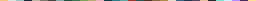

# Art bible: Đạp Thiên Lộ

Phiên bản 3 · 2026-11-15 · Hướng **bán tả thực điện ảnh**, tông **sương sớm núi non**. Thay toàn bộ hướng cel-shaded của phiên bản 1–2 (xem mục 0).

Tài liệu này là chuẩn hình ảnh cho mọi asset vào game: model Tripo, asset thủ tục (bpy, `GeoBuilder`), VFX, icon, UI, và pass chỉnh màu. Khi ảnh concept, model hay shader lệch với tài liệu này, sửa asset chứ không sửa tài liệu. Muốn đổi chuẩn thì sửa tài liệu trước, ghi lý do ở mục 11.

Nguồn chuẩn đi kèm:

| File | Vai trò |
| --- | --- |
| `assets/palette.json` | Bảng màu tâm trạng 32 màu, 6 màu áo người chơi, thông số chỉnh màu (`grading`) theo sáng sớm / ban ngày / đêm. **Nguồn duy nhất** |
| `assets/palette.png` | Ô màu 256×1 (mỗi màu 8 px) để tham chiếu và cho vật liệu thủ tục đơn sắc. Sinh bằng `pnpm palette` |
| `tools/palette/gen_palette.mjs` | Kiểm bảng màu (đủ 32, không trùng, ΔE ≥ 8, hex trong `grading` hợp lệ, bóng ban ngày ngả ngọc lam) và sinh ô màu |
| `docs/prompts/` | Mẫu prompt Codex và Tripo dựa trên tài liệu này |
| `docs/tripo-runbook.md` | Quy trình chạy Tripo (web app và CLI) |

---

## 0. Quyết định

### 0.1 Đang có hiệu lực

| # | Quyết định | Ngày | Ghi ở |
| --- | --- | --- | --- |
| 1 | **Bán tả thực điện ảnh**, tỉ lệ khoảng 7 đầu, vật liệu PBR cách điệu, texture Tripo giữ chi tiết, chỉnh màu ở hậu kỳ. Thay quyết định 6.1 của plan | 2026-11-15 | mục 1–3, 5 |
| 2 | **Tông riêng: sương sớm núi non**. Ban ngày xanh ngọc lam + nắng vàng ấm, sương dày; đêm trầm hơn | 2026-11-15 | mục 1, 5 |
| 3 | **Người chơi 15–25 nghìn tam giác** ở LOD0, có LOD1/LOD2 (quay lại giá trị của skill `blender-pipeline`). Thay quyết định 6.7. Quái, NPC, boss nâng theo tỉ lệ tương ứng. Tripo cho tối đa 20.000 mặt mỗi lần dựng, nên mức trên 20 nghìn chỉ đạt khi tách bộ phận | 2026-11-15 | mục 6 |
| 4 | Bảng 32 màu là **bảng màu tâm trạng**: dùng cho concept, duyệt và chỉnh màu; **không ép màu texture** | 2026-11-15 | mục 4 |
| 5 | **Kiếm Linh giữ hình cáo** (khớp `"model": "fox"` trong `monsters.json`) | 2026-11-14 | mục 2.2 |
| 6 | 6 màu áo người chơi (đã chỉnh sắc độ cho hướng mới) | 2026-11-14, chỉnh 2026-11-15 | mục 4.4 |
| 7 | Tripo CLI: tối đa **300 credit mỗi đợt**, luôn giữ lại **ít nhất 100** | 2026-11-14 | `docs/tripo-runbook.md` mục 1 |
| 8 | File nguồn lớn ở `../dtl-asset-source` (biến `DTL_ASSET_SOURCE`), ngoài repo | 2026-11-14 | `docs/tripo-runbook.md` mục 2 |
| 9 | Tripo dựng hình bằng **model v3.1** cho tới khi thử nghiệm M0 xong | 2026-11-14 | `docs/prompts/tripo.md` mục 1 |

### 0.2 Đã bị thay (không còn áp dụng)

| Quyết định cũ | Thay bằng |
| --- | --- |
| Plan 6.1 (b): nhân vật cách điệu 1:6, cel-shaded, màu phẳng | Quyết định 1 ở trên |
| Plan 6.7: người chơi 10–12 nghìn tam giác | Quyết định 3 ở trên |
| Palette 32 màu dùng để ép màu texture trong pipeline (plan 2.2 lớp 3) | Bảng màu tâm trạng, không ép (quyết định 4) |
| Ép palette không dithering (quyết định ngày 2026-11-14) | Hết hiệu lực vì không còn bước ép palette. Hạt phim và dither ở pass hậu kỳ cuối là chuyện khác, vẫn làm (mục 5.4) |
| Material toon dùng chung 3 bậc sáng, bóng lam xám, viền mực inverted hull (art bible v1–2 mục 3, 5; plan 2.2 lớp 4) | PBR cách điệu + pass chỉnh màu điện ảnh (mục 3, 5). Không dùng viền mực trên model |
| Texture tiêu chuẩn, không PBR, chỉ giữ albedo | Texture chi tiết, giữ PBR (base color, normal, roughness/metalness) |

Việc M1-6 đang làm theo hướng toon cần chuyển sang mục 5 của tài liệu này.

---

## 1. Tinh thần

**Núi non lúc sương sớm.** Một buổi sáng trên Vân Lam Sơn Mạch: nắng vàng ấm xuyên qua lớp sương dày, núi xa tan dần vào sắc ngọc lam, mái ngói thanh và cột son của Lạc Kiếm Tông hiện lên ở lớp gần. Nhân vật và quái là model bán tả thực, chất liệu thật (vải, đá, gỗ, đồng) nhưng được vẽ lại có chủ ý, không phải ảnh chụp.

Ba từ khóa, dùng để tự hỏi khi duyệt một asset hay một cảnh:

1. **Sương** (chiều sâu): cảnh có lớp gần, lớp giữa, lớp xa. Sương dày ăn dần màu và độ tương phản theo khoảng cách. Chất thủy mặc của game nằm ở đây: núi xa như nét mực loang.
2. **Nắng** (ấm và lạnh): vùng sáng ngả vàng ấm, vùng bóng ngả ngọc lam. Không bao giờ đen tuyền, không bao giờ xám bẩn.
3. **Chất** (vật liệu đọc được): nhìn là biết vải, đá, gỗ, đồng thau hay ngọc. Chi tiết vừa đủ để đọc được ở khoảng cách chơi, không làm rối hình bóng.

**Tím** (`attire_rogue`, `spirit_thunder`, `spirit_demonic`) chỉ là điểm nhấn dưới 5% khung hình, không bao giờ làm tông nền hay tông đêm.

Thế giới thủ tục hiện có (`docs/screenshots/`) giữ bố cục (sân đá, mái ngói thanh, cột son, hoa đào, rừng tùng), nhưng sẽ được nâng chất liệu và chỉnh màu theo mục 3 và 5.

**Không chép game demo** của guizang-game-skill (nội dung "all rights reserved"). Chỉ học mức chi tiết và cách làm không khí (model Tripo đồng bộ một bảng màu, chuỗi hậu kỳ, sương, bloom thấp). **Không** dùng tông đêm tuyết chàm tím, nhân vật, boss, HUD, tiêu đề thư pháp hay bố cục màn chơi của họ.

---

## 2. Tỉ lệ và hình khối

### 2.1 Nhân vật người (khoảng 1:7)

| Thông số | Giá trị |
| --- | --- |
| Chiều cao chuẩn nam | 1,70 m (từ gót đến đỉnh đầu, không tính búi tóc) |
| Chiều cao chuẩn nữ | 1,64 m (cùng bộ xương `rig_human_base`, scale đều 0,965) |
| Tỉ lệ | khoảng 7 đầu (đầu khoảng 0,24 m); nét mặt thanh, hơi lý tưởng hóa, không phải chân dung thật |
| Vai | rộng khoảng 2 đầu ở nam, 1,7 đầu ở nữ |
| Tay | tỉ lệ thật; bàn tay tách ngón (ngón cái và 4 ngón có thể gộp thành 2 khối ở LOD1) |
| Chân | khoảng 3,5 đầu; ống quần rộng bó ở cổ chân, giày vải |
| Mặt | mắt, mũi, môi có hình khối thật ở LOD0; chi tiết lông mày, mi vẽ bằng texture |

Hình bóng (silhouette) phải đọc được ở 30 m khi tô đen. Những khối tạo nên hình bóng tu sĩ:

- **Tay áo rộng** buông dưới cổ tay, mép tay áo là khối riêng để gắn xương `sleeve_l/r`.
- **Búi tóc** (nam: búi cao có trâm; nữ: búi thấp hoặc hai búi) và lọn tóc mái là khối tóc lớn có vân sợi trên texture, không làm từng sợi bằng hình học.
- **Đai lưng** chia thân trên và vạt áo; vạt áo dài tới bắp chân, xẻ hai bên để chân đi không xuyên áo.
- **Vũ khí** không dính vào model nhân vật. Kiếm, phi kiếm là model riêng gắn vào `socket_hand_r` / `socket_back` (xem `blender-pipeline`).

Tư thế chuẩn để dựng: **A-pose**, tay hạ 45° dưới phương ngang, chân rộng bằng vai, lòng bàn tay hướng vào đùi, mặt nhìn thẳng, có khe hở giữa tay áo và thân.

### 2.2 Quái và boss

Kích thước, va chạm và tầm đánh lấy từ dữ liệu (`monsters.json`, `shared/level.ts`), **không suy ra từ model**. Đổi model không được làm đổi cảm giác chơi.

| Đối tượng | Kích thước gợi ý | Hình khối và chất liệu |
| --- | --- | --- |
| Sói Xám | dài khoảng 1,5 m, cao vai khoảng 0,8 m | thân thon, mõm dài, lông xám ấm thành từng mảng có vân lông trên texture |
| Yêu Lang, U Minh Lang | lớn hơn Sói Xám 30–45% (scale 1,3 và 1,45) | cùng xương sói; lông tối hơn, gai lưng, vệt ma khí |
| Thiết Bối Trư | dài khoảng 1,6 m | thân nặng, lưng có giáp sắt dạng tấm, lông cứng |
| Hỏa Vân Hồ | dài khoảng 1,2 m | cáo thon, đuôi gộp thành 1–3 khối, lông son đỏ pha vàng đất, chóp đuôi phát sáng nhẹ |
| Thạch Viên | cao khoảng 1,8 m khi đứng | vượn có mảng đá trên vai và tay, tay dài chạm đất |
| Kiếm Linh | dài khoảng 1,3 m (scale 1,2) | **cáo linh thể** (đã chốt): chung xương cáo với Hỏa Vân Hồ; thân sáng màu sương, bán trong suốt ở đuôi và chân; vài thanh kiếm nhỏ là model riêng lơ lửng quanh lưng, phát sáng `spirit_sword` ở mép |
| Boss (Kiếm Khôi, Huyết Lang Vương, Thủ Mộ Thạch Tướng) | lớn gấp 2–3 lần quái thường | hình bóng khác hẳn quái thường, đọc được ở 60 m. Huyết Lang Vương là biến thể xương sói; Kiếm Khôi và Thủ Mộ Thạch Tướng là biến thể xương vượn |
| Hàn Giao | giữ model thủ tục theo đốt trong `models.ts` (quyết định 6.2) | nâng vật liệu (vảy, ánh băng) theo mục 3; có thể làm lại phần đầu |

Màu quái hiện có trong `monsters.json` (ví dụ vệt tím của Yêu Lang, vệt lơ của U Minh Lang) là màu tạm của model thủ tục, sẽ đổi theo bảng này khi có model Tripo.

**Phần nguy hiểm phải dễ thấy**: nanh, vuốt, đuôi lửa, nắm đấm đá sáng hơn hoặc tương phản hơn phần còn lại.

### 2.3 Hình học chung

- Chi tiết vừa phải: các khối chính và nếp áo lớn làm bằng hình học; vân vải, hoa văn, vảy, vân đá, vết xước để ở normal map và base color.
- Pháp tuyến mềm trên thân và vải, cạnh vát cứng trên kim loại, đá, gỗ.
- Không có lưới bị che khuất bên trong (răng, lưỡi, mặt trong tay áo dày) trừ khi thấy được trong game.

---

## 3. Vật liệu và texture (PBR cách điệu)

Model dùng `MeshStandardNodeMaterial` (PBR) với texture của Tripo. "Cách điệu" nghĩa là: chất liệu đọc được như thật, nhưng màu, độ bóng và chi tiết được chọn để hợp với tranh chung, không theo đuổi ảnh chụp.

| Map | Giữ? | Quy tắc |
| --- | --- | --- |
| Base color (albedo) | có | giữ chi tiết vẽ của Tripo. Không có bóng đổ cứng hay vệt nắng có hướng nướng vào (xung đột với nắng trong game); AO nướng nhẹ ở kẽ được chấp nhận |
| Normal | có | nếp vải, vân đá, vảy, lông |
| Roughness / metalness (ORM) | có | vải, da, gỗ, đá: roughness 0,6–0,95, metalness 0. Kim loại (đồng thau, sắt, lưỡi kiếm): metalness 0,8–1, roughness 0,3–0,6. Không bề mặt nào bóng loáng như nhựa |
| Emissive | chỉ phần linh quang | mép kiếm, chóp đuôi Hỏa Vân Hồ, mắt quái biến dị, linh thảo. Đánh dấu trong pipeline, không lấy từ ảnh concept |

Màu của texture:

- Concept được vẽ theo bảng màu tâm trạng (mục 4), nên texture Tripo vốn đã gần tông.
- Pipeline **không** ép texture về 32 màu. Chỉ có bước **chuẩn hóa nhẹ** (tùy chọn, mỗi asset): cân trắng về trung tính, đưa độ sáng trung bình và độ bão hòa vào khoảng chuẩn để các asset đứng cạnh nhau không lệch tông. Sau đó chuỗi chỉnh màu ở hậu kỳ (mục 5) thống nhất cả cảnh.
- Mật độ điểm ảnh gợi ý: nhân vật người chơi khoảng 500 px/m, NPC và quái khoảng 300 px/m, prop khoảng 250 px/m. Mặt nhân vật được ưu tiên diện tích UV gấp đôi.
- Asset thủ tục (địa hình, cây, kiến trúc bpy) chuyển dần sang vật liệu PBR đơn giản: màu lấy từ bảng màu tâm trạng, roughness theo bảng trên, thêm texture nhiễu hoặc trim sheet nhỏ để có chất.

---

## 4. Bảng màu tâm trạng (32 màu)

Bảng này là **hướng dẫn**, không phải ràng buộc từng điểm ảnh. Dùng để:

1. Viết prompt concept (liệt kê màu cần dùng cho đối tượng).
2. Duyệt concept và model: màu chính của vật có nằm gần một màu trong bảng không, có lạc tông không.
3. Chọn màu cho vật liệu thủ tục và VFX.
4. Làm mốc cho thông số chỉnh màu (mục 5).

Ảnh xem trước có dải "dưới nắng" và "trong bóng" theo preset ban ngày: chạy `node tools/palette/gen_palette.mjs --preview <file.png>`.

### 4.1 Bảng màu

| # | id | Hex | Nhóm | Tên | Dùng cho |
| --- | --- | --- | --- | --- | --- |
| 0 | `air_sun_dawn` | `#F2C47E` | Ánh sáng và khí quyển | Nắng sớm | ánh nắng sáng sớm và chiều, viền sáng trên mép vật |
| 1 | `air_mist` | `#DCE6DF` | Ánh sáng và khí quyển | Sương sớm | màu sương ban ngày, mây gần, hơi nước trên hồ |
| 2 | `air_sky` | `#9CC4C3` | Ánh sáng và khí quyển | Trời ngọc | bầu trời ban ngày, ánh trời hắt vào bóng |
| 3 | `air_night` | `#1A2938` | Ánh sáng và khí quyển | Đêm lam | trời đêm, bóng đêm; không đen tuyền |
| 4 | `stone_light` | `#BDB6A4` | Đá và núi | Đá sân | đá lát sân tông môn, bậc đá, tượng đá sáng |
| 5 | `stone` | `#7D786C` | Đá và núi | Đá | vách đá, tảng đá, tường thành |
| 6 | `stone_dark` | `#464540` | Đá và núi | Đá tối | kẽ đá, đá ướt, hang |
| 7 | `stone_far` | `#88ABAA` | Đá và núi | Núi xa | lớp núi xa đã nhuốm sương ngọc lam |
| 8 | `leaf_pine` | `#23503F` | Lá và cỏ | Tùng | tán tùng bách, lá trong bóng |
| 9 | `leaf` | `#3E7552` | Lá và cỏ | Lá | tán cây thường, thân linh thảo |
| 10 | `leaf_grass` | `#7EA25A` | Lá và cỏ | Cỏ nắng | cỏ, lá non dưới nắng |
| 11 | `leaf_dry` | `#B7AC74` | Lá và cỏ | Cỏ úa | cỏ khô, lau sậy, sườn núi nắng |
| 12 | `leaf_blossom` | `#E9B4C0` | Lá và cỏ | Hoa đào | hoa đào, hoa linh thảo |
| 13 | `water_deep` | `#123B45` | Nước | Nước sâu | lòng hồ, vực |
| 14 | `water` | `#2E7D88` | Nước | Nước ngọc | mặt hồ, suối |
| 15 | `water_shallow` | `#5FA7A2` | Nước | Nước nông | bờ nước, thác, bọt nước dưới nắng |
| 16 | `wood_cinnabar` | `#9D392E` | Gỗ, mái, kim loại | Son đỏ | cột, lan can, sơn môn, dây buộc |
| 17 | `wood_roof` | `#2B5552` | Gỗ, mái, kim loại | Ngói thanh | mái ngói, viền áo tông môn |
| 18 | `wood_dark` | `#4D3324` | Gỗ, mái, kim loại | Gỗ tối | xà, thân cây, bao kiếm, chuôi kiếm |
| 19 | `wood` | `#8A6944` | Gỗ, mái, kim loại | Gỗ | sàn gỗ, rương, giỏ tre |
| 20 | `wood_bronze` | `#AE8B49` | Gỗ, mái, kim loại | Đồng thau | lò đan, đầu ngói, hoa văn viền, chắn kiếm |
| 21 | `attire_ivory` | `#E6DDCB` | Y phục và da | Vải ngà | áo trắng ngà, áo trong, tường vôi |
| 22 | `attire_sect` | `#3B6584` | Y phục và da | Lam tông môn | áo đệ tử Lạc Kiếm Tông |
| 23 | `attire_elder` | `#22364E` | Y phục và da | Lam trưởng lão | áo khoác trưởng lão, đai lưng đệ tử |
| 24 | `attire_rogue` | `#55475F` | Y phục và da | Tím than | tán tu, người ngoài tông môn |
| 25 | `attire_skin` | `#E6BF9C` | Y phục và da | Da người | da mặt, tay |
| 26 | `attire_ink` | `#29292C` | Y phục và da | Mực | tóc đen, giày, áo đen |
| 27 | `spirit_jade` | `#7FE3D0` | Linh quang | Linh khí ngọc | linh khí, đả tọa, linh thảo phát sáng, hồi phục |
| 28 | `spirit_sword` | `#CFF3FF` | Linh quang | Kiếm khí | vệt kiếm khí, phi kiếm, ngự kiếm |
| 29 | `spirit_thunder` | `#B48CFF` | Linh quang | Thiên lôi | thiên lôi độ kiếp, đột phá |
| 30 | `spirit_demonic` | `#4A2B5E` | Linh quang | Ma khí | ma khí, yêu khí, quái biến dị, boss |
| 31 | `spirit_gold` | `#FFDE96` | Linh quang | Kim quang | đồ rơi quý, hoàn thành nhiệm vụ, cường hóa thành công |

### 4.2 Tỉ lệ màu trong khung hình

- **Khoảng 60% không khí và nền**: sương, trời, núi xa, đá sân.
- **Khoảng 30% màu vùng**: lá, gỗ, nước, đất.
- **Khoảng 10% điểm nhấn**: son đỏ, đồng thau, lam tông môn, linh quang.

Một vật đơn lẻ có **tối đa 4–5 màu chính** (vân và sắc độ trong cùng một màu không tính).

### 4.3 Quy tắc theo nhóm

- Tên màu là tên gọi hình ảnh, không phải chỉ số trong game (ví dụ "Linh khí ngọc" là màu; chỉ số là linh lực).
- **Linh quang** (#27–#31) chỉ dùng cho phần phát sáng, VFX và điểm nhấn UI. Không làm màu chính của áo, lông hay đá. Ngoại lệ: phần bán trong suốt của Kiếm Linh.
- **Ma khí** `spirit_demonic` là màu của tà khí và yêu ma: vệt trên quái biến dị (Yêu Lang, U Minh Lang), boss. Người chơi không được chọn.
- **Son đỏ** dành cho kiến trúc tông môn và chi tiết nhỏ (dây buộc tóc, tua kiếm). NPC tông môn không mặc áo son đỏ, để sơn môn và cột vẫn là điểm nhấn của cảnh. Người chơi được chọn son đỏ làm màu áo vì đó là lựa chọn riêng của họ.
- **Mực** `attire_ink` là màu vật (tóc, giày), không phải màu bóng. Bóng do ánh sáng và chỉnh màu tạo ra.

### 4.4 Y phục theo phe và màu áo người chơi

| Phe / vai | Màu chính | Màu phụ | Chi tiết |
| --- | --- | --- | --- |
| Đệ tử Lạc Kiếm Tông | `attire_sect` hoặc `attire_ivory` | viền `wood_roof` | đai `attire_elder`, giày `attire_ink` |
| Trưởng lão, chưởng môn | `attire_ivory` | khoác `attire_elder` | hoa văn viền `wood_bronze` |
| Thiết lão (thợ rèn, trông coi Tàng Kiếm Các), Tố Tâm (dược sư Đan Phòng) | `wood` hoặc `leaf_dry` | `attire_ivory` | tạp dề, túi thuốc `wood_dark` |
| Tán tu, người ngoài | `attire_rogue` | `stone` | |
| Yêu thú (sói, heo, cáo, vượn) | `stone_light`, `stone`, `stone_dark`, `wood_dark`; Hỏa Vân Hồ `wood_cinnabar` + `leaf_dry` | | mắt `wood_bronze`; nanh `attire_ivory` |
| Quái biến dị, boss | như yêu thú | vệt `spirit_demonic` | mắt hoặc vết nứt phát sáng `spirit_demonic` / `spirit_thunder` |
| Linh thể (Kiếm Linh dạng cáo, Kiếm Khôi) | Kiếm Linh: `air_mist`, `stone_far`; Kiếm Khôi: `stone`, `wood_bronze` | phát sáng `spirit_sword` | |

**Màu áo người chơi** (quyết định 6.4b, đã chỉnh sắc độ cho hướng bán tả thực: trầm hơn, ít bão hòa hơn bản v2):

| Lựa chọn | id | Hex |
| --- | --- | --- |
| Mặc định | `attire_sect` | `#3B6584` |
| | `attire_ivory` | `#E6DDCB` |
| | `wood_roof` | `#2B5552` |
| | `wood_cinnabar` | `#9D392E` |
| | `attire_rogue` | `#55475F` |
| | `attire_ink` | `#29292C` |

Kỹ thuật: vùng áo chính có mặt nạ trong texture; material nhân màu áo đã chọn vào độ sáng của base color ở vùng mặt nạ, nên **giữ nguyên vân vải và nếp gấp**. Tên hiển thị của từng màu đi qua i18n khi làm màn tạo nhân vật.

---

## 5. Ánh sáng và chỉnh màu (thỏa thuận với M1-6)

Đây là phần thay cho material toon cũ. Số nằm trong khối `grading` của `palette.json`, là **điểm khởi đầu**; M1-6 chỉnh khi thử trong game rồi cập nhật cả JSON lẫn mục này trong cùng commit.

### 5.1 Ba thời điểm

| Thông số | Sáng sớm (`dawn`) | Ban ngày (`day`, mặc định) | Đêm (`night`) |
| --- | --- | --- | --- |
| Mặt trời / trăng | `#F6C27E`, cường độ 2,0, cao 14° | `#FFD596`, 3,4, cao 36° | trăng `#9DB4CF`, 0,45, cao 35° |
| Ánh trời | `#B9CFC8`, 0,9 | `#9CC4C3`, 0,72 | `#1A2938`, 0,5 |
| Sương: màu, mật độ `FogExp2` | `#E4E3D6`, 0,0016 | `#C9DDD8`, 0,0011 | `#22323F`, 0,0013 |
| Sương theo độ cao: đỉnh lớp, hệ số | 60 m, ×2,5 | 40 m, ×1,8 | 40 m, ×2,0 |
| Sương xa (`fogHaze`, bắt đầu từ `fogHazeStart`) | 0,0026 từ 50 m | 0,0021 từ 60 m | 0,0016 từ 60 m |
| Viền sáng nhân vật (`rim`) | 0,55 | 0,45 | 0,2 (sắc trăng) |
| Sắc bóng (`shadowTint`) | `#2F5B5C` ngọc lam | `#2A5A5E` ngọc lam | `#0F1F2A` lam đêm |
| Sắc vùng sáng (`highlightTint`) | `#FFD49A` | `#FFC670` | `#FFB869` (đèn lồng) |
| Nâng đen (`blackLift`) | `#14292B` | `#0F2427` | `#0B1720` |
| Tương phản / bão hòa / phơi sáng | 1,05 / 1,0 / 1,0 | 1,16 / 1,06 / 1,0 | 1,1 / 0,82 / 0,9 |

Chỉnh 2026-11-15 (P2 grading): ban ngày hạ ánh trời (0,72) và hạ mặt trời xuống 36° với cường độ 3,3 để có bóng dài, tương phản sáng–tối; mức nhuộm tách tông riêng từng preset (`shadowAmount` 0,6 / `highlightAmount` 0,28 ban ngày; mặc định 0,5 / 0,1); `fogScatter` 0,85: sương phía mặt trời ngả `highlightTint` (nắng vàng xuyên sương), phía đối diện giữ ngọc lam; giảm bão hòa theo độ sâu còn 30%. Đỉnh núi là đá xám phủ rêu và cỏ khô, không có tuyết (mục 8); mặt đất xa hơn khoảng 70 m hòa dần về màu đỉnh lưới để không vân ô vuông; AO tắt dần từ 60 đến 140 m.

Chỉnh 2026-11-16 (PR D): thêm **lớp sương xa** kiểu thủy mặc. Sương cũ là hàm mũ bậc hai nên tới 200–600 m gần như chưa ăn; lớp mới là hàm mũ bậc một tính từ `fogHazeStart` (chỗ thấp dày hơn chỗ cao), làm núi và rừng xa nhạt dần thành lớp, còn tầm chiến đấu (dưới 60 m) không đổi. Thêm **viền sáng** (rim) cho thân người chơi và NPC: fresnel hẹp, sắc nắng của preset (không trắng), mạnh ở phía hướng mặt trời, không vào bloom. Trời độ kiếp đổi từ tím sang lam đêm ngả chàm (`pulseColor` 0,20/0,25/0,40, mức 0,62) để giữ quy tắc tím dưới 5% khung hình; tím chỉ còn ở tia sét và vùng báo.

Sương ban ngày dày hơn mức hiện tại trong `env.ts` (`FogExp2` 0,00068) để có chiều sâu; phải kiểm lại biên tải thế giới và độ dễ đọc mục tiêu tab ở 40–60 m.

### 5.2 Chuỗi hậu kỳ

Thứ tự đề xuất trong `post.ts` (TSL):

1. Render cảnh HDR với PBR, một đèn hướng có shadow map, ánh trời (hemisphere hoặc env map nhỏ dựng từ màu trời và sương).
2. Sương theo khoảng cách và theo độ cao (trong material hoặc pass riêng); giảm bão hòa theo độ sâu từ 80 m, tới 40% ở 700 m.
3. Bloom: ngưỡng 1,0, cường độ 0,35, bán kính 0,5; đỉnh HDR của vật phát sáng giữ dưới 2,5.
4. Tone mapping ACES Filmic.
5. Chỉnh màu: tách tông (vùng tối nhân sắc bóng, vùng sáng nhân sắc vùng sáng, cân bằng theo `splitBalance`), nâng đen về `blackLift`, đường cong S theo `contrast`, `saturation`.
6. Vignette 0,18 (vào 0,4, ra 0,9).
7. Hạt phim 0,025 và dither để chống vệt bậc ở trời và sương.

Preset Thấp tắt bloom và sương theo độ cao, giữ chỉnh màu (rẻ). Các uniform hiệu ứng trúng đòn (`uHit`, `uFlash`) đi trong cùng pass chỉnh màu.

### 5.3 Quy tắc ánh sáng

- Một mặt trời duy nhất. Nhân vật luôn có ít nhất một nửa mặt được nắng ở góc camera thường.
- Bóng đổ từ mặt trời; nhân vật LOD2 tắt bóng đổ, mọi nhân vật và quái có bóng tròn mờ dưới chân.
- Không rim light trắng gắt. Viền sáng là sắc nắng của preset (`sunColor`), cường độ theo `rim` trong `palette.json`, cộng qua `emissiveNode` (`rimLight` trong `render/materials/world.ts`).
- Đêm: chủ yếu là ánh trăng lam và đèn lồng ấm `#FFB869`; vẫn đọc được hình bóng nhân vật.

### 5.4 Phát sáng

- Chỉ phần dùng nhóm linh quang mới phát sáng.
- Ban ngày bloom phải tinh tế; đêm cho phép linh quang nổi hơn nhưng vẫn dưới đỉnh HDR 2,5.

---

## 6. Ngân sách tam giác và texture

Ngân sách tổng (CLAUDE.md): dưới 300 draw call, 1–2 triệu tam giác, 512MB texture, tải lần đầu dưới 30MB. Kiểm bằng `asset-validator` và `perf-auditor`.

| Loại | LOD0 / LOD1 / LOD2 (tam giác) | Texture (KTX2) |
| --- | --- | --- |
| Người chơi | **15–25 nghìn** (Tripo cho tối đa 20 nghìn; trên mức đó phải tách bộ phận) / 8 nghìn / 3 nghìn | base color 1024² + normal 1024² + ORM 1024² (preset Cao có thể base color 2048²); vũ khí 512² |
| NPC | 10–15 nghìn / 5 nghìn / — | base color 1024², normal và ORM 512² |
| Quái thường | 5–10 nghìn / 3 nghìn / 1 nghìn | base color 1024², normal và ORM 512² |
| Boss | 30–50 nghìn khi tách bộ phận; một lần dựng Tripo tối đa 20 nghìn / 15 nghìn / 5 nghìn | base color 2048², normal và ORM 1024² |
| Vũ khí, phi kiếm | 1–3 nghìn | bộ 512² |
| Prop (lò đan, rương, linh thảo) | 500–5 nghìn / 40% / 15% | bộ 512²–1024², gộp atlas khi lặp nhiều |
| Đồ rơi | 300–1,5 nghìn | 256² |
| Kiến trúc | giữ pipeline bpy thủ tục, nâng vật liệu PBR; **không đưa qua Tripo** | trim sheet |

Kiểm toán thô ở trường hợp xấu nhất (sân tông môn, 50 người chơi, 30 quái, 1 boss), giới hạn 12 người chơi LOD0 trong 20 m như plan:

- **Tam giác (pass chính)**: người chơi 12×20k + 20×8k + 18×3k ≈ 454k; quái 30 × khoảng 5k ≈ 150k; boss 20–30k; thế giới khoảng 410k (sẽ tăng khi nâng vật liệu). Tổng khoảng **1,04 triệu**. Pass bóng gần như nhân đôi phần có bóng, nên preset Thấp hạ LOD0 xuống 6 người và tắt bóng nhân vật từ LOD1.
- **Draw call**: không đổi so với plan 2.4 (khoảng 300 ở trường hợp xấu nhất); PBR không thêm draw call nếu mỗi nhân vật vẫn là 1 material.
- **Texture GPU**: 2 thân người chơi × khoảng 3MB + 10 NPC × 1,5MB + 8 quái × 1,5MB + 4 boss × khoảng 8MB + prop khoảng 10MB. Tổng **dưới 100MB**, xa ngưỡng 512MB.
- **Tải lần đầu**: mỗi thân người chơi khoảng 2MB (tham khảo số đo game demo: 1,4–1,9MB một nhân vật Tripo; sẽ thay bằng số đo M0-3). Tổng ước khoảng **15MB**, dưới 30MB. Boss, nhạc, quái vùng xa nạp dần.

Số liệu thật lấy ở M0-3 và đo lại ở M3-9.

---

## 7. VFX và UI

- VFX dùng nhóm linh quang, cộng sáng, chịu bloom. Kiếm khí `spirit_sword`, hồi phục và đả tọa `spirit_jade`, độ kiếp `spirit_thunder`, chiêu quái biến dị và boss `spirit_demonic`, rơi đồ quý `spirit_gold`.
- Chất thủy mặc giữ ở VFX: vệt kiếm khí dày giữa thon hai đầu như nét bút; vết mực loang trên đất khi trúng đòn nặng hoặc khi quái chết; sương cuộn quanh chân khi ngự kiếm.
- UI (chỉnh 2026-11-16): **nền mực bán trong suốt** `#0D1117` ở 80% (`--k-ink-bg`; mực ngả lam đêm, không đen tuyền) cho khung HUD và bảng, giấy ngà cho bảng trang trọng (hồi sinh); **viền kim** `#C8A96E` (`--k-bronze`, là `wood_bronze` nâng sáng cho dễ đọc trên nền mực); **ngọc** `#38BDF8` (`--k-ngoc`) chỉ cho trạng thái đang focus/đang chọn. Tiêu đề, tên và cảnh giới dùng font có chân; chỉ số dùng sans. `spirit_jade` vẫn là màu của hồi phục và dòng chỉ số tốt. HUD thường trực dưới 15% màn hình; UI phóng theo màn hình bằng `--ui-scale` (1 tới 1920×1080, 1,35 ở 2560×1440, trần 2). Thanh khí huyết, linh lực vẽ bằng code. Tiêu đề "Đạp Thiên Lộ" dựng bằng font thư pháp, bố cục và màu tự thiết kế (không theo màn tiêu đề của game demo).
- Mọi chuỗi hiển thị đi qua i18n; tên lấy từ `packages/content/data/glossary.json`.

---

## 8. Những điều cấm

1. Chép nội dung game demo guizang: tông đêm tuyết chàm tím, nhân vật, boss, HUD, màn tiêu đề, bố cục màn chơi, câu thoại.
2. Tả thực kiểu ảnh chụp: lỗ chân lông, da bóng dầu, ánh sáng nướng có hướng trong texture.
3. Cel-shading, viền đen kiểu hoạt hình, màu phẳng không chất liệu (hướng cũ đã bỏ).
4. Chibi hoặc tỉ lệ đầu to.
5. Bóng đen tuyền, ảnh cháy sáng, bloom làm nhòe cả cảnh.
6. Ảnh concept để dựng (không áp dụng cho moodboard) có hiệu ứng phát sáng, hạt, khói, tia điện: Tripo sẽ dựng chúng thành khối thật.
7. Vũ khí liền với model nhân vật.
8. Màu linh quang làm màu chính của áo, lông, đá.
9. Kiến trúc đi qua Tripo.
10. Nêu tên game, phim, tranh, họa sĩ, studio có thật trong prompt; chép nhân vật hay trang phục nhận diện được của tác phẩm khác (kể cả bộ truyện mà thang cảnh giới tham khảo).
11. Chữ Hán, chữ Việt hay ký hiệu có nghĩa vẽ trên model hay texture. Triện, bùa dùng hoa văn không đọc được.
12. Kiểu dáng phương Tây lạc tông: giáp tấm hiệp sĩ, áo choàng trùm đầu kiểu phù thủy, vạc phù thủy, kiếm có chắn chữ thập, quỷ cánh dơi, trang trí gô-tích.

---

## 9. Kiểm tra trước khi một asset vào game

- [ ] Ảnh xem trước đặt cạnh nhân vật chuẩn 1,70 m và một mảnh sân tông môn (trang `?viewer=asset`), dưới cả ba preset ánh sáng.
- [ ] Hình bóng tô đen đọc được ở 30 m (boss 60 m).
- [ ] Màu chính gần bảng màu tâm trạng; không lạc tông khi đứng cạnh asset đã duyệt.
- [ ] Base color không có bóng đổ cứng hay vệt nắng có hướng; roughness/metalness đúng mục 3.
- [ ] Số tam giác, số LOD và kích thước texture trong ngân sách mục 6.
- [ ] Hướng, tỉ lệ, gốc ở chân đúng quy ước `blender-pipeline` (Y lên, 1 unit = 1 m).
- [ ] Đã ghi `meta.json` có task id, và `assets/LICENSES.md`.
- [ ] `asset-validator` không còn lỗi.

---

## 10. Chỉnh bảng màu và thông số chỉnh màu

1. Sửa `assets/palette.json` (giữ đủ 32 màu và thứ tự index).
2. `pnpm palette` để kiểm và sinh lại `assets/palette.png`.
3. Cập nhật bảng 4.1 (màu) hoặc 5.1 (chỉnh màu) trong tài liệu này.
4. Nếu đổi khối `grading`, cập nhật `post.ts` (M1-6) trong cùng commit.

## 11. Nhật ký thay đổi

| Ngày | Phiên bản | Thay đổi |
| --- | --- | --- |
| 2026-11-14 | 1 | Bản đầu (M0-1): cách điệu 1:6 cel-shaded, palette 32 màu ép texture, material toon 3 bậc, viền mực |
| 2026-11-14 | 2 | Ghi 7 quyết định người dùng duyệt: Kiếm Linh giữ hình cáo, không dithering, palette và màu áo, hạn mức CLI, nơi lưu nguồn, Tripo v3.1 |
| 2026-11-16 | 3 | Mục 7: chốt ngôn ngữ UI (nền mực `#0D1117` 80%, viền kim `#C8A96E`, ngọc `#38BDF8`), phóng UI theo màn hình |
| 2026-11-16 | 3 | Mục 5: lớp sương xa (`fogHaze`), viền sáng nhân vật (`rim`), trời độ kiếp lam đêm thay tím |
| 2026-11-15 | 3 | **Đổi hướng**: bán tả thực điện ảnh, tỉ lệ 1:7, PBR cách điệu, tông sương sớm (ngọc lam + nắng vàng); bảng màu thành bảng tâm trạng (không ép texture), thay khối `toon` bằng `grading`; người chơi 15–25 nghìn tam giác; chỉnh sắc 6 màu áo |
