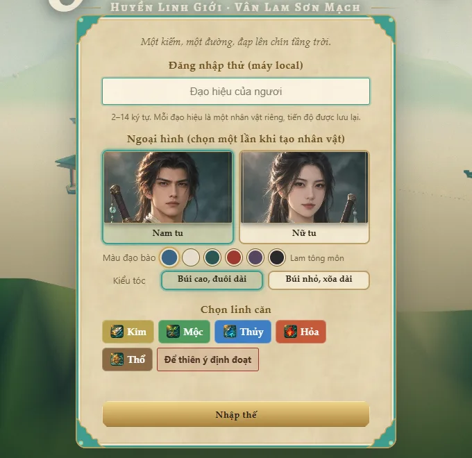
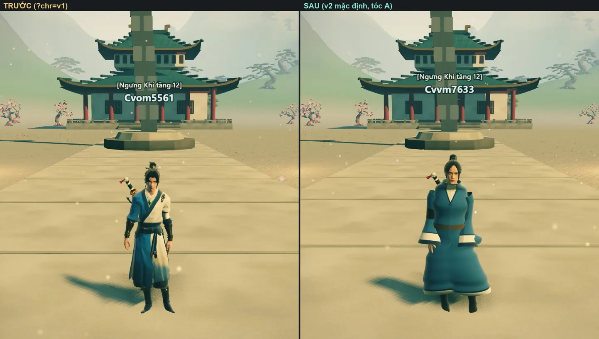
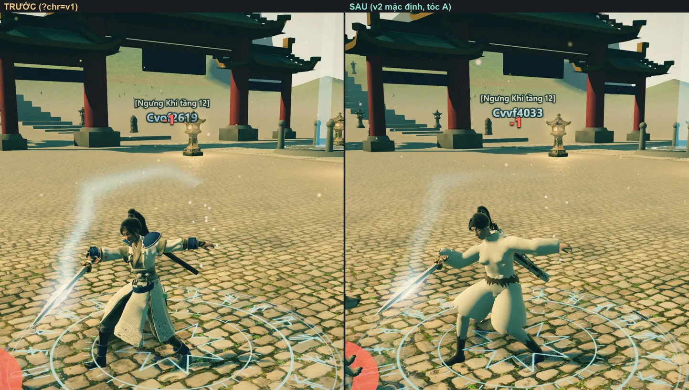
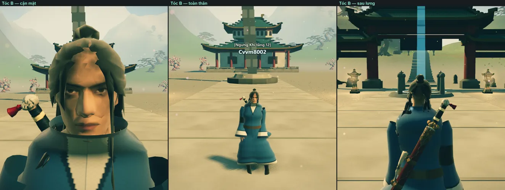
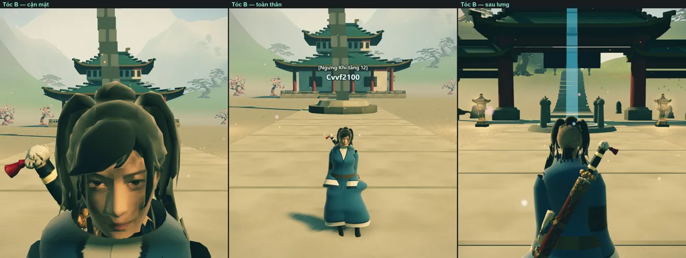

# CHR-ROLLOUT 1: nhân vật nền v2 làm mặc định

Người dùng chọn đi tiếp với nhân vật v2 (MakeHuman + đầu/tóc Tripo, xem `docs/chr-v2/`). PR này: mặc định, chọn tóc, đồ tân thủ, làm mềm mặt. Các bộ trang phục còn lại gắn lại ở PR sau (`docs/chr-v2-rollout/` sẽ có ma trận ảnh đủ bộ).

## Thay đổi

- **Mặc định v2**: `PlayerSkins` dùng `chr_v2_{nam,nu}` (tóc A) / `chr_v2_hb_{nam,nu}` (tóc B); `?chr=v1` về hai model Tripo cũ để so một thời gian. NPC dựng bằng `createNpc` cũng dùng thân v2 (mặc bộ đồ đệ tử nhuộm màu NPC). Test chạy trong node (không có `location`) vẫn dùng model cũ.
- **Chọn kiểu tóc A/B khi tạo nhân vật** (màn tạo nhân vật, ảnh `man-tao-nhan-vat-chon-toc.webp`): `Appearance.hair?: 'a'|'b'` (shared, `parseAppearance` kiểm id, thiếu = `a`), lưu cột `characters.appearance` như màu áo, `PlayerS.hr` gửi cho người khác, client `look.hair` chọn asset. Nhân vật cũ không có `hair` → kiểu A.
- **Bộ đồ đệ tử tân thủ** (`set_de_tu_v2_{nam,nu}`, `tools/blender/chr_v2_starter.py`): thân v2 không có áo nên người không mặc bộ nào (hoặc bộ chưa có áo v2) phải có đồ. Làm lại thành **đạo bào thật** (bản đầu là lớp da bó sát, bị chê giống đồ lặn): áo khoác ngoài dựng bằng các vòng elip quanh thân (rộng hơn thân, tà xòe tới bắp chân), cổ giao lĩnh + viền gấu vẽ trên texture, tay áo rộng loe dọc xương tay có bo miệng, đai lưng, quần và ủng tối màu. Trọng số vạt dưới hông trộn hông + hai chân nên không xé mảnh khi chạy/chém/đả tọa. Vải là màu tham chiếu `#3B6584`: đổi theo màu đạo bào / bộ trang bị / NPC; bộ tân thủ (Lạc Kiếm) vẫn mang phụ kiện giáp vai của bộ.
- **Làm mềm mặt**: da ấm hơn, giảm tương phản, mắt sáng hơn (làm sáng texel quanh hai mắt); **mép chân tóc** có bóng đổ mềm (đỉnh đầu cách mặt tóc < 1 cm tối dần trên texture) thay cho đường cắt cứng.
- `outfit_build.py` ánh xạ nhóm xương tóc về Head (đã sửa ở #172).

## Số đo (`bench:crowd`, 50 bot, sân tông môn, WebGPU, High)

| | draw | tam giác | CPU p50 / p95 | texture | tick server p95 |
| --- | --- | --- | --- | --- | --- |
| `?chr=v1` (cũ) | 206 | 1.093k | 6,5 / 9,2 ms | 380 MB | 5,4 ms |
| v2 mặc định | **235** (< 300) | 673k | 6,8 / 9,8 ms | 393 MB | 2,8 ms |

CPU p95 vượt 8 ms ở cả hai (đã vượt trước PR này), v2 thêm ~0,6 ms. Draw +29: mỗi người một lưới thân + một lưới áo.

## Ảnh trước/sau

Tệp `<tan-thu|lac-kiem|liet-mach>-<nam|nu>-<matcan|matgan|toanthan|chay|chem|datoa>.webp` (trái = `?chr=v1`, phải = v2) và `toc-b-<tan-thu|lac-kiem>-<nam|nu>.webp` (tóc B). Sinh bằng `pnpm --filter @dtl/perf run shots:chrv2 --out <thư mục>`.

## Giới hạn

- Đồ tân thủ vẫn đơn giản (màu phẳng + vài đường viền, không hoa văn); thân áo hơi phình ở ngực (đo từ mặt cắt thân + độ rộng).
- Sáu bộ còn lại (`dia_giap`, `phuc_mach`, `tinh_khuyet`, `co_thanh`, `than_tang`, `van_kinh`, `luu_ly`) chưa có áo v2: tạm mặc đồ tân thủ nhuộm màu bộ.
- Chết, bay (ngự kiếm) chưa chụp trong PR này; ma trận ảnh đủ bộ ở PR sau.

---

# CHR-ROLLOUT 2: gắn lại bảy bộ trang phục còn lại lên thân v2

Cùng nhánh xếp chồng (PR này nhắm vào nhánh của PR 1). Chín bộ có áo mô-đun giờ đều có bản v2 cho nam và nữ (`set_<bộ>_v2_<nam|nu>`, 14 asset mới): Địa Long Hộ Giáp, Phục Mạch Đan Bào, Tinh Khuyết Kiếm Bào, Cổ Thành Huyền Giáp, Thần Tàng Đan Bào, Vân Kính Thiết Giáp, Lưu Ly Đan Y (cộng Liệt Mạch, Kính Quang đã có từ #172). Bốn bộ tân thủ (`lac_kiem`, `huyen_giap`, `dan_tam`, `han_giao`) chưa có áo mô-đun nên mặc đồ đệ tử nhuộm màu bộ (PR 1).

## Việc làm

- Dựng bằng `outfit_build.py` với `outfit.player = chr_v2_<giới>` (meta nhân từ bản cũ), một vòng `run.mjs --force` + `optimize` mỗi asset.
- **Vùng che** khai trong `outfit_covers.json` cho từng mảnh (cùng `chest belly upperArm thigh calf foot`: cẳng tay và bàn tay luôn lộ).
- **Sửa áo phồng** bằng tham số `wscale` có sẵn của `outfit_build.py` (thu bề ngang/sâu theo thân v2 vai hẹp hơn): Địa Long 0,82 → 0,70, Cổ Thành 0,82 → 0,70, Vân Kính 0,85 → 0,72, Phục Mạch thêm 0,88. Phục Mạch "nhàu" là vân texture của áo gốc, không phải hình học, nên chỉ thu nhỏ.
- Kiếm và vỏ: kiếm lưng đã nằm trong thân v2 (`chr_v2_post.py`), kiếm riêng theo trang bị và vỏ kiếm theo bộ dùng đường cũ (`swordModel`, `scabbardMount`), không đổi. Trang sức đầu của từng bộ do `outfit_build.py` căn theo xương Head của thân v2; chưa tinh chỉnh riêng theo hai kiểu tóc.
- **Vạt áo vỡ mảnh khi chạy/chém/đả tọa** (Cổ Thành, Thần Tàng, Phục Mạch, Liệt Mạch; nam và nữ): bỏ xương lò xo của áo ngoài và quần (`spring: false`), trộn trọng số chân tối đa (`legBlend: 1.0`), làm mượt trọng số mạnh hơn (`smooth` 7 áo, 6 quần): vạt đi cùng cả người như một khối, không xé thành mảnh nhọn. Còn vài mảnh nhỏ ở Tripo gốc nhưng dịu hơn nhiều.
- Chụp ma trận ảnh: chín bộ × nam, nữ × bảy trạng thái (cận mặt, đứng, chạy, đả tọa, chém, bay, chết), tệp `ma-tran-<bộ>-<nam|nu>.webp` (mỗi tệp một dải bảy ô, đã kiểm trong game thật bằng `shots:chrv2`, nay có thêm bay và chết, chết rồi hồi sinh về chỗ chụp).

## Dung lượng, tải đầu

- **Áo chỉ nạp lười khi mặc**: không có `prefetch`/`acquire` hằng nào của `set_*` (đã grep `apps/client/src`); `PlayerSkins.loadOutfit` chỉ chạy khi một người chơi trong tầm nhìn mặc bộ đó (ưu tiên 15). Tải đầu (`preload.ts`) chỉ gồm: model người chơi giới đã chọn (v2 ~0,6 MB; **trước PR này vẫn tải nhầm model cũ 1,7–2,6 MB vì đọc `appearance.json`, đã sửa ở #176**), đồ tân thủ (~0,2 MB), thư viện clip, kiếm mặc định, kiến trúc tông môn.
- `pnpm size` (tải đầu theo bản build, ngân sách 30 MB): **2,79 MB cả trước (`main`) lẫn sau**, vì công cụ chỉ đếm id viết thẳng trong mã; phần model người chơi nạp theo giới tính nên đo riêng ở trên. Phần GLB người chơi/áo nằm ngoài ngân sách tải đầu (nạp sau khi vào).
- **Nén**: thiếu KTX-Software nên các lớp `outfit_v2`/`player_v2` (`assets/budgets.json`, `webp: true`) nén texture sang **WebP** (`EXT_texture_webp`, three nạp được): màu và normal lossy q88, ORM (mặt nạ nhuộm) lossy q93, emissive lossless; hình học đã meshopt (mesh có xương không quantize: clip có kênh scale sẽ làm nhân vật co lại). So ảnh trong game trước/sau nén: màu nhuộm không đổi đáng kể. Áo 20 asset: **56 MB → 23,8 MB** (mỗi áo 1,0–1,5 MB, bản nam/nữ riêng), nhân vật v2 4 asset ~2,3 MB. Khi có `toktx`, `pnpm assets:build` sẽ nén KTX2 thay WebP và nhỏ/nhanh giải mã GPU hơn.

## Giới hạn

- Cổ Thành còn tà áo xòe rộng ở gấu dạng nón; Vân Kính và Địa Long vẫn dày hơn thân nhưng không còn phồng như bản trước.
- Trang sức đầu theo kiểu tóc B chưa soát riêng; tóc A là kiểu mặc định trong ảnh.
