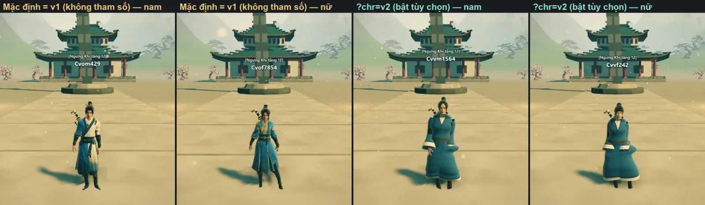
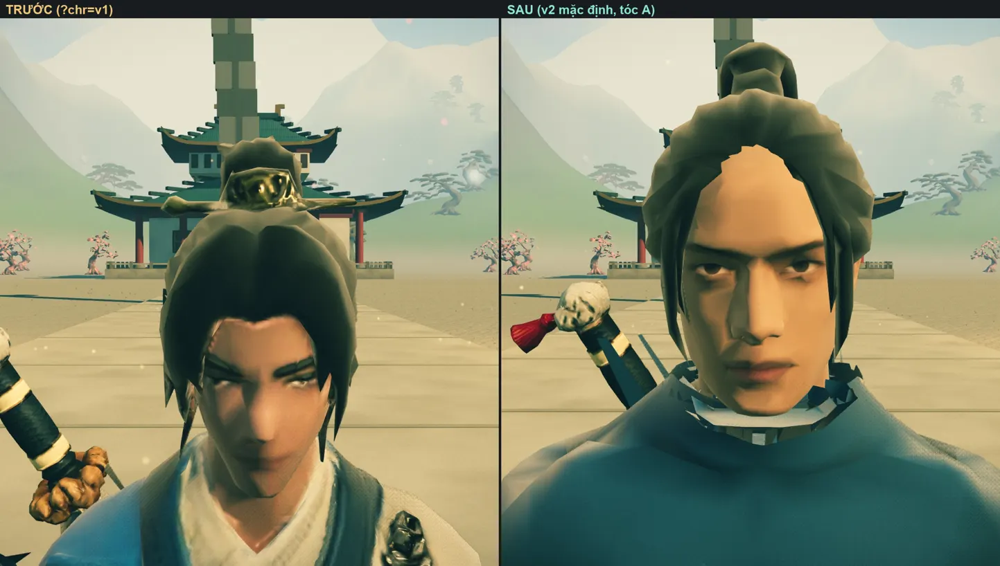
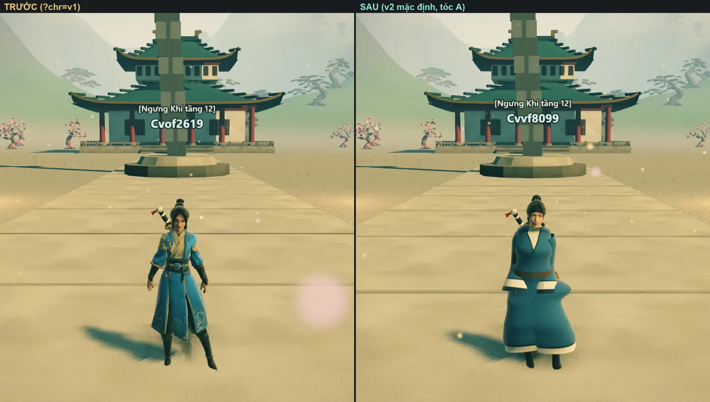
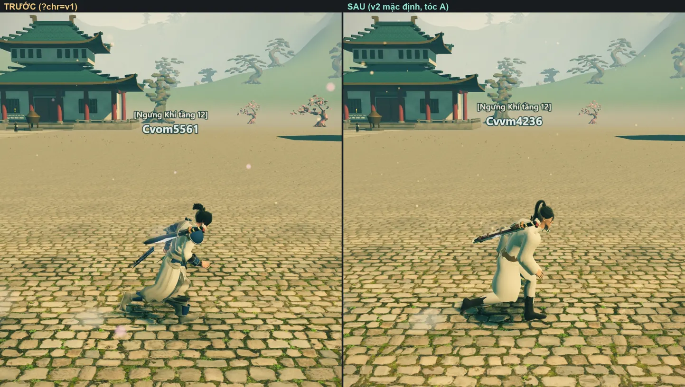
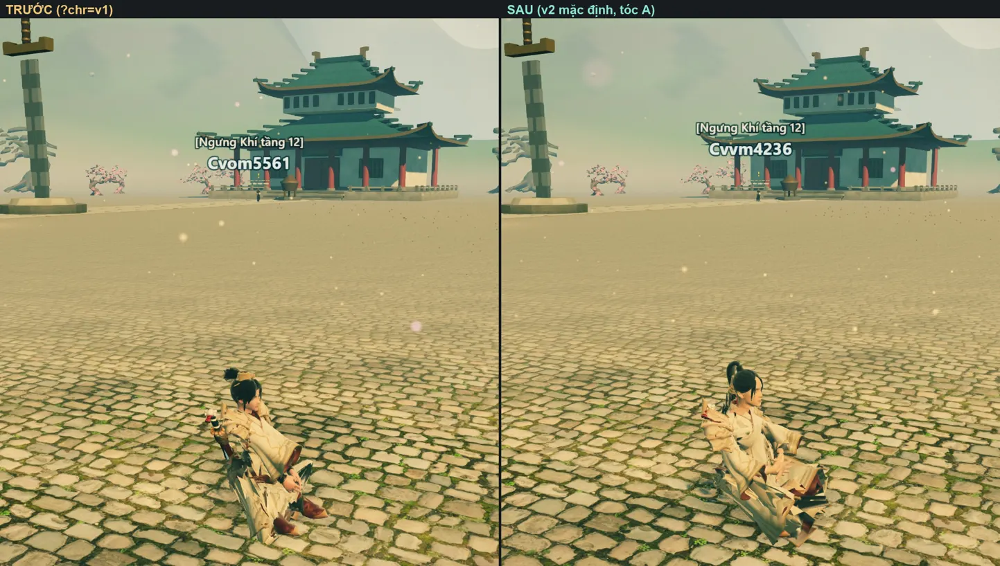

# CHR-ROLLOUT 1: nhân vật nền v2 (tùy chọn `?chr=v2`; mặc định VẪN là v1)

> **Cập nhật (người dùng chọn phương án A):** mặc định giữ **v1** (hai model Tripo cũ); v2 chỉ bật bằng `?chr=v2`. Ảnh xác nhận: `mac-dinh-v1.webp` (trái: không tham số = v1; phải: `?chr=v2`). Phần mã tốt được giữ: chọn tóc A/B (hàng chọn tóc ở màn tạo nhân vật chỉ hiện khi bật v2, server vẫn lưu `hair`), prefetch theo tóc (chỉ khi v2), áo nạp lười, nén WebP. Bộ đạo bào thủ tục (tân thủ, Lạc Kiếm...) chỉ chạy dưới `?chr=v2`, không còn nằm trên đường mặc định.

(Phần dưới mô tả hành vi khi bật `?chr=v2`.)

Người dùng chọn giữ v1 làm mặc định, v2 tùy chọn (MakeHuman + đầu/tóc Tripo, xem `docs/chr-v2/`). PR này: mặc định, chọn tóc, đồ tân thủ, làm mềm mặt. Các bộ trang phục còn lại gắn lại ở PR sau (`docs/chr-v2-rollout/` sẽ có ma trận ảnh đủ bộ).

## Thay đổi

- **Mặc định v2**: `PlayerSkins` dùng `chr_v2_{nam,nu}` (tóc A) / `chr_v2_hb_{nam,nu}` (tóc B); `?chr=v1` về hai model Tripo cũ để so một thời gian. NPC dựng bằng `createNpc` cũng dùng thân v2 (mặc bộ đồ đệ tử nhuộm màu NPC). Test chạy trong node (không có `location`) vẫn dùng model cũ.
- **Chọn kiểu tóc A/B khi tạo nhân vật** (màn tạo nhân vật, ảnh `man-tao-nhan-vat-chon-toc.webp`): `Appearance.hair?: 'a'|'b'` (shared, `parseAppearance` kiểm id, thiếu = `a`), lưu cột `characters.appearance` như màu áo, `PlayerS.hr` gửi cho người khác, client `look.hair` chọn asset. Nhân vật cũ không có `hair` → kiểu A.
- **Bộ đồ đệ tử tân thủ** (`set_de_tu_v2_{nam,nu}`, `tools/blender/chr_v2_starter.py`): thân v2 không có áo nên người không mặc bộ nào (hoặc bộ chưa có áo v2) phải có đồ. Làm lại thành **đạo bào thật** (bản đầu là lớp da bó sát, bị chê giống đồ lặn): áo khoác ngoài dựng bằng các vòng elip quanh thân (rộng hơn thân, tà xòe tới bắp chân), cổ giao lĩnh + viền gấu vẽ trên texture, tay áo rộng loe dọc xương tay có bo miệng, đai lưng, quần và ủng tối màu. Trọng số vạt dưới hông trộn hông + hai chân nên không xé mảnh khi chạy/chém/đả tọa. Vải là màu tham chiếu `#3B6584`: đổi theo màu đạo bào / bộ trang bị / NPC; bộ tân thủ (Lạc Kiếm) vẫn mang phụ kiện giáp vai của bộ.
- **Làm mềm mặt**: da ấm hơn, giảm tương phản, mắt sáng hơn (làm sáng texel quanh hai mắt); **mép chân tóc** có bóng đổ mềm (đỉnh đầu cách mặt tóc < 1 cm tối dần trên texture) thay cho đường cắt cứng.
- `outfit_build.py` ánh xạ nhóm xương tóc về Head (đã sửa ở #172).

## Số đo (`bench:crowd`, 50 bot, sân tông môn, WebGPU, High)

| | draw | tam giác | CPU p50 / p95 | texture | tick server p95 |
| --- | --- | --- | --- | --- | --- |
| `?chr=v1` (cũ) | 206 | 1.093k | 6,5 / 9,2 ms | 380 MB | 5,4 ms |
| v2 mặc định | **235** (< 300) | 673k | 6,8 / 9,8 ms | 393 MB | 2,8 ms |

CPU p95 vượt 8 ms ở cả hai (đã vượt trước PR này), v2 thêm ~0,6 ms. Draw +29: mỗi người một lưới thân + một lưới áo.

## Ảnh trước/sau

Tệp `<tan-thu|lac-kiem|liet-mach>-<nam|nu>-<matcan|matgan|toanthan|chay|chem|datoa>.webp` (trái = `?chr=v1`, phải = v2) và `toc-b-<tan-thu|lac-kiem>-<nam|nu>.webp` (tóc B). Sinh bằng `pnpm --filter @dtl/perf run shots:chrv2 --out <thư mục>`.

## Giới hạn

- Đồ tân thủ vẫn đơn giản (màu phẳng + vài đường viền, không hoa văn); thân áo hơi phình ở ngực (đo từ mặt cắt thân + độ rộng).
- Sáu bộ còn lại (`dia_giap`, `phuc_mach`, `tinh_khuyet`, `co_thanh`, `than_tang`, `van_kinh`, `luu_ly`) chưa có áo v2: tạm mặc đồ tân thủ nhuộm màu bộ.
- Chết, bay (ngự kiếm) chưa chụp trong PR này; ma trận ảnh đủ bộ ở PR sau.
