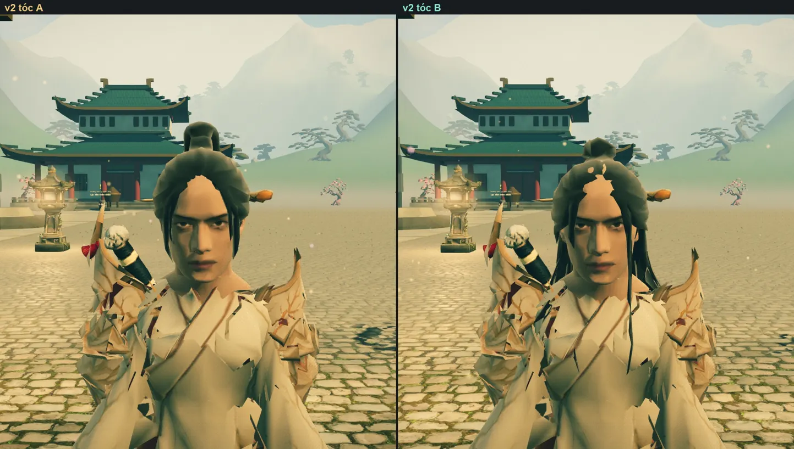

# CHR-PROTO: nhân vật nền v2 (MakeHuman thân + đầu/tóc Tripo) — bản thử

> **Ghi chú R-1 (2026-11-18):** ảnh/video duyệt PR của hạng mục này đã gỡ khỏi repo; thư mục chỉ giữ tối đa 5 ảnh then chốt (WebP). Tên file nhắc bên dưới mà không còn trong thư mục là ảnh đã gỡ, xem lại bằng `git show c78b50c6:docs/chr-v2/<file>`.

**Không thay nhân vật trong game.** Chỉ dựng và so sánh để quyết. Phương án C: thân + tay MakeHuman (CC0), đầu + tóc do người dùng dựng trên Tripo web từ concept ở đây.

Xem thử: thêm `?chr=v2` vào URL game (`?mute=1&auto=<tên>&chr=v2`), `&hair=b` cho tóc kiểu B. Bỏ tham số là về nhân vật cũ. Mặc bộ bằng lệnh GM như thường (`/gm set set_liet_mach`).

## Trạng thái

| Hạng mục | Trạng thái |
| --- | --- |
| Thân nam + nữ MakeHuman, rig Mixamo, 5 ngón tách, T-pose | xong |
| **Đầu Tripo** thay đầu tạm: cắt ở cổ, hàn nối viền cổ, trọng số Neck→Head, da thân khớp da mặt | xong |
| **Tóc Tripo** 4 kiểu (nam A, B; nữ A, B), úp khớp đầu, đẩy ra khỏi thân/vai | xong |
| Xương lò xo cho đuôi tóc, tóc xõa, mái (`dtl_o_hair_*`, chạy bằng hệ lò xo vạt áo có sẵn) | xong, kiểm bằng mắt trong game |
| Clip nền, pose IK, kiếm lưng (dùng nguyên `anim_human_base`/`k3`) | chạy |
| Ẩn thân theo vùng áo che (`bodyRegions.ts`, `outfit_covers.json`) | xong |
| Mặc thử Liệt Mạch Kiếm Y, Kính Quang Kiếm Y × nam, nữ × tóc A, B | xong |
| Blendshape nháy mắt | **không làm** (xem mục 7) |

## 1. Đầu + tóc Tripo

Nguồn: `<nguồn>/chr/chr_base_v2/tripo/raw_head_{nam,nu}_v01.glb` (~2,8k tam giác), `raw_hair_{nam,nu}_{a,b}_v01.glb` (~1,8k). Concept sinh bằng Codex (`tools/codex-assets/chr-base-gen.mjs`): nam A búi cao + đuôi dài, nam B búi nhỏ + xõa, nữ A buộc cao + mái, nữ B hai đuôi + búi + mái chéo.


Asset: `chr_v2_{nam,nu}` (tóc A) và `chr_v2_hb_{nam,nu}` (tóc B), mỗi cái **một lưới, một vật liệu, một draw call** (thân + đầu + tóc + kiếm).

## 2. Cách dựng

```
DTL_ASSET_SOURCE=<nguồn> node tools/blender/build-chr-v2.mjs        # cả 4 kiểu (cờ --only nam|nu, --style a|b)
node tools/blender/run.mjs --only <id> --force                       # import_tripo + chr_v2_post.py
pnpm --filter @dtl/asset-pipeline exec tsx src/cli.ts optimize --only <id>
```

Hai giai đoạn trong Blender 5.3 chạy nền (MPFB2 CC0 ở `chr_base_v2/_src/`):

1. `tools/blender/chr_base_v2.py`: macro Á Đông, rig Mixamo + trọng số MakeHuman, giảm mặt (26,7k → ~6,5k), ép T-pose (tay trên chúc xuống 10°, cẳng tay gập ra trước 21° đo từ `chr_kiem_tu_nam`, rồi hạ thêm 9° (`--arm-down`) vì thân MakeHuman vai rộng, tay dài: đo trong game, góc xương tay đứng của v2 và nhân vật cũ trùng nhau (~11° so với phương thẳng đứng) nên phải hạ thêm mới buông sát thân; clip chung xoay quanh tư thế nghỉ nên mọi clip lệch cùng góc), vẽ albedo 1K (da, đồ lót, môi...). Đầu/tóc tạm của giai đoạn này sẽ bị bỏ ở bước sau.
2. `tools/blender/chr_v2_head.py`:
   - bỏ đầu tạm, cắt thân ở mặt phẳng ngang giữa cổ `Zc`;
   - khớp đầu Tripo (cao 1 m, gồm cổ + vai trên): tỉ lệ theo bề ngang sọ ở lát rộng nhất so với đầu MakeHuman, rồi cắt phần dưới `Zc`;
   - **hàn cổ**: `bridge_loops` hai viền cắt (144 cạnh, hai bên khác số đỉnh: 46 thân, 98 đầu), UV mặt nối lấy theo da thân, trọng số cổ chuyển Neck→Head theo độ cao;
   - **da mặt**: texture Tripo bị nén vệt sáng bake (sáng trên trung vị ×0,45) và giảm bão hòa 14% cho đỡ cam/bóng; độ nhám vật liệu 0,82;
   - **màu da thân**: 80% màu texture tại vòng cổ + 20% trung vị vùng má/mũi của đầu Tripo (đã làm dịu); nhân màu lên các pixel gần màu da cũ của thân (không đụng đồ lót);
   - tóc: tỉ lệ theo bề ngang mũ tóc, gán 100% xương Head; đỉnh tóc buông thấp hơn đầu bị đẩy ra mặt sau/trước thân (lan sang đỉnh kề để cả dải dịch cùng nhau);
   - **xương lò xo** `dtl_o_hair_{l,c,r,bang}`: con của Head, cụm theo x (trái/giữa/phải) cho tóc buông, riêng mái; trọng số tăng dần xuống dưới. `chr_v2_post.py` ghi extras `dtl.springs` sau khi `import_tripo` chuẩn hóa;
   - **atlas 2048²** (JPEG, một vật liệu): thân (trái trên) | đầu (phải trên) | tóc (trái dưới) | chỗ trống (ô màu kiếm). Tripo chỉ lấy map màu (bỏ normal/ORM để giữ một vật liệu); tóc nén sáng mạnh + gần trung tính (sẫm hơn bản đầu), tóc ôm đầu sát hơn (`hair_w` 1,08) để nhuộm áo của game (`dye.ts`) không đổi màu tóc theo bộ.

Tham số khớp từng kiểu tóc ở `tools/blender/build-chr-v2.mjs` (`CFG`).

**Đổi tư thế nghỉ / hình thể thân nền thì phải dựng lại cả bốn áo v2** (`run.mjs --only set_<bộ>_v2_<giới> --force` + `optimize`): `outfit_build.py` bỏ tư thế (unpose) đỉnh áo về tư thế nghỉ của `assets/build/raw/<nhân vật>.glb` lúc dựng, còn lúc chạy áo bind với `boneInverses` của thân; lệch tư thế nghỉ thì tay áo xoay lệch khỏi tay. `outfit_build.py` ánh xạ nhóm trọng số xương lò xo tóc `dtl_o_hair_*` của thân v2 về xương Head (trước đó script văng `StopIteration` nên áo không dựng lại được).


## 3. Ẩn thân bị áo che

Mỗi mảnh áo khai báo vùng che trong `packages/content/data/equipment/outfit_covers.json` (khóa là mảnh áo, không hậu tố giới, không `_v2`). Vùng: `head neck chest belly upperArm forearm hand thigh calf foot`. Client (`apps/client/src/game/character/bodyRegions.ts`) suy vùng từng đỉnh từ xương trội, bỏ tam giác mà cả ba đỉnh đều trong vùng bị che. Xương lò xo tóc không thuộc vùng nào nên tóc không bị ẩn. Cả hai bộ che `chest belly upperArm thigh calf foot` và để lộ cẳng tay. Test: `bodyRegions.test.ts`.

## 4. Ảnh trước/sau (cùng góc, trong game thật, tắt tiếng, WebGPU)

`pnpm shots chrv2 --out <thư mục tuyệt đối>` (cờ `--variant old|v2|v2b`, `--genders m,f`, `--sets none,set_liet_mach,set_kinh_quang`, `--only still`). Tệp: `<than-tran|liet-mach|kinh-quang>-<nam|nu>-<matcan|matgan|banthan|toanthan|chay|chem|datoa|saugan>.webp` (trái = nhân vật cũ, phải = v2 tóc A) và `toc-ab-<bộ>-<giới>-<góc>.webp` (so tóc A với B).

Cận mặt nam (Liệt Mạch, máy ảnh sát mặt) và thân trần cận mặt nữ:


Tóc kiểu B (nam: Liệt Mạch; nữ: Kính Quang), cận mặt, toàn thân, sau lưng:


Liệt Mạch, nam (cận mặt, toàn thân, chạy, chém, đả tọa):


Kính Quang, nữ:


Thân trần (kiểm cổ nối, trọng số, đồ lót):


Tóc A so với B:



## 5. Số đo

Asset (tam giác LOD0/1/2; GLB chưa nén KTX2 vì máy dựng thiếu `toktx`):

| Asset | LOD0 | LOD1 | LOD2 | Texture | GLB |
| --- | --- | --- | --- | --- | --- |
| `chr_kiem_tu_nam` (cũ) | 19.096 | 7.632 | 2.864 | 3 × 1024² (màu, normal, ORM) | 1,7 MB |
| `chr_kiem_tu_nu` (cũ) | 20.000 | 8.000 | 2.999 | 3 × 1024² | 2,6 MB |
| `chr_v2_nam` (tóc A) | 9.319 | 5.125 | 2.200 | 1 × 2048² JPEG | 0,72 MB |
| `chr_v2_hb_nam` (tóc B) | 9.343 | 5.132 | 2.200 | 1 × 2048² | 0,71 MB |
| `chr_v2_nu` (tóc A) | 9.383 | 5.160 | 2.200 | 1 × 2048² | 0,72 MB |
| `chr_v2_hb_nu` (tóc B) | 9.366 | 5.150 | 2.199 | 1 × 2048² | 0,72 MB |
| áo Liệt Mạch (cũ và v2) | 11.463 | 4.585 | ~1,7k | 4 × 1024² | 4,0 MB |

Một nhân vật v2 ≈ 9,3k tam giác: thân MakeHuman ~5,5k (đã giảm mặt) + đầu Tripo (~2,8k, phần vai dưới cổ bị cắt) + tóc ~1,8k + kiếm lưng; chưa tách số liệu chính xác từng phần.

Cảnh sân tông môn, khung giống nhau (`__game.info()`, cộng dồn mọi pass, gồm đổ bóng), một người chơi:

| Trạng thái | Draw cũ → v2 | Tam giác cũ → v2 (nam) | Tam giác cũ → v2 (nữ) |
| --- | --- | --- | --- |
| Thân trần | 116 → 116 | 300.887 → 282.077 (−18,8k) | 303.471 → 282.233 (−21,2k) |
| Mặc Liệt Mạch | 122 → 122 | 299.085 → 301.029 (+1,9k) | 298.690 → 299.816 (+1,1k) |
| Mặc Kính Quang | 129 → 129 | 386.531 → 389.097 (+2,6k) | 387.572 → 388.624 (+1,1k) |

Tóc A và B cho số tam giác cảnh gần như bằng nhau (chênh ≤ 1,2k). Khi mặc bộ, game cũ đã cắt thân còn đầu/cổ/tay, nên chênh lệch nhỏ và hơi nghiêng về v2 do đầu + tóc Tripo dày hơn đầu cũ đã giảm. Lợi chính vẫn là thân không còn lớp trang phục nặng ẩn bên dưới, trang phục mô-đun không phải khoác lên trên một bộ đồ nữa, và texture 3 → 1.

## 6. Kiểm xuyên mesh

Xem bằng mắt trong game thật (ảnh ở mục 4): đứng, chạy, chém, đả tọa, cả bốn kiểu tóc, hai bộ. Tóc đuôi/xõa bám theo lưng và vai nhờ đẩy ra khỏi thân + xương lò xo giới hạn góc vào trong của hệ lò xo sẵn có. Chưa đo tự động; bay (ngự kiếm) và chết chưa chụp.

## 7. Giới hạn đã biết

- **Nháy mắt: không làm.** Mắt Tripo là nét vẽ trên texture trong một lưới liền (không có mi, nhãn cầu riêng); dựng blendshape mi cần dựng lại vùng mắt thủ công. Có thể làm sau bằng cách đổi UV vùng mắt sang ô texture "mắt nhắm" (đòi hỏi tô thêm ô texture).
- Hai kiểu tóc B (xõa dài) và nữ B (hai đuôi) vẫn có vài dải tóc bị ép phẳng khi nằm sát ngực/lưng (đẩy ra theo vị trí phía trước/sau tâm đầu); nhìn gần ở T-pose thấy gai nhọn, trong game ít lộ. Ở T-pose nữ B lộ một mảng da gáy dưới mũ tóc (thiết kế mũ tóc Tripo ngắn ở sau); chưa chỉnh.
- Tripo chỉ lấy map màu: chưa có normal/ORM của đầu và tóc (độ bóng da/tóc dùng hằng số).
- Màu da thân khớp da mặt ở mức trung bình, có thể còn vệt đổi màu mờ ở cổ.
- Chưa có KTX2 (thiếu `toktx`); `pnpm assets:build` đầy đủ sẽ nén. Atlas 2048² nặng bộ nhớ GPU hơn 3 × 1024² cũ nếu không nén (~21 MB với mipmap so với ~16 MB); sau KTX2 thì nhỏ hơn nhiều.
- NPC vẫn dùng model cũ (`?chr=v2` chỉ áp cho người chơi và NPC dựng từ model người chơi theo giới).
- PR thêm GLB: 4 nhân vật ~0,7 MB + 4 áo ~4 MB vào `apps/client/public/assets/`.
