# CHR-PROTO: nhân vật nền v2 (MakeHuman) — bản thử

**Không thay nhân vật trong game.** Chỉ dựng và so sánh để quyết. Phương án C: thân + tay từ MakeHuman (CC0), đầu + tóc do người dùng dựng trên Tripo web từ concept ở đây.

Xem thử: thêm `?chr=v2` vào URL game (`?mute=1&auto=<tên>&chr=v2`). Bỏ tham số là về nhân vật cũ. Mặc bộ bằng lệnh GM như thường (`/gm set set_liet_mach`).

## Trạng thái

| Hạng mục | Trạng thái |
| --- | --- |
| Thân nam + nữ MakeHuman, rig Mixamo, 5 ngón tách, T-pose, texture 1K | xong |
| Dùng nguyên thư viện clip `anim_human_base` / `anim_human_k3`, pose IK, kiếm sau lưng | chạy (kiểm trong game: đứng, chạy, chém, đả tọa) |
| Đầu + tóc tạm (đầu MakeHuman, tóc vẽ lên da đầu + búi/đuôi thủ tục) | xong, **chỉ để có ảnh so sánh** |
| Concept đầu + tóc cho Tripo (6 ảnh + hướng dẫn) | xong, chờ người dùng dựng |
| Ẩn thân theo vùng áo che | xong (`bodyRegions.ts`, `outfit_covers.json`) |
| Mặc thử Liệt Mạch Kiếm Y, Kính Quang Kiếm Y × nam, nữ | xong |
| Nhập đầu/tóc Tripo vào thân v2 | **chưa** (chờ file `raw_head_*`/`raw_hair_*`), kế hoạch ở mục 5 |

## 1. Concept đầu + tóc (làm trên Tripo)

Ảnh PNG gốc 1086×1448 + prompt + hướng dẫn từng bước: `D:\METAGRIT\dtl-asset-source\chr\chr_base_v2\concept\` (`README.md` ở đó). Tóm tắt: Image to 3D, HD Model, đầu ~3000 mặt, tóc ~2000 mặt, lưu `raw_head_<nam|nu>_v01.glb` / `raw_hair_<nam|nu>_<a|b>_v01.glb` vào `chr_base_v2\tripo\`.

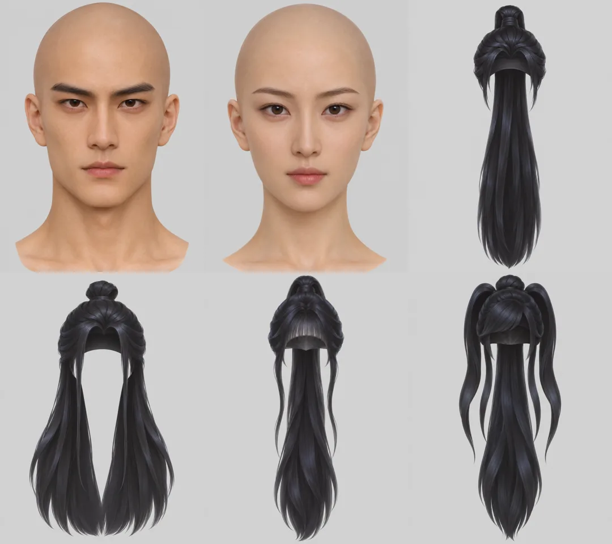

Hàng trên: đầu nam, đầu nữ, tóc nam A (búi cao + đuôi dài). Hàng dưới: tóc nam B (búi nhỏ + xõa), tóc nữ A (buộc cao + mái), tóc nữ B (búi cao + đuôi + mái chéo). Sinh bằng Codex: `node tools/codex-assets/chr-base-gen.mjs`.

## 2. Thân nền

Công cụ: `tools/blender/chr_base_v2.py` (Blender 5.3 chạy nền) + MPFB2 (`git clone --depth 1 https://github.com/makehumancommunity/mpfb2`, đặt ở `chr_base_v2/_src/` hoặc biến `MPFB_SRC`). Chỉ dùng lưới cơ sở, target hình thể, bộ xương Mixamo và trọng số đi kèm MPFB (CC0, xem `assets/LICENSES.md`); không dùng asset pack tải riêng.

Quy trình trong script: macro Á Đông, trẻ, cao ráo → rig Mixamo có trọng số → bỏ răng/lưỡi/váy/quần helper, giữ thân + mắt → Decimate (collapse, đối xứng X) từ 26,7k xuống ~6,5k → ép T-pose như asset Tripo → vẽ albedo 1K theo UV MakeHuman (da, đồ lót bó xám trung tính, môi, lông mày, má hồng, mống mắt, tóc) → gộp một lưới một vật liệu → `rig_v01.glb`. Sau đó đi qua pipeline có sẵn: `import_tripo.py` (chuẩn hóa hướng/tỉ lệ, thêm kiếm lưng bằng `anim_biped_extra.py`) → `optimize.ts` (LOD) với lớp ngân sách mới `player_v2` (4–12 nghìn tam giác).

```
node tools/blender/run.mjs --only chr_v2_nam          # raw GLB (cần DTL_ASSET_SOURCE)
pnpm --filter @dtl/asset-pipeline exec tsx src/cli.ts optimize --only chr_v2_nam
```

Kiểm trọng số: khuỷu, vai, hông, gối, ngón nhìn ổn trong cả chạy, chém, đả tọa (ảnh dưới). Da tông Á Đông (`#DEB591` nam, `#E6BF9C` nữ), texture 1K (chưa 2K mặt vì đầu sẽ thay bằng Tripo).

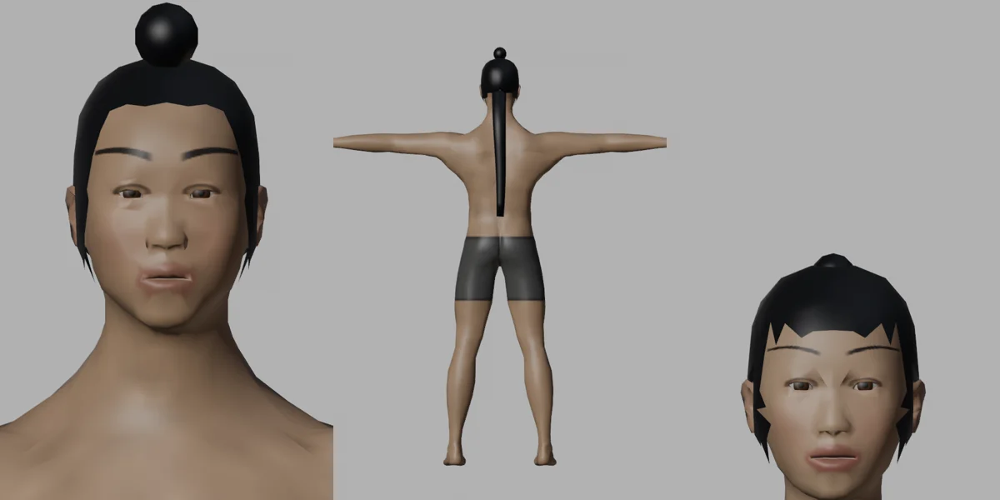

## 3. Ẩn thân bị áo che

Mỗi mảnh áo khai báo vùng che trong `packages/content/data/equipment/outfit_covers.json` (khóa là mảnh áo, không hậu tố giới, không `_v2`). Vùng: `head neck chest belly upperArm forearm hand thigh calf foot`. Client (`apps/client/src/game/character/bodyRegions.ts`) suy vùng của từng đỉnh từ xương trội, rồi bỏ tam giác mà cả ba đỉnh đều trong vùng bị che (tam giác ranh giới ở lại, nằm dưới áo). Không cần thuộc tính đỉnh riêng nên sống qua meshopt. Cắt theo vùng thay cho luật cũ "chỉ giữ đầu/cổ/tay" (`dressedIndex`), vẫn một draw call. Bật bằng `?chr=v2`; test: `bodyRegions.test.ts`.

Hai bộ đã thử đều che `chest belly upperArm thigh calf foot` và để lộ **cẳng tay** (ống tay áo bộ này dừng giữa cẳng tay; che cả cẳng tay thì bàn tay lơ lửng). Khi có bộ khác, chỉ cần thêm dòng vào JSON.

## 4. Ảnh trước/sau (cùng góc, trong game thật, tắt tiếng)

`pnpm --filter @dtl/perf run shots:chrv2 --out <thư mục tuyệt đối>` (tự chạy `pnpm dev`; cờ `--variant old|v2`, `--genders m,f`, `--sets none,set_liet_mach,set_kinh_quang`, `--only still`). Mỗi ảnh: trái = nhân vật cũ, phải = v2. Góc: cận mặt (`matcan`), bán thân (`banthan`), toàn thân (`toanthan`), chạy (`chay`), chém (`chem`), đả tọa (`datoa`). Có đủ cho thân trần, Liệt Mạch, Kính Quang × nam, nữ: tên tệp `<than-tran|liet-mach|kinh-quang>-<nam|nu>-<góc>.webp` trong thư mục này.

Mặc Liệt Mạch, nam:

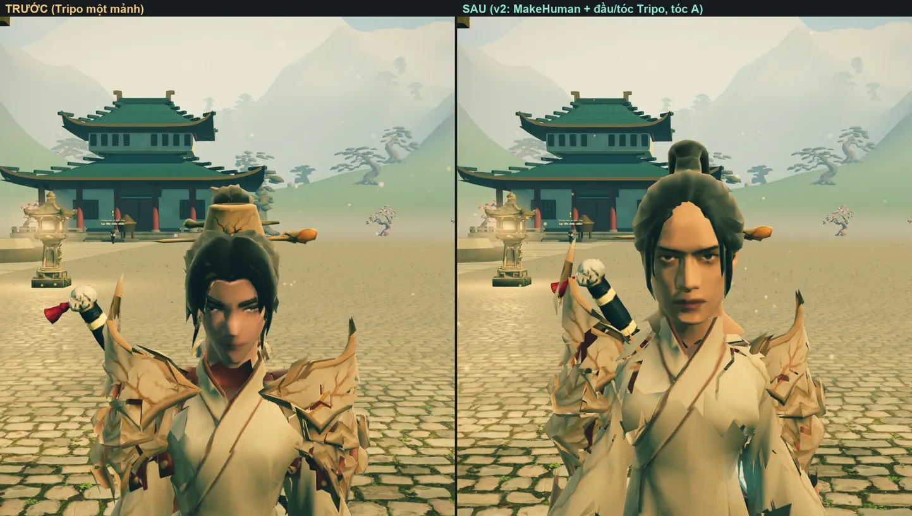
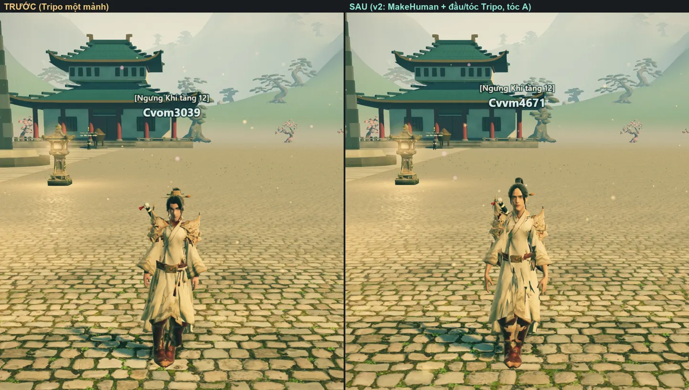
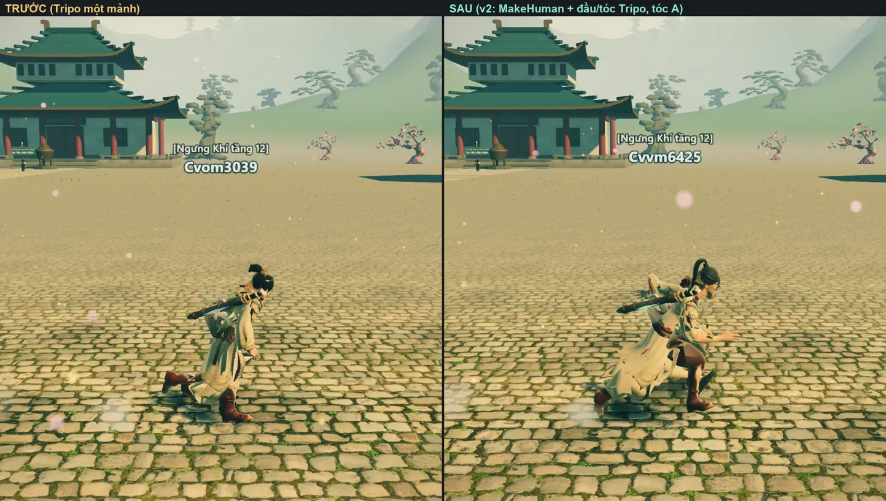
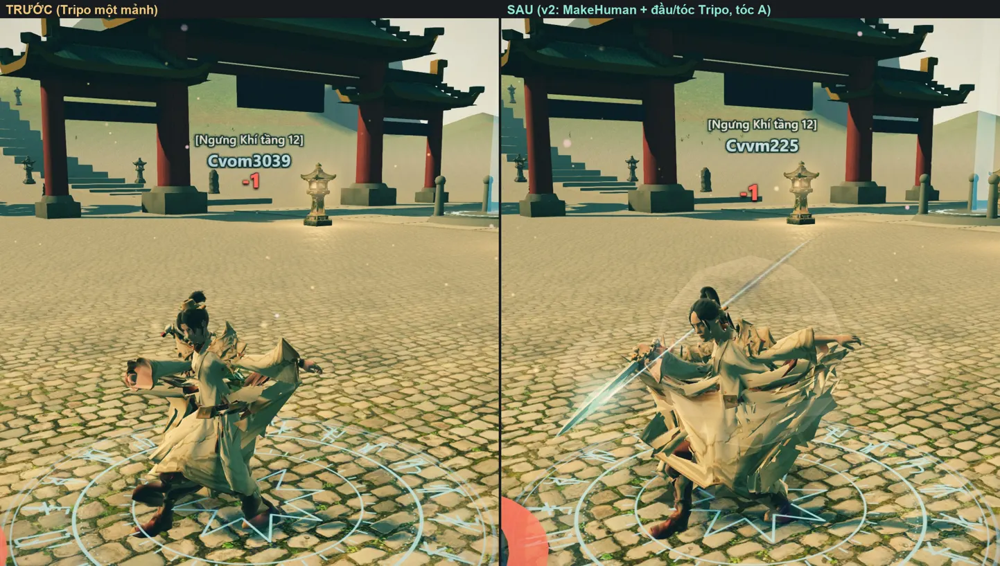
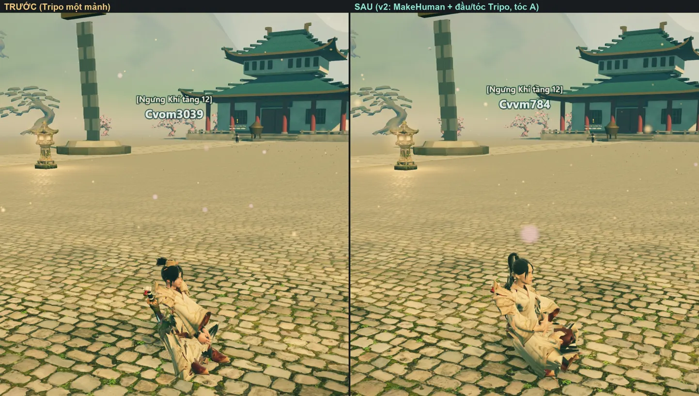

Mặc Kính Quang, nữ:

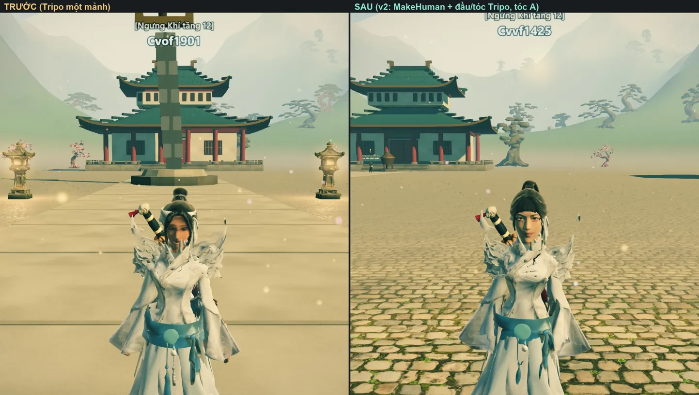
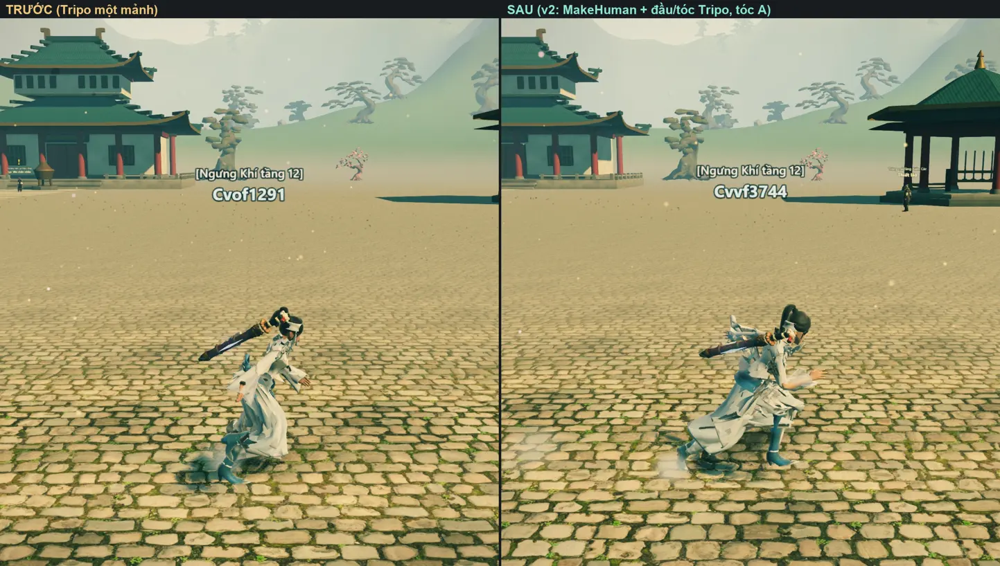
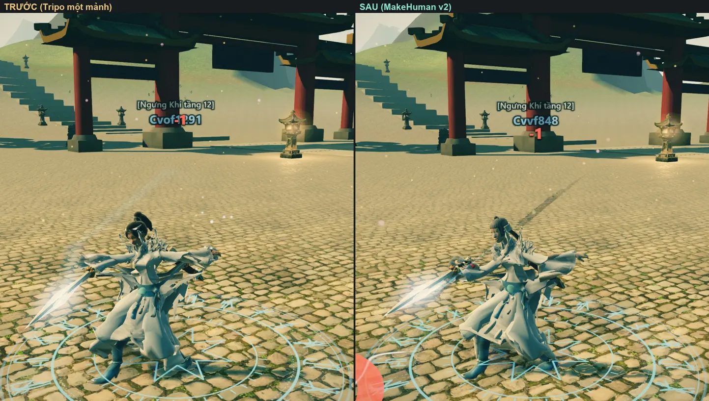

Thân trần (kiểm trọng số và đồ lót), nữ:

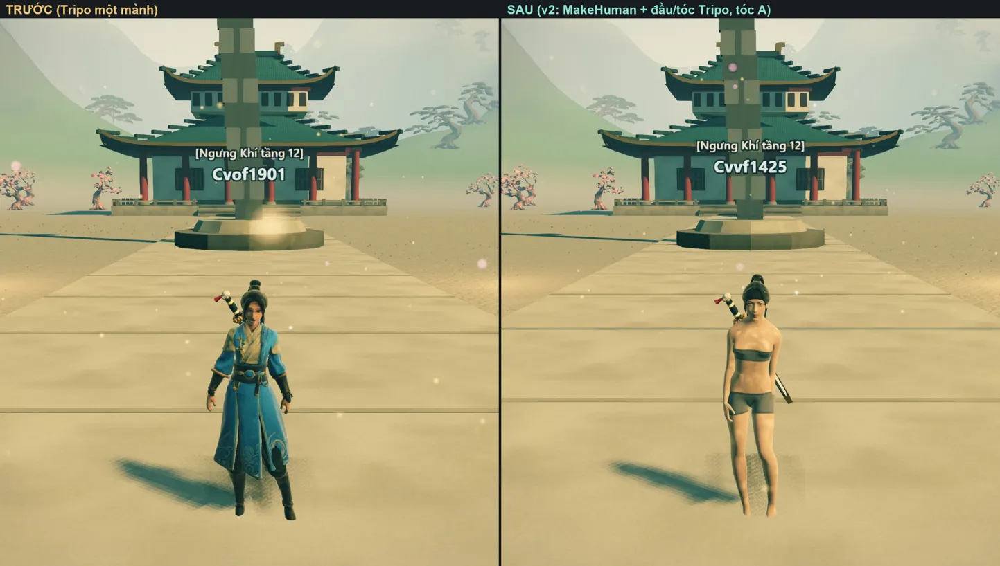
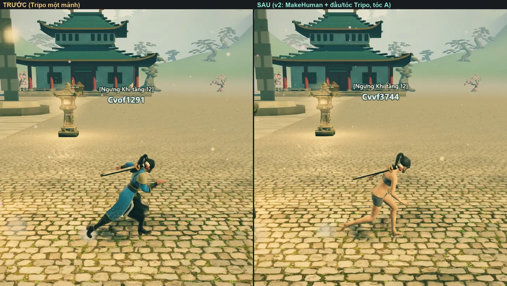

## 5. Số đo

Asset (tam giác LOD0/1/2; texture; kích thước GLB, chưa nén KTX2 vì máy này thiếu `toktx`):

| Asset | LOD0 | LOD1 | LOD2 | Texture | GLB |
| --- | --- | --- | --- | --- | --- |
| `chr_kiem_tu_nam` (cũ) | 19.096 | 7.632 | 2.864 | 3 × 1024² | 1,7 MB |
| `chr_kiem_tu_nu` (cũ) | 20.000 | 8.000 | 2.999 | 3 × 1024² | 2,6 MB |
| `chr_v2_nam` | 7.174 | 3.586 | 1.578 | 1 × 1024² | 0,77 MB |
| `chr_v2_nu` | 7.132 | 3.566 | 1.568 | 1 × 1024² | 0,78 MB |
| áo Liệt Mạch (cả cũ lẫn v2) | 11.463 | 4.585 | 1.7k | 4 × 1024² | 4,0 MB |

Thân v2 chỉ một lưới, một vật liệu (da + mắt + tóc chung một atlas: game dùng vật liệu của lưới đầu cho cả nhân vật), cộng kiếm lưng: cùng số draw call với nhân vật cũ.

Cảnh sân tông môn, khung giống nhau (`__game.info()`, cộng dồn mọi pass, gồm cả đổ bóng), một người chơi:

| Trạng thái | Draw cũ → v2 | Tam giác cũ → v2 (nam) | Tam giác cũ → v2 (nữ) |
| --- | --- | --- | --- |
| Thân trần | 116 → 116 | 300.887 → 277.707 (−23k) | 303.471 → 277.725 (−26k) |
| Mặc Liệt Mạch | 122 → 122 | 299.085 → 297.576 (−1,5k) | 298.690 → 297.772 (−0,9k) |
| Mặc Kính Quang | 129 → 129 | 386.531 → 387.768 (+1,2k) | 387.572 → 388.018 (+0,4k) |

Khi mặc bộ, game cũ đã cắt thân còn đầu/cổ/tay nên chênh lệch nhỏ: lợi chính của v2 là **thân trần nhẹ hơn ~3 lần**, texture 3 → 1 và không còn thân nặng ẩn dưới áo ở LOD xa. Vùng bị ẩn do áo: ngực, bụng, tay trên, đùi, bắp chân, bàn chân (chưa đo tỉ lệ tam giác ẩn).

## 6. Kế hoạch nhập đầu + tóc Tripo (khi có file)

1. Bản thân v2 hiện có đầu MakeHuman (vùng `head`) và tóc (vẽ lên da đầu + búi/đuôi thủ tục): thêm `head` vào danh sách vùng che của một bộ hiển thị tạm, hoặc dùng cờ riêng, để ẩn vùng đầu tạm.
2. Script Blender `import_head_hair.py` (chưa viết): nạp `raw_head_*`/`raw_hair_*`, căn theo xương `Head` và cổ thân v2 (khớp đường cắt cổ), gán 100% xương Head (tóc đuôi dài thêm xương lò xo như `anim_biped_extra`), hạ texture về 1K, gộp vào `chr_v2_<giới>` thành lưới đầu/tóc rời (hai vật liệu: thân và đầu/tóc; client cần cho phép vật liệu thứ hai, hiện `PlayerSkins.material()` chỉ lấy vật liệu của lưới đầu tiên).
3. Ảnh so sánh lại bằng `shots:chrv2`.

## 7. Giới hạn đã biết

- Đầu và tóc hiện tại là **tạm**: mặt thô (giảm đồng đều làm mất chi tiết mặt, môi hơi hở), tóc phẳng; không phản ánh chất lượng cuối.
- Giảm mặt đồng đều (Decimate không bảo vệ vùng được theo nhóm đỉnh trong Blender 5.3 như kỳ vọng): bàn tay vẫn đủ 5 ngón nhưng ngón thô hơn bản MakeHuman gốc.
- Chưa có KTX2 (máy dựng thiếu KTX-Software): texture PNG 1K; `pnpm assets:build` đầy đủ sẽ nén.
- Nhân vật NPC vẫn dùng model cũ (`?chr=v2` chỉ áp cho người chơi và NPC dựng từ model người chơi theo giới).
- Mắt không động (không chớp, không nhìn theo).
- Lực chiến, hit-box, chiều cao: v2 giữ cùng chiều cao 1,75 / 1,68 m (kiếm nằm trong hộp bao, bù trong `meta.json`).
- Bốn GLB áo dựng lại (v2) cùng kích thước ~4 MB mỗi cái, giống bản cũ: PR thêm ~17 MB vào `apps/client/public/assets/` (thư mục này đã nằm trong git).
