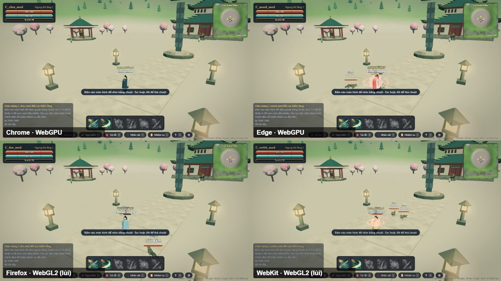
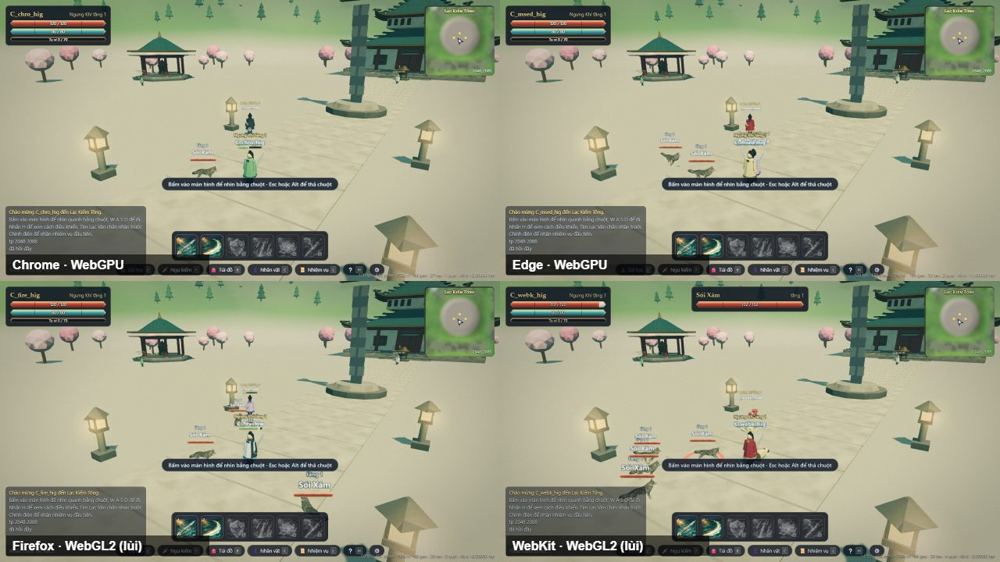
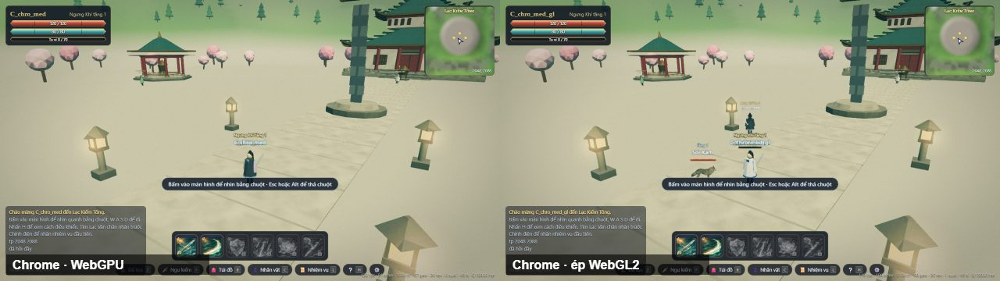

# Tương thích trình duyệt (M6-4)

Lần kiểm: 15/11/2026, commit trên nhánh M6-4 (sau `cd4569a`). Máy Windows 11, Intel i5-12400F, RTX 3060 Ti,
cửa sổ 1280×720, dpr 1, Vite dev server (chưa gộp module, React dev). Chạy lại: `pnpm compat` (mục "Cách kiểm").

**Safari thật không có trên máy này.** Cột WebKit dùng WebKit 26.6 của Playwright trên Windows: cùng engine với
Safari 26 nhưng là bản build khác. Bản này **không có Web Audio, MediaSource, codec hệ thống và WebGPU**, và báo
GPU giả "Apple GPU". Vì vậy nó chỉ cho biết kết quả gần đúng về render WebGL2, input và giao thức mạng, không cho
biết gì về âm thanh hay WebGPU của Safari. Firefox là Firefox 155 của Playwright (máy không cài Firefox thật).

## Bảng kết quả

| Mục | Chrome 157 | Edge 157 | Firefox 155 (Playwright) | WebKit 26.6 (Playwright, gần đúng Safari) |
| --- | --- | --- | --- | --- |
| Khởi động, đăng nhập thử (`?auto=`) | Đạt (vào game 3,0–3,7 s) | Đạt (2,6–3,0 s) | Đạt (5–8,5 s) | Đạt (6–13 s) |
| Backend render | **WebGPU** (nvidia/ampere) | **WebGPU** | **WebGL2** (lùi tự động, WebGPU nằm trong blocklist của bản Playwright) | **WebGL2** (lùi tự động, không có `navigator.gpu`) |
| Ép WebGL2 (`?renderer=webgl2`) | Đạt | Đạt | (đã là WebGL2) | (đã là WebGL2) |
| Shader TSL (so ảnh với Chrome WebGPU, cùng góc) | Ảnh tham chiếu; WebGL2 lệch 2,6/255 | Lệch 2,8–3,2/255 | Lệch 3,8–3,9/255 | Lệch 3,5–6/255 |
| Sương, chỉnh màu, quầng đèn, bóng (preset Cao), bằng mắt | Đạt | Đạt | Đạt | Đạt |
| GLB meshopt + texture (6/6 asset qua `AssetCache`) | Đạt | Đạt | Đạt | Đạt |
| KTX2 Basis ETC1S + UASTC (transcoder wasm) | Đạt → BC1 (`texture-compression-bc`) | Đạt → BC1 | Đạt → BC7 (`EXT_texture_compression_bptc`) | Đạt → BC7 |
| `canPlayType` Opus/WebM · AAC/M4A | probably · probably | probably · probably | probably · probably | probably · probably (không phát được, xem dưới) |
| Giải mã bằng OfflineAudioContext (4 sprite SFX + 5 âm môi trường, mỗi cái webm + m4a) | Đạt 18/18 | Đạt 18/18 | Đạt 18/18 | Không kiểm được (bản build không có Web Audio) |
| Âm môi trường stream qua `<audio>` (5 file) | Đạt 5/5 | Đạt 5/5 | Đạt 5/5 | Không kiểm được (không có backend media) |
| Âm thanh thật trong game (âm lượng 0 + tắt tiếng mức trình duyệt) | Đạt: giải mã 3 sprite, phát `forest.webm` | Đạt | Đạt | Không chạy (không có cờ tắt tiếng, không có Web Audio) |
| Lùi m4a khi webm hỏng (chặn `.webm` = 404) | Đạt sau bản sửa: SFX và `forest.m4a` phát | Đạt | Đạt | — |
| Bàn phím: giữ W 1,2 s | Đạt (đi 9,1 m) | Đạt (8,8 m) | Đạt (8,8 m) | Đạt (6,0 m, khung thấp) |
| Tab chọn mục tiêu | Đạt | Đạt | Đạt | Đạt |
| Lăn chuột (khoảng cách camera) | Đạt (14 → 15,7) | Đạt | Đạt | Đạt |
| Kéo chuột xoay camera (chế độ strafe) | Đạt | Đạt | Đạt | Đạt |
| Pointer lock (chế độ chuột, bấm canvas) | Đạt | Đạt | Đạt | Không khóa được trong headless (ghi chú 4) |
| Lỗi console (lỗi đỏ) | 0 | 0 | 0 | 1, vô hại (ghi chú 2) |
| Cảnh báo console | 0 | 0 | 6, vô hại (ghi chú 3) | 2 (thông báo lùi WebGL2) |

### FPS và CPU sơ bộ (headless, sân tông môn, đứng yên 4 giây)

FPS bị trình duyệt headless chặn trần 120. CPU là thời gian `Game.frame()` p50/p95 (ms). Firefox làm tròn
`performance.now()` tới 1 ms nên số của nó nhảy bậc. Số draw call giữa các trình duyệt khác nhau một chút vì quái/người
chơi thử của lượt trước còn trong kênh. Đây không phải số đo hiệu năng chính thức (xem `pnpm bench:client`).

| Preset | Chrome (WebGPU) | Edge (WebGPU) | Firefox (WebGL2) lượt 1 / lượt 2 | WebKit (WebGL2) |
| --- | --- | --- | --- | --- |
| Thấp | 119 fps · 2,4/3,2 ms · 81 draw | 120 fps · 2,3/2,9 ms · 119 draw | 118 / 82 fps · p95 6 / 9 ms · 109–118 draw | 22 fps · 4/6 ms |
| Vừa | 120 fps · 2,4/3,0 ms · 91 draw | 120 fps · 2,9/3,9 ms · 124 draw | 116 / 83 fps · p95 5 / 9 ms · 110–119 draw | 10 fps · 7/22 ms |
| Cao | 120 fps · 3,2/3,9 ms · 145 draw | 120 fps · 4,6/6,3 ms · 172 draw | 105 / 58 fps · p95 7 / 15 ms · 153–163 draw | 12 fps · 7/26 ms |
| Vừa, ép WebGL2 | 120 fps · 2,2/2,9 ms · 108 draw | 120 fps · 3,1/4,0 ms · 119 draw | — | — |

Tam giác 0,2–0,3 triệu ở mọi tổ hợp. FPS thấp của WebKit là do bản WebKit Windows của Playwright vẽ chậm (asset
cũng nạp chậm gấp 10–20 lần), không phản ánh Safari trên Mac.

### Ảnh so sánh

Cùng góc camera ở sân tông môn (yaw 0,6, pitch 0,32, khoảng cách 14). Quái/người chơi khác nhau giữa các ảnh là
do các lượt kiểm chạy nối tiếp trên cùng server.

Preset Vừa:



Preset Cao (có bóng):



Chrome, WebGPU và ép WebGL2:



## Đã sửa trong PR này

- **Nhạc nền/âm môi trường không lùi sang m4a khi webm hỏng.** SFX đã thử định dạng kế tiếp khi giải mã lỗi
  (`decodeFirst`), nhưng `StreamDeck.sync` trong `apps/client/src/game/audio.ts` chỉ lấy định dạng đầu tiên mà
  `canPlayType` nhận. Nếu `<audio>` báo lỗi khi nạp webm (trình duyệt nói "có" nhưng không giải mã được, như
  WebM/Opus trên một số bản Safari) thì game bỏ bản m4a có sẵn và chỉ còn gió tổng hợp, còn nhạc thì im. Giờ
  `StreamDeck` thử lần lượt mọi định dạng phát được rồi mới về gió tổng hợp. Đã kiểm bằng lượt chặn `.webm`:
  trước khi sửa không có âm môi trường nào phát, sau khi sửa `forest.m4a` phát (Chrome, Edge, Firefox).

## Ghi chú

1. **Firefox, WebGPU**: Firefox của Playwright không trả adapter WebGPU, kể cả khi bật `dom.webgpu.enabled` và
   `gfx.webgpu.ignore-blocklist`. Firefox bản phát hành trên Windows bật WebGPU từ bản 141, nên với người chơi dùng
   Firefox thật, game có thể chạy đường WebGPU (wgpu), và đường này **chưa được kiểm**.
2. **WebKit, `Wrong protocol for WebSocket '[object Object]'`**: lỗi này đến từ colyseus.js. Thư viện cố ý thử
   `new WebSocket(url, { headers, protocols })` kiểu Node trước, bắt lỗi, rồi gọi lại kiểu trình duyệt. WebKit
   báo lần thử đầu như một lỗi trang, nhưng kết nối vẫn thành công. Safari thật cũng sẽ in dòng này. Không sửa ở
   phía game.
3. **Firefox, 6 cảnh báo**: "WebGPU is not available, running under WebGL2" và "WebGPU is disabled by blocklist"
   (lùi backend như mong đợi); "WebGL context was lost" (renderer của màn tiêu đề `TitleBackdrop` được dispose khi
   vào game, và `WebGLBackend.dispose()` của three gọi `loseContext()` có chủ đích); "WEBGL_debug_renderer_info is
   deprecated" (do chính script kiểm đọc tên GPU).
4. **WebKit, pointer lock**: WebKit headless không cấp pointer lock. Chế độ kéo chuột vẫn chạy. Cần thử lại trên
   Safari thật.
5. **KTX2 trên WebGPU ra BC1 thay vì BC7**: `KTX2Loader.detectSupportAsync` của three r178 hỏi feature
   `texture-compression-bptc`, mà WebGPU không có feature tên đó (BC7 nằm trong `texture-compression-bc`). Hệ quả là
   UASTC chuyển sang BC1 trên WebGPU (chất lượng thấp hơn BC7), trong khi WebGL2 ra BC7. Hiện chưa asset nào dùng
   KTX2 (`ktx2: false` trong manifest) nên chưa ảnh hưởng. Nên xem lại khi bật KTX2 trong pipeline.
6. **Âm thanh, kiểm luôn tắt tiếng**: phần dò dùng `OfflineAudioContext` (không ra loa) và `<audio muted>` chỉ nạp
   metadata. Lượt "âm thanh thật" mở game không có `?mute=1` nhưng đặt âm lượng master 0 trong `localStorage`, cộng
   `--mute-audio` (Chromium) hoặc `media.volume_scale = 0` (Firefox). WebKit không có cờ tương đương nên không chạy
   lượt này (bản build cũng không có Web Audio).

## Việc còn lại (cần giao riêng)

- **Safari thật trên Mac** (bắt buộc trước khi mời bạn chơi bằng Mac/iPad): WebGPU trên Safari 26 (Metal), giải mã
  Opus/WebM bằng `decodeAudioData` hay phải lùi m4a, `<audio>` stream, pointer lock, hiệu năng. Cách nhanh: mở
  `http://<máy-dev>:<CLIENT_PORT>/?mute=1&debug=1` trên Mac cùng mạng LAN; tiếng thì kiểm bằng log `[audio]` trong
  Web Inspector với âm lượng máy để 0.
- **Firefox thật (≥141)**: đường WebGPU/wgpu của shader TSL, và CPU khung ở Cao. Lượt 2 headless đo p95 15 ms, trên
  ngân sách 8 ms; lượt 1 là 7 ms. Cần đo bằng bản build (`pnpm build && pnpm start`) trên Firefox thật để biết đó
  là nhiễu hay vấn đề thật.

## Cách kiểm

```
pnpm compat                                   # Chrome, Edge, Firefox, WebKit × Thấp/Vừa/Cao (+ ép WebGL2 trên Chromium)
pnpm compat --browsers chrome,firefox --presets medium --no-audio-live
```

`tools/perf/src/compat.ts` tự chạy `pnpm dev` ở cặp cổng riêng (mặc định 2645/5145; đổi bằng `PORT`/`CLIENT_PORT`),
kiểm cổng trống trước, tự tắt khi xong. Kết quả ghi vào `bench/results/compat-<ngày>/` (JSON + ảnh PNG từng
trình duyệt/preset, thư mục bị gitignore). Firefox/WebKit của Playwright cần cài một lần:
`pnpm --filter @dtl/perf exec playwright install firefox webkit`.
