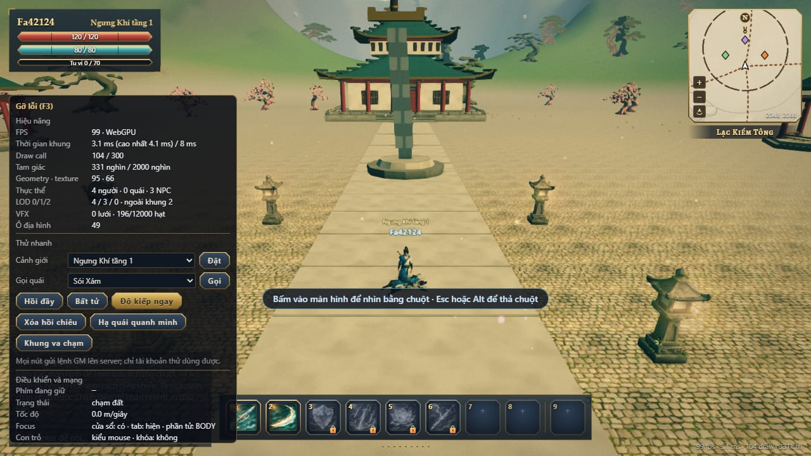
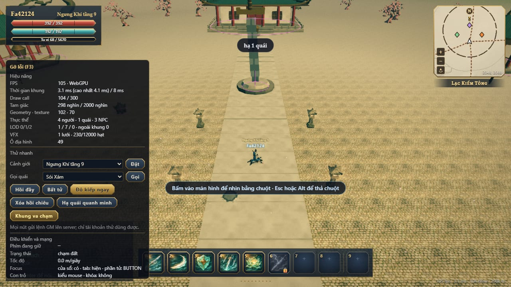
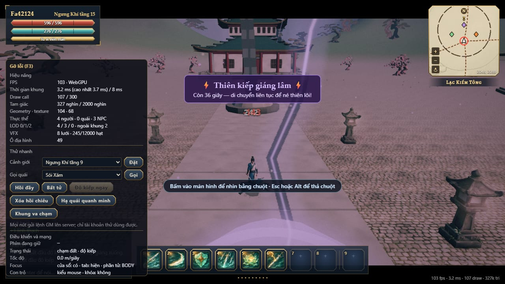
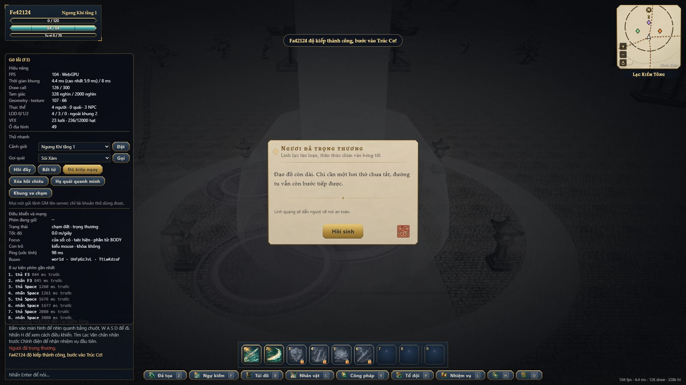

# Bảng F3 và chế độ debug

Mở rộng bảng gỡ lỗi F3 (M1-2) thành chỗ xem số đo và thử nhanh. Không viết lại: vẫn là `ui/DebugPanel.tsx`, engine vẫn chỉ điền số khi bảng đang mở.

## Mở bảng

- Bản dev (`pnpm dev`): nhấn **F3**.
- Bản build: thêm `?debug=1` vào URL rồi nhấn F3. Không có `?debug=1` thì F3 không làm gì.
- `?debug=1` còn hiện một dòng gọn ở góc dưới phải: `fps · ms · draw · tri`.

## Số đo

| Dòng | Nguồn | Ngưỡng tô màu |
| --- | --- | --- |
| FPS, backend | khung vẽ thật trong ~100 ms gần nhất; WebGPU hay WebGL2 | vàng khi dưới 55 |
| Thời gian khung | CPU của `Game.frame()`: trung bình và cao nhất trong khoảng lấy mẫu | vàng từ 6,4 ms, đỏ trên 8 ms |
| Draw call, tam giác | khung vừa vẽ, cộng mọi pass (bóng, cảnh, hậu kỳ) | vàng từ 80%, đỏ khi vượt 300 / 2 triệu |
| Geometry · texture | `renderer.info.memory` | |
| Thực thể | người, quái, NPC đang có mô hình | |
| LOD 0/1/2 | số thực thể ở từng mức và số ngoài khung nhìn | |
| VFX | lưới đang sống trong pool hiệu ứng, hạt sống / ngân sách hạt | |
| Ô địa hình, ping, phím, trạng thái, room | như bảng cũ | |

## Nút thử nhanh

Chỉ hiện với tài khoản thử. **Mọi nút gửi một lệnh `/gm` lên server**; server kiểm quyền (`p.dev`: đăng nhập thử và `AUTH_DEV_BYPASS`, tự tắt khi production hoặc có `GOOGLE_CLIENT_ID`) rồi mới làm. Client không tự đổi state.

| Nút | Lệnh |
| --- | --- |
| Cảnh giới + Đặt | `/gm level N` |
| Gọi quái + Gọi (có cả boss và tinh anh) | `/gm spawn <id>` |
| Hồi đầy | `/gm heal` |
| Bất tử | `/gm god` |
| Độ kiếp ngay | `/gm trib` (mới) |
| Xóa hồi chiêu | `/gm cd` |
| Hạ quái quanh mình | `/gm killall` |
| Khung va chạm | không gửi gì: vẽ các collider tròn của `stepMove` ở client (`game/debugColliders.ts`, 1 draw call) |

Lệnh GM mới:

- `/gm realm nk1…nk15 | tc | tc1…tc3`: đặt cảnh giới theo mã (cùng đường với `/gm level`).
- `/gm trib`: đưa về Ngưng Khí tầng 15 viên mãn đã vượt bình cảnh, cấp một viên Trúc Cơ Đan nếu thiếu (qua `tx` + sổ cái, lý do `gm`), rồi gọi đúng `onBreakthrough` của người chơi thật. Đang độ kiếp, đang tỉ thí, đã chết hoặc ở bí cảnh thì từ chối.

## Tham số URL

Ghép sau `?mute=1&auto=<tên>`. Server kiểm ở `apps/server/src/testflags.ts`; tài khoản thật bị từ chối và được báo `sys.test_denied`.

| Tham số | Ý nghĩa |
| --- | --- |
| `god=1` | bất tử (đã có) |
| `at=<địa điểm>` | vào ở điểm đặt tên (đã có) |
| `at=x,z` | vào ở tọa độ, phải nằm trong bản đồ 0…4096 |
| `realm=nk15` | đặt cảnh giới lúc vào: `nk1`…`nk15`, `tc`, `tc1`…`tc3` hoặc số cấp |
| `tribulation=1` | kích độ kiếp ngay sau khi vào |

Ví dụ: `?mute=1&auto=thu&debug=1&realm=nk15&god=1&at=2048,2088`, `?mute=1&auto=thu&god=1&tribulation=1`.

Một tham số sai (mã cảnh giới lạ, tọa độ ngoài bản đồ) thì server không áp tham số nào và in mã hợp lệ vào chat.

## Sửa kèm

- Vào room (hoặc kết nối lại) khi mình đang độ kiếp thì client lỡ tin `tribstart` nên không có HUD đếm giờ và mây kiếp. Giờ client dựng lại khi thấy cờ độ kiếp của mình bật quá 0,6 giây mà chưa có giờ kết thúc (đếm từ đủ 40 giây, là cận trên; HUD vẫn tắt theo cờ của server).
- Ca "?god: bị đánh nhưng không mất máu" của bộ `security` thành may rủi sau M-1 (bãi sói đổi chỗ): sửa cho đứng yên giữa bầy sói vừa gọi.

## Ảnh

