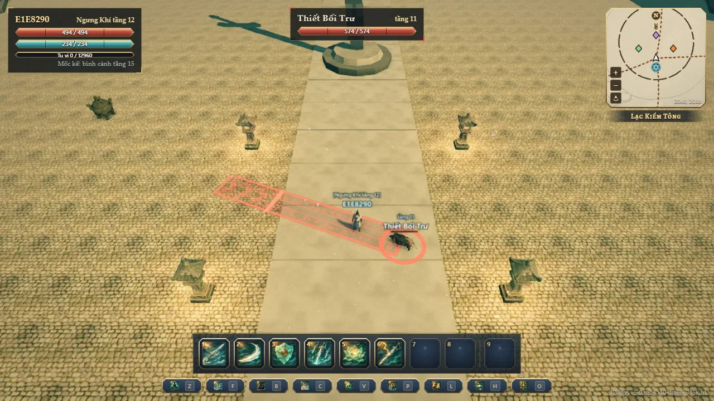
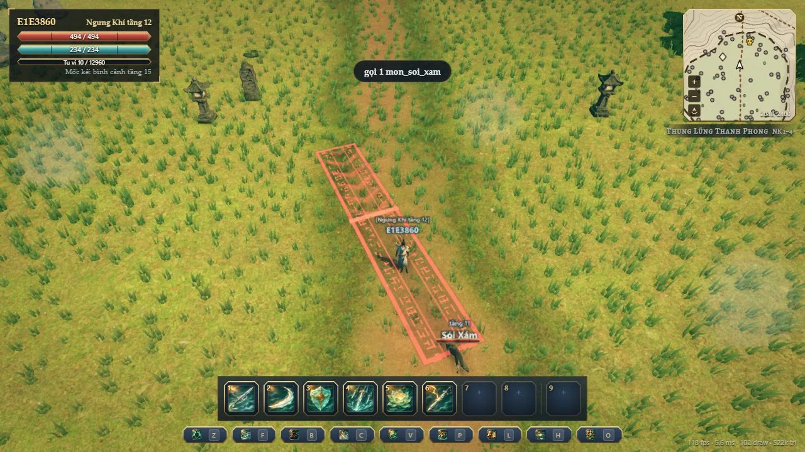
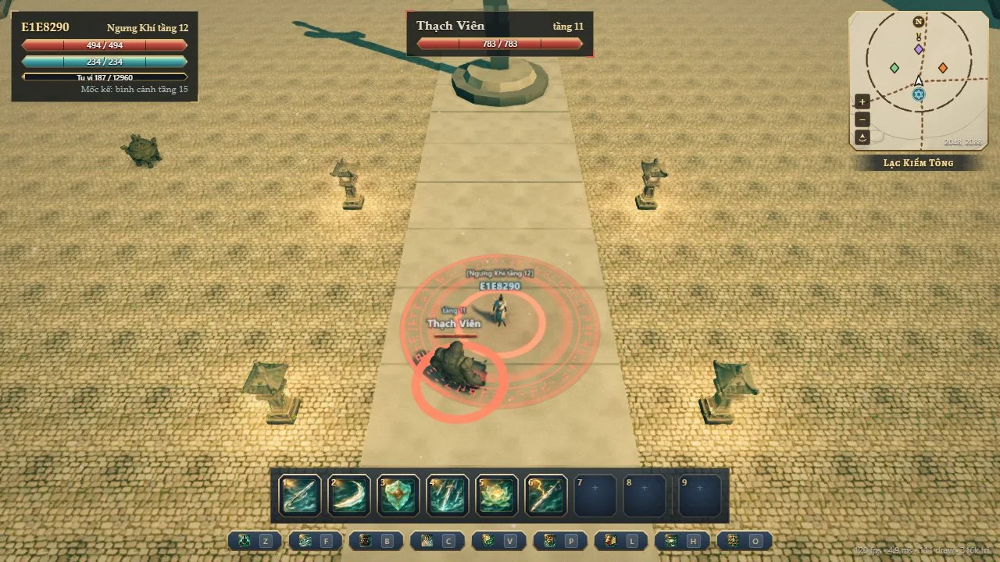
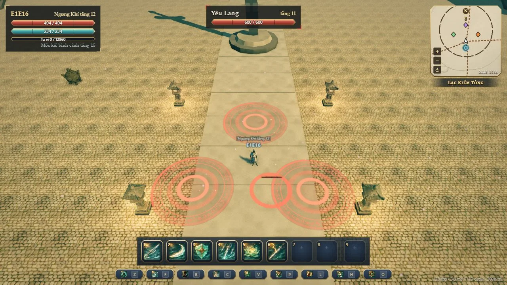
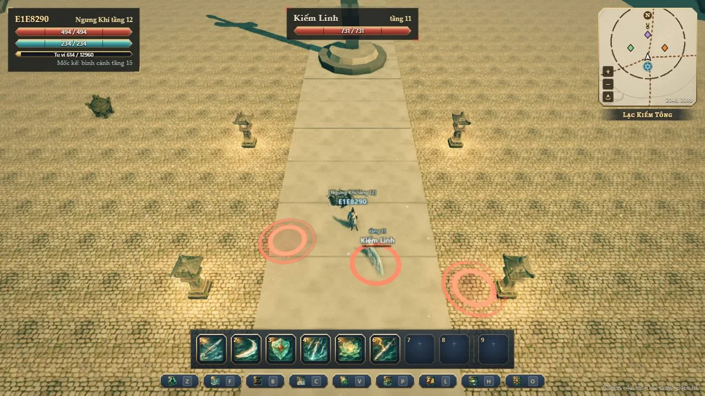

# E1-E: nguyên tắc quái mở rộng

> **Ghi chú R-1 (2026-11-18):** ảnh/video duyệt PR của hạng mục này đã gỡ khỏi repo; thư mục chỉ giữ tối đa 5 ảnh then chốt (WebP). Tên file nhắc bên dưới mà không còn trong thư mục là ảnh đã gỡ, xem lại bằng `git show c78b50c6:docs/e1e-monskill/<file>`.

Bảy kiểu chiêu mới cho quái thường, tinh anh và boss, khai báo trong `ai` của `monsters.json` (cũng ghi đè theo pha boss qua `phases[].ai`, `null` để bỏ). Chưa quái nào dùng: E2-B (Địa Mạch Long, Thôn Mạch Ngô Công Vương) và E2-C (Thạch Tâm Khôi Vương) gắn vào bằng dữ liệu.

Mã: kiểu dữ liệu `packages/shared/src/types.ts` (`MonsterLine`…`MonsterReveal`), hàm thuần `packages/shared/src/monskill.ts`, trạng thái và hook `apps/server/src/game/monskill.ts` (`MonSkills`, gắn vào `sim.ts`: `tickMonster`, `damageMonster`, `resetAi`, `breakPosture`, `tryInterrupt`), kiểm `packages/content/src/check.ts` (`checkMonSkills`), client `apps/client/src/game/monFlags.ts` + `Game.monFlagFx`. Test: `apps/server/src/game/monskill.test.ts` (24), `packages/shared/src/monskill.test.ts` (6).

## Nguyên tắc chung

- **Server quyết định.** Mọi vạch báo là một `Hazard` của sim: hiện ngay, nổ đúng `delay` giây sau, ai đứng trong hình lúc nổ mới trúng (`inHazard`). Né bằng cách ra khỏi hình trước lúc nổ. Quái chết hoặc bỏ đuổi thì vạch không còn sát thương.
- **Vạch báo client** dùng lại pháp trận `sigil` (`game/telegraph.ts`, `render/vfx/sigil.ts`): mép ngoài hiện ngay, vạch sáng chạy từ tâm ra mép đúng thời gian báo, 80 ms cuối nháy, nền ≤ 0,35, màu `wood_cinnabar` (quái thường) hoặc `spirit_demonic` (boss). Không thêm material. `HazardMsg.mv` cho biết chiêu nào sinh vạch (`line|charge|leap|burrow|emerge|summon`).
- Chỉ một chiêu "bận" tại một thời điểm (`MonSkillRt.act`); thứ tự ưu tiên khi nhiều chiêu cùng sẵn sàng: burrow, leap, charge, line, summon, reflect, reveal. Lần dùng đầu sau nửa chu kỳ (charge/leap: tối đa 1,5 s để còn khoảng cách).
- Bị quỵ (đầy phá thế) hoặc bị ngắt chú: hủy chiêu đang dở (trừ chui đất); vạch đã thả vẫn nổ như đã báo.
- Cờ mới trong `MonS.mf`: `MF_REFLECT` (8), `MF_WEAK` (16), `MF_BURROW` (32), `ce` là lúc hết. `sim.setMonFlags` giữ ba cờ này khi cờ chú/choáng đổi.

## Bảy kiểu

| Kiểu | Khai báo (đơn vị: giây, mét, độ) | Hành vi | Ràng buộc `content:check` |
| --- | --- | --- | --- |
| `line` | `{cd, range, r, w, delay, mul, kind}` | Mục tiêu trong `range`: quái đứng yên khóa hướng, vạch chữ nhật dài `r` rộng `w` từ chỗ quái, nổ sau `delay` | delay 0,9–3; cd > delay+2; w 0,5–6; range ≤ r |
| `charge` | `{cd, min, range, r, w, delay, mul, speed, kind}` | Mục tiêu cách `min`…`range`: vạch dài `r` (rút ngắn nếu gặp nước/vách/dốc > 1,2 m/0,5 m; ngắn dưới 3 m thì không lao), nổ sau `delay`, rồi quái lao hết vạch với `speed` | delay 0,9–3; cd > delay+3; speed 8–30 |
| `leap` | `{cd, min, range, r, delay, mul, kind}` | Khóa chỗ mục tiêu đang đứng, vòng tròn `r` ở đó; quái đứng yên rồi bay vòng cung 0,35 s cuối và đáp đúng lúc nổ | delay 0,8–3; r 1–8 |
| `burrow` | `{cd, range, hide, n, r, spread, mul, cone:{r,w,delay,mul}, kind}` | Quái chui xuống `hide` giây (miễn mọi sát thương, cờ `MF_BURROW`, client ẩn thân), để `n` vòng `r` quanh mục tiêu (cách `spread`); nổ cùng lúc quái trồi ở vòng đầu rồi đánh quạt `cone` về phía mục tiêu | hide 1,2–4; n 1–4; cone.delay 1,2–3; cd > hide+cone.delay+3 |
| `reflect` | `{cd, warn, dur, ratio, cap, take}` | Cờ `MF_REFLECT` hiện từ đầu; sau `warn` giây tụ thế, trong `dur` giây mỗi đòn trúng quái bị phản `ratio` (tối đa `cap`×máu tối đa người đánh), quái nhận `take`×. Chất độc/dot không bị phản | warn 0,6–3; dur 1–6; cap ≤ 0,5; take < 1 |
| `summon` | `{cd, mon, n, max, r, delay}` | Vạch tròn báo (không sát thương) ở `n` chỗ cách quái `r`; hết `delay` đệ tử xuất hiện (cùng cấp quái chủ), tối đa `max` sống cùng lúc, trần 24 cả room. Đệ tử không rơi đồ/tu vi; mất khi chủ chết hoặc bỏ trận | `mon` là quái thường, không tự gọi lại; delay 1–4; cd ≥ 6 |
| `reveal` | `{cd, dur, mul, guard?, after?, posture?}` | Lộ yếu điểm `dur` giây (cờ `MF_WEAK`): sát thương nhận ×`mul`; ngoài lúc lộ ×`guard`. `after: charge|leap|burrow` thì lộ ngay sau khi chiêu đó xong; `posture` lấp phá thế lúc lộ | mul 1–3 (>1); `after` phải có chiêu tương ứng |

"Đổi pha" dùng cơ chế pha boss sẵn có (`phases[].ai`), không cần kiểu riêng.

## Ảnh vạch báo

`E1E_PATCH=1 pnpm shots:e1e --out <thư mục tuyệt đối> [--only line,charge,...] [--at thung_lung]` (tắt tiếng, tự chạy `pnpm dev`, tạm gán bộ chiêu cho vài quái thường rồi khôi phục `monsters.json`). Thân nhân vật và chân vẫn đọc được dưới vạch.

| | |
| --- | --- |
|  line |  charge |
|  leap |  burrow: ba vòng, quái ẩn |
| burrow: quái trồi, quạt báo | reflect: vòng đỏ dưới chân |
| reveal: vòng vàng |  summon: vòng báo chỗ đệ tử |

## Số đo

- Server: 24 test mới (từng kiểu: trúng/né theo vị trí, hết giờ báo, người ngoài vùng không trúng, hủy khi quỵ, phản không vượt `cap`, dot không bị phản, đệ tử mất khi chủ chết).
- `pnpm bots --count 100 --duration 120` (hook bật): 0 lỗi `refId`, `ledger:check` khớp; tick p95 cuối bài 3,9–4,7 ms (hook tắt: 3,7 ms; một lần đo đầu 8,6 ms do máy bận, không lặp lại).
- `pnpm bench:client`: 17/18 điểm đạt; WebGPU/Cao/hồ có CPU p95 8,4 ms (vượt 8 ms), các điểm còn lại 3,8–6,8 ms. Client chỉ thêm so sánh cờ `mf` mỗi quái mỗi khung (không thêm material hay lưới, draw call/tam giác cùng cỡ các lần trước), nên coi là nhiễu đo; chưa chạy lại để xác nhận.

## Còn lại cho gói sau

- Chưa có quái dùng các kiểu này; E2-B/E2-C điền `monsters.json` + i18n tên/lời.
- Phản đòn và yếu điểm chưa có biểu hiện âm thanh riêng; chui đất chưa có clip trồi lên riêng cho model có xương (client chỉ ẩn thân + bụi).
- Hộ pháp chia sát thương (`GAME_DESIGN_CORE.md` 5.3) và cờ khắc chế `DmgMsg.ke` ở UI chưa làm (ngoài phạm vi).
