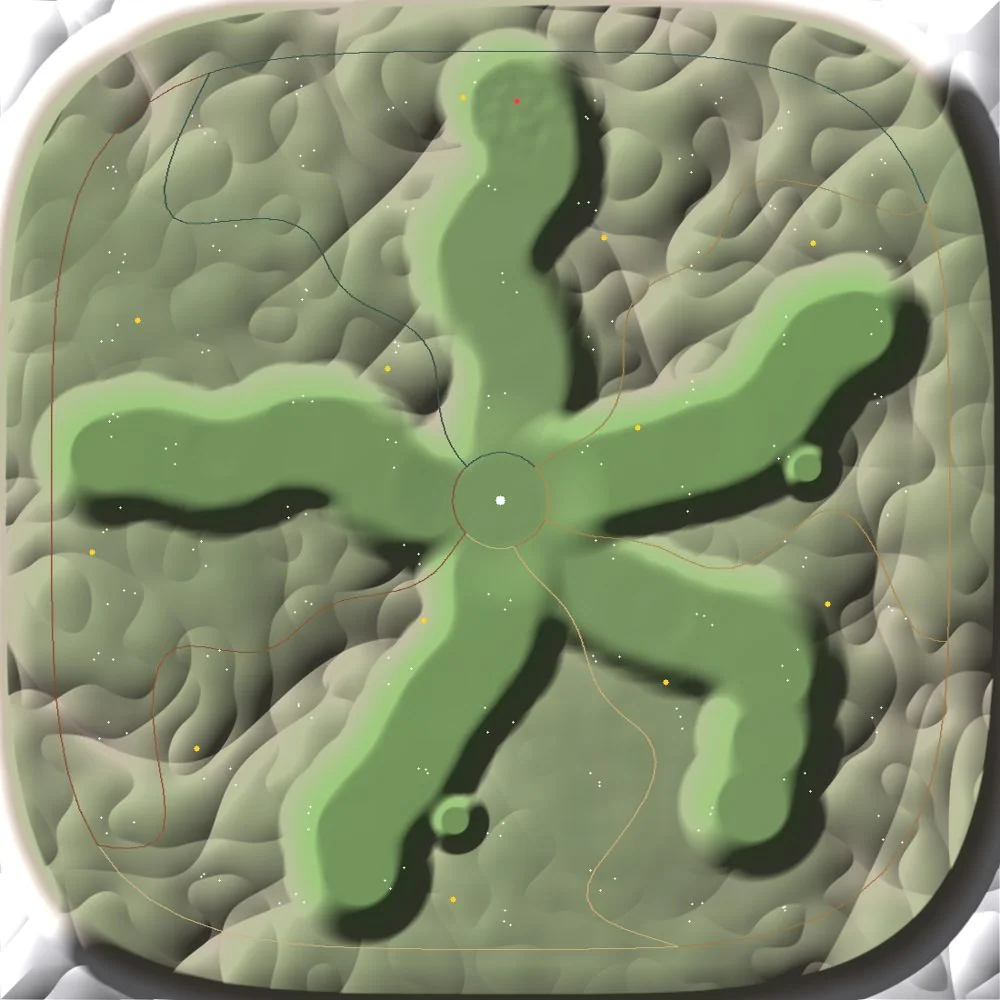
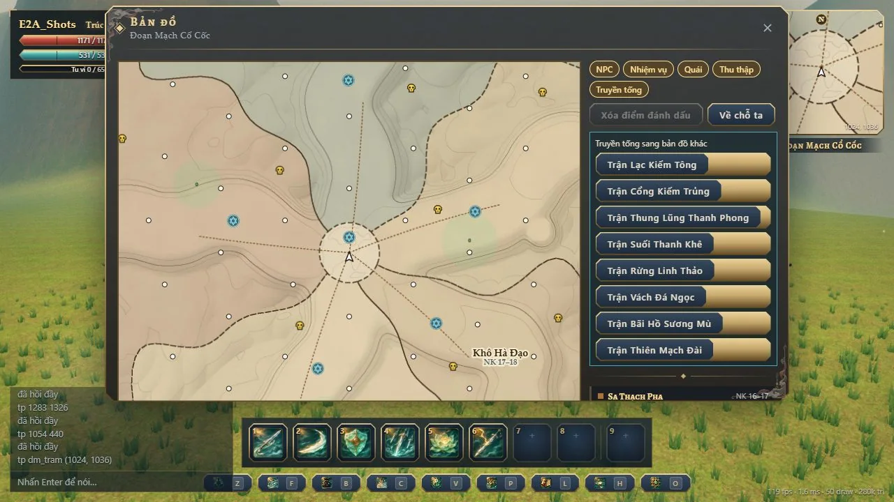
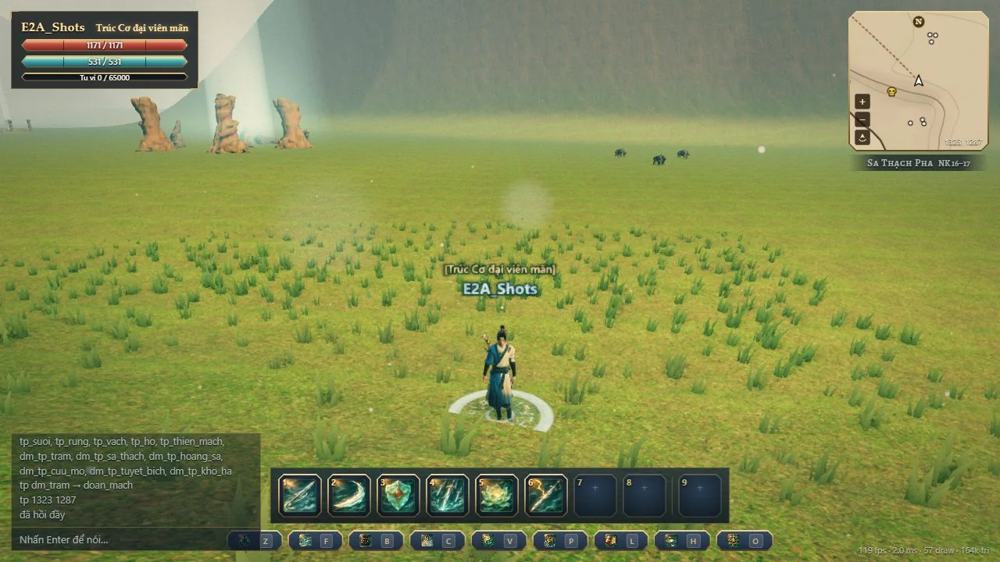
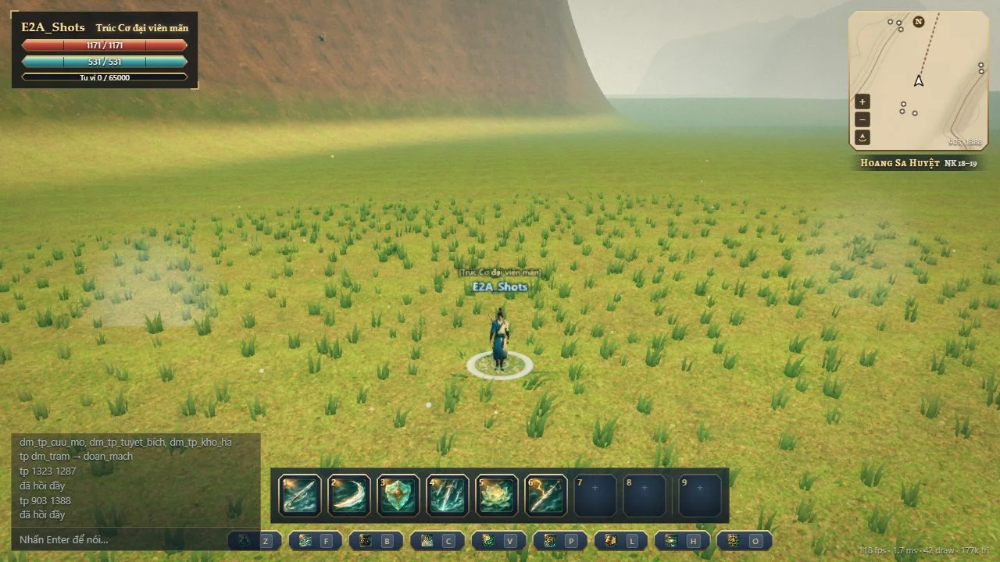
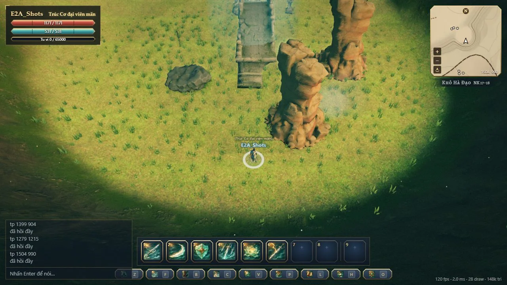

# E2-A: Đoạn Mạch Cổ Cốc (bản đồ 2, cấp 16–19)

> **Ghi chú R-1 (2026-11-18):** ảnh/video duyệt PR của hạng mục này đã gỡ khỏi repo; thư mục chỉ giữ tối đa 5 ảnh then chốt (WebP). Tên file nhắc bên dưới mà không còn trong thư mục là ảnh đã gỡ, xem lại bằng `git show c78b50c6:docs/e2-map/<file>`.

Gói E2-A của E-2 Kết Đan (`docs/EXPANSION_DESIGN.md` mục 4.1, 10.2, 11.2). Chỉ dữ liệu level, địa hình, trận truyền tống, chuỗi; không đụng sim server hay engine client.

## Đã có

| Thứ | Ở đâu |
| --- | --- |
| Địa hình dữ liệu hóa (`TerrainDef`) | `packages/content/data/levels/doan_mach.terrain.json`, đăng ký ở `packages/content/src/index.ts` (`registerTerrain`) khi nạp `@dtl/content` |
| Level: 5 vùng, 75 cụm, 12 tinh anh, boss, 5 điểm đáng chú ý, 3 điểm tài nguyên, điểm vào | `packages/content/data/levels/doan_mach.json` |
| Khai báo asset client của level | `packages/content/data/levels/doan_mach.assets.json` (E1-D) |
| Trận truyền tống `dm_*` (6) và `tp_thien_mach` (Vân Lam) | `packages/shared/src/teleport.doanmach.ts`, `teleport.ts` |
| Prop bày (48, asset sẵn có) | `packages/shared/src/props.doanmach.ts`, nối vào `propsOf('doan_mach')` |
| Chuỗi: `zone.*`, `poi.*`, `tele.*`, `map.doan_mach`, tên quái; glossary `maps`, `zones`, `teleports`, `pois` | `packages/content/data/i18n/vi.json`, `glossary.json` |
| Điểm đặt tên `?at=` / `/gm tp` (`dm_tram`, `dm_sa_thach`, `dm_kho_ha`, `dm_hoang_sa`, `dm_cuu_mo`, `dm_tuyet_bich`, `dm_boss`) | `packages/content/data/places.json` |
| Nền minimap | `apps/client/public/map/doan_mach.{webp,json}` (`pnpm minimap:build --level doan_mach`) |
| Bộ sinh tất định | `tools/maps/gen-doan-mach.mjs` (sửa số liệu ở đây rồi chạy lại, sinh 5 tệp ở trên), `tools/maps/apply-content-doan-mach.py` (chuỗi + quái tạm, chạy một lần) |
| Ảnh chụp trong game | `pnpm shots:e2a --out <thư mục>` (`tools/perf/src/shots-e2a.ts`: vào bằng `/gm tp dm_tram`, tới từng điểm, chụp cả bản đồ lớn) |

## Bố cục

Trạm Hạ Khuyết ở tâm (đĩa 75 m, không quái). Năm vùng tỏa ra như năm nhánh hẻm; biên giữa các vùng uốn lượn. Mỗi vùng có một lòng sông cạn (dải phẳng thấp hơn cao nguyên chừng 50 m) chạy dọc đường giữa vùng, trận truyền tống đứng trên lòng sông; hố boss ở cuối nhánh Đoạn Mạch Tuyệt Bích. Tọa độ so với trạm (+x đông, +z nam):

| Vùng | Cấp | Hướng | Tinh anh |
| --- | --- | --- | --- |
| Sa Thạch Pha | 16–17 | đông nam | Liệt Cốt Báo Vương ×2 |
| Khô Hà Đạo | 17–18 | đông | Hộ Mạch Khôi Tướng ×2 |
| Hoang Sa Huyệt | 18–19 | nam | Xích Sa Ngô Công ×3 |
| Cựu Mỏ Khu | 18–19 | tây | Hộ Mạch Khôi Tướng ×2, Liệt Cốt Báo Vương ×1 |
| Đoạn Mạch Tuyệt Bích | 19 | bắc | Xích Sa Ngô Công ×2; boss Địa Mạch Long (30, −620) |

Tổng: 75 cụm, 231 quái thường, 12 tinh anh, 1 boss. Vùng săn 1,80 km² → **128,5 quái/km²** (`content:check`: 100–140). Số cụm mỗi vùng xem `levels/doan_mach.json` (cụm rải đều toàn bản đồ, không theo chỉ tiêu từng vùng). Điểm đáng chú ý: Mạch Tinh Trụ, Cầu Đá Gãy, Hố Sa Lún, Cổng Mỏ Khai Mạch, Vách Đứt Mạch (mỗi vùng một, ≥ 5 prop quanh).

## Đường đi

- Vân Lam → Đoạn Mạch: trận `dm_tp_tram` (Hạ Khuyết Trạm). **Không mở sẵn** (`TELE_FREE` giữ nguyên): mở khóa lần đầu bằng nhiệm vụ chương 2 (E2-H) hoặc `/gm tele dm_tp_tram`; tới nơi thì trận tự mở (điểm đến cách trận 3 m < `TELE_TOUCH_R`). Niệm 5 s, đi qua vé một lần của E1-B.
- Về: `tp_tong_mon` (mở sẵn) hoặc `tp_thien_mach` (Thiên Mạch Đài, bệ phía bắc Chính điện, mở khi chạm).
- Hồi sinh ở trạm (`spawn` của level). Mỗi vùng một trận `dm_tp_<vùng>`, đứng trên lòng sông cách trạm 280–430 m.

## Số đo (`pnpm map:report --level doan_mach`)

| | |
| --- | --- |
| Cụm / quái thường / tinh anh / boss | 75 / 231 (cụm 3 con, một phần 4 con; không còn quái đánh xa kèm cụm) / 12 / 1 |
| Mật độ vùng săn | 128,5 quái/km² (đạt 100–140) |
| Chỗ kẹt (4991 điểm quét) | **0** |
| Độ phủ chuẩn mới: khoảng cách tới **mép cụm** gần nhất (lưới 12 m, 12 414 điểm) | 99,2 % ≤ 70 m, p50 32,5 m, **p95 61,4 m, max 84,4 m** |
| Chuẩn cũ (≤ 35 m tới từng quái, chỉ để so; Vân Lam giữ chuẩn này) | 28,1 % (trước đổi 23,3 %) |

**Chuẩn độ phủ theo level** (`packages/content/src/coverage.ts`, `COVER_BY_LEVEL`): Vân Lam giữ ≤ 35 m tới quái (đo ở `mapreport.ts`); bản đồ mở rộng đo khoảng cách từ mỗi điểm trong vùng săn tới mép cụm gần nhất (tâm cụm trừ bán kính; đấu trường quanh boss bán kính 60 m không tính). `content:check` (`levelcheck.ts`) cứng: **p95 ≤ 65 m và max ≤ 85 m** cho `doan_mach`; level khác dùng `DEFAULT_COVER` (cùng số). `map:report` in thêm mục này.

**Vì sao max là 84 m chứ chưa phải 70 m:** mật độ 100–140 quái/km² với cụm 3–4 con, bán kính tối đa 30 m, chỉ cho hình học xấp xỉ sau (cùng đa giác vùng săn 1,80 km²):

| Số cụm | Mật độ | Điểm xa nhất tới mép cụm |
| --- | --- | --- |
| 75 (bản này) | 128,5 | 84 m (p95 61 m) |
| 83 | 138,5 | 75 m (p95 58 m) |
| ≈ 90 | ≈ 150 | ≈ 70 m (vượt trần 140) |

Muốn 100 % điểm ≤ 70 m phải nâng trần mật độ lên ≈ 150 quái/km² hoặc cho cụm 2 con. Bản này chọn 128,5 quái/km² (giữ ~120 theo quyết định) và ghi ngưỡng cứng 85 m; đổi ngưỡng là sửa `COVER_BY_LEVEL`. Cụm được rải bằng lưới lục giác chọn bước/góc tốt nhất, tối ưu vị trí rồi vá điểm xa nhất (`tools/maps/gen-doan-mach.mjs`).

## Ảnh để duyệt

| | |
| --- | --- |
| Bố cục nhìn từ trên (map:report: địa hình, ranh vùng, bãi quái, tinh anh vàng, boss đỏ) |  |
| Nền minimap (đồng mức mực, ranh vùng, đường mòn tỏa từ trạm) | _(ảnh đã gỡ)_ |
| Bản đồ lớn (phím M) |  |
| Sa Thạch Pha |  |
| Khô Hà Đạo | _(ảnh đã gỡ)_ |
| Hoang Sa Huyệt |  |
| Cựu Mỏ Khu | _(ảnh đã gỡ)_ |
| Cầu Đá Gãy |  |
| Mạch Tinh Trụ | _(ảnh đã gỡ)_ |
| Cổng Mỏ Khai Mạch | _(ảnh đã gỡ)_ |
| Vách Đứt Mạch | _(ảnh đã gỡ)_ |
| Tinh anh Liệt Cốt Báo Vương | _(ảnh đã gỡ)_ |
| Boss Địa Mạch Long (toàn thân, cùng người chơi) | _(ảnh đã gỡ)_ |

Trong game mặt đất vẫn là cỏ xanh Vân Lam, chưa có tông đất son "cốc đứt mạch": bộ texture ochre, mood, cỏ/cây riêng là việc của E2-I (mỹ thuật). Ảnh chỉ chứng minh địa hình, bố cục, quái, prop PROP_LIB và đường vào.

## Prop (PROP_LIB #118 đã dùng)

Điểm đáng chú ý dùng prop PROP_LIB của `doan_mach` (`prop_mach_tinh_tru`, `prop_tru_nham_do`, `prop_cau_da_gay`, `prop_cong_khai_mach`, `prop_cay_goc_kho`, `prop_ngung_dan_lo` ở trạm) cộng vài prop Vân Lam làm đệm (đá, đèn đá, bia, kiếm gãy, lều, lò đan). Bán kính va chạm theo `propLib.ts`; `levelcheck` cho prop va chạm ≤ 4,5 m ở level mới (Vân Lam giữ 1,5 m). Client có cấu hình vẽ (`PROP_CFG`) cho 6 id mới. Chưa dùng: `prop_da_troi`, `prop_tru_da_khac_van` (thuộc bản đồ khác).

Để lại cho các gói khác (không nằm trong E2-A):

- **E2-B**: `monsters.json`/`loot.json` có **bản tạm** cho 4 quái thường, 3 tinh anh, boss `boss_dia_mach_long` (chỉ để `content:check` qua: chưa có `charge`/`leap`/`dig`, tinh anh dùng `caster`); E2-B thay bằng bản có AI riêng, có thể xung đột chỗ cuối hai tệp này (giữ bản của E2-B). Bài test `skinned.test.ts` ("12 skin E-0") đã sửa để không coi quái có dòng là "chưa có".
- **E2-I**: texture ochre cho `ground` (`doan_mach.assets.json` đang `neutral`), mood, nhạc (`wild_ochre`, `cave_lull`, `boss_dia_mach`: hiện cả năm vùng dùng `wild` vì `MUSIC_ZONES` chưa có), cỏ/cây/đá riêng; client còn vẽ cỏ Vân Lam ở level này. Prop theo `propsOf(level)` đã được vẽ (`allProps(level)`, `trees: scatter` trong `doan_mach.assets.json`; chỉ prop đặt tay, chưa rải cây/đá tự động).
- **Client**: đã sửa trong PR này: tên vùng/tiêu đề bản đồ lớn ở chỗ không thuộc vùng nào lấy `map.<level>` (`areaKey`), nhãn cấp `NK19` khi min = max (`ui.mm.zone_lv1`).
- **E2-H**: mở khóa `dm_tp_tram` bằng nhiệm vụ; NPC (Hứa lão, Tô Vãn Ngư) đặt ở trạm; `nodes` dùng tạm `itm_linh_thao` đến khi E2-F có Hoàng Sa Thảo.
