# E2-A: Đoạn Mạch Cổ Cốc (bản đồ 2, cấp 16–19)

Gói E2-A của E-2 Kết Đan (`docs/EXPANSION_DESIGN.md` mục 4.1, 10.2, 11.2). Chỉ dữ liệu level, địa hình, trận truyền tống, chuỗi; không đụng sim server hay engine client.

## Đã có

| Thứ | Ở đâu |
| --- | --- |
| Địa hình dữ liệu hóa (`TerrainDef`) | `packages/content/data/levels/doan_mach.terrain.json`, đăng ký ở `packages/content/src/index.ts` (`registerTerrain`) khi nạp `@dtl/content` |
| Level: 5 vùng, 60 cụm, 12 tinh anh, boss, 5 điểm đáng chú ý, 3 điểm tài nguyên, điểm vào | `packages/content/data/levels/doan_mach.json` |
| Khai báo asset client của level | `packages/content/data/levels/doan_mach.assets.json` (E1-D) |
| Trận truyền tống `dm_*` (6) và `tp_thien_mach` (Vân Lam) | `packages/shared/src/teleport.doanmach.ts`, `teleport.ts` |
| Prop bày (48, asset sẵn có) | `packages/shared/src/props.doanmach.ts`, nối vào `propsOf('doan_mach')` |
| Chuỗi: `zone.*`, `poi.*`, `tele.*`, `map.doan_mach`, tên quái; glossary `maps`, `zones`, `teleports`, `pois` | `packages/content/data/i18n/vi.json`, `glossary.json` |
| Điểm đặt tên `?at=` / `/gm tp` (`dm_tram`, `dm_sa_thach`, `dm_kho_ha`, `dm_hoang_sa`, `dm_cuu_mo`, `dm_tuyet_bich`, `dm_boss`) | `packages/content/data/places.json` |
| Nền minimap | `apps/client/public/map/doan_mach.{webp,json}` (`pnpm minimap:build --level doan_mach`) |
| Bộ sinh tất định | `tools/maps/gen-doan-mach.mjs` (sửa số liệu ở đây rồi chạy lại, sinh 5 tệp ở trên), `tools/maps/apply-content-doan-mach.py` (chuỗi + quái tạm, chạy một lần) |
| Ảnh chụp trong game | `pnpm shots:e2a --out <thư mục>` (`tools/perf/src/shots-e2a.ts`: vào bằng `/gm tp dm_tram`, tới từng điểm, chụp cả bản đồ lớn) |

## Bố cục

Trạm Hạ Khuyết ở tâm (đĩa 75 m, không quái). Năm vùng tỏa ra như năm nhánh hẻm; biên giữa các vùng uốn lượn. Mỗi vùng có một lòng sông cạn (dải phẳng thấp hơn cao nguyên chừng 50 m) chạy dọc đường giữa vùng, trận truyền tống đứng trên lòng sông; hố boss ở cuối nhánh Đoạn Mạch Tuyệt Bích. Tọa độ so với trạm (+x đông, +z nam):

| Vùng | Cấp | Hướng | Cụm | Quái thường | Tinh anh |
| --- | --- | --- | --- | --- | --- |
| Sa Thạch Pha | 16–17 | đông nam | 11 | 39 | Liệt Cốt Báo Vương ×2 |
| Khô Hà Đạo | 17–18 | đông | 12 | 45 | Hộ Mạch Khôi Tướng ×2 |
| Hoang Sa Huyệt | 18–19 | nam | 12 | 45 | Xích Sa Ngô Công ×3 |
| Cựu Mỏ Khu | 18–19 | tây | 15 | 61 | Hộ Mạch Khôi Tướng ×2, Liệt Cốt Báo Vương ×1 |
| Đoạn Mạch Tuyệt Bích | 19 | bắc | 10 | 38 | Xích Sa Ngô Công ×2; boss Địa Mạch Long (30, −620) |

Tổng: 60 cụm, 228 quái thường (trong đó 3 quái đánh xa kèm cụm), 12 tinh anh, 1 boss. Vùng săn 1,80 km² → **126,8 quái/km²** (`content:check`: 100–140). Điểm đáng chú ý: Mạch Tinh Trụ, Cầu Đá Gãy, Hố Sa Lún, Cổng Mỏ Khai Mạch, Vách Đứt Mạch (mỗi vùng một, ≥ 5 prop quanh).

## Đường đi

- Vân Lam → Đoạn Mạch: trận `dm_tp_tram` (Hạ Khuyết Trạm). **Không mở sẵn** (`TELE_FREE` giữ nguyên): mở khóa lần đầu bằng nhiệm vụ chương 2 (E2-H) hoặc `/gm tele dm_tp_tram`; tới nơi thì trận tự mở (điểm đến cách trận 3 m < `TELE_TOUCH_R`). Niệm 5 s, đi qua vé một lần của E1-B.
- Về: `tp_tong_mon` (mở sẵn) hoặc `tp_thien_mach` (Thiên Mạch Đài, bệ phía bắc Chính điện, mở khi chạm).
- Hồi sinh ở trạm (`spawn` của level). Mỗi vùng một trận `dm_tp_<vùng>`, đứng trên lòng sông cách trạm 280–430 m.

## Số đo (`pnpm map:report --level doan_mach`)

| | |
| --- | --- |
| Quái thường / tinh anh / boss | 228 / 12 / 1 |
| Mật độ vùng săn | 126,8 quái/km² (đạt 100–140) |
| Chỗ kẹt (4889 điểm quét) | **0** |
| Độ phủ trong vùng săn, ≤ 35 m tới quái gần nhất | **23 %** (p50 59 m, p95 141 m, max 217 m) |

**Độ phủ ≤ 35 m không đạt, và không thể đạt cùng với mật độ 100–140.** Cả hai tính trên cùng đa giác vùng săn: mỗi quái chiếm ≥ 7 150 m² (140/km²) mà phải có điểm nào cũng cách quái ≤ 35 m (đĩa 3 850 m²), mà quái trong cụm lại dồn quanh tâm cụm (bán kính 26–30 m). Với 3,8 quái/cụm trần lý thuyết khoảng 25–30 %; đã dùng cụm lớn nhất (bán kính 26–30 m, 75 % cụm 4 con) và rải đều bằng lấy mẫu "điểm xa nhất" để đạt 23 %. Vân Lam đạt 99,6 % vì vùng săn của nó là các bãi nhỏ, dày hơn nhiều (ngưỡng M-1 tính theo số quái tuyệt đối, không theo mật độ). Cần chọn: (a) hạ ngưỡng độ phủ cho level mở rộng (ví dụ p50 ≤ 60 m), hoặc (b) thu đa giác vùng săn sát bãi quái (khi đó mật độ vượt 140; nâng trần hoặc tăng số quái). Tôi để (a) cho người dùng quyết.

## Ảnh để duyệt

| | |
| --- | --- |
| Bố cục nhìn từ trên (map:report: địa hình, ranh vùng, bãi quái, tinh anh vàng, boss đỏ) | 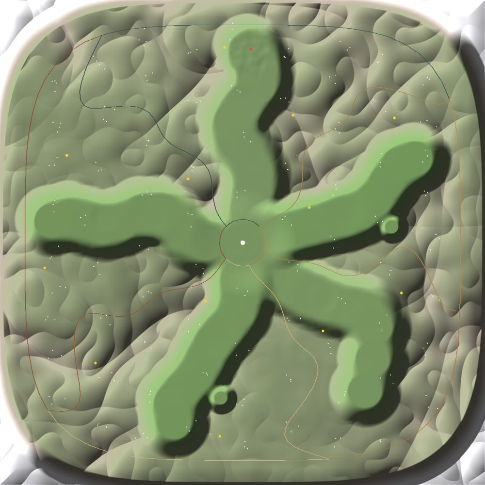 |
| Nền minimap (đồng mức mực, ranh vùng, đường mòn tỏa từ trạm) | 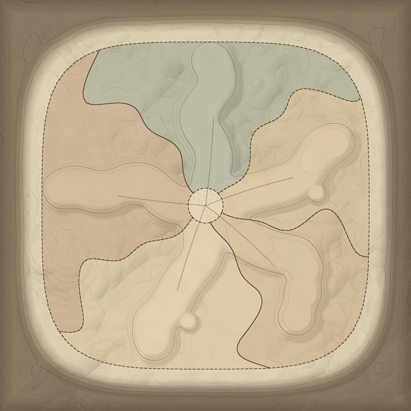 |
| Bản đồ lớn (phím M) |  |
| Sa Thạch Pha | 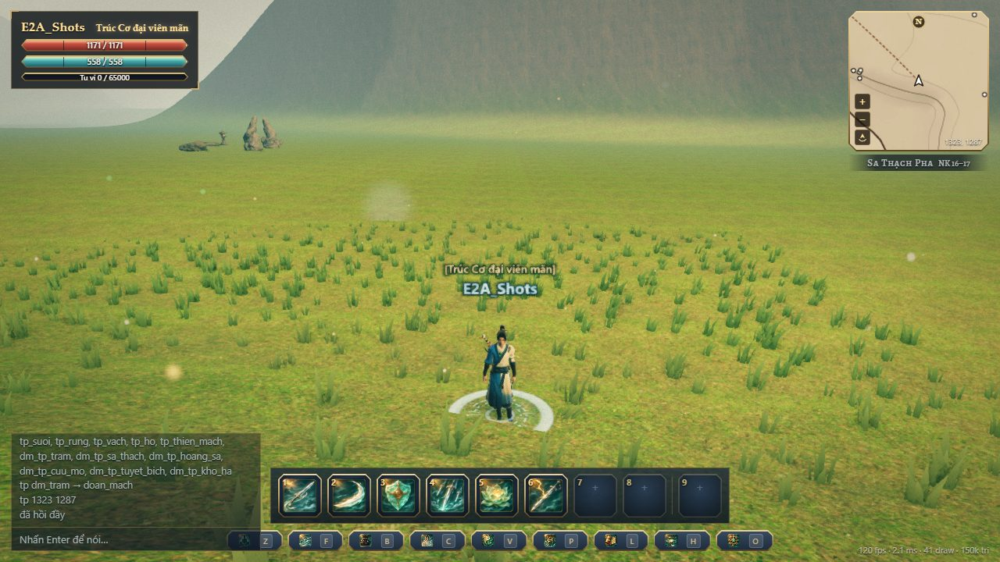 |
| Khô Hà Đạo | 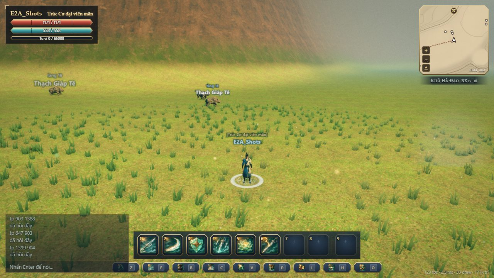 |
| Hoang Sa Huyệt | 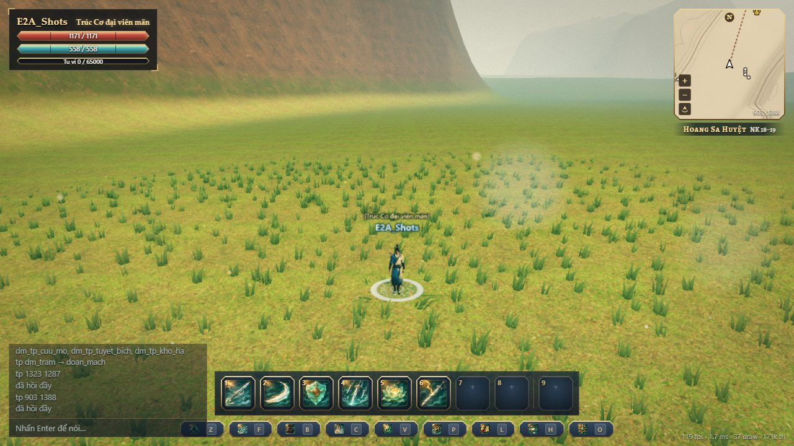 |
| Cựu Mỏ Khu | 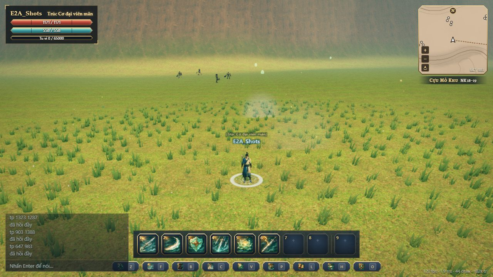 |
| Cầu Đá Gãy |  |
| Mạch Tinh Trụ | 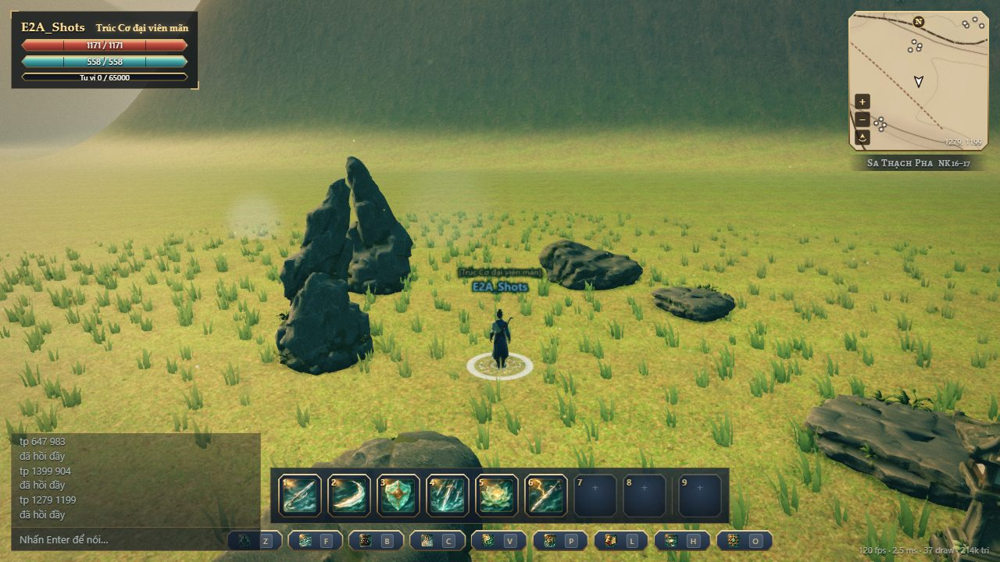 |
| Cổng Mỏ Khai Mạch | 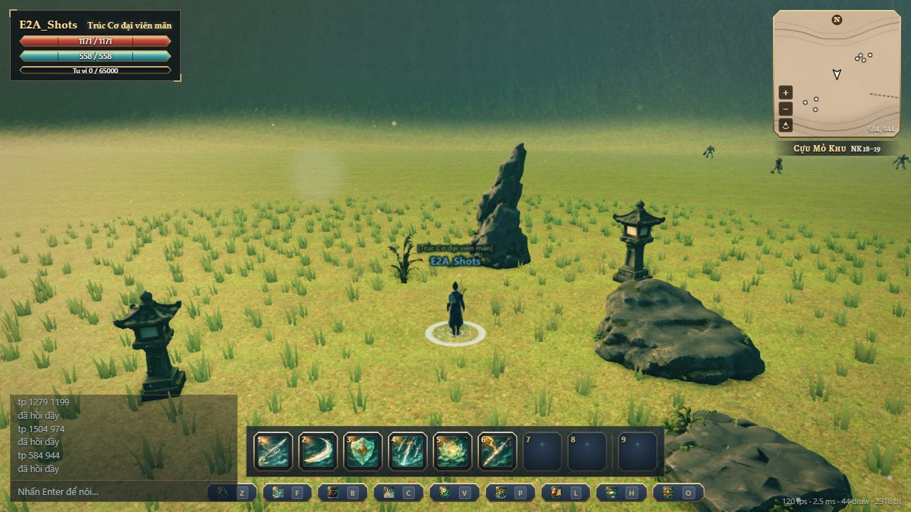 |
| Vách Đứt Mạch | 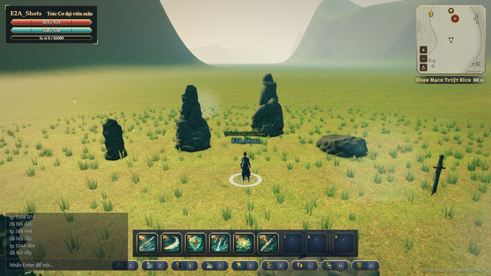 |
| Tinh anh Liệt Cốt Báo Vương | 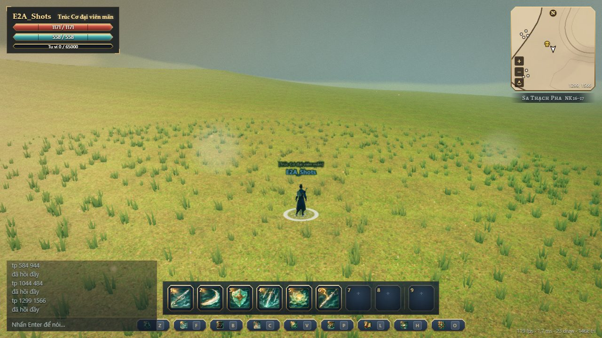 |
| Boss Địa Mạch Long (toàn thân, cùng người chơi) | 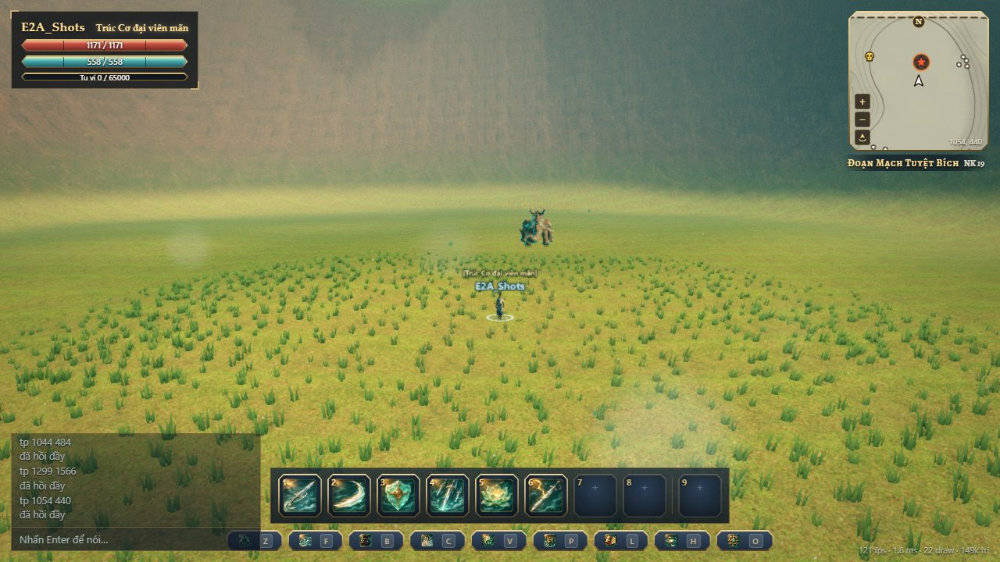 |

Trong game mặt đất vẫn là cỏ xanh Vân Lam, chưa có tông đất son "cốc đứt mạch": bộ texture ochre, mood, cỏ/cây riêng là việc của E2-I (mỹ thuật). Ảnh chỉ chứng minh địa hình, bố cục, quái, prop tạm và đường vào. Prop ở điểm đáng chú ý là đá/đèn đá Vân Lam dùng tạm; thay bằng PROP_LIB (#118) theo bảng dưới khi nó merge.

## Chỗ để PROP_LIB (#118) và việc kế tiếp

Chưa merge nên điểm đáng chú ý dùng prop sẵn có làm chỗ đứng (đá dựng, đá nằm, phiến đá, bia, kiếm gãy, đèn đá, lò đan, lều). Thay khi #118 vào (sửa `POI_KIT` ở bộ sinh, chạy lại):

| Điểm | Prop PROP_LIB |
| --- | --- |
| Mạch Tinh Trụ | `prop_mach_tinh_tru` (cột linh quang), `prop_tru_nham_do` quanh |
| Cầu Đá Gãy | `prop_cau_da_gay` |
| Hố Sa Lún | `prop_cay_goc_kho`, `prop_da_troi` |
| Cổng Mỏ Khai Mạch | `prop_cong_khai_mach`, `prop_lau` cho trại |
| Vách Đứt Mạch | `prop_tru_da_khac_van` |
| Trạm Hạ Khuyết | `prop_ngung_dan_lo` (đang dùng `prop_lo_dan`) |

Để lại cho các gói khác (không nằm trong E2-A):

- **E2-B**: `monsters.json`/`loot.json` có **bản tạm** cho 4 quái thường, 3 tinh anh, boss `boss_dia_mach_long` (chỉ để `content:check` qua: chưa có `charge`/`leap`/`dig`, tinh anh dùng `caster`); E2-B thay bằng bản có AI riêng, có thể xung đột chỗ cuối hai tệp này (giữ bản của E2-B). Bài test `skinned.test.ts` ("12 skin E-0") đã sửa để không coi quái có dòng là "chưa có".
- **E2-I**: texture ochre cho `ground` (`doan_mach.assets.json` đang `neutral`), mood, nhạc (`wild_ochre`, `cave_lull`, `boss_dia_mach`: hiện cả năm vùng dùng `wild` vì `MUSIC_ZONES` chưa có), cỏ/cây/đá riêng; client còn vẽ cỏ Vân Lam ở level này. Prop theo `propsOf(level)` đã được vẽ (`allProps(level)`, `trees: scatter` trong `doan_mach.assets.json`; chỉ prop đặt tay, chưa rải cây/đá tự động).
- **Client**: đã sửa trong PR này: tên vùng/tiêu đề bản đồ lớn ở chỗ không thuộc vùng nào lấy `map.<level>` (`areaKey`), nhãn cấp `NK19` khi min = max (`ui.mm.zone_lv1`).
- **E2-H**: mở khóa `dm_tp_tram` bằng nhiệm vụ; NPC (Hứa lão, Tô Vãn Ngư) đặt ở trạm; `nodes` dùng tạm `itm_linh_thao` đến khi E2-F có Hoàng Sa Thảo.
