# E2-C: Phục Mạch Quật (phó bản chương 2)

Gói E2-C (`docs/EXPANSION_DESIGN.md` 5.1, 11.2). Cấp 17+, 4–5 người, 5 đợt, boss Thôn Mạch Ngô Công Vương. Skin GLB người dùng đã nhập (#115/#116/#117), prop sẵn có, không Tripo, không dựng model mới.

## Cách vào

Đoạn Mạch Cổ Cốc → cổng đĩa sáng trước **Khai Mạch Cổng** (584, 970; `portals` trong `levels/doan_mach.json`) → bấm E. Server cấp vé một lần (15 s) → client vào room `dungeon-phuc_mach`; vé kiểm trong `static onAuth` (không vé = `no_ticket`, vé của level khác không bị đốt). `private: true` trong `levels/phuc_mach.json`: mỗi lượt vào là một room riêng, đồng đội cùng tổ đội trong 30 m và đủ cấp được kéo theo cùng khóa `dgKey` (người lạ không lọt vào). Kiếm Trủng giữ cách cũ (ghép chung room còn chỗ). Ra: cổng vàng ở điểm vào, hoặc tự đưa ra 20 s sau khi dẹp xong, về Đoạn Mạch tại `returnSpawn`.

## Dữ liệu (`packages/content/data/levels/phuc_mach.json`)

| Đợt | Nội dung | Ghi chú |
| --- | --- | --- |
| 1 | 8 Khai Mạch Khôi Lỗi (c18) | vòng quanh tâm |
| 2 | 4 Mạch Thương Hộ Vệ + 1 Hộ Mạch Khôi Tướng (c18) | khóa room khi vào đợt 2 (`lockAt`) |
| 3 | 10 Ngô Công Ấu (c18) ở 3 điểm riêng (`points` + `at`) | mỗi điểm tỏa trong 3 m |
| 4 | Thạch Tâm Khôi Vương (c18) | `reveal` = tim ngọc mở, mất thế |
| 5 | Thôn Mạch Ngô Công Vương (c19) | xem dưới |

Mới trong `DungeonDef`/`WaveDef`: `points`, `at`, `delay`, `title`, `lockAt`, `maxRevives` (2), `private`, `reward`. Hồi sinh: tối đa 2 lần mỗi người, lần thứ ba được hồi sinh rồi bị đưa ra ngoài.

**Thôn Mạch** (hpMul 75, xpMul 22, `posture` kiểu Hàn Giao): pha 1 `slam` + `chant` Thôn Mạch (kiểu mới `drain` 2%/s, hồi máu khi niệm; phá chú bằng ngắt/Trấn Hồn Linh/mất thế thì ngừng và boss choáng 4 s); từ 65% thêm `burrow` (3 vòng r 4, trồi đánh quạt 14 m báo 1,5 s), `summon` Ngô Công Ấu ×2 (tối đa 6), `reveal` sau chui; từ 35% `line` 22×3 m báo 1,2 s, tốc độ ×1,15; từ 10% tự bạo mạch (`chant` r 12 báo ~3,6 s, `mul` 4,6 ≈ 63% khí huyết người cấp 19 chưa mặc đồ; **ngắt được**, không phải không-ngắt-được như thiết kế gốc vì `content:check` bắt buộc cửa sổ ngắt ≥ 1,2 s).

**Thưởng**: rơi đồ từng quái ở `loot.json` (hai boss mới). Khi dẹp xong, `GameSim.grantDungeonReward` chạy một transaction: linh thạch, Ngưng Đan Mạch Tinh (3–4), Mạch Tinh Phiến, Tụ Khí Đan, mỗi bộ `set_liet_mach|dia_giap|phuc_mach` 40% một món (Huyền/Địa), khóa idem `dungeon:phuc_mach:<charId>:<ngày>` (ghi `ledger`), rồi cộng 15% tu vi cần của tầng hiện tại. Người đã dùng lượt thưởng hôm nay (`meta.dungeonDays[level]`) không nhận.

Nhiệm vụ `q2_phuc_mach`: chỉ hook; `afterJoin` phát `questEvent('dungeon')` như Kiếm Trủng. Nhiệm vụ chưa có trong `quests.json` (E2-H).

## Mỹ thuật (hang mỏ, art bible v3)

Lòng chảo Kiếm Trủng (địa hình Vân Lam, `terrain: van_lam`) dựng thành hang kín, bằng tài nguyên sẵn có:
- **Vỏ hang** (`game/caveShell.ts`, `LevelAssets.cave`): nửa quả cầu úp một lưới, màu theo đỉnh, nhiễu dịch đỉnh cho vách gồ ghề và trần sa xuống như thạch nhũ; chỉ chân vách được đèn rọi (nâu ấm, vân tầng đá), lên cao tắt thành đen. Che hết đường chân trời và bầu trời, nên không còn thiên thể nào. Server kéo người chơi về trong bán kính `bound` 90 m (`DungeonDef.bound`).
- **Ánh sáng**: đèn đá dọc lối vào và quanh sàn có quầng ấm và vũng sáng thật (point light, chỉ WebGPU); tinh thể mạch (`prop_mach_tinh_tru`, PROP_LIB #118) có quầng lam lục riêng, không vào bloom (tránh ô vuông billboard). Cổng ra là vòng sáng ấm mờ nằm trên nền, không còn đĩa vàng dựng đứng (hình bầu dục chói trước kia chính là đĩa cổng ra của Kiếm Trủng, không phải thiên thể).
- **Hạt**: bỏ bụi sáng và tro xám (trước đây tro của vùng Kiếm Trủng trông như tuyết); thay bằng vài đốm lửa ấm bay lên (`ember`, 2,2/s) và bụi đá nâu mịn rơi thưa (`ash` đổi màu ở level này).
- Mood `ochre_night`, texture mặt đất `terrain-ochre` (E2-I), vòng trụ đá, gốc khô, đá nằm (`shared/src/props.phucmach.ts`). Chưa có thạch nhũ/cột chống/xe mỏ dạng model (không có asset sẵn; trần nhũ chỉ là hình học vỏ hang).
- Ngân sách: 41–61 draw call, 217–349k tam giác, 120 fps ở 1280×720 (trước thêm vỏ hang: 55 draw).

Ảnh: `pnpm shots:e2c --out <thư mục tuyệt đối>`.

## Đo

- `pnpm sim:progress`: nhóm 4 × cấp 18, sạch thuần 10,3 phút, kể cả lỡ tay lần đầu 18,6 phút (mục tiêu ~20; sim báo LỖI nếu ngoài 15–25). Hệ số trong `packages/content/src/sim.ts` (hiệu suất 0,7/0,6, nghỉ 45 s, vào 60 s, lỡ tay ×1,8) là giả định chưa kiểm bằng người thật. Cân boss: tự bạo mạch đo trong test.
- Test `apps/server/src/game/phucmach.test.ts` (14): dữ liệu đợt, vé, kéo tổ đội, điểm sinh, khóa room, thưởng một lần/ledger, hồi sinh, hút mạch, pha, tự bạo.
- Playtest: vào bằng cổng thật, room `dungeon-phuc_mach`, 5 đợt, 0 lỗi console, 120 fps / 59 draw / 341k tam giác ở boss.

## Ảnh

| | |
| --- | --- |
| Cổng ở Đoạn Mạch | 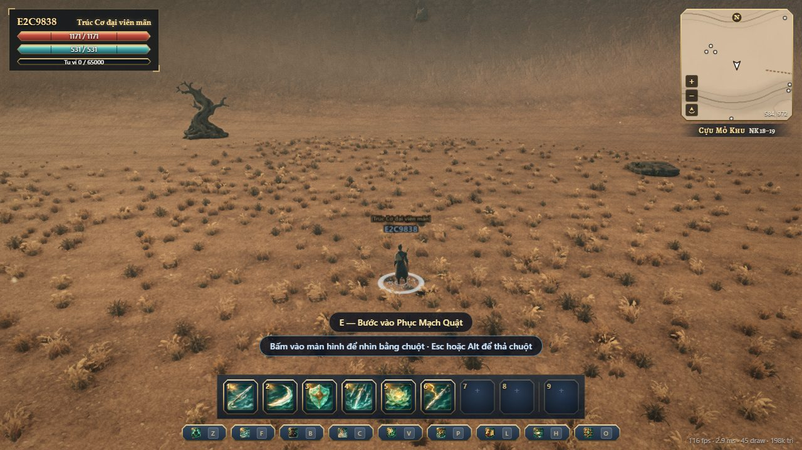 |
| Vào hầm | 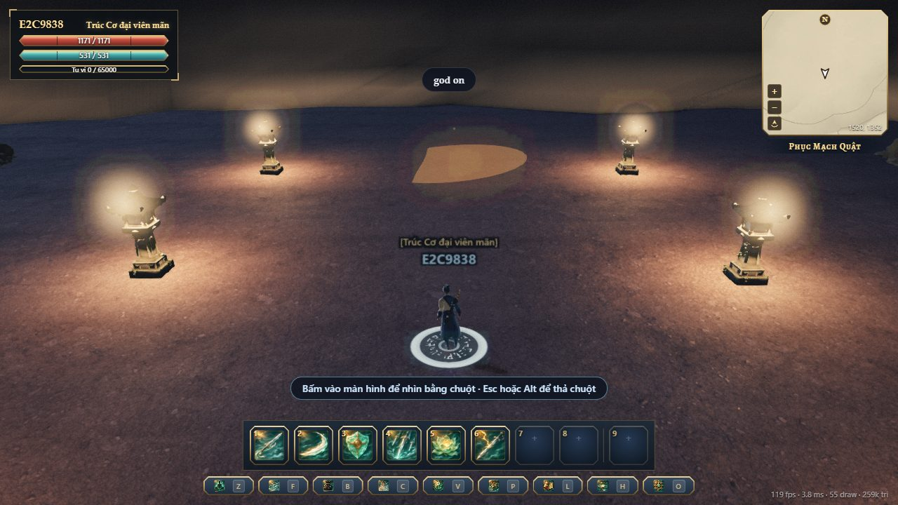 |
| Vách hang và trần tối | 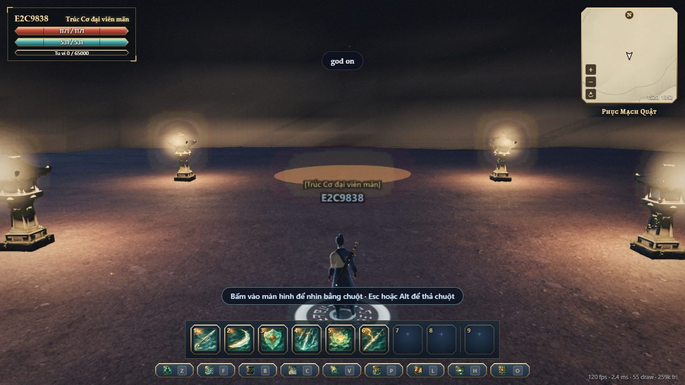 |
| Đợt 1 khôi lỗi | 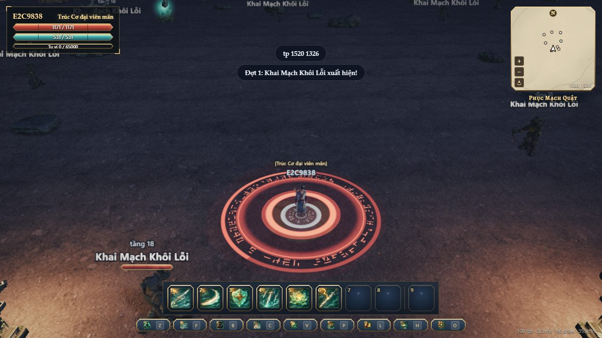 |
| Đợt 2 hộ vệ + khôi tướng | 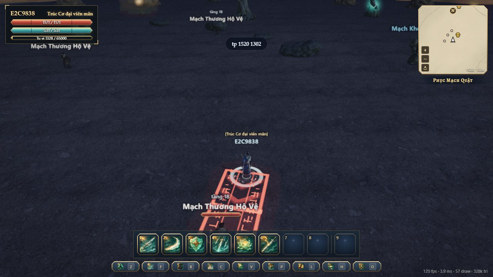 |
| Đợt 3 ngô công ấu (ba điểm trên minimap; rết nhỏ nên khó thấy từ trên cao) | 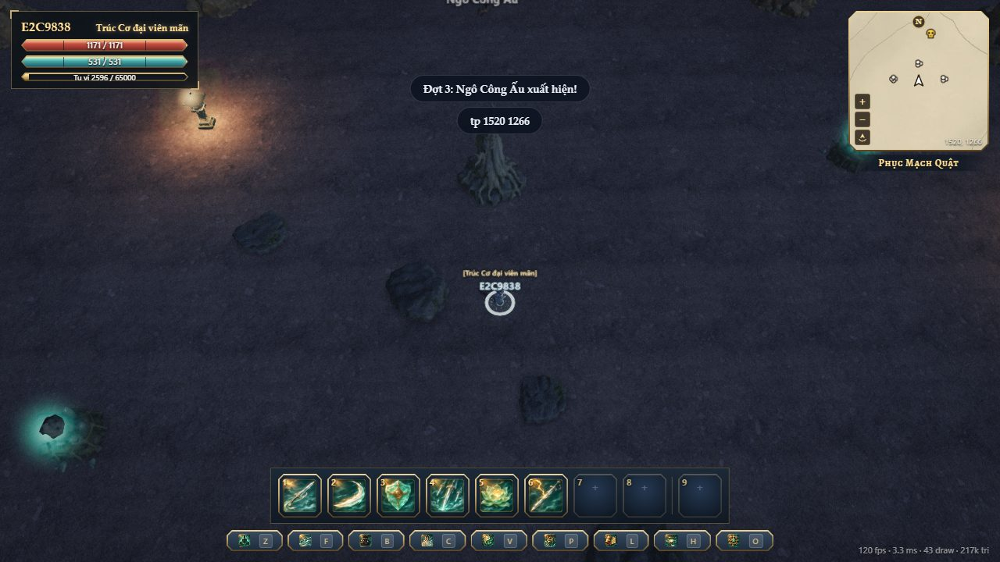 |
| Thạch Tâm: vạch đập | 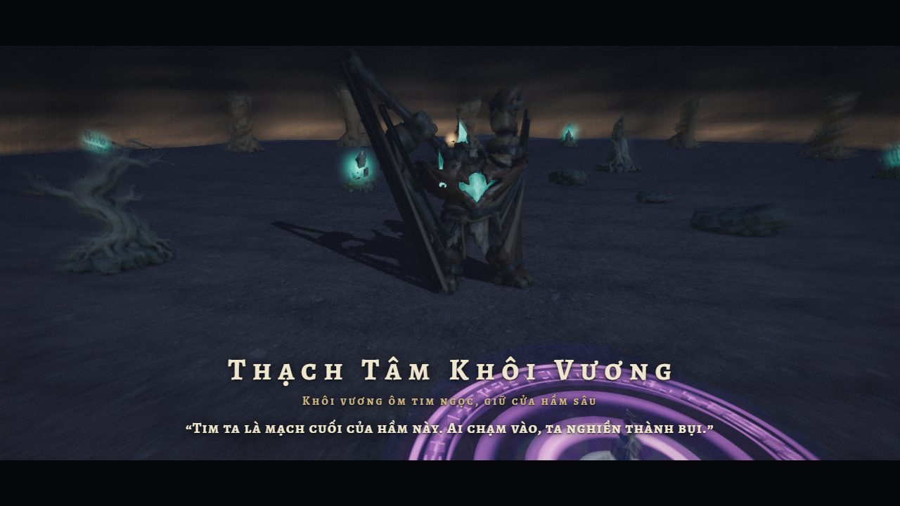 |
| Thạch Tâm: vạch đường | 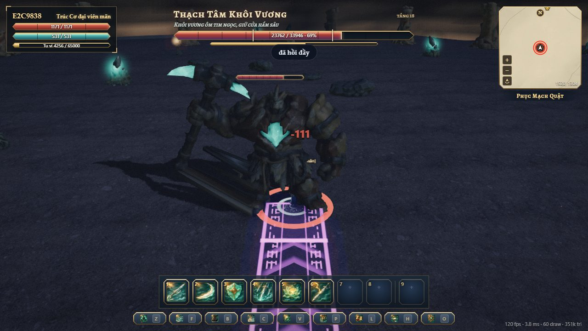 |
| Thôn Mạch: slam | 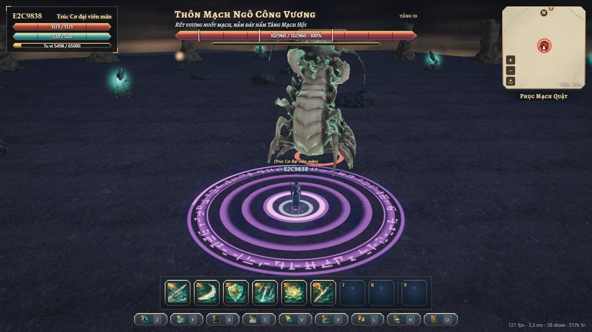 |
| Thôn Mạch: niệm Thôn Mạch (r 12) | 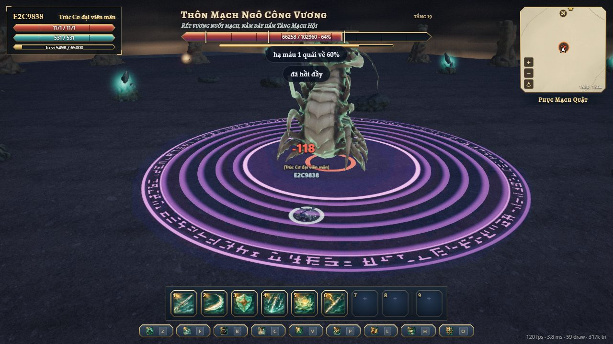 |
| Thôn Mạch: slam ở pha 35% | 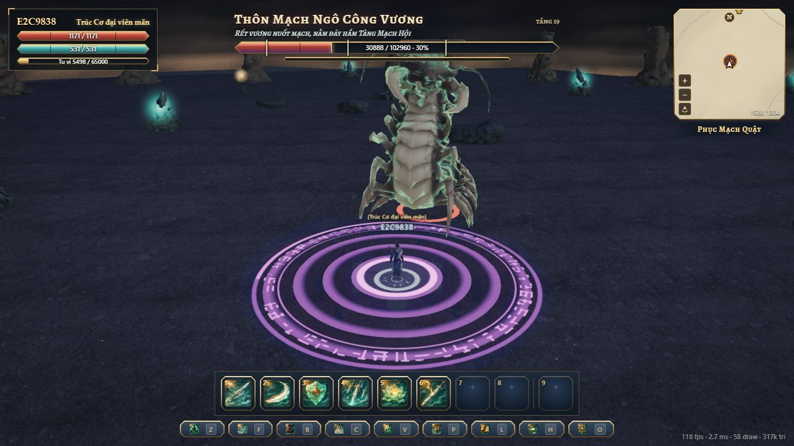 |
| Thôn Mạch: vạch dài 22×3 m (từ 35% máu) | 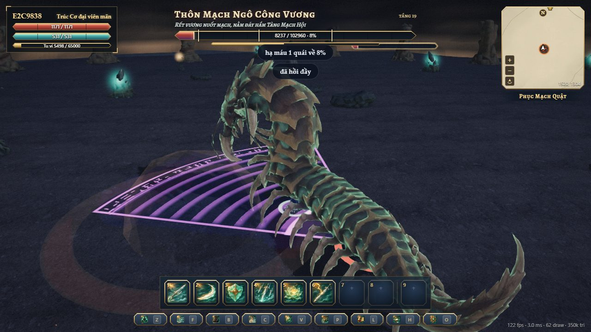 |

`hazards.json`: vạch báo client ghi được mỗi pha.

## Giới hạn / việc để lại

- Hầm hình chữ Y chưa có: dùng lòng chảo tròn Kiếm Trủng của Vân Lam (chưa có địa hình hầm riêng; không dựng model mới).
- Ảnh pha tự bạo (≤10% máu) không bắt được trong kịch bản (cơ chế đã test ở server); minimap dùng nền Vân Lam.
- Phải chơi với 4 người thật để kiểm 20 phút; cổng không có hướng dẫn nhiệm vụ cho tới E2-H.
- Sửa kèm: `items.json` trùng id `itm_ngung_dan_mach_tinh` (E2-D và E2-F cùng thêm) làm `content:check` đỏ trên main; giữ bản của E2-F (bậc 2).
