# E3-B: quái, tinh anh, boss Vân Hải Phù Đảo

Gói E3-B (`docs/EXPANSION_DESIGN.md` 6.2, 5.4, 11.2). Thay quái tạm của Đoạn Mạch trên bản đồ E3-A bằng quái riêng; dùng skin GLB người dùng đã nhập (#115–#117), không Tripo, không dựng model mới. Vị trí cụm/tinh anh giữ nguyên của E3-A (chạy lại `node tools/maps/gen-van-hai.mjs`: chỉ đổi loại quái và thêm boss; mật độ, độ phủ, chỗ kẹt không đổi).

> Sau khi merge main (#149 Kính Nguyệt Cung): `mon_kinh_linh`, `mon_phu_dao_thach_quy`, `elite_kinh_dien_ma_quan` đã được #149 định nghĩa trước (dùng chung với phó bản), nên giữ bản của #149 (chiêu và bảng rơi `dungeon` khác bảng chiêu ghi dưới đây cho ba con này, ví dụ Thạch Quy dùng `charge`). Ảnh của ba con này chụp theo bản cũ của gói này.

## Dữ liệu (`packages/content/data/monsters.json`, `loot.json`, `levels/van_hai.json`)

| Đảo (cấp) | Quái thường | Tinh anh | Ghi chú |
| --- | --- | --- | --- |
| Tùng Đài (20–21) | Vân Hạc, Bích Ngọc Kim Thiền | Tuyết Vũ Vân Hạc Vương ×2 | |
| Thạch Quy (21–22) | Phù Đảo Thạch Quy, Vân Hạc | Lôi Vân Sư Vương ×3 | |
| Kính Hồ (21–22) | Kính Linh | Kính Diện Ma Quân ×2 | |
| Lôi Vân (22–23) | Kính Linh, Vân Hạc | Lôi Vân Sư Vương ×2, Kính Diện Ma Quân ×1 | |
| Kình Ngư Đài (23) | Vân Hạc, Bích Ngọc Kim Thiền | Vân Hạc Vương ×2 | **Boss Vân Hải Kình Vương** ở tâm đảo, hồi sinh 30 phút |

30 cụm × 3 = 90 quái thường (140 quái/km², tới 0,643 km²), 12 tinh anh, 1 boss. Mỗi điểm săn cách mép cụm gần nhất p95 64,6 m, max 83 m (chuẩn `COVER_BY_LEVEL.van_hai`, không đổi so với E3-A).

| Quái | Hệ | Chiêu (vạch báo) |
| --- | --- | --- |
| Vân Hạc (bay 2,2 m) | Thủy | `caster` đạn lông: 3 viên tản 20°, v 10 |
| Bích Ngọc Kim Thiền (bay 1,1 m) | Mộc | `line` đâm thẳng 6×1,2 m báo 0,9 s |
| Phù Đảo Thạch Quy | Thổ | `leap` giậm r 5 báo 1,8 s |
| Kính Linh | Kim | combo + `reflect` giơ khiên 2 s (nhận 40%, phản 30%) |
| Tuyết Vũ Vân Hạc Vương (bay 3,2 m) | Thủy | mưa lông: 5 đạn tản 30° + combo |
| Kính Diện Ma Quân | Kim | cắt kiếm bạc: nón 10 m, 30°, báo 1,2 s; `reflect` 3 s |
| Lôi Vân Sư Vương | Hỏa | sấm vùng r 4 báo 1,2 s quanh người chơi; `leap` r 4 báo 1 s rồi lộ yếu điểm |
| **Vân Hải Kình Vương** (bay 5 m, scale 0,55 ≈ 10 m) | Thủy | **Cuốn sóng mây** `line` 40×6 m báo 2 s; **vây rơi** `slam` r 7 báo 1,5 s; **cửa sổ đánh** `reveal` mỗi 25 s trong 6 s (nhận ×1,5, ngoài lúc lộ ×0,8, lấp phá thế). Pha 70%: `sweep` nón 18 m 40°. Pha 50%: cuốn sóng dồn (báo 1,8 s). Pha 30%: **Nuốt** `chant` r 8, niệm 2,6 s (ngắt được) + vây rơi dồn |

Chiêu "kéo người chơi về miệng" của Nuốt (thiết kế 5.4) **chưa làm**: server chưa có kiểu kéo, nên Nuốt tạm là chú nổ vùng r 8 như Địa Mạch Long. Kim Thiền chết phun độc r 2 cũng chưa có (cần hook khi chết). Chuỗi lời boss: `mon.boss_van_hai_kinh_vuong.say.*`.

`check.ts`: trần `line.r` của boss nới 30 → 40 m (thiết kế 40×6).

### Rơi đồ và thưởng

Chỉ ở `loot.json` (server). Quái/tinh anh/boss Vân Hải đã nằm trong lớp `$mats` từ E3-F (Kính Hoa Sa, Vân Hải Lộ, Bích Ngọc Nhĩ) nên nguyên liệu bậc 3 chạy ngay; thêm Ngưng Anh Phách (tinh anh 8%, boss 75%), gem hệ, phẩm trang bị theo luật `content:check` (thường Phàm/Linh, tinh anh chủ yếu Huyền, boss Địa/Thiên). Mọi rơi/linh thạch đi qua đường nhặt đã có (transaction + idempotency + ledger); `pnpm ledger:check` khớp sau 100 + 40 bot.

## Bay lơ lửng (`MonsterDef.hover`, chỉ hình)

- Trường mới `hover` (m) ở `packages/shared/src/types.ts`; server **không đổi**: quái vẫn đứng trên mặt đất (vị trí, tầm đánh, nhắm, vạch báo, đạn đều theo mặt sàn; test `vanhai.mobs.test.ts` ghim `s.y == groundAt`). Vì thế vạch báo luôn nằm đúng mặt sàn (xem ảnh) và vòng chọn mục tiêu ở chân.
- Client (`apps/client/src/game/hover.ts`, nối ở `entities.ts`): nâng `root` lên `hover`, nhấp nhô ±0,28 m (chu kỳ 3,6 s, pha lệch theo id); hạ xuống 30% khi quái lộ yếu điểm hoặc choáng/quỵ (`MF_WEAK | MF_STUN`); chết thì hạ hẳn xuống đất. Nhãn tên, thanh máu đi theo `root` nên cùng nâng.
- Quái bay: Vân Hạc 2,2; Kim Thiền 1,1; Vân Hạc Vương 3,2; Kình Vương 5.

## Sửa lỗi hình Vân Hải Kình Vương

- **Chết bị méo/vặn**: clip `death` dùng chung kiểu bò (gập cổ 108°, uốn đuôi S 40°, xoay cổ 42°) làm lưới vây rộng của kình ngư bị kéo thành vệt. `tools/blender/anim_serpent.py` có nhánh riêng cho `style: swim`: đầu cúi dần (≤ 34°), đuôi buông (≤ 10°), uốn S ≤ 5°, hạ thân 3% chiều dài; kiểu bò (ngô công, giao) giữ nguyên. GLB build lại (`--only boss_van_hai_kinh_vuong`, `boss_van_hai_kinh_vuong.f25d703e15.glb`, 1,74 MB). Máy này không có `toktx` nên texture giữ PNG/JPEG (kích thước tương đương bản cũ 1,79 MB; nếu có KTX-Software thì build lại cho gọn hơn).
- **Scale**: 0,55 (≈ 10 m dài so với người 1,8 m; GLB gốc 18 m quá lớn so với đấu trường 207 m).
- Số đo: `pnpm sim:progress` 4 người cấp 23 hạ trong **81 s** (Địa Mạch Long 82 s; `hpMul` 80 → 62). TTK quái thường (`fight:check --levels 20,23`): Vân Hạc 4–7 s, Kính Linh 5–8 s, Thạch Quy 4–7 s, Kim Thiền 2,6–6 s (bầy, máu thấp theo thiết kế). Tinh anh `hpMul` 7,8–9,5 (design × 1,35 như E2-B).

## Ảnh (`pnpm shots:e3b --out <thư mục tuyệt đối>`, `?mute=1`, `--mute-audio`; 6 khung chiêu + 3 khung chết)

| | |
| --- | --- |
| Vân Hạc (Tùng Đài) | 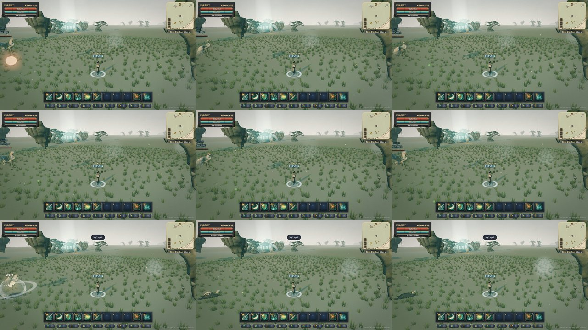 |
| Bích Ngọc Kim Thiền (Tùng Đài) | 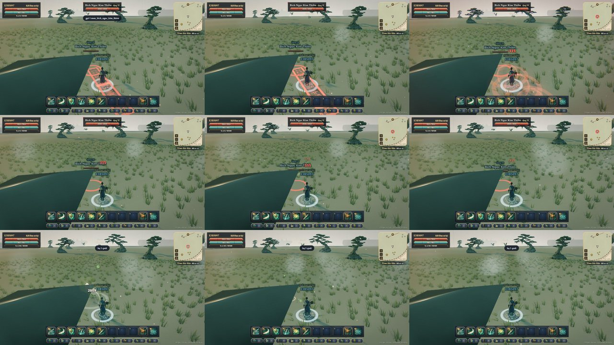 |
| Phù Đảo Thạch Quy (Thạch Quy) | 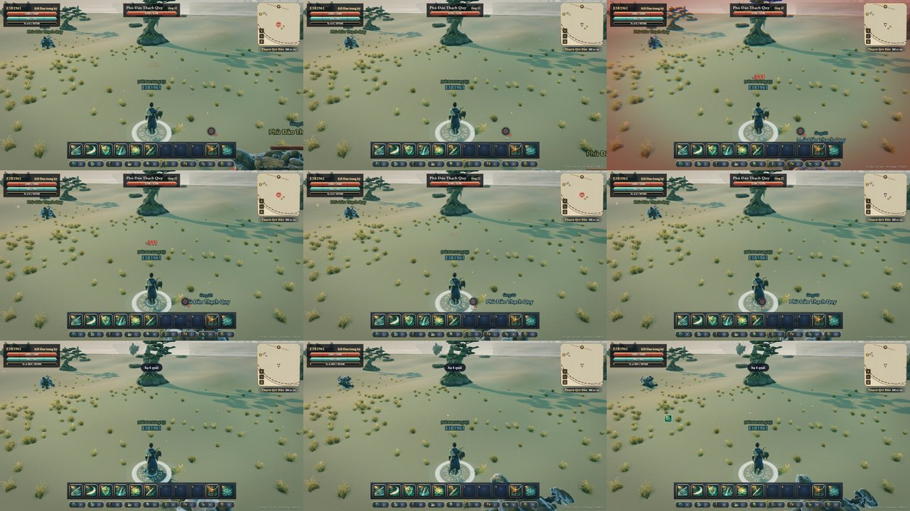 |
| Kính Linh (Kính Hồ) | 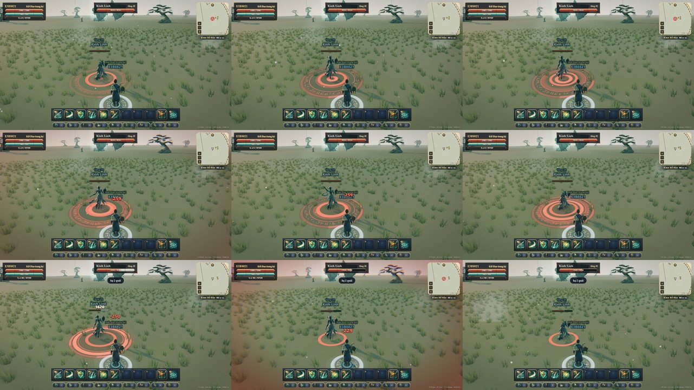 |
| Tuyết Vũ Vân Hạc Vương | 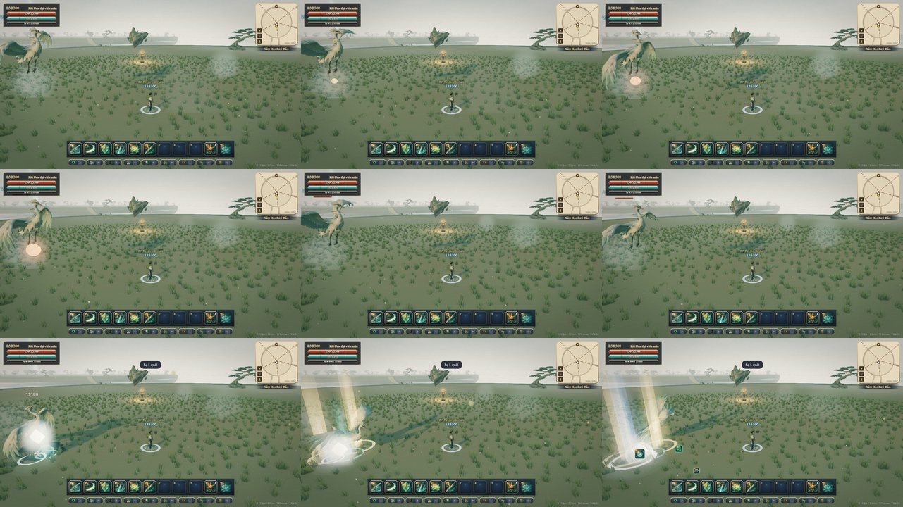 |
| Kính Diện Ma Quân | 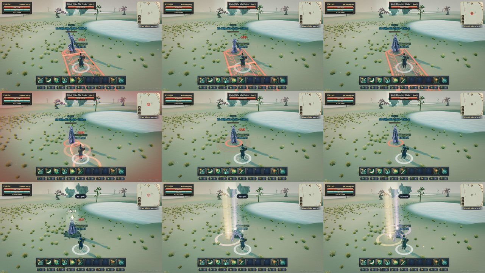 |
| Lôi Vân Sư Vương | 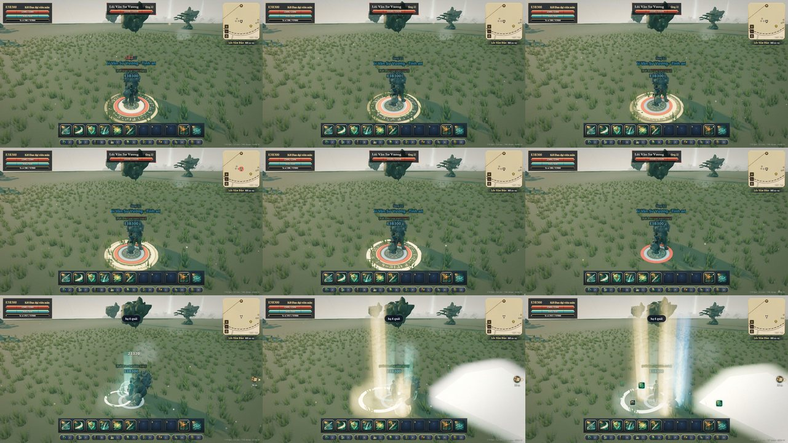 |
| Kình Vương, pha 1: bay lơ lửng + vạch báo trên sàn; 3 khung cuối: chết (ngã xuống, không méo) | 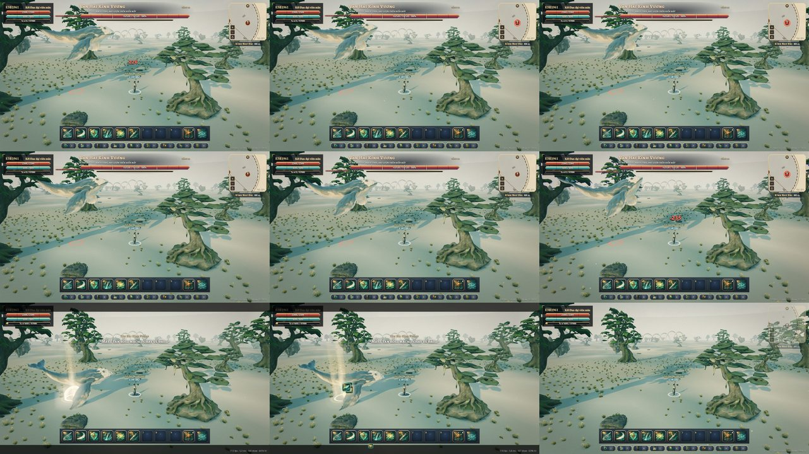 |
| Kình Vương, 99% máu (cửa sổ đánh: hạ thấp) | 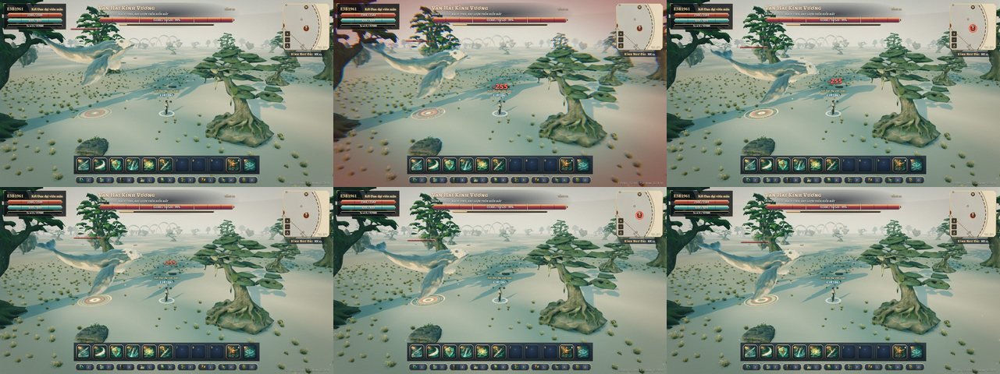 |
| Kình Vương, ≤ 45% | 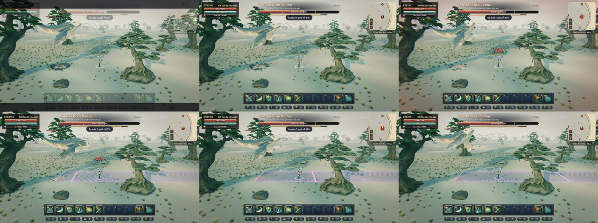 |
| Kình Vương, ≤ 25% (Nuốt) | 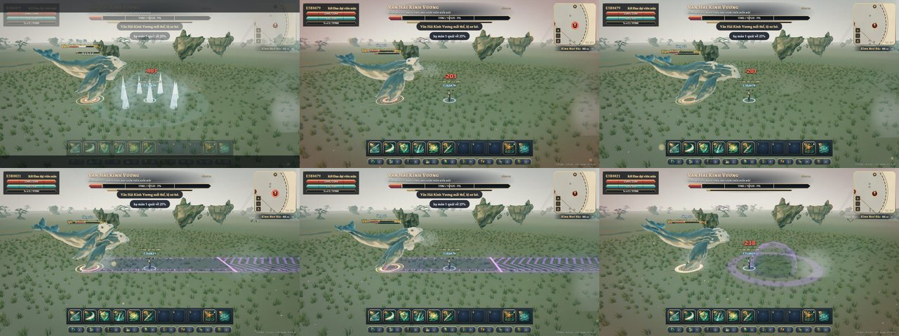 |

Mặt đảo vẫn là cỏ Vân Lam nhạt màu (bộ texture riêng thuộc E3-I).

## Kiểm chứng

`pnpm typecheck`; `pnpm test` (client 621, server 532, content 35, shared 206; gồm `vanhai.mobs.test.ts` 15 test và `hover.test.ts`); `pnpm content:check`; `pnpm sim:progress` (nhịp chương 2 không đổi 4,03–4,17 giờ, boss 81 s); `pnpm --filter @dtl/bot-client security` tất cả ĐẠT; `pnpm bots --count 100 --duration 120` tick p95 ~4 ms, 0 dòng `refId`; 40 bot ở `world-van_hai` (103 quái) p95 0,5–0,8 ms; `pnpm ledger:check` khớp.

## Còn lại

- **Tấm trắng cháy sáng khi hạ nhiều quái cùng lúc** (thấy ở hàng cuối `elite_loi_van_su_vuong.jpg`, khi `/gm killall` hạ 4 quái một lúc và rơi nhiều đồ): một đa giác trắng phẳng rất lớn bên phải màn hình, tái hiện được. Khi chỉ hạ một con thì không có. Chưa xác định nguồn: vòng (`RING_GEO`) và cột sáng (`BEAM_GEO`) của đồ rơi đều tròn, nên nghi một mesh cộng sáng sát camera (cột/lõi bậc cao, hoặc bloom chồng nhiều lớp). Đã thêm làm mờ cột sáng khi camera lại gần (`lootDrop` ở `game/vfx.ts`) nhưng chưa hết tấm trắng. Cần: ghi lại mesh phủ nhiều pixel nhất ở khung đó (duyệt `scene`), rồi hạ cường độ hoặc đổi thành vòng mờ. Không do dữ liệu E3-B (tinh anh khác cũng dùng chung VFX rơi đồ).

- Nuốt kéo người chơi, Kim Thiền phun độc khi chết (cần hook server).
- Kính Linh "mở sườn khi đánh" (chưa có cơ chế).
- Nhạc `boss_kinh`, texture mặt đảo (E3-I/mỹ thuật bản đồ 3).
- (Xong) cờ `E3B_PENDING_MONS` đã xóa; `q3_nguyen_anh` chuyển sang Lâm Chiếu Dung, `requires q3_kinh_vuong`.
