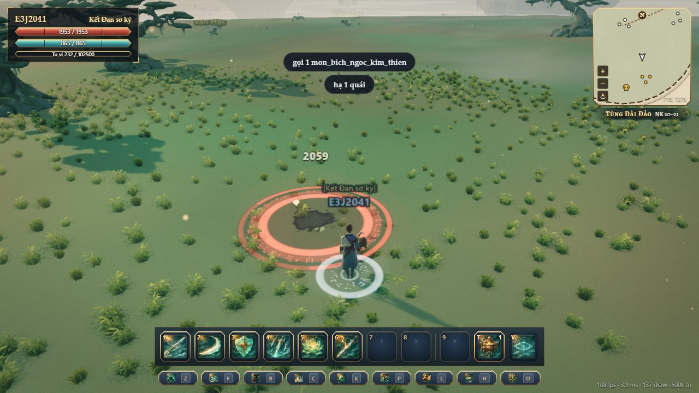
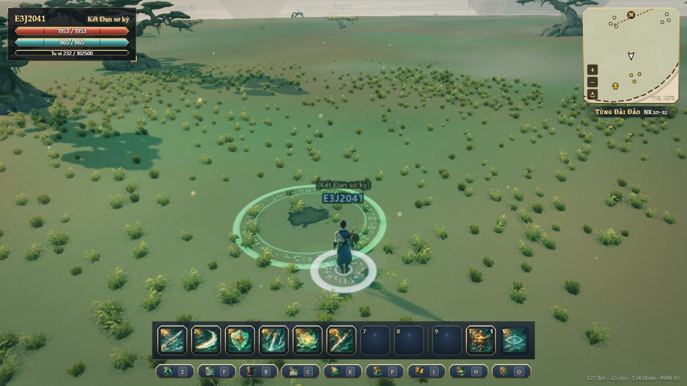
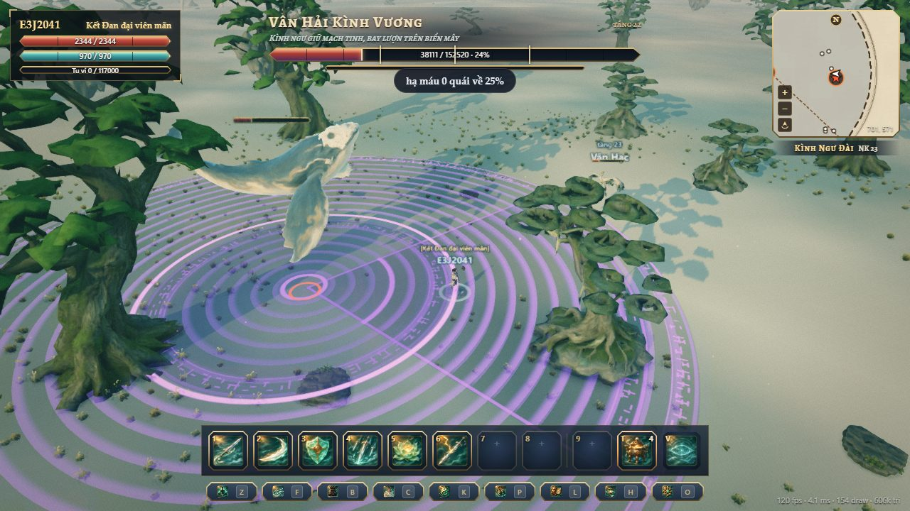
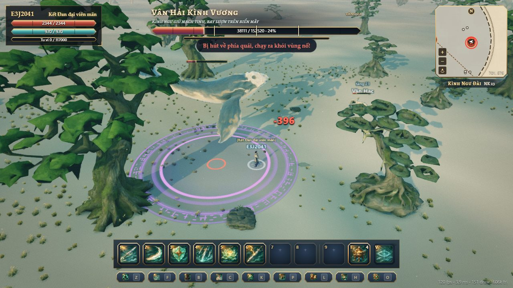
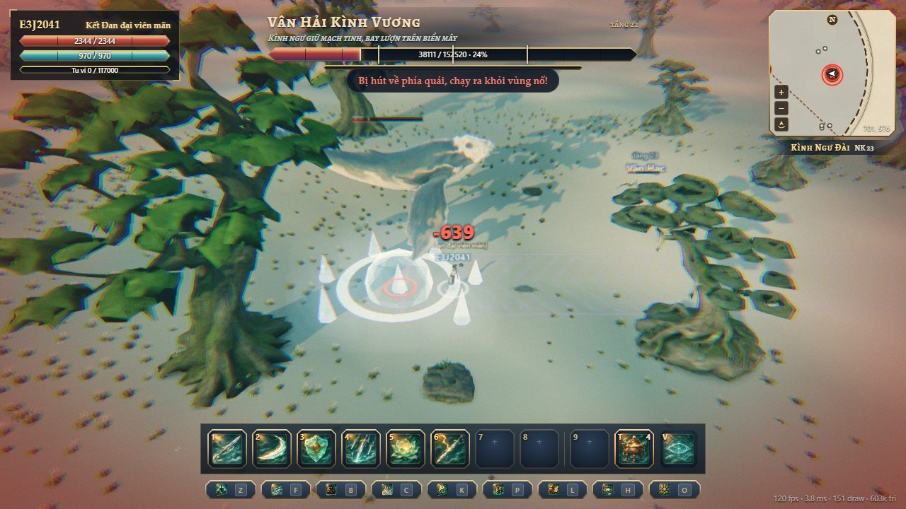

# E3-G / E3-J: chiêu quái còn thiếu của Vân Hải + cân bằng chương 3 (Kết Đan → độ kiếp Nguyên Anh)

Hai việc: (1) bù hai chiêu quái E3-B còn bỏ ngỏ (Nuốt kéo người, Kim Thiền phun độc khi chết); (2) cân bằng nhịp **Kết Đan sơ kỳ (cấp 20) → độ kiếp Nguyên Anh xong ≈ 6 giờ ±12%** theo cách E2-J (`docs/e2j-balance.md`), không phá nhịp Ngưng Khí 1 → 15 (3–4 giờ) và chương 2 (≈ 4 giờ).

## 1. Chiêu quái mới

Mọi sát thương vẫn do server phán; client chỉ vẽ. Hàm thuần ở `packages/shared/src/monskill.ts` (`pullStep`, `inPool`), trạng thái ở `apps/server/src/game/monzone.ts` (`MonZones`, gắn `GameSim.zones`), móc trong `sim.ts`: `releaseChant` (bắt đầu kéo), `killMonster` (để lại vũng độc), `tick`. `check.ts` kiểm tham số (`chant.pull`, `deathPool`).

### Nuốt (Vân Hải Kình Vương, pha 30%)

`MonsterChant.pull {range 20, delay 1,1, dur 0,9, stop 3}` trong `monsters.json`.

1. Boss niệm chú 2,6 s như cũ (ngắt được; ngắt hoặc quỵ thế thì không kéo).
2. Chú thả: **vòng báo** bán kính 20 m (`HazardMsg.mv = 'pull'`, sát thương 0) hiện 1,1 s; vùng nổ r 8 vẫn hiện ngay nhưng chỉ nổ sau `pull.delay + pull.dur + chant.delay` (3,2 s) để người bị kéo còn kịp thoát khỏi chỗ nổ.
3. Hết giờ báo: mọi người đứng trong vòng bị **kéo về tâm boss** trong 0,9 s tới cách tâm 3 m (trong vùng nổ).
4. Luật server:
   - kéo bằng `planDash` (cùng luật lướt: không xuyên vách, không leo/rơi vách đứng, theo `caveBoundOf`; người bị chặn thì **ngừng kéo**, không ép qua; kéo theo mặt đất nên không lôi ra ngoài đảo);
   - **kháng**: người đang ngự kiếm/lơ lửng (`airborne`, cùng luật không ra chiêu khi bay), đang độ kiếp, nguyên anh xuất khiếu: không bị kéo (báo `sys.pull_resist`);
   - hủy kéo khi boss chết, bỏ đuổi, hoặc choáng/quỵ thế;
   - bị kéo thì hủy đả tọa và niệm chiêu.
5. Client: vòng báo là pháp trận tròn như vùng nguy hiểm (không rung/âm nện vì không nổ); người chơi bị kéo thấy qua đối soát vị trí như khi lướt.

`check.ts`: `pull.range ∈ [chant.r; 30]`, `delay ∈ [0,9; 3]`, `dur ∈ [0,4; 2]`, `stop ∈ [1; chant.r]`, và `chant.cd > cast + pull.delay + pull.dur + delay + stun`.

### Bích Ngọc Kim Thiền: vũng độc khi chết

`MonsterDef.deathPool {r 2,5, delay 1,0, dur 6, tick 1, mul 0,22, kind spirit}`.

- Chết (không tính đệ tử, bóng tâm ma): vạch báo tròn r 2,5 m hiện 1 s (`mv = 'pool'`, kèm `dur`), rồi vũng ngọc lục tồn tại 6 s.
- Ai đứng trong vũng chịu `0,22 × công quái` (qua phòng thủ) mỗi giây; **ra khỏi vũng là hết**, không có dư độc. Hết 6 s vũng tắt. Trần 24 vũng cùng lúc/room.
- `check.ts`: chỉ quái thường/tinh anh, `r ∈ [1; 6]`, `delay ≥ 0,9`, `dur ∈ [2; 10]`, `mul ≤ 0,5`.

### Test

`apps/server/src/game/monzone.test.ts` (10 test): `pullStep`; boss pha 30% có `pull`, vòng báo `mv=pull` đúng bán kính/giờ và vùng nổ trễ đúng; người trong vòng được kéo tới ≤ `stop` + 0,3 m **chỉ sau giờ báo**, người ngoài vòng đứng yên, giữ đất; người ngự kiếm kháng; boss chết giữa chừng ngừng kéo; vách chặn thì dừng (host giả); vũng độc: báo trước rồi mới trúng, trúng mỗi nhịp với sát thương nhỏ (< 5% máu), người ngoài vũng không trúng, rời vũng hết trúng, vũng tắt sau `dur`, quái không có `deathPool` không để vũng, trần vũng.

Ảnh vạch báo (`pnpm shots:e3j --out <thư mục tuyệt đối>`, `?mute=1` + `--mute-audio`, cổng 2761/5361, 0 lỗi console):

| | |
| --- | --- |
| Kim Thiền vừa chết: vạch báo vũng độc |  |
| Vũng độc (ngọc lục, 6 s) |  |
| Kình Vương pha 30%: vòng kéo r 20 (tím) + vùng nổ r 8 |  |
| Lúc kéo |  |
| Sau khi kéo, chờ nổ |  |

## 2. Mô hình nhịp chương 3 trong sim

Trước đây sim chỉ có bảng kinh tế chương 3 theo `TIER_INCOME_HOUR`; chưa có ai đo nhịp thật trên Vân Hải. Khối mới trong `packages/content/src/sim.ts` ("Nhịp chương 3", cùng cấu trúc `ch2Timeline`), cấp 20–23, từng công pháp, một mình:

- **Săn quái thường** theo cụm thật `levels/van_hai.json` (cụm cấp `L−2…L+1`, thời gian tìm quái 10,9 s/lần), kéo 2 con, khiên/hồi 60%, đả tọa hồi máu.
- **Đồ bậc 3**: pha dần từ bộ bậc 2 (đã mặc 85% từ chương 2) sang bộ bậc 3 phẩm Linh, 30/50/70/85% ở cấp 20/21/22/23 (`CH3_GEAR_FRAC`).
- **Tinh anh** 1 con/15 phút săn; **nhiệm vụ** chính `q3_*` **và phụ** `s3_*` (150 s đi lại mỗi nhiệm vụ); **Kính Nguyệt Cung** một lượt ở cấp 21 (tu vi `xpPct` 15% + quái chia nhóm 4; 23,8 phút kể cả lỡ tay lần đầu); **Vân Hải Kình Vương** một lần theo nhóm (8 phút); thử thách tâm ma ở bình cảnh 21 và 23; **chế Nguyên Anh Đan** (4 phút) và **Tam Trọng Kiếp** (90 s chuẩn bị + 65 s, làm lại nếu hỏng: mất 15% tu vi cấp 23, phải chế đan mới).
- **Tam Trọng Kiếp** có Monte Carlo (4000 lần) bám đúng `tribulations.json` (`nguyen_anh`): tia nhắm + tia rơi quanh co dần ở pha lôi, **tia xích** (vạch 16×2,6 m + hai tia hai đầu), **lưới lửa 4×4** (một ô luôn là ô người độ kiếp đứng, một ô ngẫu nhiên; **xuất khiếu** 6 s/20 s đẩy lửa nặng sang ô kề), **tâm ma** (tia + Tâm Ma Ảnh dùng chiêu, tâm cảnh 100, −5 mỗi lần trúng, +1,5/s khi đánh bóng; hạ được bóng hoặc sống tới 65 s thì thành), Hộ Thể 35%, tối đa 3 đan hồi.

## 3. Trước / sau

| Mục | Trước | Sau | Lý do |
| --- | --- | --- | --- |
| Giờ chương 3 (Kiếm/Hộ/Đan) | 5,47 / 5,60 / 5,55 giờ (−7…−9%, sát đáy ±12%) | **6,11 / 6,26 / 6,18 giờ** | Quái Vân Hải cho tu vi cao hơn mô hình thiết kế (≈ 255 kill/giờ chứ không thấp hơn); hạ `xpMul` để vào giữa khung |
| `xpMul` quái Vân Hải (thường: Vân Hạc / Kim Thiền / Thạch Quy / Kính Linh; tinh anh: Vân Hạc Vương, Lôi Vân Sư Vương, Kính Diện Ma Quân) | 2,2 / 1,8 / 2,8 / 2,4; 4,0 / 4,0 / 4,5 | **1,95 / 1,6 / 2,45 / 2,1; 3,5 / 3,5 / 4,0** (×0,88) | Đòn bẩy chính (không đổi `xpNeed`, không cần migration) |
| Tam Trọng Kiếp, tay thường, một mình | 98% (Kiếm tu), 97%, 99% | **85% / 85% / 89%** | Kiếp quá dễ: bản đầu của E3-L ghi "chờ cân bằng" |
| Tam Trọng Kiếp, tay vụng / giỏi | 67% / 100% | **30% / 99%** | Thang chuẩn như Đan Hỏa Kiếp: vụng ≤ 50%, thường 55–90%, giỏi ≥ 90% |
| `nguyen_anh` pha lôi | `aimPct` 0,22; `extraPct` 0,2; tia xích 0,15 + đầu 0,16 | 0,30; 0,24; 0,20 + 0,20 | |
| `nguyen_anh` pha hỏa / tâm ma | lưới `pct` 0,22; `aimPct` 0,12 | 0,26; 0,17 | |
| Ngưng Anh Phách (cần 3 mỗi đan) | ≈ 2,4 (thiếu, cần 3,1 × 1,3 dư) | **≈ 5,0** (cần 3,5, kể cả làm lại) | Tinh anh Vân Hải 8% → 18%; Kính Diện Ma Quân (định nghĩa ở #149) chưa rơi phách nay rơi 18%; Kính Nguyệt Cung thêm phách 50% |

## 4. Kết quả cuối (`pnpm sim:progress`)

Giờ theo thành phần (Kiếm tu 6,11 giờ): quái thường 4,59 · tinh anh 0,25 · đả tọa 0,07 · nhiệm vụ 0,46 · Kính Nguyệt Cung 0,40 · Kình Vương 0,13 · tâm ma 0,04 · chế đan 0,07 · Tam Trọng Kiếp 0,10.

| Cấp | TTK quái (Kiếm/Hộ/Đan) | Mất máu/lần | TTK tinh anh (Kiếm) | Giờ cấp (Kiếm) |
| --- | --- | --- | --- | --- |
| 20 | 5,6 / 6,2 / 6,1 s | 2% / 1% / 0% | 24 s | 1,57 |
| 21 | 5,4 / 6,0 / 5,9 s | 2% / 0% / 0% | 21 s | 1,54 |
| 22 | 4,8 / 5,4 / 5,3 s | 0% | 26 s | 1,25 |
| 23 | 4,5 / 5,1 / 5,0 s | 0% | 25 s | 1,58 |

Kình Vương nhóm 4 hạ trong 81 s; Kính Nguyệt Cung 23,8 phút kể cả lỡ tay lần đầu (sạch thuần 13,2 phút).

**Tam Trọng Kiếp: tỉ lệ qua** (Monte Carlo 4000 lần, một mình = có hộ pháp)

| Tay nghề (xác suất né mỗi lần) | Kiếm tu | Hộ pháp | Đan sư |
| --- | --- | --- | --- |
| vụng (60%) | 30% | 29% | 38% |
| thường (80%) | 85% | 85% | 89% |
| giỏi (92%) | 99% | 99% | 99% |

**Hộ pháp không đổi tỉ lệ qua** (khác Đan Hỏa Kiếp ở #142: 66% → 81%). Lý do là luật hiện có, không phải mô hình: hộ pháp chỉ chắn ở tia khóa mệnh (`final`, `shareToGuards`), mà `nguyen_anh` không có `final` (chỉ pha ba `shadows` do chủ kiếp tự đánh). Nếu muốn hộ pháp có tác dụng ở kiếp này, cần thêm luật mới (ví dụ chắn một phần tia nhắm hoặc ô lửa nặng): để người dùng quyết, chưa làm trong gói này.

**Độ nhạy theo đồ bậc 3** (Kiếm tu): không có món nào 6,63 giờ, đủ bộ phẩm Linh từ cấp 20 là 5,88 giờ; kỳ vọng 6,11. Cả hai mốc cực đều trong ±12% của 6 giờ (5,28–6,72).

## 5. Kinh tế linh thạch (một mình)

| | Nguồn | Mỗi giờ | Thiết kế |
| --- | --- | --- | --- |
| Kiếm tu | 58.590 (55.955 vàng/nhiệm vụ/phó bản/boss + 2.635 bán đồ) | 9.594 | ~8.880 (7.400 + 20% bán đồ) |

Hố tiêu cầu toàn 77.315 = Thăng Bậc 7 ô 20.720 + cường hóa +5 bốn ô 40.073 + chế một bộ 8.510 + Nguyên Anh Đan 5.872 (kể cả làm lại, 5.000 mỗi lần) + Phá Cảnh Đan 340 + đan hồi 1.800 = **1,32× nguồn thu**. Sim báo LỖI nếu ngoài 0,8–2,2×. Giá vật phẩm giữ nguyên (không đổi `price`/`sell`, Thăng Bậc 2.960/ô, giá chế): người cầu toàn thiếu một phần như chương 2 (2,07×), người chơi thường chọn ô nên cân bằng; không có nguồn linh thạch mới nên không lạm phát. Bán đồ rơi chỉ ≈ 4,5% nguồn thu (thiết kế 20%): trang bị rơi từ quái thường phẩm thấp. Nên tăng tỉ lệ rơi trang bị trước khi tăng vàng nếu người thử thấy thiếu.

Nguyên liệu: Ngưng Anh Phách ≈ 5,0 (cần 3 + làm lại ≈ 3,5); các nguyên liệu bậc 3 khác (Kính Hoa Sa, Vân Hải Lộ, Bích Ngọc Nhĩ) giữ nguyên tỉ lệ rơi từ E3-F/E3-B.

## 6. CI

`packages/content/src/pace.test.ts` thêm: chương 3 ba công pháp trong 6 giờ ±12% (dòng `[pace3]`). Thêm trong `sim.ts`: TTK quái thường chương 3 3,8–7,3 s, tinh anh 18–40 s, mất máu ≤ 45% mỗi lần giết, Tam Trọng Kiếp (tay thường 55–90%, giỏi ≥ 90%, vụng ≤ 50%), Ngưng Anh Phách dư 1,3×, hố tiêu 0,8–2,2× nguồn thu.

## 7. Việc còn lại / giả định cần người thử

- Mô hình Tam Trọng Kiếp dùng giả định về xác suất trúng của người đứng yên (vạch tia xích ≈ 70%, ô lửa nặng luôn ở ô người độ kiếp, xuất khiếu dùng ngay khi sẵn sàng); số tay nghề (né 60/80/92%) là giả định như E2-J. Cần người chơi thật thử, hai con số nên chỉnh trước tiên là `aimPct` pha lôi và `tamCanh.hurt`.
- Mô hình chưa tính thời gian di chuyển giữa các đảo (cầu xích) ngoài hệ số `PATH_FACTOR`, nên giờ thật có thể nhỉnh hơn một chút (dự phòng nằm ở phía đáy khung: giữa khung 6,11 so với 6,72).
- Nhiệm vụ phụ `s3_do_thuyen`, `s3_guong_nuoc` (-148) chưa merge lúc đo: khi merge, `git merge origin/main` rồi chạy lại `pnpm sim:progress` (mỗi nhiệm vụ phụ ≈ 1% giờ).

## 8. Kiểm chứng

`pnpm typecheck`; `pnpm test` (shared 206, content 36, client 634, server 576, asset-pipeline 17, perf 3, gồm `monzone.test.ts` 10 test); `pnpm content:check` (itemsources khớp `loot.json`); `pnpm sim:progress` không dòng LỖI (`[pace3]` 6,11/6,26/6,18 giờ; chương 2 4,12/4,17/4,03 và Ngưng Khí 1 → 15 không đổi); `pnpm --filter @dtl/bot-client security` 139 ĐẠT, 0 HỎNG (server không bật `RATE_LIMIT_EXEMPT`, DB mới); `pnpm bots --count 100 --duration 120` 100 bot online, tick p95 ≤ 3,3 ms, 0 dòng `refId`; `pnpm ledger:check` khớp (100 nhân vật, 1568 dòng sổ cái). Server riêng ở cổng 2763/5363 (ảnh: 2761/5361), đã tắt.
