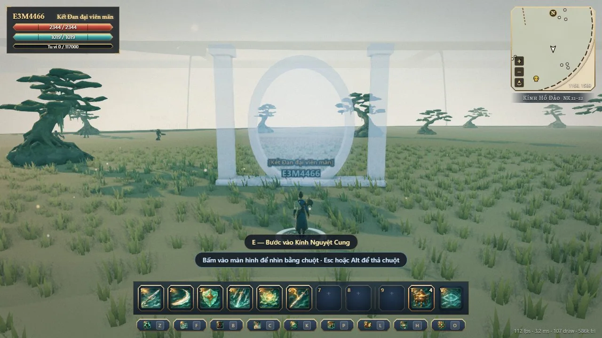
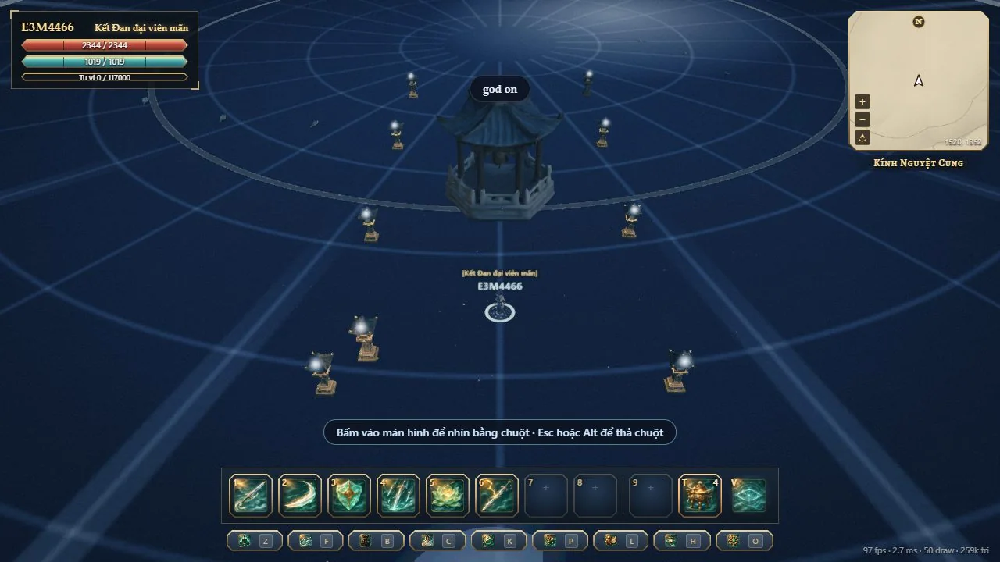
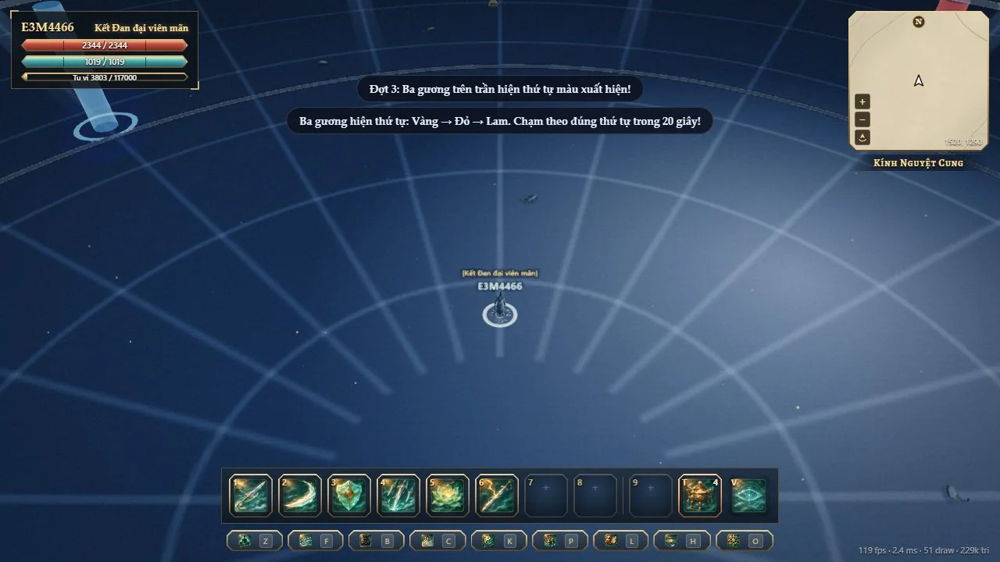
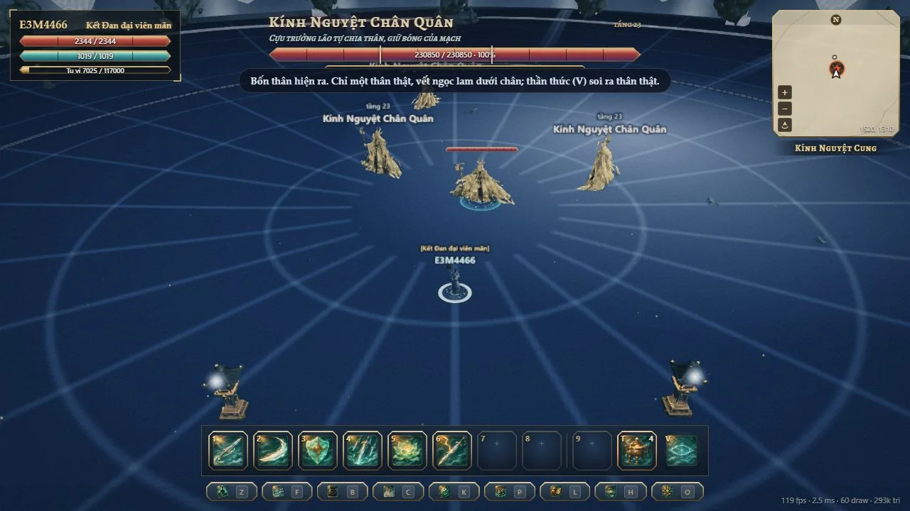
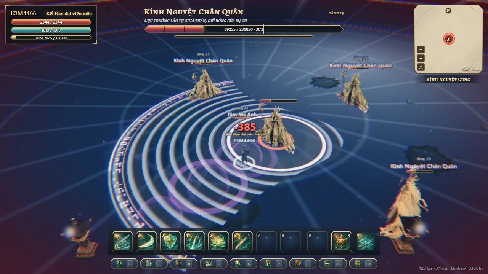

# E3-M: Kính Nguyệt Cung (phó bản chương 3)

> **Ghi chú R-1 (2026-11-18):** ảnh/video duyệt PR của hạng mục này đã gỡ khỏi repo; thư mục chỉ giữ tối đa 5 ảnh then chốt (WebP). Tên file nhắc bên dưới mà không còn trong thư mục là ảnh đã gỡ, xem lại bằng `git show c78b50c6:docs/e3m-dungeon/<file>`.

Gói E3-M (`docs/EXPANSION_DESIGN.md` 5.2, 11.3). Cấp 21+, 4–5 người, 5 đợt, boss Kính Nguyệt Chân Quân. Theo mẫu E2-C (`docs/e2c-dungeon/README.md`). Skin là GLB người dùng đã nhập (#115–#117), prop sẵn có, không Tripo, không model mới.

## Cách vào

Vân Hải Phù Đảo (#148): cổng đĩa sáng cạnh **Kính Hồ Đài** (Kính Hồ Đảo, vòm đá tại 1168, 1598, cách đài 27 m; `portals` trong `levels/van_hai.json`) → bấm E. Ra (cổng bạc ở điểm vào, hoặc tự đưa ra 20 s sau khi dẹp xong) về Vân Hải tại `returnSpawn` (1168, 1584) trước cổng. Điểm vào cũng tới được bằng `/gm tp vh_kinh_ho`.

Vé một lần kiểm ở `static onAuth` (không vé hoặc sai `dgKey` = `no_ticket`), room `dungeon-kinh_nguyet`, `private: true` (mỗi lượt vào một room riêng, đồng đội cùng tổ trong 30 m được kéo theo), tối đa 2 lần hồi sinh mỗi người.

## Dữ liệu (`packages/content/data/levels/kinh_nguyet.json`)

| Đợt | Nội dung | Cơ chế |
| --- | --- | --- |
| 1 | 8 Kính Linh (c21) | giơ khiên phản đạn (`reflect` 30%), đánh khi hạ khiên |
| 2 | Kính Diện Ma Quân (tinh anh c22) | `reflect` 30% mọi chiêu xa + vạch đường; dùng đòn gần để hạ; khóa room khi vào đợt 2 |
| 3 | **Đố ba gương** (không quái, `WaveDef.puzzle`) | ba cột gương lam/đỏ/vàng, thứ tự bốc ngẫu nhiên, chạm đúng thứ tự trong 20 s |
| 4 | 6 Kính Linh + 2 Phù Đảo Thạch Quy hóa gương (c21/22) | bầy mạnh: `charge` + `reflect` |
| 5 | Kính Nguyệt Chân Quân (c23) | xem dưới |

**Đố ba gương** (`apps/server/src/game/mirrorpuzzle.ts`, dùng trong `DungeonRoom`): server giữ đáp án, phán định chạm (3,2 m), tin hệ thống đọc thứ tự màu ("Đỏ → Vàng → Lam"), FX `mirror_pillar` vẽ cột. Sai hoặc hết giờ: 3 Kính Linh xuất hiện thêm và đố lại thứ tự mới; quá 3 lần thì bỏ đố, không thưởng. Đúng: sát thương của boss lên người chơi giảm 8% suốt phó bản (`GameSim.bossDmgMul`). Director chờ trong lúc đố.

## Kính Nguyệt Chân Quân (`monsters.json`, khối `mirror`)

hpMul 90, xpMul 25, cấp 23, `posture` kiểu Thôn Mạch. Cơ chế riêng ở `apps/server/src/game/mirror.ts` (`MirrorSystem`, nối vào `GameSim.mirror`), cấu hình theo dữ liệu `MonsterDef.mirror` (`decoys`, `echo`, `disc`, `veil`; kiểm bằng `content:check`).

- **Ba bóng một thật**: lúc vào trận và mỗi lần đổi pha dựng 3 bóng giả `mon_kinh_anh_gia` (đệ tử, hpMul 0,02: một đòn là chết, không rơi đồ, cùng model và tên với boss) cách boss 12 m. Chết thì nổ vòng 6 m (Hazard báo 1 s). Thể thật mang cờ `MF_REAL`: client vẽ vết ngọc lam dưới chân (bóng giả không có). **Thần thức (V)** gắn `MF_SENSED` 6 s: vòng vàng quanh thể thật (`SpiritSystem.onScanned` → `MirrorSystem.onScan`).
- **Lặp lại**: sau chiêu sát thương/aoe/đường/lướt của người chơi, bóng thật phản đúng chỗ người đó (vạch tròn 3 m, báo 1 s, 0,9 × công), mỗi người hồi 7 s. Và boss lặp lại câu cuối trong chat (cách nhau 6 s): "Ngươi là ai?" → "Ngươi là ai."
- Pha 1 (100–60%): `sweep` nón 14 m, 35° (cd 9 s).
- Pha 2 (60%): thêm `slam`; **đĩa gương**: 3 tia dài 24 m rộng 3 m xoay 25°/s trong 8 s (báo 1,5 s đầu chưa trúng), trúng mỗi 0,5 s (0,9 × công); đứng giữa các tia (lệch 60°) hoặc lướt qua. Client vẽ tia theo đúng công thức server (`discAngle`).
- Pha 3 (30%): thêm `line` 20×3 m; **nguyệt phản**: màn gương bán kính 14 m trong 18 s (hồi 32 s): mỗi người đang đứng trong vùng bị một Tâm Ma Ảnh của chính mình đuổi (`spawnShadow`, máu 25% khí huyết tối đa, chỉ chủ đánh được), cứ 4 s ném một chiêu của chính mình (vạch báo 1,2 s). Hết màn bóng tan.

## Định Thần Phù

Vật phẩm `itm_dinh_than_phu` (bùa, buff `ward`): 10 s giảm 40% sát thương "gương" (quái `glass`, boss gương, bóng tâm ma trong cung) ở `GameSim.damagePlayer` (`wardMul`). Chế ở Dược sư (`rcp_dinh_than_phu`: 2 Kính Hoa Sa + 2 Linh Thảo, 120 linh thạch, cấp 21), còn rơi từ phần thưởng phó bản. `ward` thêm vào `PillBuffKind` (không phải chỉ số; check cho bùa ≤ 50%, ≤ 60 s). **TODO**: icon đang dùng emoji dự phòng; công thức đặt ở Dược sư vì Tố Tâm chưa có trong `npcs.json`.

## Thưởng

Rơi đồ từng quái ở `loot.json`. Khi dẹp xong, `GameSim.grantDungeonReward` (một transaction + idem `dungeon:kinh_nguyet:<charId>:<ngày>` + `ledger`): linh thạch 2200–3000, Kính Hoa Sa 4–6, Vân Hải Lộ 5–8, Bích Ngọc Nhi (70%), Định Thần Phù (60%), Tụ Khí Đan, mảnh mỗi bộ `set_kinh_quang|set_van_kinh|set_luu_ly` 40% một món (Huyền/Địa/Thiên), rồi +15% tu vi cần của tầng. Người đã nhận hôm nay không nhận lại. Hook nhiệm vụ: `afterJoin` phát `questEvent('dungeon')` (`q3_kinh_nguyet`, E3-H nối).

## Mỹ thuật (art bible v3: tông trầm, không lóa che nhân vật)

Lòng chảo Kiếm Trủng dựng thành sảnh gương treo giữa mây, bằng tài nguyên sẵn có:
- **Vỏ cung** (`caveShell.ts`, `LevelAssets.palace`): nửa quả cầu úp nhẵn, hàng cột sáng bạc mỗi 15°, trần xanh đen có lỗ trăng mờ ở đỉnh. Mood `night` (ánh trăng lạnh).
- **Sàn gương giả** (`buildMirrorFloor`): đĩa bám địa hình (+0,08 m), một texture canvas 1024²: đá đen bóng, vân vòng, tấm ghép tỏa tia, vệt phản chiếu hàng cột, quầng trăng. KHÔNG phản chiếu thật (không render lần hai): một draw call.
- **Khung cung** (`buildPalaceHall`): 20 cột lam bạc có đế, đầu cột và gờ ngang, gương lớn treo giữa các cột (khung bạc + mặt gương), gờ sàn bạc; một lưới màu đỉnh, một draw call, màu giữ tối.
- Đèn đá: quầng nhỏ màu lạnh không vào bloom, ánh sáng điểm giảm còn 35%; vòng ra màu bạc xanh nằm trên sàn.
- Màu quái (`palette`): Kính Nguyệt Chân Quân thân thật áo tím thẫm + vàng, bóng giả cùng bảng màu và cùng độ đục (nhìn thường không phân biệt), chỉ thể thật lộ ra bằng vết ngọc lam dưới chân (`MF_REAL`) hoặc vòng vàng của thần thức (`MF_SENSED`); Kính Linh lam bạc, Ma Quân tím nhạt, Thạch Quy đá đồng.
- Prop (`shared/src/props.kinhnguyet.ts`): cổng đình, Kính Hồ Đài, vòng đá trôi, mảnh gương (`prop_anh_ngoc_kinh`), đèn đá.
- VFX: đĩa gương (`Vfx.mirrorDisc`), cột đố (`mirrorPillar`), vòng màn gương, chớp bóng giả vỡ, vết ngọc lam thể thật (`monFlags.ts`).
- Ngân sách: 43–59 draw call, 177–275k tam giác, 120 fps ở 1280×720 (WebGPU).

## Đo

- `pnpm sim:progress`: nhóm 4 × cấp 21, sạch thuần 13,2 phút, kể cả lỡ tay lần đầu **23,8 phút** (mục tiêu ~25; sim báo LỖI nếu ngoài 20–30). Hệ số hiệu suất đánh boss gương `DG_MIRROR_EFF` = 0,55 và thời gian đố (0,75 × 20 s) là giả định chưa kiểm bằng người thật.
- Test `apps/server/src/game/kinhnguyet.test.ts` (24): dữ liệu đợt, vé/khóa, đố gương, bóng giả/lặp lại/đĩa/nguyệt phản/thần thức, Định Thần Phù, thưởng + ledger.
- Playtest `pnpm shots:e3m --out <thư mục tuyệt đối>`: vào bằng cổng thật, room `dungeon-kinh_nguyet`, đủ 5 đợt, 0 lỗi console.

## Ảnh

| | |
| --- | --- |
| Cổng |  |
| Vào cung | _(ảnh đã gỡ)_ |
| Vách cung | _(ảnh đã gỡ)_ |
| Toàn cảnh sảnh |  |
| Cột đá và gương lớn treo vách | _(ảnh đã gỡ)_ |
| Đợt 1 Kính Linh | _(ảnh đã gỡ)_ |
| Đợt 2 Kính Diện Ma Quân | _(ảnh đã gỡ)_ |
| Đợt 3 đố ba gương (cột lam góc trái, thứ tự trong tin hệ thống) |  |
| Chạm cột đúng thứ tự | _(ảnh đã gỡ)_ |
| Giải xong | _(ảnh đã gỡ)_ |
| Đợt 4 Thạch Quy | _(ảnh đã gỡ)_ |
| Boss: bốn thân, thể thật có vết lam |  |
| Lặp lại | _(ảnh đã gỡ)_ |
| Bóng giả vỡ | _(ảnh đã gỡ)_ |
| Đĩa gương (ba tia xoay) | _(ảnh đã gỡ)_ |
| Nguyệt phản (Tâm Ma Ảnh) |  |
| Hoàn thành | _(ảnh đã gỡ)_ |

## Giới hạn / việc để lại

- Chưa có hướng dẫn nhiệm vụ cho tới E3-H.
- Ảnh thần thức soi thể thật không bắt được trong kịch bản: boss đánh trúng làm tản thần thức giữa chừng (cơ chế đã test ở server).
- Phải chơi với 4 người thật để kiểm 25 phút và độ khó đĩa gương/nguyệt phản.
- Icon Định Thần Phù là emoji dự phòng (`icons:check` 168/171).
- `monsterSkins.ts` thêm `elite_kinh_dien_ma_quan` (level `kinh_nguyet`); nếu #148 cũng thêm khóa này thì gộp một bản khi merge.
