# E4-B: quái, tinh anh, boss ngoài trời Thiên Khuyết Cổ Thành

Gói E4-B (`docs/EXPANSION_DESIGN.md` 6.3, 5.4). Chỉ **dữ liệu quái/rơi đồ/chuỗi/skin/test**; level bản đồ và bãi quái (camps) là của E4-A (worker khác), nên gói này **không sửa** `levels/*`. Skin GLB người dùng đã nhập (không Tripo).

## Dữ liệu (`monsters.json`, `loot.json`, `i18n/vi.json`)

| Quái | Hệ | hp/atk (đã chỉnh bằng `fight:check`) | Chiêu (vạch báo) |
| --- | --- | --- | --- |
| Thạch Tượng Võ Sĩ | Thổ | 1,6 / 1,4 | chém ngang nón 6 m báo 1 s (`caster` cone); giơ khiên chặn 50% (`reflect`) |
| Dạ Minh Lộc | Thủy | 1,6 / 1,4 | húc lao line 10×2 báo 0,9 s (`charge`) rồi lộ yếu điểm 2 s |
| Cốt Vệ Kiếm Thủ | Kim | 1,6 / 1,25 | combo 2 kiếm (`combo` 40%) |
| Cổ Thành Chiến Ma | Hỏa | 1,8 / 1,5 | đâm giáo line 8×2,5 báo 1,1 s (`line`) |
| Thạch Tượng Đại Tướng (tinh anh) | Thổ | 8 / 1,7 | quét nón r 12 (nửa góc 30°) báo 1,1 s; giáng kiếm line 14×3 báo 1,2 s |
| Dạ Minh Lộc Vương (tinh anh) | Thủy | 7 / 1,8 | **quầng sao** r 6 báo 1,3 s; húc lao line 14×2 báo 1 s + lộ yếu điểm |
| Cốt Kiếm Thống Lĩnh (tinh anh) | Kim | 7,5 / 1,9 | combo 60%; tia quét line 10×3 báo 1,1 s; vồ r 3,5 báo 1 s |
| **Thiên Khuyết Thủ Linh** (boss, cấp 27) | Thổ | 85 / 1,5, xp ×34 | **búa halberd** line 20×4 báo 1,8 s; **quầng sao** `slam` r 8; **gọi tượng** 2 Thạch Tượng Võ Sĩ mỗi 20 s (tối đa 4); cửa sổ đánh `reveal` 22 s/5 s. Pha 70%: quét nón 14 m. Pha 50%: quầng sao dồn (tối đa 5). Pha 30%: **quầng sao lớn** `chant` r 16, niệm 2,6 s (ngắt được), choáng 3 s |

- **Nguyên tắc cân bằng** (mục 2.3): `hpMul`/`atkMul` ban đầu lấy theo thiết kế ×1,5 như E2-B/E3-B, rồi hạ theo `fight:check --levels 24,27`: ba công pháp kiếm/hộ pháp có TTK 4,6–8,0 s, mất máu ≤ 16% mỗi con, không chết. Công pháp Đan sư (`thanh_moc_dan_kinh`, sát thương thấp) 8,5–14,7 s: thuộc đường cong công pháp, không phải riêng gói này (E3-B cũng ngang ngưỡng ở cấp 23, 6,5–8,8 s). Tinh anh giữ tỉ lệ ~5× quái thường cùng bản đồ (như Vân Hải) để vào mốc 20–40 s của `sim:progress`. Boss 85 (thiết kế 140): `hpMul` Địa Mạch Long/Kình Vương đều đã hạ theo nhịp nhóm 4 người (xem `docs/e3b-mons`); cần đo lại bằng sim nhóm khi có bảng chương 4 (`sim:progress` chưa có chương 4).
- `loot.json`: bảng rơi riêng từng quái (thường: Phàm/Linh, tinh anh: Huyền, boss: Địa/Thiên chắc 1 món). **Nguyên liệu bậc 4** (Tinh Quang Mặc, Thần Tàng Ngọc, Cổ Thành Phiến) chuyển từ nguồn tạm ở tinh anh/boss Vân Hải sang quái Thiên Khuyết qua lớp `$mats`. `itemsources.json` dựng lại (`pnpm --filter @dtl/content sources:build`). Không có `drops`/`gold` trong `monsters.json`.
- Tên, tên phụ, lời boss: `mon.*` ở `i18n/vi.json` (Thủ Linh không phải kẻ địch, chỉ làm đúng lệnh cũ của Cựu Thiên Điện, khớp `q4_thu_linh`).
- Skin: ba tinh anh gộp từ `ELITE_SKINS_NEW` vào `MONSTER_SKINS` (`level: 'thien_khuyet'`, nạp lười); bốn quái thường và boss đã có skin từ trước. Quái đều `scale 1` (GLB đã đúng kích thước thật).
- FX: dùng khung timeline V5 chung (`mon_warn`/`mon_boom_*`/`mon_strike`… theo hệ và loại vùng, bảng màu `mon_<hệ>`/`mon_boss`), không thêm JSON FX mới.

## Gán vào bản đồ (E4-A đã merge)

`tools/maps/gen-thien-khuyet.mjs` (`MIX`, `ELITES`, boss) sinh lại `levels/thien_khuyet.json`: thay quái mẫu tạm bằng quái chương 4 (Đại Lộ: Thạch Tượng Võ Sĩ; Lâm Sao: Dạ Minh Lộc; Binh Khí: Chiến Ma + Cốt Vệ; Điện Tiền: Cốt Vệ/Thạch Tượng/Chiến Ma; Mộ Đạo: Cốt Vệ). 12 tinh anh: Đại Lộ 2 Đại Tướng, Lâm Sao 2 Lộc Vương, Binh Khí 3 Thống Lĩnh, Điện Tiền 2 Đại Tướng + 1 Thống Lĩnh, Mộ Đạo 2 Thống Lĩnh. Boss ở (964, 1530) Mộ Đạo (dời khỏi vòng prop và cột linh quang của điểm Cổ Thành Thất Lộ ở 964, 1504; chỗ người chơi đứng chụp: place `tk_boss`), cấp 27, hồi sinh 30 phút. Vị trí cụm không đổi: `map:report --level thien_khuyet` độ phủ chuẩn p95 64,4 m, max 83,3 m (ĐẠT), 0 chỗ kẹt, 240 quái thường (121/km²). Test `thienkhuyet.mobs.test.ts` và `content/thienkhuyet.test.ts` kiểm id quái, số tinh anh, boss.

## Chưa làm

- Cốt Vệ **hồi sinh một lần sau 6 s**, Chiến Ma **gầm giảm phòng ngự**, Cốt Kiếm Thống Lĩnh **combo 4 và tia quét kép**: server chưa có kiểu tương ứng nên dùng `combo`/`line` gần nhất.
- Quầng sao hai vòng lệch pha (r 12 + r 20) của Thủ Linh: dùng `slam` r 8 và `chant` r 16 (trần `check.ts`). Phản ứng ngũ hành của boss để tùy chọn sau.
- Boss `hpMul` cần cân lại bằng sim nhóm khi có bảng chương 4.

## Ảnh (`pnpm shots:e4b --out <thư mục tuyệt đối>`, `?mute=1`, `--mute-audio`)

Chụp trong bản đồ Thiên Khuyết thật, mỗi quái ở vùng của nó (ban đêm).

| | |
| --- | --- |
| Thạch Tượng Võ Sĩ | 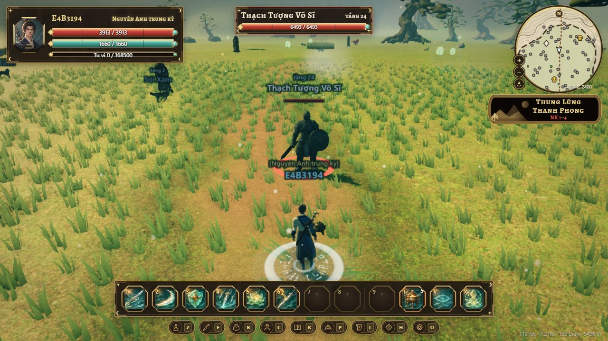 |
| Dạ Minh Lộc | 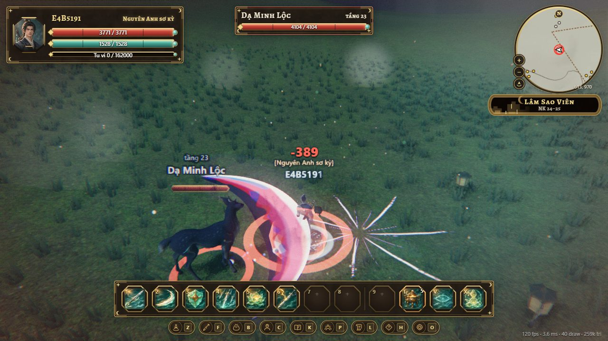 |
| Cốt Vệ Kiếm Thủ | 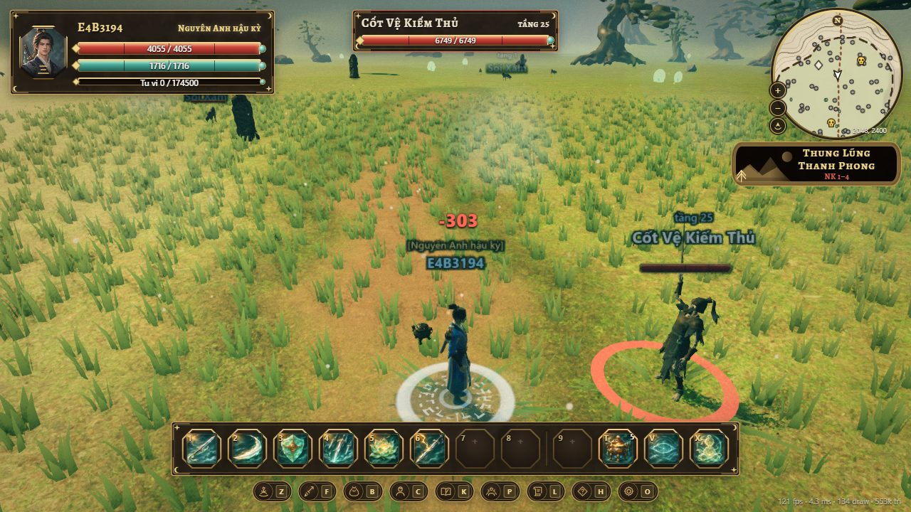 |
| Cổ Thành Chiến Ma | 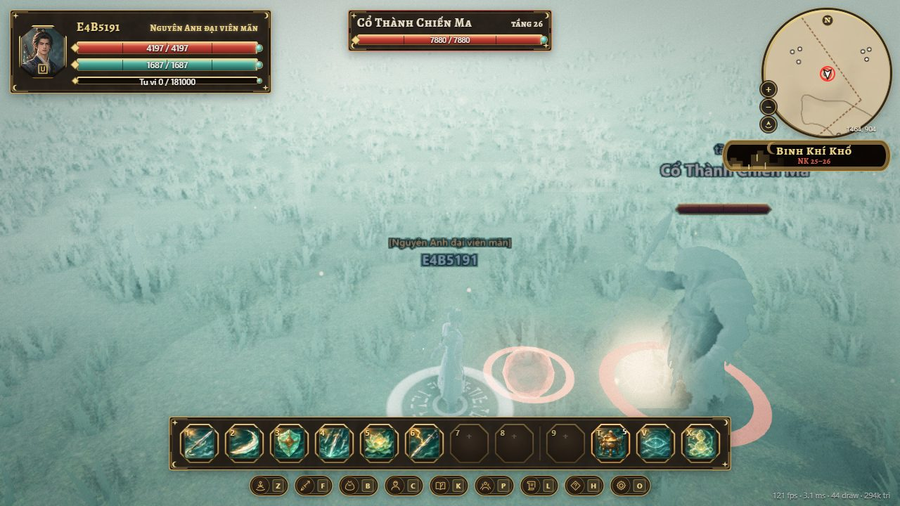 |
| Thạch Tượng Đại Tướng | 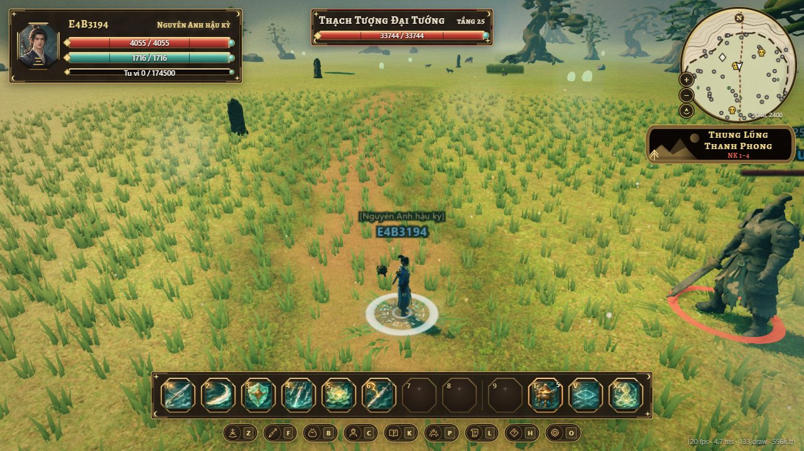 |
| Dạ Minh Lộc Vương | 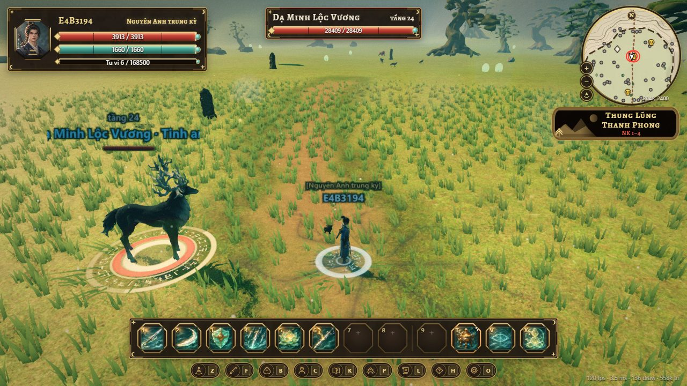 |
| Cốt Kiếm Thống Lĩnh | 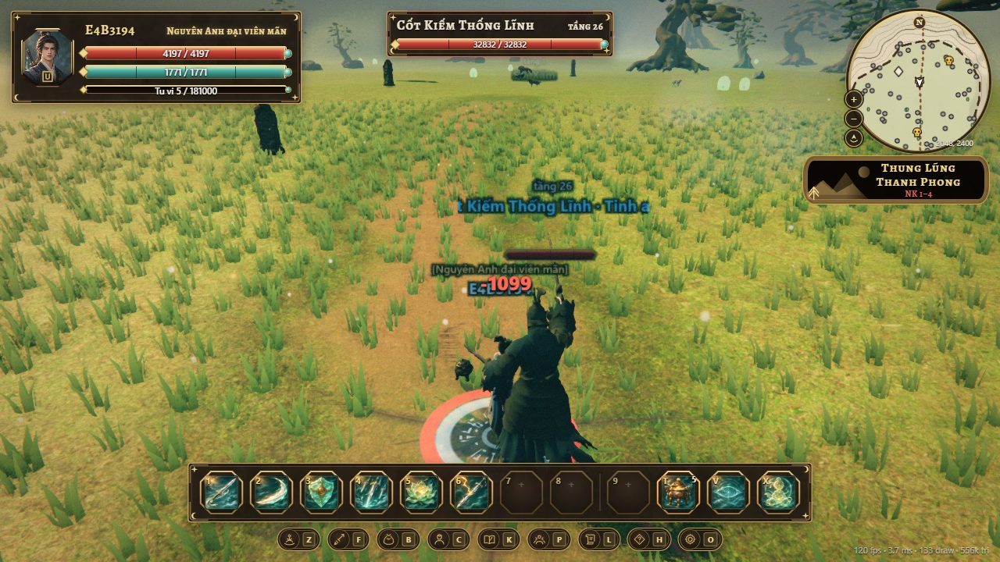 |
| Thủ Linh, pha 1 (halberd) | 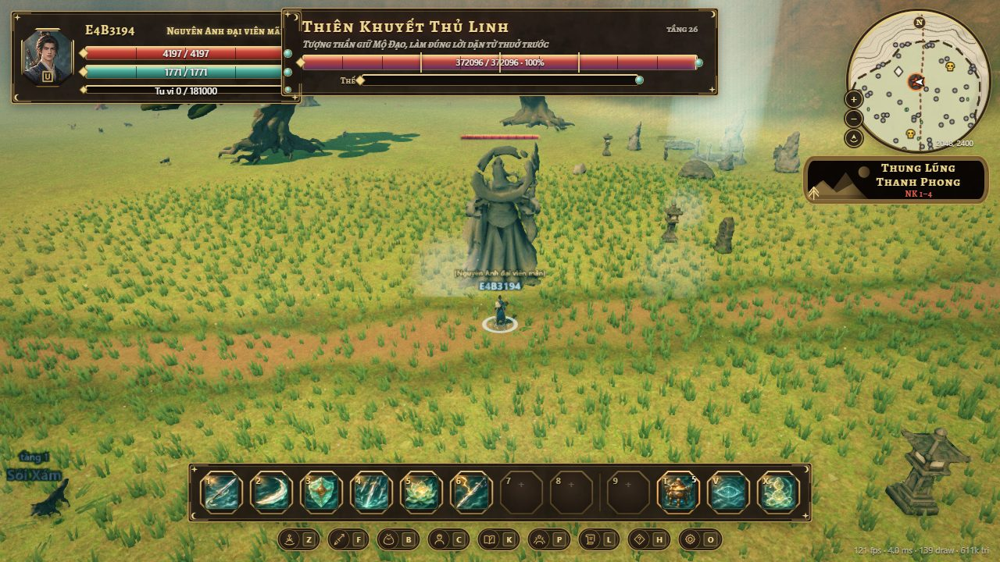 |
| Thủ Linh, 65% | 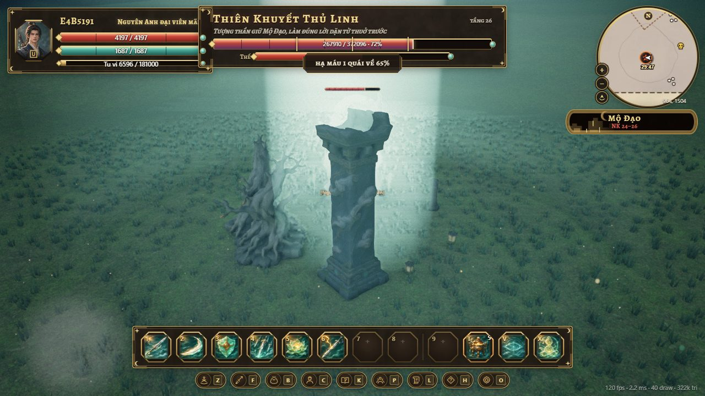 |
| Thủ Linh, 25% (quầng sao lớn, gọi tượng) | 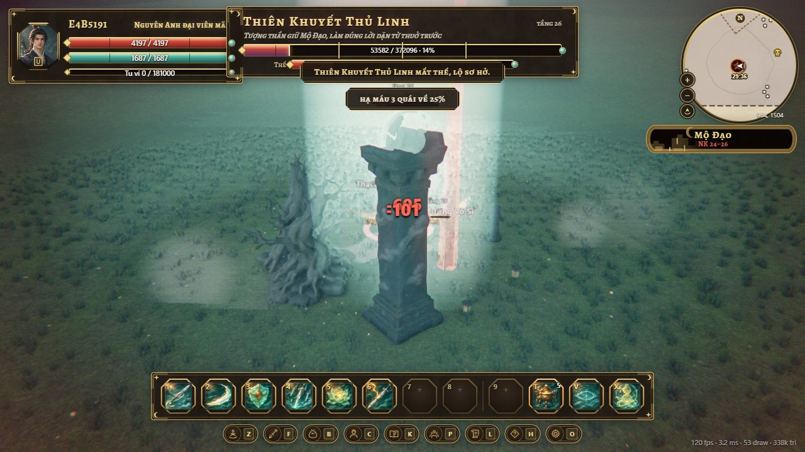 |
| Thủ Linh, chết | 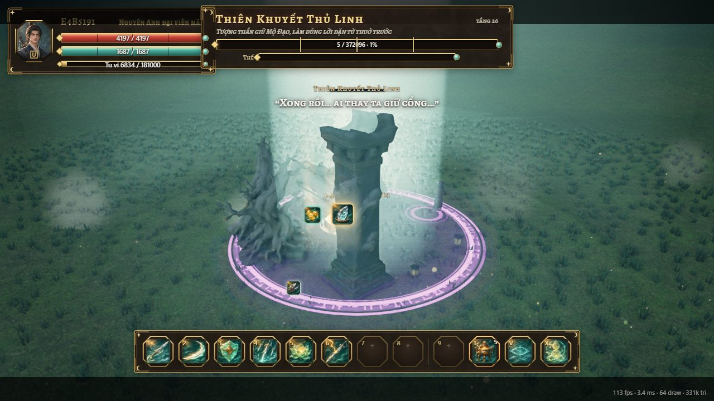 |

## Kiểm chứng

`pnpm typecheck`; `pnpm content:check`; test content/client đạt, server 41/41 file đạt khi chạy tuần tự (`vitest --no-file-parallelism`; chạy song song đôi khi trượt ngẫu nhiên các test thời gian); `thienkhuyet.mobs.test.ts` 13 test; `pnpm sim:progress` chương 2–3 không đổi (4,03–4,17 giờ / 6,13–6,28 giờ). Lỗi có sẵn ở `packages/shared/src/fxtimeline.test.ts` (tia sét `bolt scale`) không thuộc gói này. Không sửa `rooms.ts`/`index.ts` nên không chạy lại `security`.

Ghi chú ảnh: cột sáng trắng đục từng che người chơi/quái ở bản trước là **cột linh quang của điểm đáng chú ý** (`render/beacons.ts`, Hàng Trụ Đá Khắc Vân / Cổ Thành Thất Lộ), không phải chiêu của tinh anh; bản mới chụp ở chỗ cách điểm đáng chú ý ≥ 50 m, camera tự quay về phía quái.
