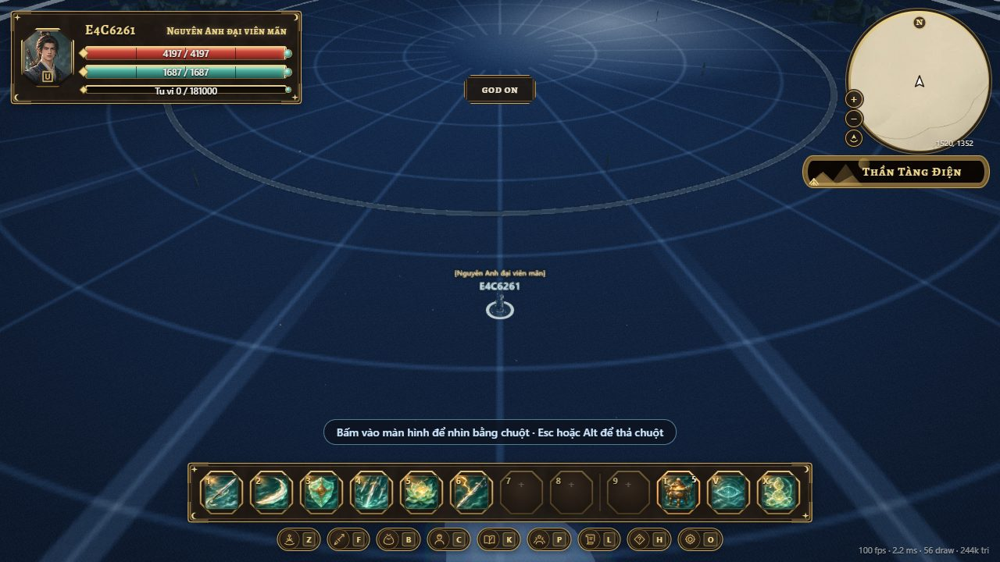
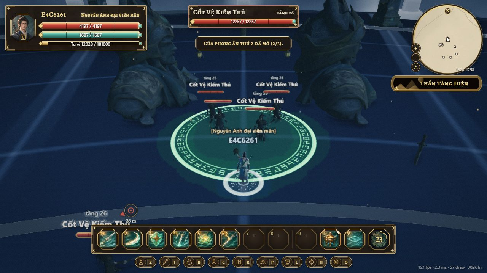
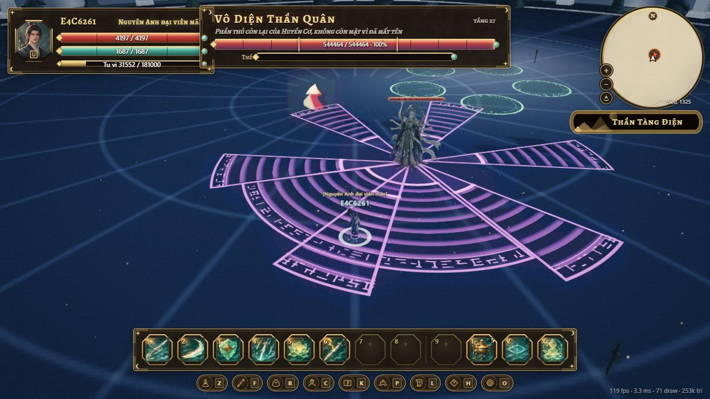
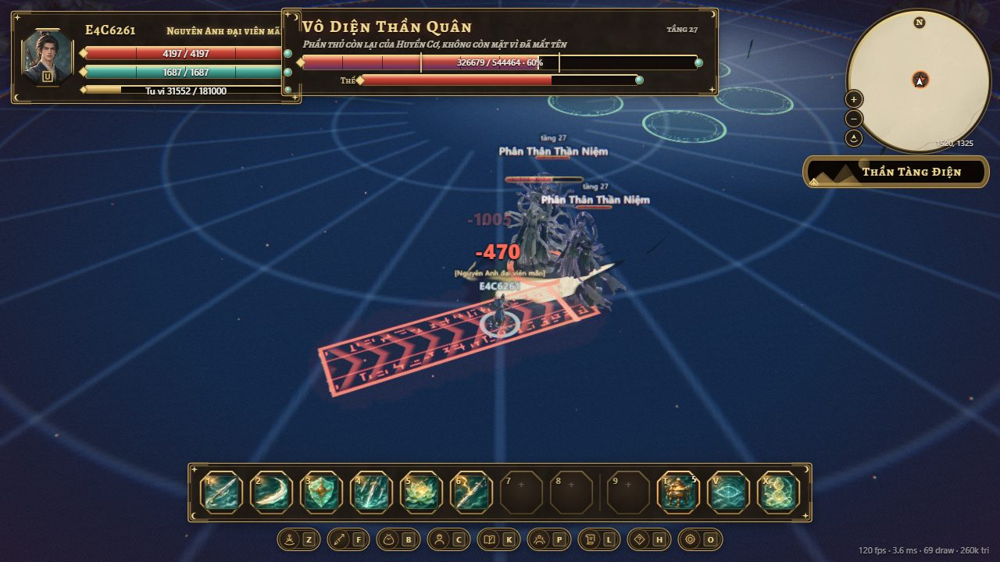
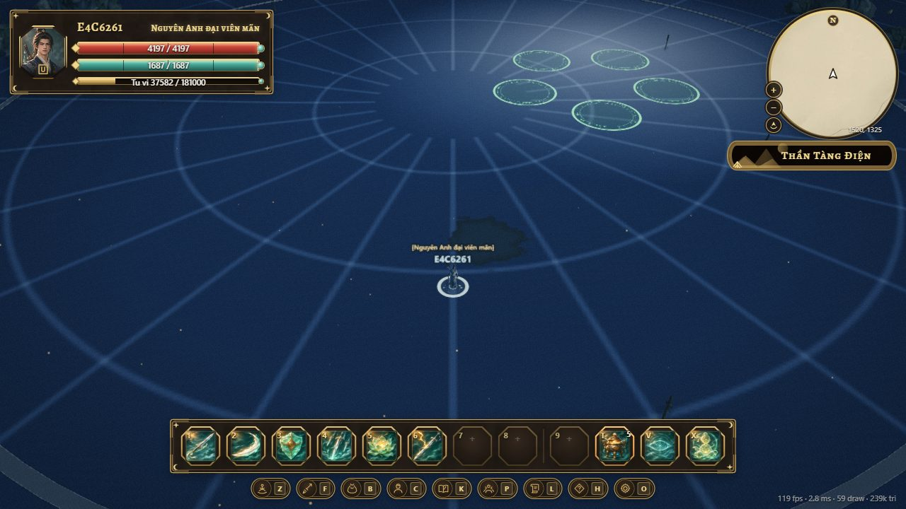

# E4-C: Thần Tàng Điện (phó bản cấp 26+, 6 đợt)

Theo `docs/EXPANSION_DESIGN.md` mục 5.3 (bí cảnh) và E4-M (cửa phong ấn). Khuôn: Phục Mạch Quật (E2-C), Kính Nguyệt Cung (E3-M).

## Đã làm

| Phần | Nơi |
| --- | --- |
| Level `than_tang`: 6 đợt, thưởng, `.assets.json` (vỏ điện dùng lại `palace` của Kính Nguyệt), prop riêng | `levels/than_tang.json`, `shared/src/props.thantang.ts` |
| Cổng vào ở Thiên Khuyết (cạnh poi `cong_than_tang_dien`), vé một lần do `WorldRoom.onPortal` | `levels/thien_khuyet.json` `portals` (+ `gen-thien-khuyet.mjs`) |
| **Đợt phong ấn** (đợt 4): 3 cửa; mở bằng nguyên anh xuất khiếu (X) chạm trận môn trong hốc, hoặc Phá Ấn Phù; thân xác bị đẩy ra khỏi hốc; mỗi cửa mở kéo thêm 4 quái; chống kẹt (180 s không mở thêm thì tự lỏng một cửa) | `apps/server/src/game/seal.ts`, `rooms.ts` (`DungeonRoom.startSeals`) |
| **Phá Ấn Phù** `itm_pha_an_phu` (`use.seal`): chế ở Dược sư (3 Tinh Quang Mặc + 4 Yêu Đan, cấp 26), rơi 25% từ Cốt Kiếm Thống Lĩnh, 50% thưởng hoàn thành; cửa chỉ mở sau khi tx trừ bùa thành công | `sim.ts` `onUse`, `GameSim.sealHook` |
| **Vô Diện Thần Quân** (`MonsterDef.than`): sáu tay (6 nón xoay 45° mỗi lượt), ngũ hành (5 ấn trên sàn, đứng ấn khắc chế giảm 80%, cờ `DmgMsg.ke`), phân thân (pha 2: hạ hết trong 15 s thì boss mất thế, không thì hợp lại hồi 8%), vòng đá + tia Phản hồi (pha 3: cả đội đứng gần nhau thì sát thương gấp đôi) | `apps/server/src/game/thantang.ts` |
| Quái bí cảnh id riêng: `mon_tt_cot_ve`, `mon_tt_thach_tuong`, `mon_tt_chien_ma`, `elite_tt_cot_kiem`, `mon_tt_phan_than`, boss `boss_vo_dien_than_quan` (không đụng quái ngoài trời của E4-B) | `monsters.json`, `loot.json`, `monsterSkins.ts` |
| Thưởng: 15% tu vi, Tinh Quang Mặc, **Thần Tàng Ngọc**, Cổ Thành Phiến, mảnh 3 bộ bậc 4; transaction + idem `dungeon:than_tang:<char>:<ngày>` + ledger (dùng lại `grantDungeonReward`) | `levels/than_tang.json` |
| `content:check` kiểm `seals` và `than` (khe giữa các tay, ấn nằm trong vòng đánh, quay ≤ 30°/s, báo ≥ 1,3–1,5 s...) | `packages/content/src/check.ts` |
| Test: 20 test mới (dữ liệu, hàm thuần, vé/cổng, phong ấn, boss từng cơ chế, thưởng) | `apps/server/src/game/thantang.test.ts` |

## Soát

- `lore-keeper`: tên theo bảng thuật ngữ; đã sửa tiêu đề boss ("không còn mặt") và câu `sys.tt_final`. **Còn lại**: `say.1`/`say.2` của boss là mô tả động tác trong ngoặc (vì `content:check` bắt buộc mỗi pha có `say.N`); lore muốn Vô Diện không nói. Cần cho phép boss "câm" ở check rồi bỏ hai dòng này.
- `netcode-reviewer`: đã sửa (1) bùa mở cửa trước khi tx trừ bùa (nay peek → tx → mở), (2) kẹt cứng khi hết bùa (tự lỏng sau 180 s), (3) một lượt X mở tối đa một cửa, (8) ghost không bị nhắm/không tính vào gom nhóm Phản hồi, (9) phân thân không chết hai lần. Bỏ qua có chủ ý: (4) vùng chặn kiểm mỗi 250 ms (không khai thác được), (6) lẫn `Date.now()`/`sim.now` (cùng khuôn `DungeonRoom` hiện có), (7) tối ưu lọc boss mỗi tick.
- `pnpm --filter @dtl/bot-client security`: 137 đạt, 1 hỏng (`đang niệm mà ra chiêu đánh quái`, `sys.tele_combat`). **Hỏng y hệt trên `origin/main`** (đã chạy riêng), không do E4-C.

## Ảnh (`pnpm shots dungeon --level than_tang --out <thư mục tuyệt đối>`, WebGPU, tắt tiếng)

Repo chỉ giữ 5 ảnh then chốt; bộ đầy đủ (cổng, đợt 1–6, chặn thân xác, xuất khiếu, Phá Ấn Phù, ngũ hành, vòng đá) nằm ở thư mục artifact của phiên và sinh lại bằng lệnh trên.

| Ảnh | Nội dung |
| --- | --- |
|  | Toàn cảnh sảnh điện, đợt 1 |
|  | Mở cửa phong ấn bằng Phá Ấn Phù |
|  | Vô Diện Thần Quân, sáu vạch nón xoay + ấn ngũ hành |
|  | Pha 2, phân thân thần niệm |
|  | Hạ boss, hoàn thành |

`log.json`: phòng `dungeon-than_tang`, WebGPU, ~55 draw call, ~227k tam giác, 0 lỗi console; cả ba cờ phong ấn (`barrierMsg`, `door1`, `allOpen`) và `bossMsgs` đều true.

## Để lại / giới hạn

- **Model tạm**: vỏ điện là vỏ "cung" của Kính Nguyệt (sàn gương, nền xanh), chưa có kiến trúc điện tàng ba tầng cầu thang riêng.
- Vòng đá, ấn ngũ hành và cửa phong ấn vẽ bằng vạch `pool` (S.HAZARD, `mv: 'pool'`) tạm; chưa có hình riêng, chưa có FX nổ/hợp lại phân thân.
- Chưa làm: nhiệm vụ `q4_than_tang`/`q4_tra_mach`, Hóa Thần Lộ 1% (chờ E4-L), nhạc/thoại boss riêng, "Phá thế" của Thần niệm dùng thanh phá thế sẵn có (`addPosture`).
- Cân bằng số (`hpMul`, `atkMul`, sát thương tay/vòng đá) chưa chạy `fight:check`/`sim:progress` cho bí cảnh này.
- `pnpm test` ở `packages/shared` có 1 test hỏng sẵn (`fxtimeline.test.ts`, tia sét) không liên quan; một số file test server hỏng khi chạy chung toàn bộ do tải nhưng đều xanh khi chạy riêng.
