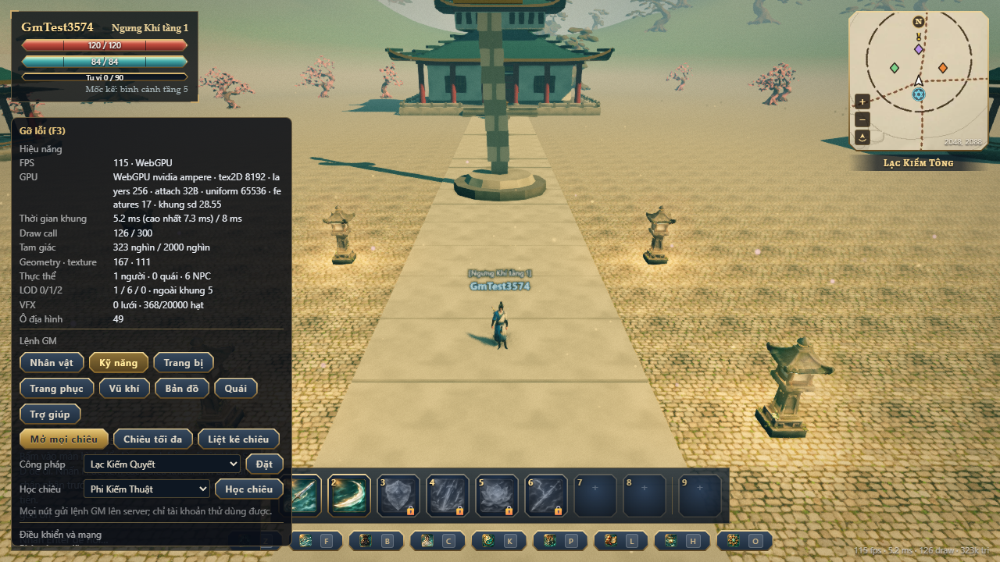
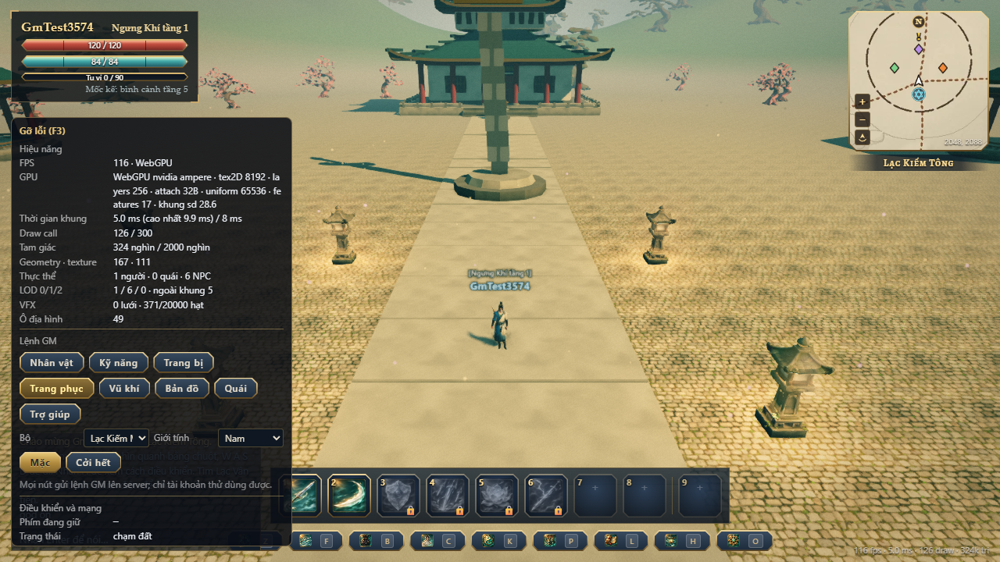
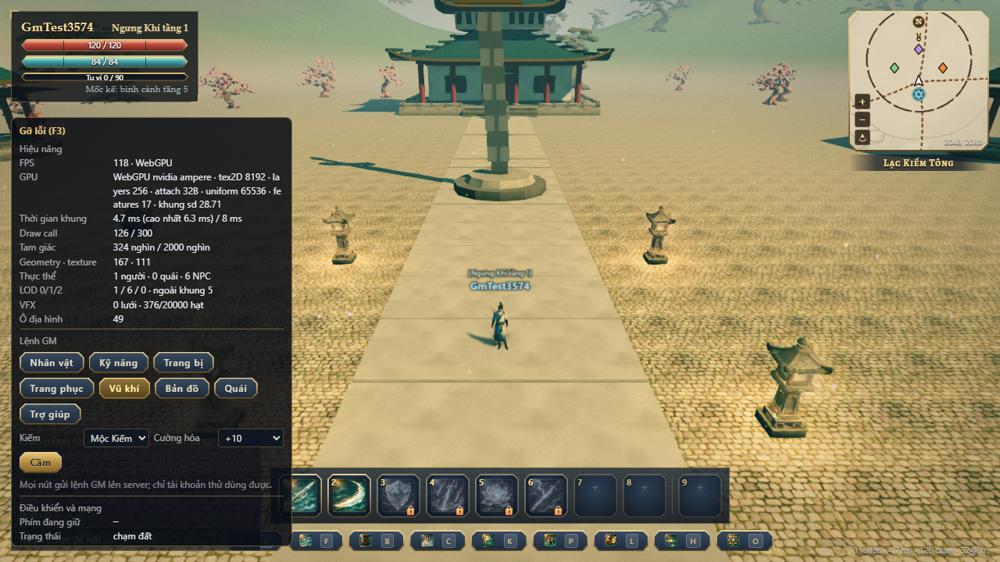
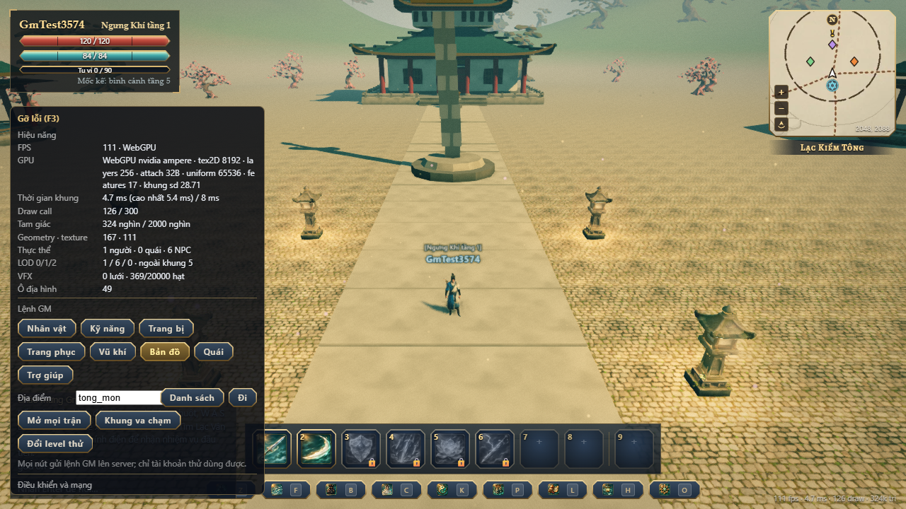
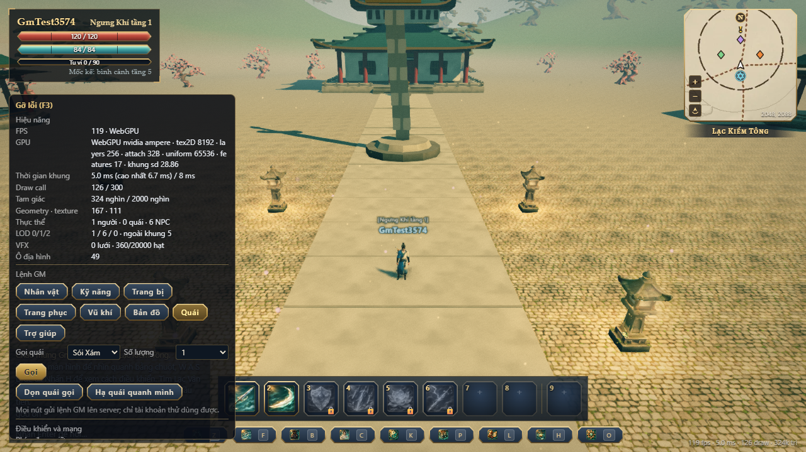
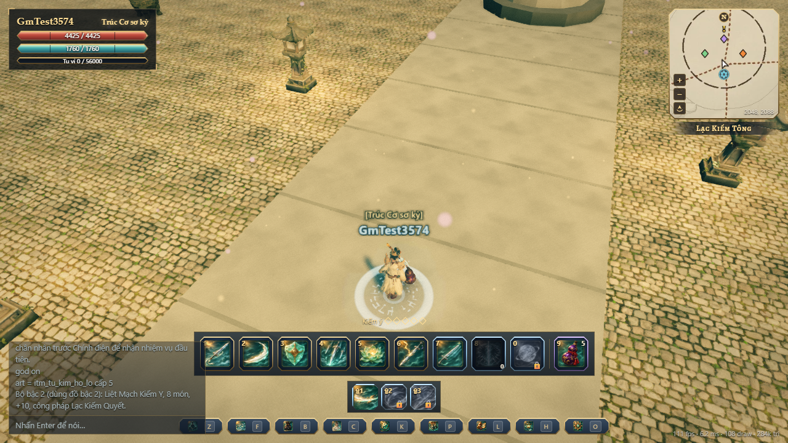
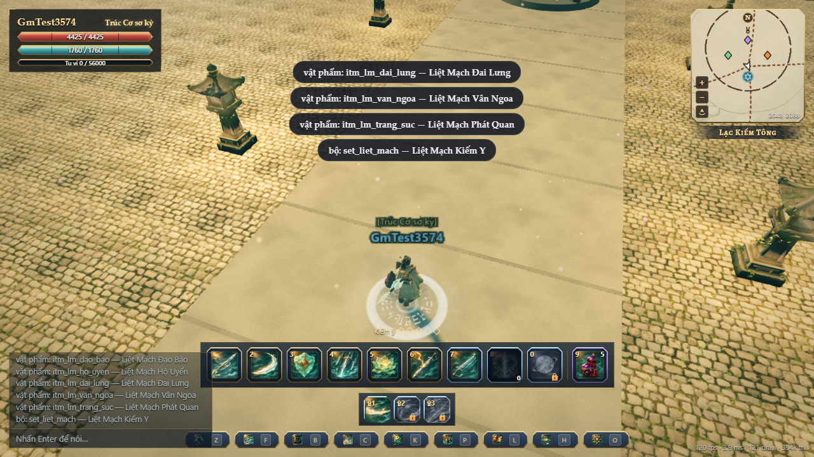
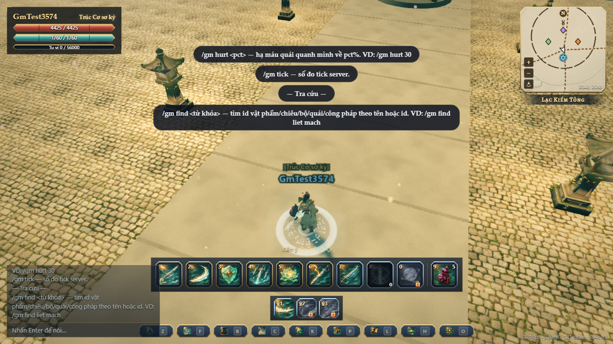
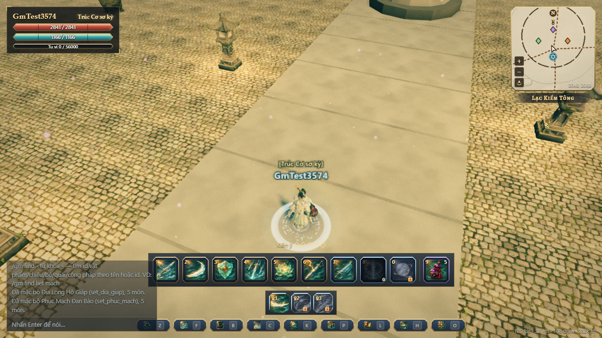
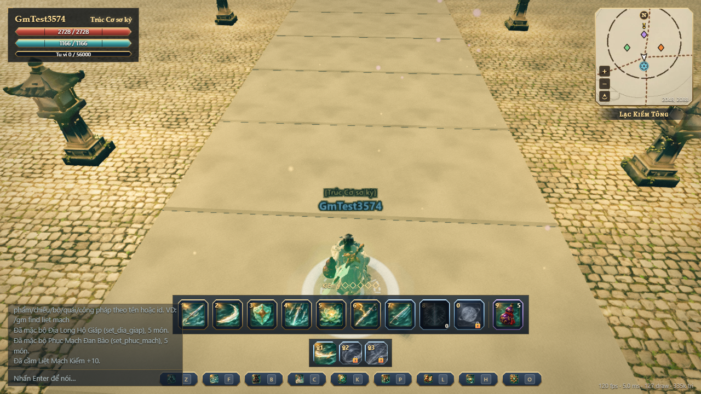

# Ảnh bảng GM và lệnh thử đồ (GM-TEST)

Chụp bằng `pnpm --filter @dtl/perf run shots:gm --out <thư mục tuyệt đối>` (WebGPU, 1280×720, `?mute=1`, Chrome `--mute-audio`, cặp cổng riêng, tự tắt server). Bảng lệnh đầy đủ: [`../gm-commands.md`](../gm-commands.md).

## Bảng GM trong F3 (từng nhóm)

| Nhóm | Ảnh |
| --- | --- |
| Nhân vật |  |
| Kỹ năng |  |
| Trang bị (bậc / nhánh / +N / giới tính) |  |
| Trang phục |  |
| Vũ khí |  |
| Bản đồ |  |
| Quái |  |

## Lệnh chạy thật

- `kit 2 kiem +10 f` bấm từ bảng (bậc 2, Kiếm tu, +10, nữ):  
- `help kit`, `find liet mach`: 
- `help` (đủ danh sách): 
- `outfit set_dia_giap m`, `outfit set_phuc_mach f`:  
- `weapon itm_liet_mach_kiem +10`: 

Góc camera là camera chơi bình thường (nhân vật nhỏ trong khung); xem kỹ hình dạng đồ thì dùng trang xem asset `?mute=1&show=char`.
