# Ánh sáng, bầu không khí và soát core loop (PR D)

Theo `docs/AUDIT_AND_ROADMAP.md` (G1, G3, G4, G13, mục 7.6). Chỉ sửa sương, ánh sáng và hậu kỳ; không đụng VFX chiêu (K-6), animation (K-4), sinh quái/AOI (M-2), số cân bằng (3-10).

## Ánh sáng và bầu không khí

| Thay đổi | Ở đâu | Chi phí |
| --- | --- | --- |
| **Lớp sương xa** kiểu thủy mặc: thêm một số hạng hàm mũ bậc một tính từ `fogHazeStart` mét, chỗ thấp dày hơn chỗ cao. Sương cũ (bậc hai) tới 200–600 m gần như chưa ăn, nên núi và rừng xa hiện nguyên màu, mép cứng. Tầm chiến đấu dưới 60 m không đổi | `render/atmosphere.ts` (`fogParams.haze`, `hazeStart`), số ở khối `grading` của `assets/palette.json` | Một `exp` mỗi điểm ảnh trong `scene.fogNode` sẵn có; 0 draw call, 0 texture |
| **Viền sáng (rim) cho thân người chơi và NPC**: fresnel hẹp, sắc nắng của preset (đêm: sắc trăng), mạnh ở phía hướng mặt trời và phần trên thân; không trắng, không vào bloom | `rimLight()` trong `render/materials/world.ts`, gọi ở `playerSkins.ts` và `npcSkins.ts`; cường độ `rim` theo preset | Cộng vào `emissiveNode`; 0 draw call, 0 texture |
| **Trời độ kiếp** từ tím sang lam đêm ngả chàm: trước đây cả khung nhuộm tím (trái art bible mục 1: tím dưới 5% khung hình). Tím giờ chỉ còn ở tia sét và vùng báo | `tribFx` trong `engine.ts` (`pulseColor`, mức 0,62) | Không |
| Bloom | Không đổi: đã chọn lọc qua MRT, trần `FX_MAX_HDR` 2,4 / `BLOOM.maxHdr` 2,5, nằm trong khoảng 2–3 yêu cầu. UI là DOM nên bloom không chạm tới | |

Số theo preset (`palette.json`, bảng 5.1 của art bible đã cập nhật):

| | Sáng sớm | Ban ngày | Đêm |
| --- | --- | --- | --- |
| `fogHaze` từ `fogHazeStart` | 0,0026 từ 50 m | 0,0021 từ 60 m | 0,0016 từ 60 m |
| `rim` | 0,55 | 0,45 | 0,9 |

Độ che của lớp sương xa ban ngày (chỗ thấp nhất): 100 m ≈ 8%, 300 m ≈ 40%, 600 m ≈ 68%.

### Ban đêm bớt tối

Ảnh đêm của M-5 cho thấy preset đêm tối tới mức thân nhân vật gần như mất, chỉ còn bảng tên. Đã nâng trong `palette.json` (preset `night`): ánh trăng 0,45 → 1,25, ánh trời đêm `#1A2938` × 0,5 → `#3B5873` × 1,0, phơi sáng 0,9 → 1,2, nâng đen `#0B1720` → `#0E1C27`, viền sáng 0,9. Màu sương, sắc bóng, độ bão hòa giữ nguyên: vẫn lam đêm trầm, đèn lồng vẫn là điểm ấm. Xem bằng `?mood=night`.

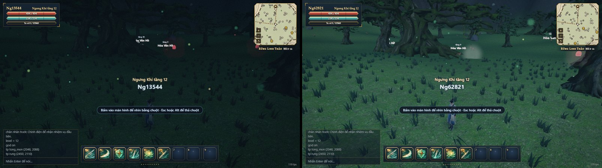

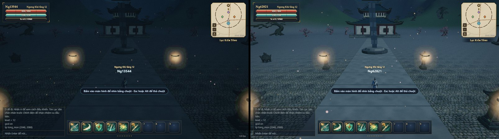

### Ảnh trước | sau (`pnpm shots`, WebGPU, Vừa; trái là `main`)

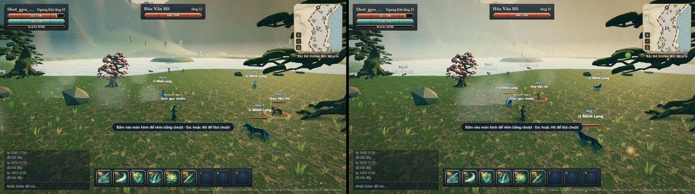

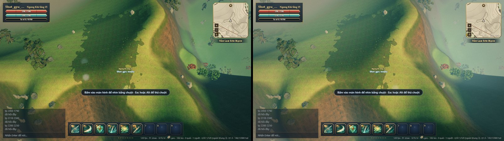

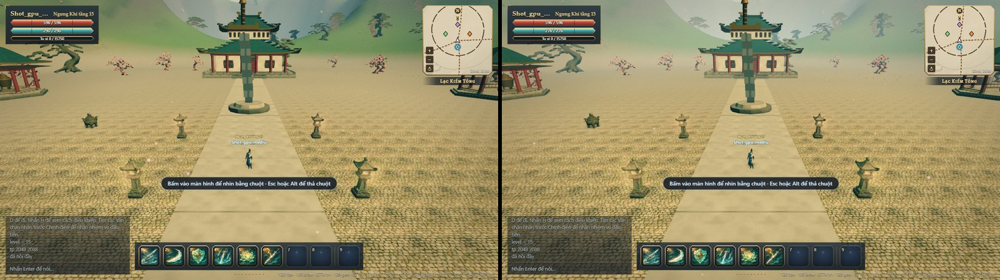

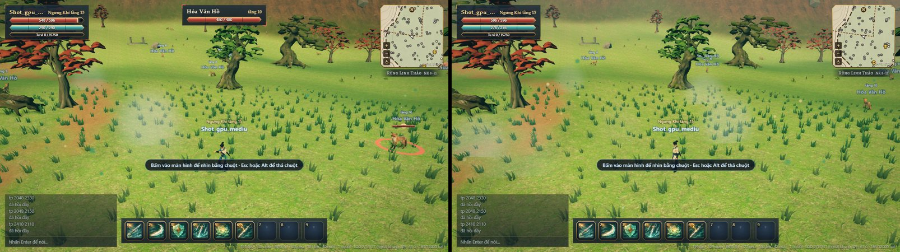

Rim tắt | bật, hai góc (ngược nắng, xuôi nắng):

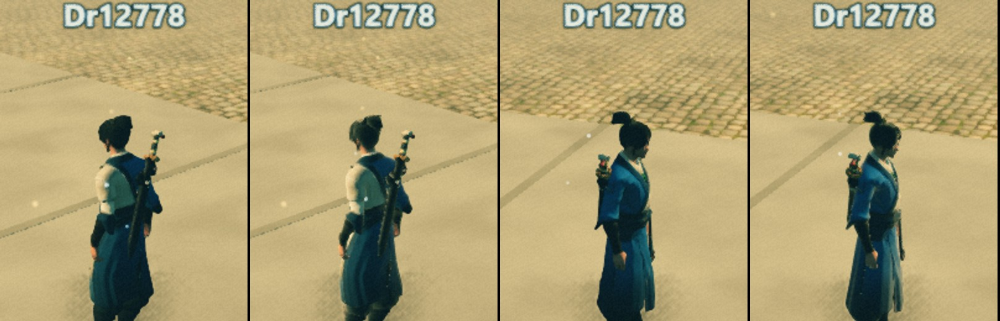

Độ kiếp sau khi đổi sắc trời, và cảnh hồ trên WebGL2:

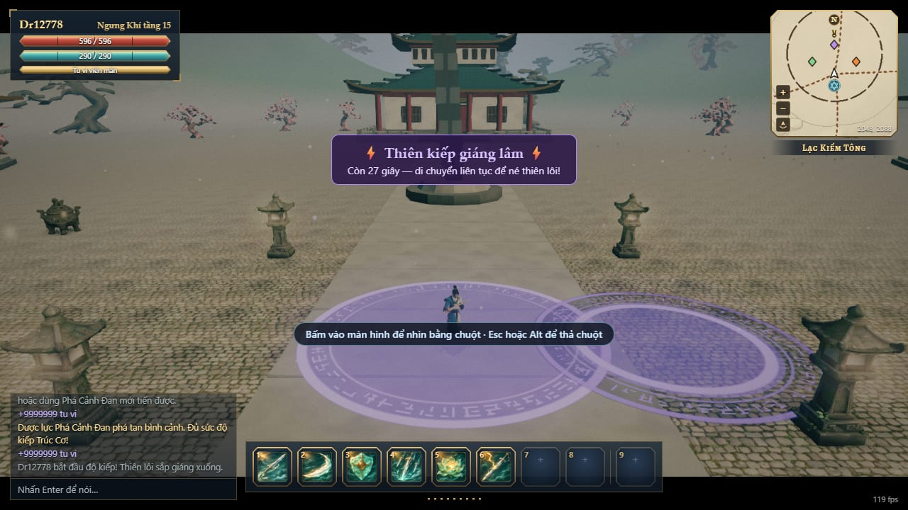

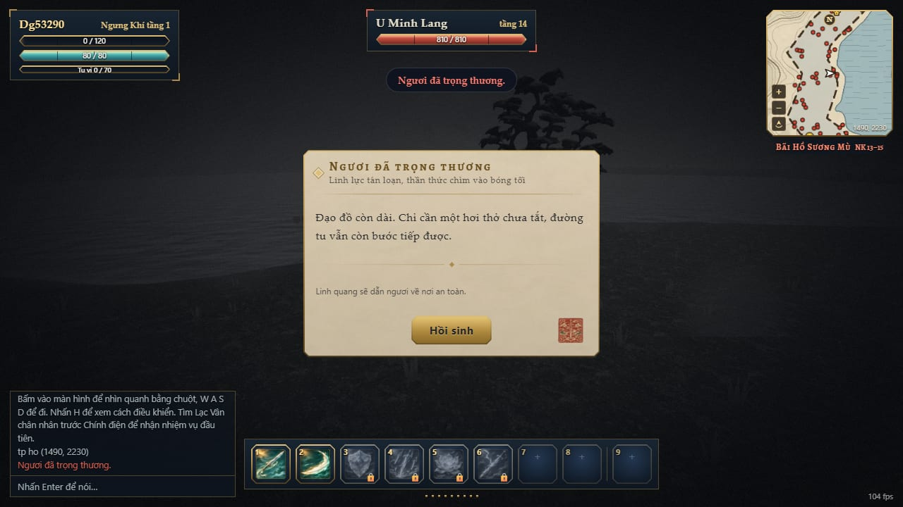

Sân tông môn vẫn còn phẳng: phần còn lại là chất liệu đá lát và bố cục cảnh (việc asset, ngoài phạm vi PR này).

### Hiệu năng

A/B xen kẽ hai vòng, `origin/main` `f1e3676` so với nhánh này, `pnpm bench:client --renderers webgpu,webgl2 --presets medium,high --seconds 6` (Chrome headless, 1280×720, máy dùng chung nên vòng 2 nhiễu hơn):

| Backend / preset | CPU p95 (ms) sân / rừng / hồ, main | nhánh | fps sân / rừng / hồ, main | nhánh |
| --- | --- | --- | --- | --- |
| WebGPU Vừa | 3,6 / 4,0 / 4,0 · 3,4 / 4,8 / 5,4 | 3,5 / 4,0 / 4,3 · 3,4 / 4,6 / 4,7 | 116 / 118 / 117 | 115 / 118 / 116 |
| WebGPU Cao | 4,4 / 5,2 / 5,2 · 6,3 / 8,5 / 7,4 | 4,3 / 5,2 / 5,0 · 5,8 / 7,5 / 6,7 | 105 / 112 / 113 | 106 / 113 / 112 |
| WebGL2 Vừa | 3,3 / 4,2 / 4,0 · 3,6 / 4,4 / 5,0 | 3,5 / 4,3 / 4,4 · 4,0 / 4,9 / 4,8 | 103 / 110 / 112 | 102 / 110 / 111 |
| WebGL2 Cao | 4,6 / 5,6 / 5,9 · 5,1 / 5,4 / 6,9 | 4,8 / 7,7 / 6,9 · 4,6 / 6,2 / 5,7 | 26 / 51 / 72 | 28 / 51 / 71 |

(Mỗi ô CPU: vòng 1 · vòng 2; fps là của vòng 1.) Draw call tối đa 180 ở cả hai bên, tam giác tối đa 961k, texture không đổi. Không thấy chênh do PR này; CPU p95 dưới 8 ms ở mọi tổ hợp của nhánh.

WebGL2 preset Cao chỉ 26–30 fps ở sân trên **cả hai bên**: nghẽn GPU có sẵn (pixelRatio 2 + FXAA + đèn lồng point light), không do PR này; đã ghi vào roadmap.

## Sửa luật: thiên lôi của người khác không giết người ngoài cuộc

Phát hiện khi làm PR C: `tickHazards` áp thiên lôi độ kiếp (24% khí huyết tối đa mỗi tia) cho mọi người chơi đứng trong vòng, kể cả khi chủ kiếp đã ngắt kết nối và đang được giữ chỗ 60 giây. Độ kiếp ở sân tông môn giết người mới và người treo máy, làm họ mất 5% tu vi.

Chú thích cũ cho thấy "đứng trong vòng thì trúng" là cố ý, nên luật đó giữ nguyên. Thay đổi: sát thương từ thiên kiếp của người khác **dừng ở 1 khí huyết**. Người ngoài vẫn thấy vòng báo, vẫn mất máu nếu đứng lì, nhưng không chết và không mất tu vi vì kiếp của người khác. Chủ kiếp vẫn chết được như cũ.

- `apps/server/src/game/sim.ts` (`tickHazards`), test trong `realm.test.ts`.
- Đây là **đổi luật chơi**; nếu muốn giữ luật cũ hoặc chọn hướng khác (chỉ đánh chủ kiếp, hay hủy kiếp khi chủ ngắt kết nối) thì chỉ cần đổi 4 dòng.

## Soát core loop

Kịch bản Playwright hai tab trên server dev, nhân vật mới, **không bật god** ở phần đánh quái, tâm ma và độ kiếp (lệnh GM chỉ dùng để dịch chuyển và nhảy cấp giữa các bước):

| # | Bước | Kết quả |
| --- | --- | --- |
| 1–4 | Nhân vật mới, nhận `q_nhap_mon` ở Lạc Vân chân nhân, trả ở Tố Tâm, mặc Mộc Kiếm và Bố Y | đạt |
| 5–6 | Đánh Sói Xám bằng chiêu: hạ 3 con, lên tầng 2, đồ và linh thạch vào túi | đạt |
| 7 | Uống Hồi Xuân Đan: hồi máu, trừ đúng 1 viên | đạt |
| 8 | Đả tọa: cờ bật, tu vi tăng | đạt |
| 9 | Ngự kiếm: tầng 2 chưa bay được, tầng 3 bay lên | đạt |
| 10–11 | Tầng 5 đầy tu vi thì kẹt bình cảnh; vượt Tâm Ma Ảnh bằng đánh thật (74–88 giây) | đạt |
| 12 | Tổ đội: mời, nhận lời bằng nút, hai bên cùng trong tổ đội | trạng thái đúng; bộ chọn DOM của script sai nên bị đánh hỏng |
| 13–14 | Tỉ thí: vào trận, gây sát thương, chịu thua không chết, không mất tu vi | đạt |
| 15–16 | Độ kiếp không god: tiêu Trúc Cơ Đan, né bằng chạy vòng, lên Trúc Cơ sơ kỳ (còn 822/1028 khí huyết) | đạt |
| 17 | Người đứng xem trong vùng sét: tụt còn 23/290 khí huyết, không chết, không mất tu vi (luật mới) | đạt |
| 18 | Chết rồi hồi sinh bằng nút | đạt |
| 19 | Tải lại trang: cấp, linh thạch, trang bị, túi còn nguyên | đạt |

18/19, 0 lỗi console. Ngoài thiên lôi, không thấy lỗi logic nào khác trong vòng lõi. Chưa soát: luyện đan, cường hóa, bí cảnh, mua bán (đã có test riêng và ảnh ở `docs/p3-*`).

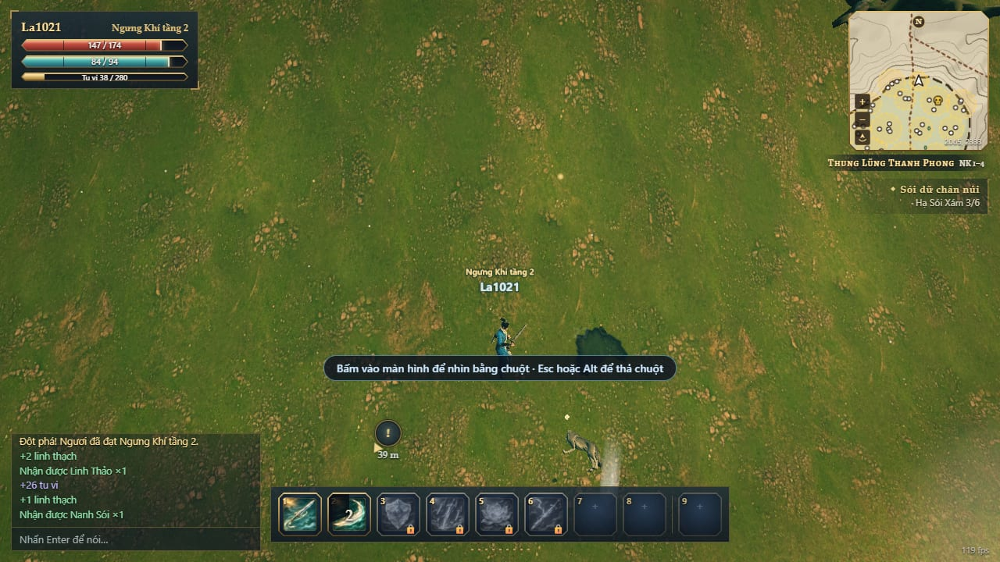

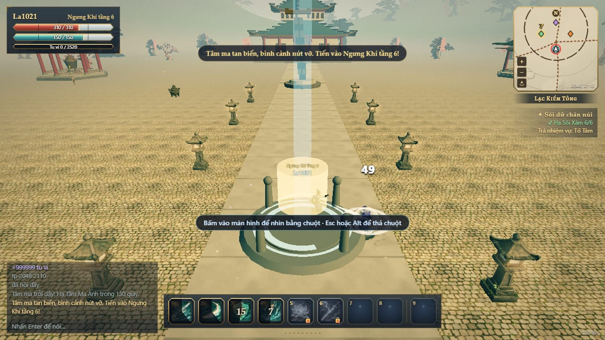

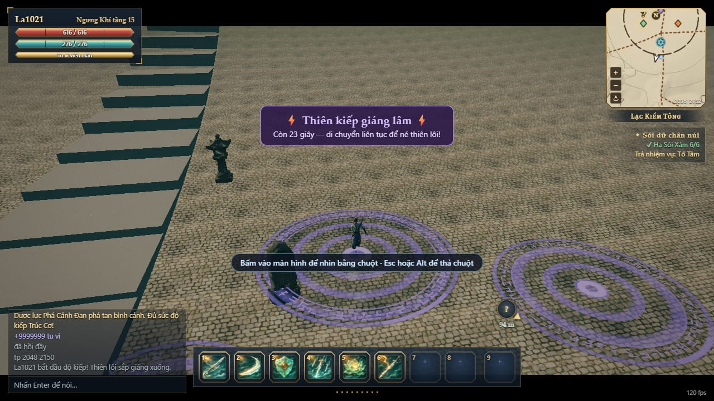

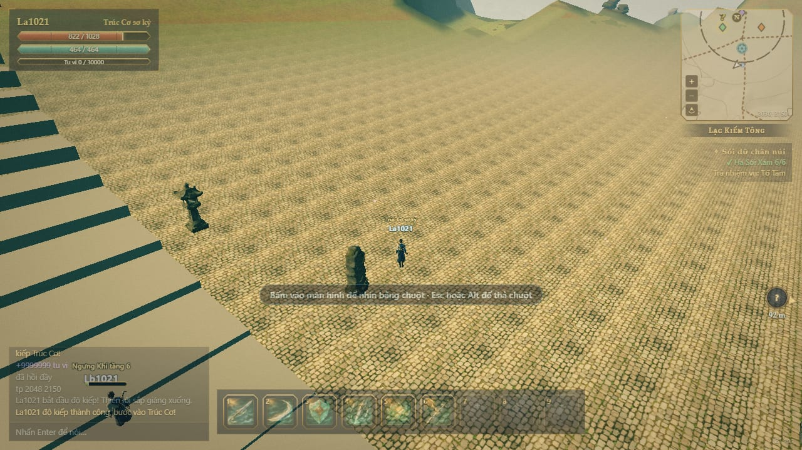

## Nội suy người chơi khác (30 bot)

`pnpm bots --count 30 --crowd 2048,2088,28`, một client đo vị trí **hiển thị** của từng người mỗi khung trong 12 giây (120 fps):

| Chỉ số | Giá trị |
| --- | --- |
| Mẫu đang di chuyển | 26.691 |
| Nhảy vị trí > 1,5 m trong một khung | 0 |
| Khựng (đang đi > 3 m/s rồi đứng một khung) | 0 |
| Đảo hướng bước | 7 (0,03%) |
| Bước lớn nhất | 0,11 m/khung |
| Hệ số biến thiên tốc độ hiển thị (trung vị / p90) | 0,35 / 0,37 |

Không giật. Tốc độ hiển thị dao động theo nhịp snapshot 20 Hz vì nội suy là trượt về vị trí mới nhất; muốn đều hơn thì nội suy theo bộ đệm thời gian (ghi ở roadmap, không gấp). Không sửa gì ở đây.

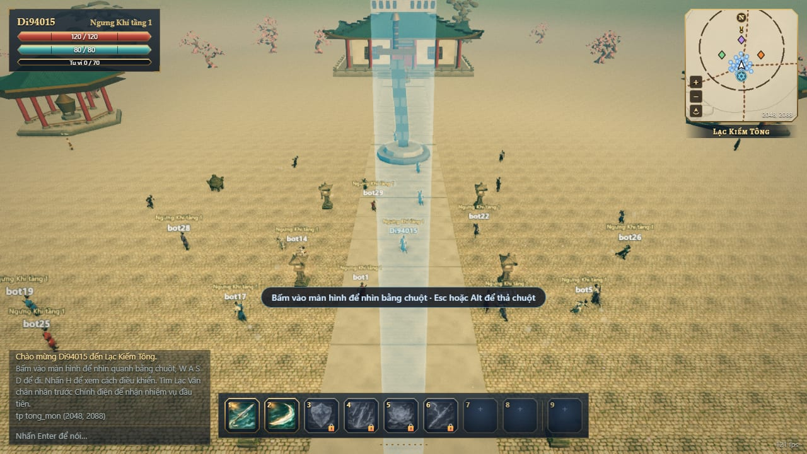

## Đã chạy

| Lệnh | Kết quả |
| --- | --- |
| `pnpm typecheck`, `pnpm content:check`, `pnpm palette:check` | đạt |
| Test | shared 151, server 220 (thêm 1), client 413: đạt. `entities.lod.test.ts` (chờ tối đa 5 giây nạp skin NPC) trượt 2 lần khi chạy cả bộ lúc máy tải nặng; chạy riêng 3/3 đạt, chạy lại cả bộ đạt |
| `pnpm build`, `pnpm size` | 2,83 MB / 30 MB |
| `pnpm bench:client` A/B | bảng trên |
| `pnpm bots --count 100 --duration 120`, `pnpm ledger:check` | tick p95 ≤ 9,3 ms; 100 nhân vật, 2162 dòng, sổ cái khớp |
| bot `security` (DB mới, không miễn giới hạn) | 106 đạt, 4 hỏng: 3 mục Truyền Tống Trận của M-4 **hỏng y hệt trên `origin/main` nguyên bản** (đã báo Orchestrator); 1 mục `?god` may rủi sau M-1 (đã sửa ở PR #100). Không mục nào liên quan thay đổi của PR này |
