# Concept trang phục Nguyên Anh bậc 3 (gói P2-concept)

Gói concept để **bạn dựng từng mảnh trên Tripo web** (image-to-3D), không tốn credit API; làm đúng khuôn gói Kết Đan ([../outfit-concepts/README.md](../outfit-concepts/README.md)). Ba bộ bậc 3 của kế hoạch tổng trang phục và vũ khí, cộng dạng cuối +10 và vỏ của Kính Quang Kiếm. Ảnh do Codex vẽ (`node tools/codex-assets/gen.mjs outfit3`, rồi `node tools/codex-assets/outfit3-doc.mjs`); dữ liệu và prompt ở `tools/codex-assets/outfit3-data.mjs`.

**Chủ đề bậc 3** (Vân Hải, Kính Nguyệt Cung): voan xuyên sáng, gương, bạc lạnh, quan đầu. Bảng màu bậc: trắng bạc + lam gương + bạc. Sáng và bắt mắt hơn tông môi trường. Cảm hứng lấy từ ảnh tham khảo bạn đã gửi (chỉ cấu trúc và tinh thần; không chép dáng, hoa văn, logo hay nhân vật nào; các ảnh đó **không nằm trong repo**). Mẫu #119 Kính Quang là bản tạm và tham chiếu dáng cho bộ Kính Quang.

**Cần duyệt:** xem ảnh trong README này. Bộ nào chưa ưng, báo mình vẽ lại trước khi bạn dựng.

## Tổng quan

| Bộ | Công pháp, ngũ hành | Tổng tam giác 6 mảnh | Bảng thiết kế | Mảnh rời |
| --- | --- | --- | --- | --- |
| **Kính Quang Kiếm Y** | Kiếm tu, Kim (gương, ánh bạc) | 11900 | [3 góc](img/kinh_quang_views.webp), [bóc lớp](img/kinh_quang_layers.webp), [chi tiết](img/kinh_quang_detail.webp) | [Áo ngoài](img/kinh_quang_ao_ngoai.webp), [Lớp dưới](img/kinh_quang_lop_duoi.webp), [Vai giáp](img/kinh_quang_vai_giap.webp), [Đai và tua](img/kinh_quang_dai_tua.webp), [Ủng](img/kinh_quang_ung.webp), [Trang sức đầu](img/kinh_quang_trang_suc_dau.webp) |
| **Vân Kình Thiết Giáp** | Hộ pháp, Thủy/Kim (kình ngư trong biển mây) | 12700 | [3 góc](img/van_kinh_views.webp), [bóc lớp](img/van_kinh_layers.webp), [chi tiết](img/van_kinh_detail.webp) | [Áo ngoài](img/van_kinh_ao_ngoai.webp), [Lớp dưới](img/van_kinh_lop_duoi.webp), [Vai giáp](img/van_kinh_vai_giap.webp), [Đai và tua](img/van_kinh_dai_tua.webp), [Ủng](img/van_kinh_ung.webp), [Trang sức đầu](img/van_kinh_trang_suc_dau.webp) |
| **Lưu Ly Đan Y** | Đan sư, Thủy (lưu ly trong suốt) | 12000 | [3 góc](img/luu_ly_views.webp), [bóc lớp](img/luu_ly_layers.webp), [chi tiết](img/luu_ly_detail.webp) | [Áo ngoài](img/luu_ly_ao_ngoai.webp), [Lớp dưới](img/luu_ly_lop_duoi.webp), [Vai giáp](img/luu_ly_vai_giap.webp), [Đai, hồ lô và dải lụa](img/luu_ly_dai_tua.webp), [Ủng](img/luu_ly_ung.webp), [Trang sức đầu](img/luu_ly_trang_suc_dau.webp) |
| **Kính Quang Kiếm** | dạng cuối +10 và vỏ | 5500 | – | [dạng cuối](img/kiem_kinh_quang_cuoi.webp), [vỏ](img/kiem_kinh_quang_vo.webp) |

Ô **trang sức đầu** là ô trang bị thứ 9 (ẩn/hiện được), mỗi bộ có một món. Mỗi bậc **một kiếm chung** cho cả ba công pháp (đã chốt 16/11), không làm kiếm riêng cho Hộ pháp hay Đan sư.

## Kính Quang Kiếm Y

Kiếm tu · Kim (gương, ánh bạc) · cảm hứng: ref-04 (áo khoác dài nền sáng, lót đậm, viền kim loại) và ref-01/02 (tay áo voan xuyên sáng); dáng tham chiếu: mẫu #119 Kính Quang.

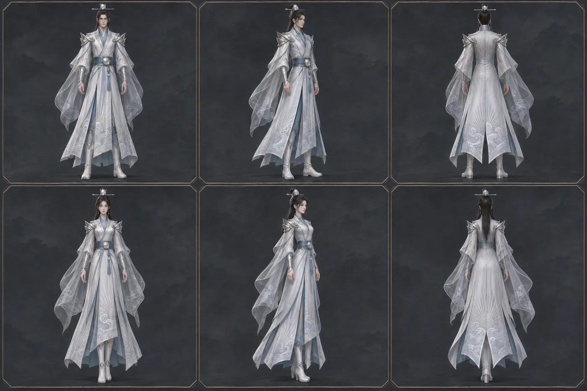

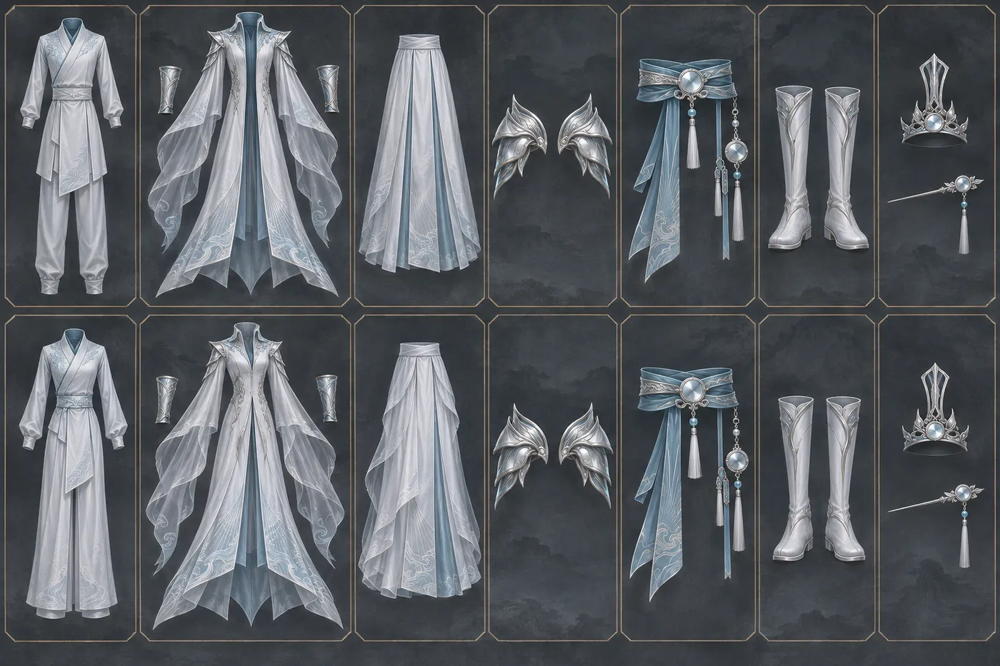

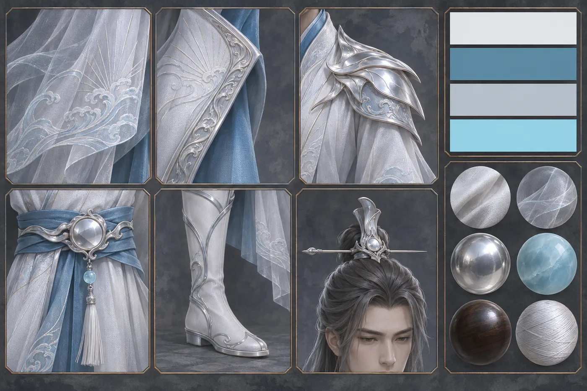

**Bảng màu 3 kênh** (mặt nạ nhuộm của shader T-5 dùng đúng 3 kênh này):

| Kênh | Mã | Tên |
| --- | --- | --- |
| Chính (áo ngoài, vạt) | `#ECEFF1` | trắng bạc |
| Phụ (lớp lót, đai, ủng) | `#5E8FA8` | lam gương |
| Viền (kim loại, vai giáp) | `#BFC8CF` | bạc lạnh |
| Nhấn phát sáng (mép gương) | `#8FD8E8` | lam băng, chỉ ở mép gương và vân bạc |

**Chất liệu:** Lụa trắng bạc dệt chéo, bóng nhẹ (áo ngoài) · voan mỏng xuyên sáng (nửa dưới tay áo, tối đa 2 mảnh trong suốt cho cả bộ) · vải đay lam gương (lớp lót) · bạc lạnh chạm khắc, đánh bóng như gương (vai giáp, hộ uyển, khóa đai, mũi ủng) · mảnh gương bạc tròn (khóa đai, tâm vai) · ngọc lam nhạt (hạt tua).

**Mảnh rời** (mỗi mảnh một ảnh concept hai góc; ảnh tải lên Tripo là bản cắt `_front` chỉ một góc chính diện):

| Mảnh | Ảnh | Tam giác | Xương gắn vào | Xương lò xo |
| --- | --- | --- | --- | --- |
| Áo ngoài | [`kinh_quang_ao_ngoai`](img/kinh_quang_ao_ngoai.webp) | 5000 | spine1/spine2 (thân), upperarm L/R, forearm L/R, cổ áo gắn neck. Trọng số lấy từ thân nền | Tay áo voan: 2 chuỗi × 4 xương mỗi bên (nửa dưới tay áo). Vạt sau: 3 chuỗi × 3 xương. Vạt xẻ tà hai bên: 1 chuỗi × 2 xương mỗi bên |
| Lớp dưới | [`kinh_quang_lop_duoi`](img/kinh_quang_lop_duoi.webp) | 2000 | pelvis/hips, thigh L/R, calf L/R. Trọng số từ thân nền | Vạt dưới trước và sau: 2 chuỗi × 2 xương |
| Vai giáp | [`kinh_quang_vai_giap`](img/kinh_quang_vai_giap.webp) | 1500 | clavicle/shoulder L và R (cứng, không co giãn); một mảnh có hai nửa đối xứng | Không. Mảnh cứng |
| Đai và tua | [`kinh_quang_dai_tua`](img/kinh_quang_dai_tua.webp) | 1300 | đai: hips/spine (cứng, quấn quanh eo). Tua: neo ở đai | Tua: 2 chuỗi × 4 xương. Dải thắt nút: 1 chuỗi × 3 xương |
| Ủng | [`kinh_quang_ung`](img/kinh_quang_ung.webp) | 1300 | foot L/R, toe L/R, calf L/R (cứng; ống ủng bám bắp chân) | Không |
| Trang sức đầu | [`kinh_quang_trang_suc_dau`](img/kinh_quang_trang_suc_dau.webp) | 800 | head (cứng). Ô trang sức đầu là ô trang bị MỚI (thứ 9, có thể ẩn/hiện) | Dải ruy băng sau: 1 chuỗi × 3 xương mỗi dải |

## Vân Kình Thiết Giáp

Hộ pháp · Thủy/Kim (kình ngư trong biển mây) · cảm hứng: ref-05 (dáng nặng, vai to, váy nhiều tầng) nhưng bằng thép lạnh và vảy kình ngư biển mây; kế thừa khối nặng của Địa Long ở bậc 2.

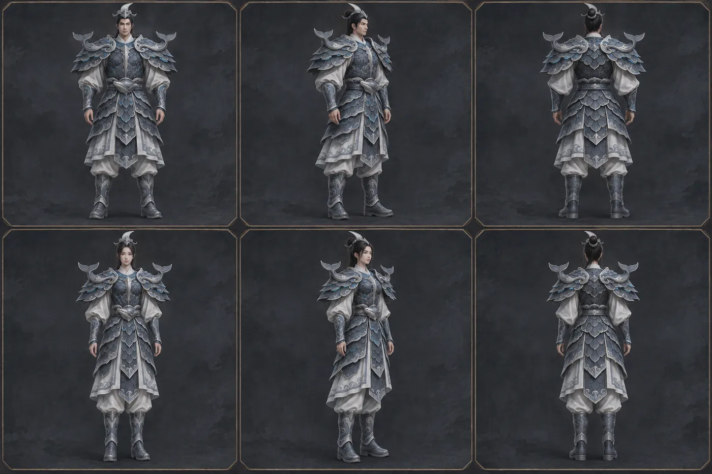

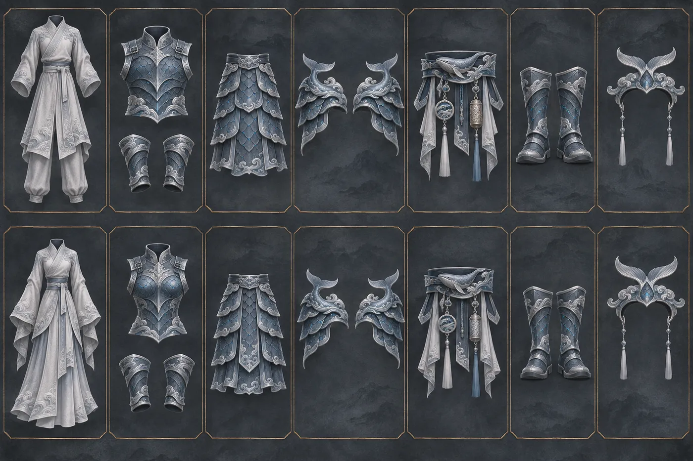

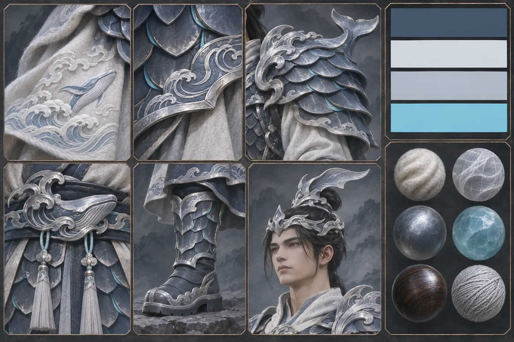

**Bảng màu 3 kênh** (mặt nạ nhuộm của shader T-5 dùng đúng 3 kênh này):

| Kênh | Mã | Tên |
| --- | --- | --- |
| Chính (giáp thân, váy giáp) | `#3E4F63` | thép xanh sương |
| Phụ (lớp lót, ủng, vải) | `#D9DEE2` | trắng mây |
| Viền (kim loại, vảy) | `#B9C2CA` | bạc lạnh |
| Nhấn phát sáng (khe vảy, sóng) | `#7FC6DC` | lam sóng, chỉ ở khe vảy |

**Chất liệu:** Thép xanh sương rèn, đánh nhám mờ (giáp ngực, vai, váy giáp) · bạc lạnh chạm sóng mây (viền vảy, khóa) · vải len dệt dày trắng mây (lớp trong) · da thuộc xám xanh (đai, ủng) · vây bạc kình (quan) · khe vảy phát sáng lam sóng.

**Mảnh rời** (mỗi mảnh một ảnh concept hai góc; ảnh tải lên Tripo là bản cắt `_front` chỉ một góc chính diện):

| Mảnh | Ảnh | Tam giác | Xương gắn vào | Xương lò xo |
| --- | --- | --- | --- | --- |
| Áo ngoài (giáp thân) | [`van_kinh_ao_ngoai`](img/van_kinh_ao_ngoai.webp) | 5000 | spine1/spine2 (giáp ngực cứng gắn spine2), upperarm L/R (tay áo ngắn), neck. Trọng số từ thân nền | Gần như không: 1 chuỗi × 2 xương cho vạt vải dưới giáp ngực. Giáp ngực cứng |
| Lớp dưới (váy giáp) | [`van_kinh_lop_duoi`](img/van_kinh_lop_duoi.webp) | 2000 | pelvis/hips, thigh L/R. Các tầng váy gắn pelvis, trọng số mềm về thigh | Mỗi tầng váy 1 xương treo (3 tầng × 2 bên, tổng ~8 xương), biên độ nhỏ cho giáp nặng |
| Vai giáp | [`van_kinh_vai_giap`](img/van_kinh_vai_giap.webp) | 2200 | clavicle/shoulder L/R (cứng); tầng dưới nối upperarm L/R | Không. Tầng dưới có 1 xương xoay nhẹ theo cánh tay |
| Đai và tua | [`van_kinh_dai_tua`](img/van_kinh_dai_tua.webp) | 1400 | hips/spine (cứng). Tua và charm neo ở đai | Tua và charm: 2 chuỗi × 3 xương |
| Ủng | [`van_kinh_ung`](img/van_kinh_ung.webp) | 1400 | foot L/R, toe L/R, calf L/R (cứng) | Không |
| Trang sức đầu | [`van_kinh_trang_suc_dau`](img/van_kinh_trang_suc_dau.webp) | 700 | head (cứng). Ô trang sức đầu là ô trang bị MỚI (thứ 9, có thể ẩn/hiện) | Không |

## Lưu Ly Đan Y

Đan sư · Thủy (lưu ly trong suốt) · cảm hứng: ref-01 và ref-06 (lớp voan, tay áo lụa mỏng, dải lụa) ở bậc 3: lưu ly trong như thủy tinh.

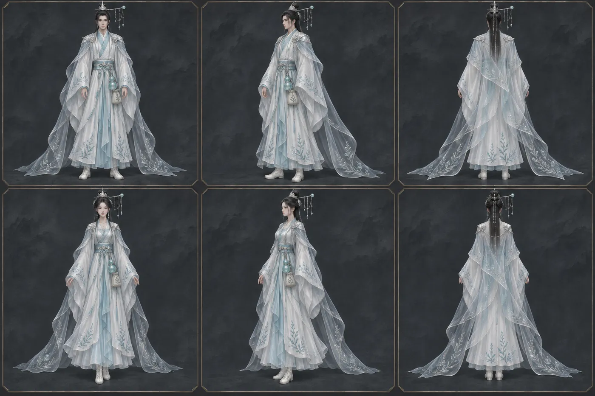

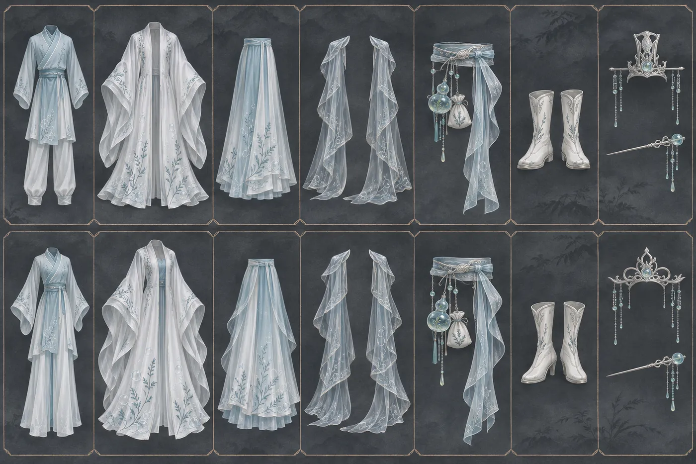

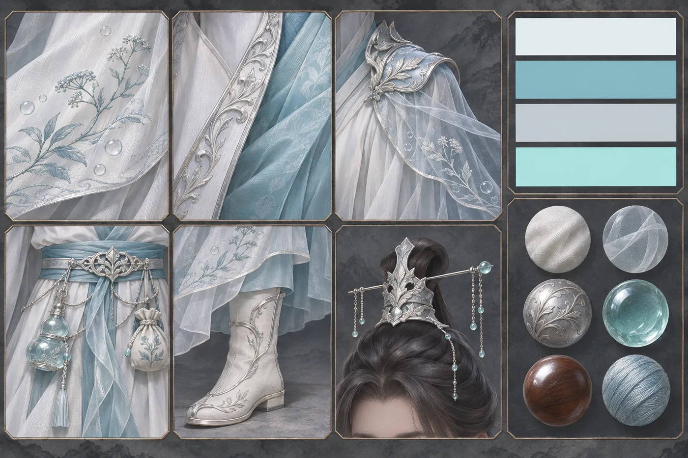

**Bảng màu 3 kênh** (mặt nạ nhuộm của shader T-5 dùng đúng 3 kênh này):

| Kênh | Mã | Tên |
| --- | --- | --- |
| Chính (áo ngoài, voan) | `#E9F1F2` | trắng lưu ly |
| Phụ (lớp lót, đai) | `#7FB9C4` | lam lưu ly |
| Viền (kim loại, trâm) | `#C9D0D6` | bạc |
| Nhấn phát sáng (hạt, mép gương) | `#A6E3E0` | xanh ngọc băng, chỉ ở hạt lưu ly và mép |

**Chất liệu:** Lụa trắng lưu ly mịn (áo ngoài) · voan mỏng xuyên sáng như thủy tinh (choàng vai và dải lụa, tối đa 2 mảnh trong suốt cho cả bộ) · vải đay thêu (lớp lót) · bạc chạm khắc (trâm, khóa đai, viền) · hồ lô lưu ly thủy tinh lam nhạt (treo đai) · hạt lưu ly (tua, chuỗi).

**Mảnh rời** (mỗi mảnh một ảnh concept hai góc; ảnh tải lên Tripo là bản cắt `_front` chỉ một góc chính diện):

| Mảnh | Ảnh | Tam giác | Xương gắn vào | Xương lò xo |
| --- | --- | --- | --- | --- |
| Áo ngoài (đạo bào + voan choàng) | [`luu_ly_ao_ngoai`](img/luu_ly_ao_ngoai.webp) | 5000 | spine1/spine2, upperarm L/R, forearm L/R, neck. Voan choàng gắn spine2 và shoulder | Tay áo rộng: 3 chuỗi × 3 xương mỗi bên. Voan choàng: 2 đuôi × 4 xương. Vạt sau: 2 chuỗi × 3 xương |
| Lớp dưới | [`luu_ly_lop_duoi`](img/luu_ly_lop_duoi.webp) | 2000 | pelvis/hips, thigh L/R, calf L/R | Vạt trước và sau: 2 chuỗi × 3 xương |
| Vai giáp (vai nhẹ) | [`luu_ly_vai_giap`](img/luu_ly_vai_giap.webp) | 1500 | clavicle/shoulder L/R (cứng) | Chuỗi hạt lưu ly: 1 chuỗi × 3 xương mỗi bên |
| Đai, hồ lô và dải lụa | [`luu_ly_dai_tua`](img/luu_ly_dai_tua.webp) | 1500 | hips/spine (đai cứng). Hồ lô và túi neo ở đai | Dải lụa: 1 chuỗi × 5 xương. Hồ lô và túi: 2 chuỗi × 3 xương. Tua: 1 chuỗi × 3 xương |
| Ủng | [`luu_ly_ung`](img/luu_ly_ung.webp) | 1200 | foot L/R, toe L/R, calf L/R (cứng) | Không |
| Trang sức đầu | [`luu_ly_trang_suc_dau`](img/luu_ly_trang_suc_dau.webp) | 800 | head (cứng). Ô trang sức đầu là ô trang bị MỚI (thứ 9, có thể ẩn/hiện) | Chuỗi hạt: 2 chuỗi × 3 xương. Dải sau: 1 chuỗi × 3 xương mỗi dải |

## Kính Quang Kiếm: dạng cuối +10 và vỏ

Dạng gốc dùng model #119 có sẵn (`prop_kiem_kinh_quang`), giữ nguyên cho +0…+9. Concept này chỉ là dạng cuối +10 và vỏ. Một kiếm chung cho cả ba công pháp (đã chốt 16/11).

| Mảnh | Ảnh | Tam giác | Gắn vào | Ghi chú |
| --- | --- | --- | --- | --- |
| Dạng cuối +10 | [`kiem_kinh_quang_cuoi`](img/kiem_kinh_quang_cuoi.webp) | 4000 | prop gắn bone `dtl_sword` (xương cầm kiếm); điểm gốc tại giữa chuôi, trục dọc theo lưỡi. Phát sáng là vật liệu riêng | Lưỡi bạc gương là khối đặc có độ dày thật, mép xuyên sáng lạnh chỉ là viền mảnh dựng đặc (worker làm phát sáng bằng vật liệu riêng); KHÔNG dùng trong suốt thật. Chắn hình cánh mỏng phải có độ dày. Dạng gốc (#119) vẫn giữ cho +0…+9; dạng cuối thay lúc cường hóa +10. |
| Vỏ kiếm | [`kiem_kinh_quang_vo`](img/kiem_kinh_quang_vo.webp) | 1500 | prop gắn ổ cắm lưng (`dtl_scabbard_back`, tạo bởi T-1/T-2); khi rút kiếm thì vỏ ở lại lưng | Vỏ dài vừa khớp lưỡi dạng gốc (#119), kín hoàn toàn. Cửa vỏ ở ngang vai khi đeo chéo lưng. |

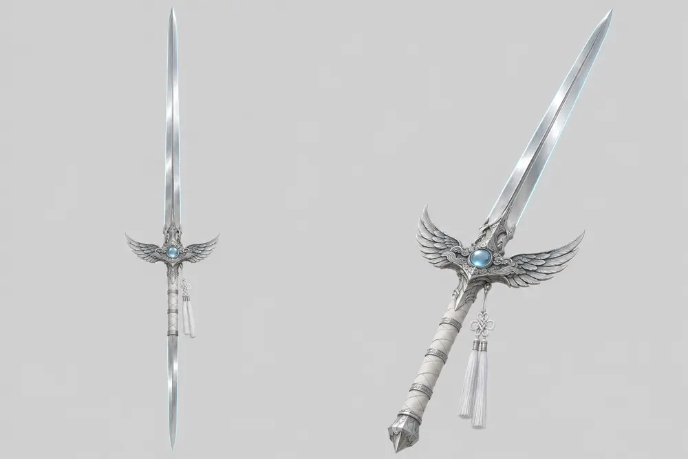

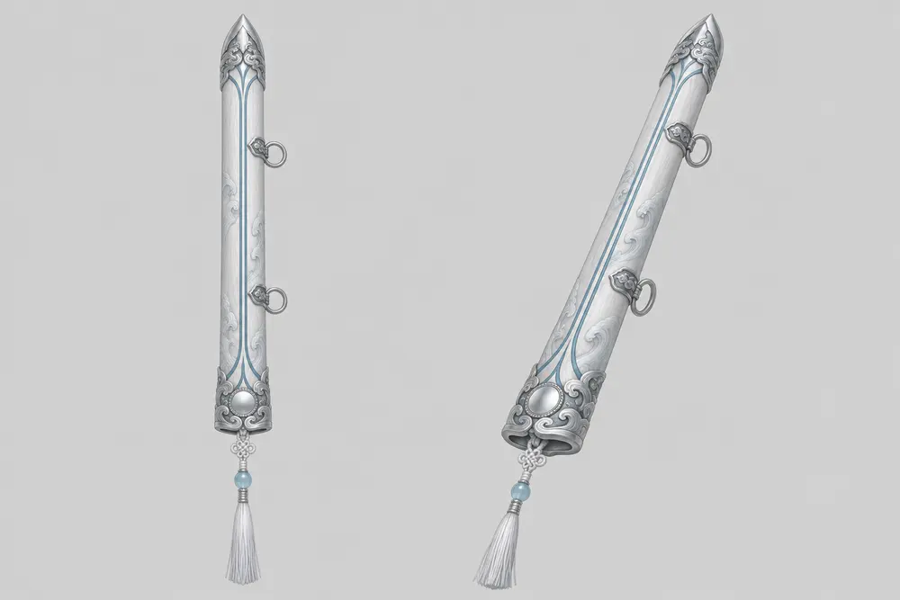

# Hướng dẫn dựng trên Tripo (Image to 3D)

Thư mục nguồn: **`D:\METAGRIT\dtl-asset-source\`**. Bài học từ Kết Đan: ảnh nguyên có 2 góc làm Tripo dựng ra 2 cái áo, nên **luôn dùng ảnh `..._v01_front.png`** (một góc chính diện, mảnh đứng riêng trên nền trơn sáng). Ngoại lệ hợp lệ: **vai giáp** và **ủng** vốn là một cặp trái-phải, ra 2 mảnh đối xứng là đúng.

## Thiết lập chung (mọi mảnh)

| Mục trên Tripo | Đặt |
| --- | --- |
| Chế độ | **Image to 3D**, ô **ảnh đơn** (ô đầu trong 4 ô). Không dùng nhiều ảnh |
| HD Model / Smart Mesh | Theo bảng từng mảnh bên dưới |
| AI Model | **H3.1 – Best Quality** |
| Generate in Parts | **Tắt** |
| 8K Texture | **Tắt** (texture mặc định ~2K là đủ) |
| Geometry & Texture | Bật texture, bật PBR; nếu có ô giới hạn số mặt (Face limit / Polycount) thì đặt theo cột "Số mặt" |
| Privacy | Private |
| Rig | **Không gắn xương** (pipeline tự gắn) |
| Generate Multi-Views | Không cần; chỉ dùng khi mặt sau ra xấu |

**Kiểm tra trước khi tải.** Xoay đủ mọi hướng, **dựng lại** nếu: mảnh là tấm mỏng không có độ dày; dính liền với người hoặc ma-nơ-canh; thủng ở cổ, cổ tay hoặc đáy; hoa văn nhòe thành vệt loang; hai bên trái phải lệch nhau; (chỉ bộ Lưu Ly và tay áo Kính Quang) đừng bắt Tripo làm trong suốt, voan cứ dựng như vải mỏng đặc, worker đổi sang alpha-test hoặc dither.

**Xuất file:** Export → **GLB**. Lưu vào thư mục `tripo\` của từng bộ, tên `raw_<mảnh>_v01.glb`, kèm `raw_<mảnh>_v01.txt` ghi task id Tripo. Dựng lại thì tăng số phiên bản (`v02`, `v03`). **Mặc định HD Model**; ra quá nhiều mặt thì Retopo xuống gần số mặt trong bảng. Nam và nữ dùng chung một mảnh (pipeline căn theo từng thân nền).

## Thứ tự làm

1. Làm trọn từng bộ rồi mới sang bộ sau: **Kính Quang → Vân Kình → Lưu Ly → Kiếm**.
2. Trong mỗi bộ: **áo ngoài trước** (quyết định dáng cả bộ). Xong áo ngoài thì nhắn mình để mặc thử lên nhân vật trước khi làm 5 mảnh còn lại.

## Bộ 1 · Kính Quang Kiếm Y (Kiếm tu)

Ảnh trong: `D:\METAGRIT\dtl-asset-source\chr\set_kinh_quang_kiem_y\concept\`
Lưu vào: `D:\METAGRIT\dtl-asset-source\chr\set_kinh_quang_kiem_y\tripo\`

| # | Mảnh | Ảnh tải lên | Chế độ | Số mặt | Lưu thành |
| --- | --- | --- | --- | --- | --- |
| 1 | Áo ngoài | `outfit_kinh_quang_ao_ngoai_v01_front.png` | **HD Model** | ~5.000 | `raw_ao_ngoai_v01.glb` |
| 2 | Lớp dưới | `outfit_kinh_quang_lop_duoi_v01_front.png` | **HD Model** | ~2.000 | `raw_lop_duoi_v01.glb` |
| 3 | Vai giáp (cặp) | `outfit_kinh_quang_vai_giap_v01_front.png` | Smart Mesh | ~1.500 | `raw_vai_giap_v01.glb` |
| 4 | Đai và tua | `outfit_kinh_quang_dai_tua_v01_front.png` | Smart Mesh | ~1.300 | `raw_dai_tua_v01.glb` |
| 5 | Ủng (cặp) | `outfit_kinh_quang_ung_v01_front.png` | Smart Mesh | ~1.300 | `raw_ung_v01.glb` |
| 6 | Trang sức đầu | `outfit_kinh_quang_trang_suc_dau_v01_front.png` | Smart Mesh | ~800 | `raw_trang_suc_dau_v01.glb` |

## Bộ 2 · Vân Kình Thiết Giáp (Hộ pháp)

Ảnh trong: `D:\METAGRIT\dtl-asset-source\chr\set_van_kinh_thiet_giap\concept\`
Lưu vào: `D:\METAGRIT\dtl-asset-source\chr\set_van_kinh_thiet_giap\tripo\`

| # | Mảnh | Ảnh tải lên | Chế độ | Số mặt | Lưu thành |
| --- | --- | --- | --- | --- | --- |
| 1 | Áo ngoài (giáp thân) | `outfit_van_kinh_ao_ngoai_v01_front.png` | **HD Model** | ~5.000 | `raw_ao_ngoai_v01.glb` |
| 2 | Lớp dưới (váy giáp) | `outfit_van_kinh_lop_duoi_v01_front.png` | **HD Model** | ~2.000 | `raw_lop_duoi_v01.glb` |
| 3 | Vai giáp (cặp) | `outfit_van_kinh_vai_giap_v01_front.png` | **HD Model** | ~2.200 | `raw_vai_giap_v01.glb` |
| 4 | Đai và tua | `outfit_van_kinh_dai_tua_v01_front.png` | Smart Mesh | ~1.400 | `raw_dai_tua_v01.glb` |
| 5 | Ủng (cặp) | `outfit_van_kinh_ung_v01_front.png` | Smart Mesh | ~1.400 | `raw_ung_v01.glb` |
| 6 | Trang sức đầu | `outfit_van_kinh_trang_suc_dau_v01_front.png` | Smart Mesh | ~700 | `raw_trang_suc_dau_v01.glb` |

## Bộ 3 · Lưu Ly Đan Y (Đan sư)

Ảnh trong: `D:\METAGRIT\dtl-asset-source\chr\set_luu_ly_dan_y\concept\`
Lưu vào: `D:\METAGRIT\dtl-asset-source\chr\set_luu_ly_dan_y\tripo\`

| # | Mảnh | Ảnh tải lên | Chế độ | Số mặt | Lưu thành |
| --- | --- | --- | --- | --- | --- |
| 1 | Áo ngoài (đạo bào + voan choàng) | `outfit_luu_ly_ao_ngoai_v01_front.png` | **HD Model** | ~5.000 | `raw_ao_ngoai_v01.glb` |
| 2 | Lớp dưới | `outfit_luu_ly_lop_duoi_v01_front.png` | **HD Model** | ~2.000 | `raw_lop_duoi_v01.glb` |
| 3 | Vai giáp (vai nhẹ) (cặp) | `outfit_luu_ly_vai_giap_v01_front.png` | Smart Mesh | ~1.500 | `raw_vai_giap_v01.glb` |
| 4 | Đai, hồ lô và dải lụa | `outfit_luu_ly_dai_tua_v01_front.png` | Smart Mesh | ~1.500 | `raw_dai_tua_v01.glb` |
| 5 | Ủng (cặp) | `outfit_luu_ly_ung_v01_front.png` | Smart Mesh | ~1.200 | `raw_ung_v01.glb` |
| 6 | Trang sức đầu | `outfit_luu_ly_trang_suc_dau_v01_front.png` | Smart Mesh | ~800 | `raw_trang_suc_dau_v01.glb` |

Lưu ý riêng: **Kính Quang** nửa dưới tay áo là voan (xuyên sáng thứ nhất), dựng mỏng đặc. **Vân Kình** vảy phải là khối nổi thật, vai là mảnh nặng nhất (HD Model). **Lưu Ly** voan choàng (áo ngoài) và dải lụa (đai) là hai mảnh xuyên sáng cho phép; hồ lô lưu ly dựng đặc màu lam nhạt.

## Kiếm · Kính Quang Kiếm (dạng cuối +10 và vỏ)

Ảnh trong: `D:\METAGRIT\dtl-asset-source\prop\prop_kiem_kinh_quang\concept\`
Lưu vào: `D:\METAGRIT\dtl-asset-source\prop\prop_kiem_kinh_quang\tripo\`

| Mảnh | Ảnh tải lên | Chế độ | Số mặt | Lưu thành |
| --- | --- | --- | --- | --- |
| Dạng cuối +10 | `outfit_kiem_kinh_quang_cuoi_v01_front.png` | **HD Model** | ~4.000 | `raw_cuoi_v01.glb` |
| Vỏ kiếm | `outfit_kiem_kinh_quang_vo_v01_front.png` | Smart Mesh | ~1.500 | `raw_vo_v01.glb` |

Kiểm tra riêng: lưỡi thẳng, có độ dày thật, mũi nhọn; chắn hình cánh dày vừa phải; chuôi tròn đều; vỏ kín và vừa dài với lưỡi. Dạng gốc dùng lại model #119, không dựng.

Prompt tiếng Anh tùy chọn và spec xương từng mảnh: [img/prompts.md](img/prompts.md).

## Trạng thái bàn giao

Đây là gói chỉ có ảnh concept; chưa có GLB nào (người dùng dựng trên Tripo web). Tiếp theo: bạn dựng, nhắn "xong áo ngoài Kính Quang" (v.v.), worker chạy pipeline T-5 và gửi ảnh duyệt.
