# Prompt Tripo và spec từng mảnh (bộ Nguyên Anh bậc 3)

Ảnh đầu vào luôn là `outfit_<id>_v01_front.png` (một góc chính diện). Hướng dẫn từng bước: [../README.md](../README.md). Ngân sách mỗi nhân vật ≤ 18k tam giác (thân nền 6k + mảnh ≤ 13k), tối đa 2 mảnh xuyên sáng mỗi bộ.


## Kính Quang Kiếm Y (Kiếm tu, Kim (gương, ánh bạc))

### Áo ngoài · `kinh_quang_ao_ngoai`

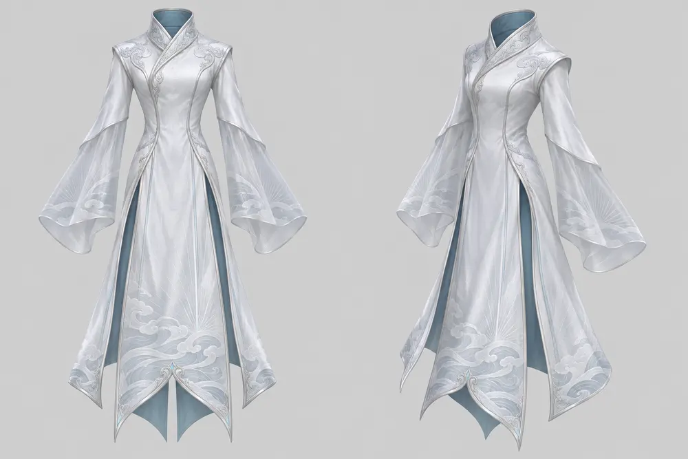

- **Lưu GLB:** `chr/set_kinh_quang_kiem_y/tripo/raw_ao_ngoai_v01.glb`
- **Xương gắn vào:** spine1/spine2 (thân), upperarm L/R, forearm L/R, cổ áo gắn neck. Trọng số lấy từ thân nền
- **Xương lò xo:** Tay áo voan: 2 chuỗi × 4 xương mỗi bên (nửa dưới tay áo). Vạt sau: 3 chuỗi × 3 xương. Vạt xẻ tà hai bên: 1 chuỗi × 2 xương mỗi bên
- **Lưu ý khi dựng:** Đây là mảnh XUYÊN SÁNG thứ nhất của bộ: nửa dưới tay áo là lớp voan mỏng riêng (dựng như vải mỏng đặc, worker đổi sang alpha-test hoặc dither). Thân áo lụa đặc. Mở thân dưới (hở) cho lớp dưới thấy bên trong.

Prompt (tùy chọn, dán vào ô mô tả thêm):

```text
A long white-silver outer swordsman coat: crossed high collar with mirror-blue lining visible, narrow torso, high side slits, long back panel ending in a swallow-tail hem, wide sleeves whose lower half is a sheer translucent gauze with a thin silver piping edge, tone-on-tone cloud-wave swirl pattern along the hem. Single isolated costume piece for a game character, no person, no mannequin, no body, clean separated geometry, hand-painted PBR materials, semi-realistic cinematic style, colors #ECEFF1, #5E8FA8, #BFC8CF.
```

### Lớp dưới · `kinh_quang_lop_duoi`

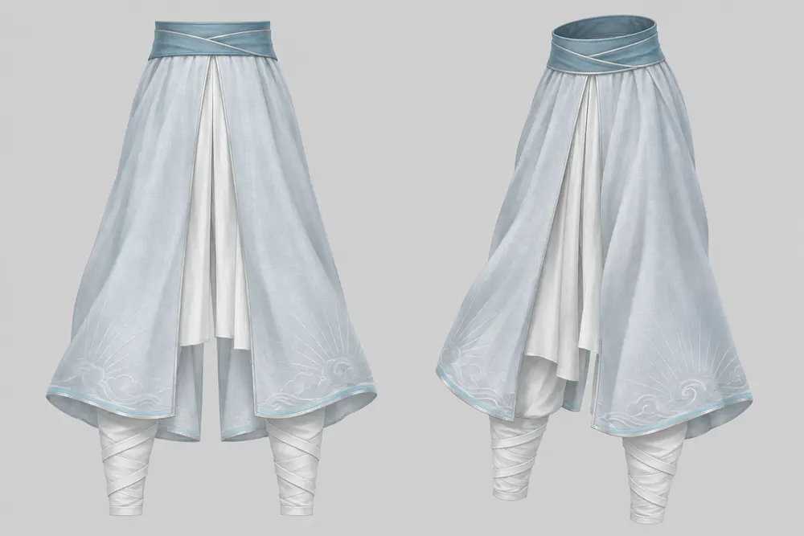

- **Lưu GLB:** `chr/set_kinh_quang_kiem_y/tripo/raw_lop_duoi_v01.glb`
- **Xương gắn vào:** pelvis/hips, thigh L/R, calf L/R. Trọng số từ thân nền
- **Xương lò xo:** Vạt dưới trước và sau: 2 chuỗi × 2 xương
- **Lưu ý khi dựng:** Quần và vạt trong tối giản để áo ngoài là điểm nhấn. Phủ kín đùi tới bắp chân để cắt vùng ẩn của thân nền. Đặc, không xuyên sáng.

Prompt (tùy chọn, dán vào ô mô tả thêm):

```text
Wide-leg trousers in plain pale mirror-blue linen with a long white inner under-skirt panel split at the middle front and back, white leg wraps below the knees, thin silver stitched hem trim, simple and tidy. Single isolated costume piece for a game character, no person, no mannequin, no body, clean separated geometry, hand-painted PBR materials, semi-realistic cinematic style, colors #ECEFF1, #5E8FA8, #BFC8CF.
```

### Vai giáp · `kinh_quang_vai_giap`

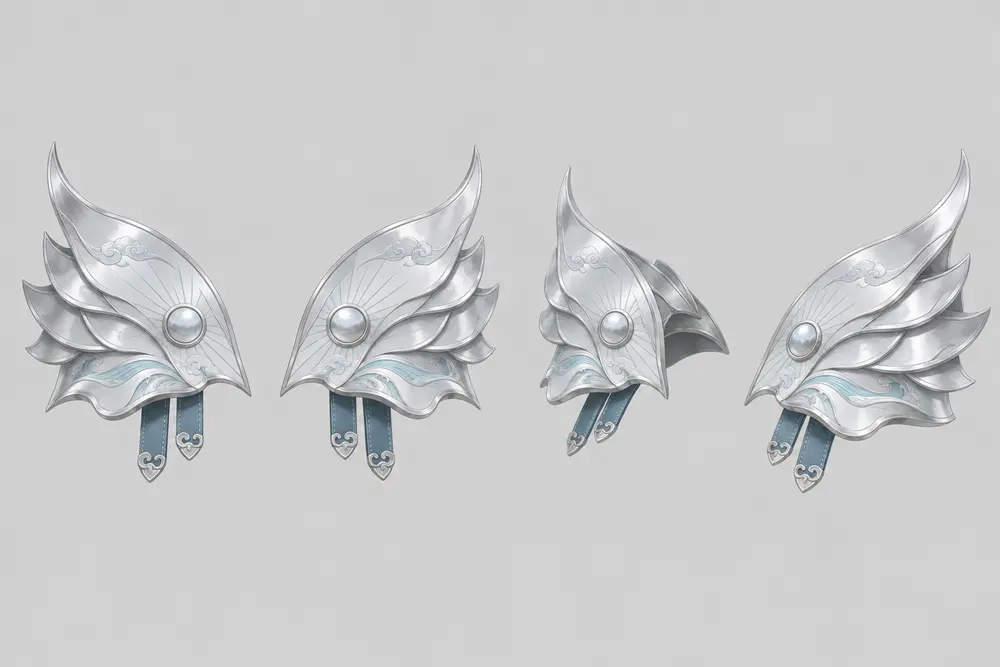

- **Lưu GLB:** `chr/set_kinh_quang_kiem_y/tripo/raw_vai_giap_v01.glb`
- **Xương gắn vào:** clavicle/shoulder L và R (cứng, không co giãn); một mảnh có hai nửa đối xứng
- **Xương lò xo:** Không. Mảnh cứng
- **Lưu ý khi dựng:** Hai nửa đối xứng, chỉ cần dựng một cặp. Bạc đánh bóng như gương: worker bật phản chiếu giả. Mép lam băng là vật liệu phát sáng riêng.

Prompt (tùy chọn, dán vào ô mô tả thêm):

```text
A matching pair of polished silver mirror pauldrons: each a fan of overlapping leaf-shaped mirror-polished silver plates rising to an upward point, thin engraved cloud-wave lines on the edges, one small round mirror disc inlaid at the center, mirror-blue leather strap tabs underneath, mirrored left and right. Single isolated costume piece for a game character, no person, no mannequin, no body, clean separated geometry, hand-painted PBR materials, semi-realistic cinematic style, colors #ECEFF1, #5E8FA8, #BFC8CF.
```

### Đai và tua · `kinh_quang_dai_tua`

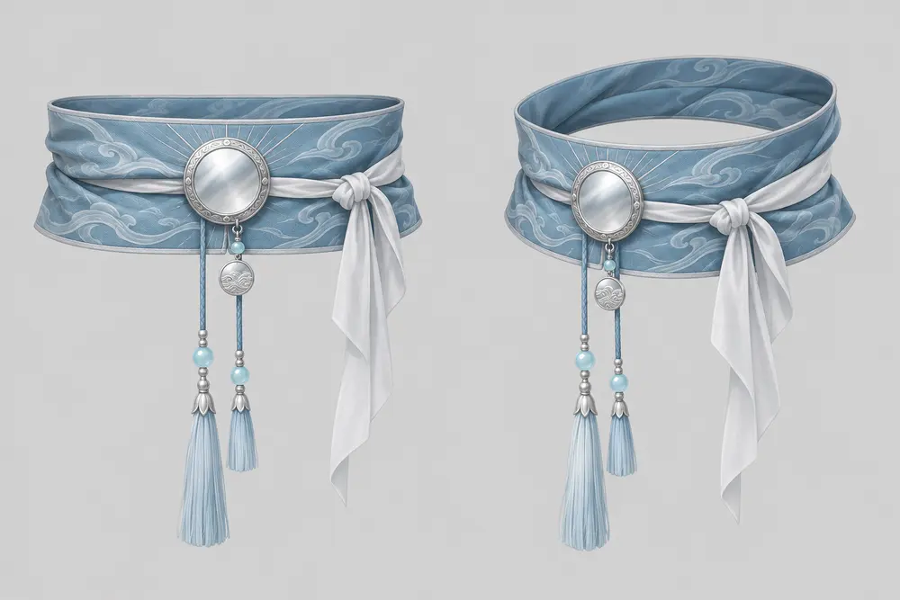

- **Lưu GLB:** `chr/set_kinh_quang_kiem_y/tripo/raw_dai_tua_v01.glb`
- **Xương gắn vào:** đai: hips/spine (cứng, quấn quanh eo). Tua: neo ở đai
- **Xương lò xo:** Tua: 2 chuỗi × 4 xương. Dải thắt nút: 1 chuỗi × 3 xương
- **Lưu ý khi dựng:** Đai là vòng kín quanh eo, dày ~2 cm để pipeline lồng đệm. Tua và dải để rời mesh gắn xương lò xo. Gương tròn ở khóa là điểm nhận diện của bộ.

Prompt (tùy chọn, dán vào ô mô tả thêm):

```text
A mirror-blue sash belt wrapped twice with a round polished silver mirror disc clasp framed by a thin engraved silver ring, a second thin white sash knot at the side, two hanging cords ending in pale blue bead tassels of different lengths, a small silver mirror charm. Single isolated costume piece for a game character, no person, no mannequin, no body, clean separated geometry, hand-painted PBR materials, semi-realistic cinematic style, colors #ECEFF1, #5E8FA8, #BFC8CF.
```

### Ủng · `kinh_quang_ung`

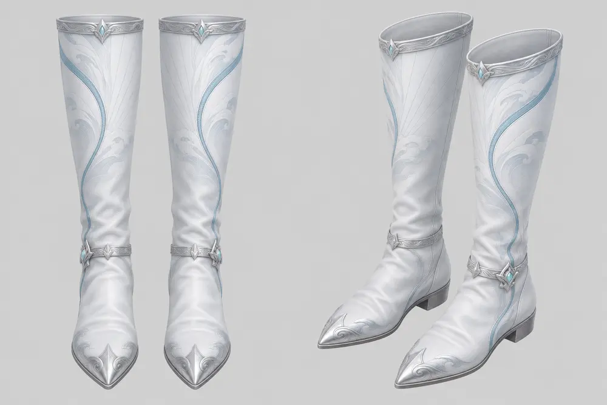

- **Lưu GLB:** `chr/set_kinh_quang_kiem_y/tripo/raw_ung_v01.glb`
- **Xương gắn vào:** foot L/R, toe L/R, calf L/R (cứng; ống ủng bám bắp chân)
- **Xương lò xo:** Không
- **Lưu ý khi dựng:** Đế phẳng, đặt chân đúng trục xương chân. Miệng ủng đủ rộng để lớp dưới chui vào.

Prompt (tùy chọn, dán vào ô mô tả thêm):

```text
A pair of tall white leather riding boots reaching below the knee, polished silver pointed toe caps, thin silver engraved bands along the top edge and ankle, a pale mirror-blue stitched wave line along the shaft, sleek and elegant. Single isolated costume piece for a game character, no person, no mannequin, no body, clean separated geometry, hand-painted PBR materials, semi-realistic cinematic style, colors #ECEFF1, #5E8FA8, #BFC8CF.
```

### Trang sức đầu · `kinh_quang_trang_suc_dau`

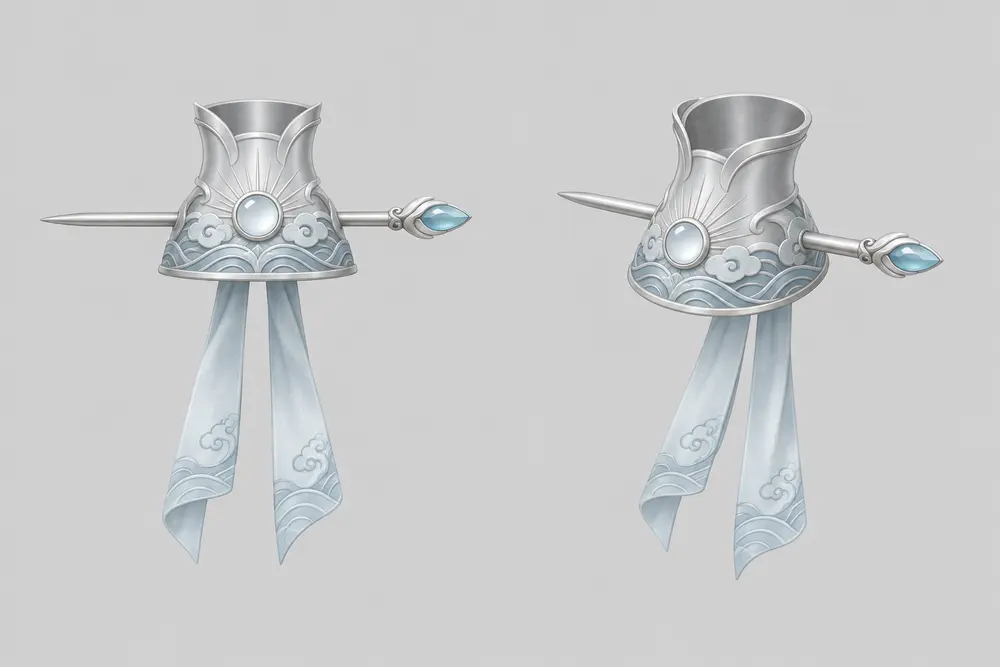

- **Lưu GLB:** `chr/set_kinh_quang_kiem_y/tripo/raw_trang_suc_dau_v01.glb`
- **Xương gắn vào:** head (cứng). Ô trang sức đầu là ô trang bị MỚI (thứ 9, có thể ẩn/hiện)
- **Xương lò xo:** Dải ruy băng sau: 1 chuỗi × 3 xương mỗi dải
- **Lưu ý khi dựng:** Chỉ có quan, trâm, dải. KHÔNG có đầu, tóc hay mặt: tóc thuộc model nhân vật gốc. Gọn trong vòng tròn ~8 cm nhìn từ trên xuống.

Prompt (tùy chọn, dán vào ô mô tả thêm):

```text
A slim polished silver hair crown (guan) holding a topknot: a small tapered silver cap with engraved cloud-wave lines and a small round mirror disc at the front, one long silver hairpin with a pale blue stone tip passing through it, two short pale mirror-blue ribbon tails hanging at the back. Single isolated costume piece for a game character, no person, no mannequin, no body, clean separated geometry, hand-painted PBR materials, semi-realistic cinematic style, colors #ECEFF1, #5E8FA8, #BFC8CF.
```


## Vân Kình Thiết Giáp (Hộ pháp, Thủy/Kim (kình ngư trong biển mây))

### Áo ngoài (giáp thân) · `van_kinh_ao_ngoai`

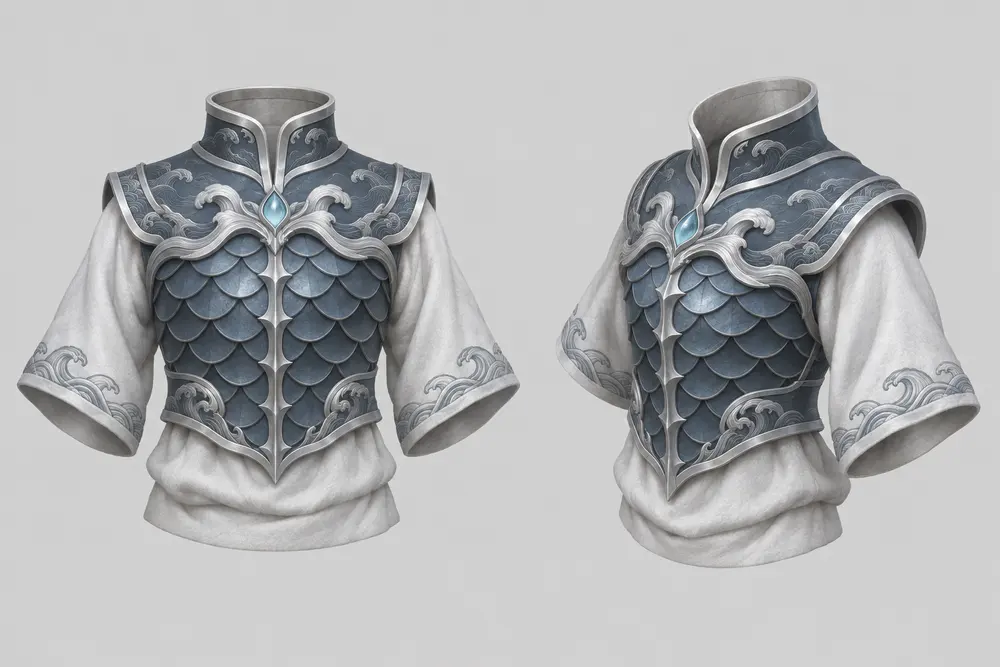

- **Lưu GLB:** `chr/set_van_kinh_thiet_giap/tripo/raw_ao_ngoai_v01.glb`
- **Xương gắn vào:** spine1/spine2 (giáp ngực cứng gắn spine2), upperarm L/R (tay áo ngắn), neck. Trọng số từ thân nền
- **Xương lò xo:** Gần như không: 1 chuỗi × 2 xương cho vạt vải dưới giáp ngực. Giáp ngực cứng
- **Lưu ý khi dựng:** Giáp ngực là khối cứng, vải tunic bên dưới là phần mềm. Để nửa dưới thân hở cho lớp dưới. Vảy phải là khối nổi thật, không phải họa tiết. Đặc hoàn toàn.

Prompt (tùy chọn, dán vào ô mô tả thêm):

```text
A heavy guardian chest armor over a thick cloud-white wool tunic: a half-breastplate of overlapping blue-grey steel whale-scale plates with cold silver edging and a central ridged spine line, silver-lined high steel collar, short wide tunic sleeves, a silver wave-crest ornament on the chest, no skirt included. Single isolated costume piece for a game character, no person, no mannequin, no body, clean separated geometry, hand-painted PBR materials, semi-realistic cinematic style, colors #3E4F63, #D9DEE2, #B9C2CA.
```

### Lớp dưới (váy giáp) · `van_kinh_lop_duoi`

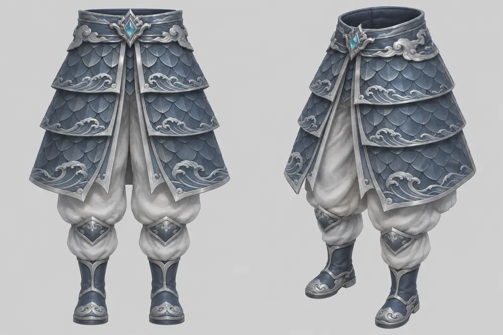

- **Lưu GLB:** `chr/set_van_kinh_thiet_giap/tripo/raw_lop_duoi_v01.glb`
- **Xương gắn vào:** pelvis/hips, thigh L/R. Các tầng váy gắn pelvis, trọng số mềm về thigh
- **Xương lò xo:** Mỗi tầng váy 1 xương treo (3 tầng × 2 bên, tổng ~8 xương), biên độ nhỏ cho giáp nặng
- **Lưu ý khi dựng:** Các tầng váy là tấm cứng chồng lên nhau, khoảng hở nhỏ giữa tầng để xương xoay. Không xuyên sáng.

Prompt (tùy chọn, dán vào ô mô tả thêm):

```text
A tiered armored skirt: three overlapping rows of blue-grey steel scale plates with thin cold-silver edging hanging from a belt line to the knees, split at the front and back for walking, thick cloud-white wool trousers underneath tucked into the boots, small steel knee guards. Single isolated costume piece for a game character, no person, no mannequin, no body, clean separated geometry, hand-painted PBR materials, semi-realistic cinematic style, colors #3E4F63, #D9DEE2, #B9C2CA.
```

### Vai giáp · `van_kinh_vai_giap`

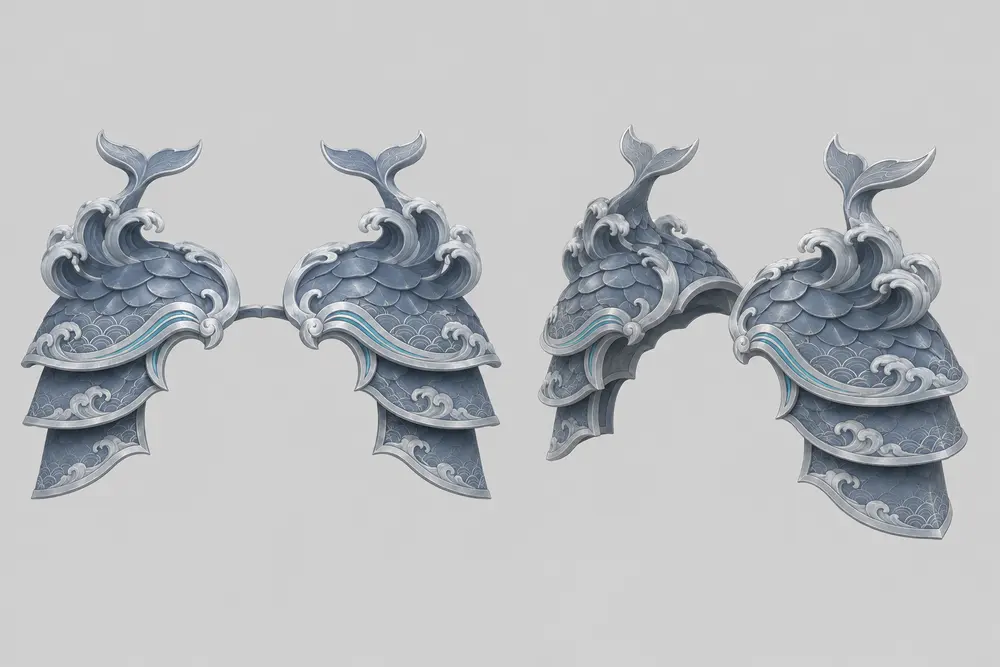

- **Lưu GLB:** `chr/set_van_kinh_thiet_giap/tripo/raw_vai_giap_v01.glb`
- **Xương gắn vào:** clavicle/shoulder L/R (cứng); tầng dưới nối upperarm L/R
- **Xương lò xo:** Không. Tầng dưới có 1 xương xoay nhẹ theo cánh tay
- **Lưu ý khi dựng:** Vai to nhất ba bộ bậc 3, đỉnh cao hơn vai ~15 cm. Kiểm tra không đâm vào cổ khi giơ tay, để pipeline tạo lồng đệm.

Prompt (tùy chọn, dán vào ô mô tả thêm):

```text
A matching pair of huge shoulder guards built from overlapping blue-grey steel whale-scale plates, rising in a sweeping rolling-wave crest that ends in a whale-fluke tip over each shoulder, three descending tiers hanging over the upper arm, cold silver wave-line edging, mirrored left and right. Single isolated costume piece for a game character, no person, no mannequin, no body, clean separated geometry, hand-painted PBR materials, semi-realistic cinematic style, colors #3E4F63, #D9DEE2, #B9C2CA.
```

### Đai và tua · `van_kinh_dai_tua`

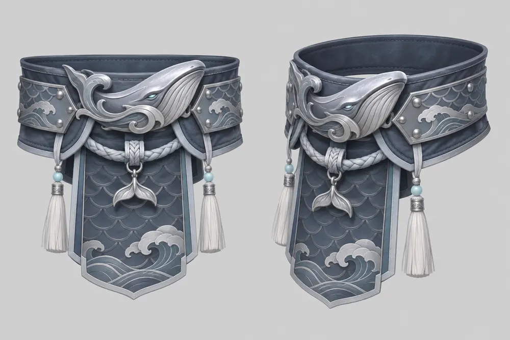

- **Lưu GLB:** `chr/set_van_kinh_thiet_giap/tripo/raw_dai_tua_v01.glb`
- **Xương gắn vào:** hips/spine (cứng). Tua và charm neo ở đai
- **Xương lò xo:** Tua và charm: 2 chuỗi × 3 xương
- **Lưu ý khi dựng:** Đai dày 3 cm vì giáp nặng. Đầu kình ngư ở khóa là điểm nhận diện bộ.

Prompt (tùy chọn, dán vào ô mô tả thêm):

```text
A broad grey-blue leather belt with a large cold-silver stylized whale-head clasp, studded steel side plates, a short hanging apron of braided cord with a small silver whale-fluke charm and cloud-white cord tassels. Single isolated costume piece for a game character, no person, no mannequin, no body, clean separated geometry, hand-painted PBR materials, semi-realistic cinematic style, colors #3E4F63, #D9DEE2, #B9C2CA.
```

### Ủng · `van_kinh_ung`

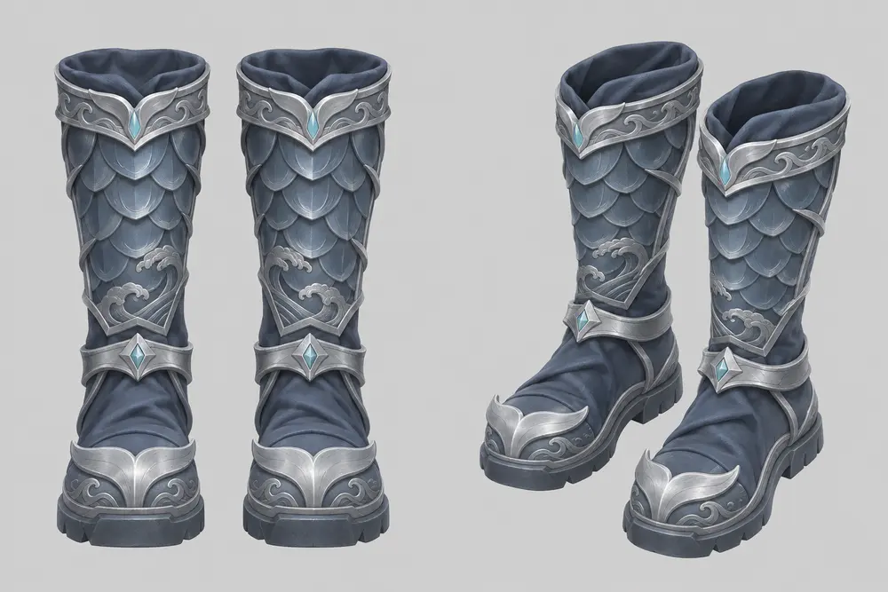

- **Lưu GLB:** `chr/set_van_kinh_thiet_giap/tripo/raw_ung_v01.glb`
- **Xương gắn vào:** foot L/R, toe L/R, calf L/R (cứng)
- **Xương lò xo:** Không
- **Lưu ý khi dựng:** Ủng nặng nhưng ống không được to hơn bắp chân quá 30% để vừa dáng hai giới.

Prompt (tùy chọn, dán vào ô mô tả thêm):

```text
A pair of heavy grey-blue boots with blue-grey steel scale-plated shins, cold silver trim bands at the ankle and top, thick reinforced toe caps shaped like whale-fluke tips, wide sturdy sole. Single isolated costume piece for a game character, no person, no mannequin, no body, clean separated geometry, hand-painted PBR materials, semi-realistic cinematic style, colors #3E4F63, #D9DEE2, #B9C2CA.
```

### Trang sức đầu · `van_kinh_trang_suc_dau`

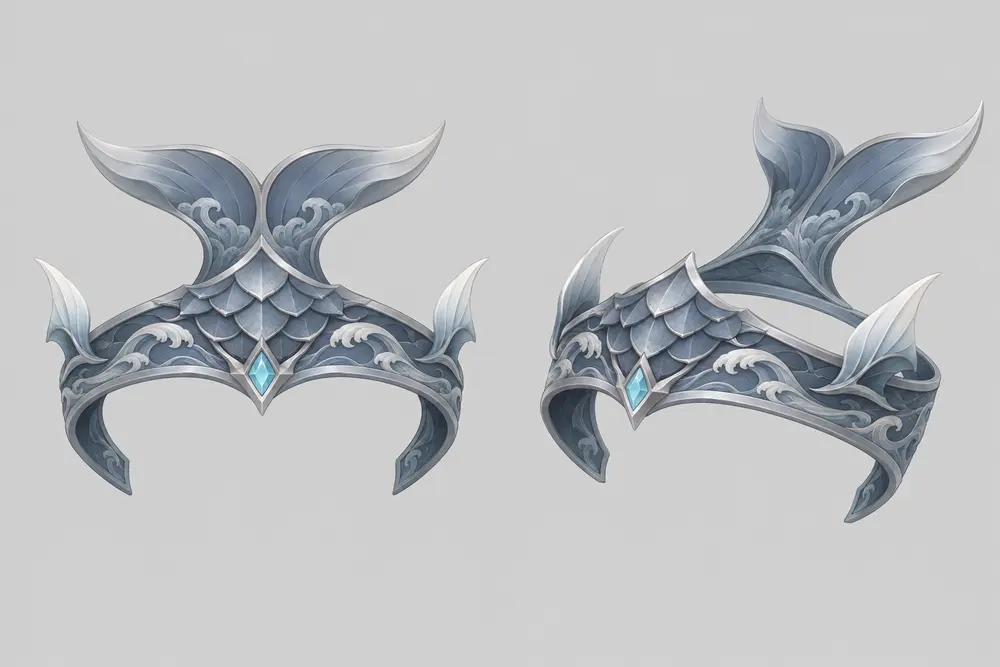

- **Lưu GLB:** `chr/set_van_kinh_thiet_giap/tripo/raw_trang_suc_dau_v01.glb`
- **Xương gắn vào:** head (cứng). Ô trang sức đầu là ô trang bị MỚI (thứ 9, có thể ẩn/hiện)
- **Xương lò xo:** Không
- **Lưu ý khi dựng:** Chỉ có vòng quan và vây, để hở mặt và tóc. Vây ngắn, hướng ra sau, không vượt quá 12 cm.

Prompt (tùy chọn, dán vào ô mô tả thêm):

```text
A cold-steel helm-crown (circlet style, open face, no visor): a band with cold silver edging and a center scale crest, a swept-back silver whale-fin crest at the back and two short swept-back fin horns on the sides with pale tips, a small pale blue gem at the forehead. Single isolated costume piece for a game character, no person, no mannequin, no body, clean separated geometry, hand-painted PBR materials, semi-realistic cinematic style, colors #3E4F63, #D9DEE2, #B9C2CA.
```


## Lưu Ly Đan Y (Đan sư, Thủy (lưu ly trong suốt))

### Áo ngoài (đạo bào + voan choàng) · `luu_ly_ao_ngoai`

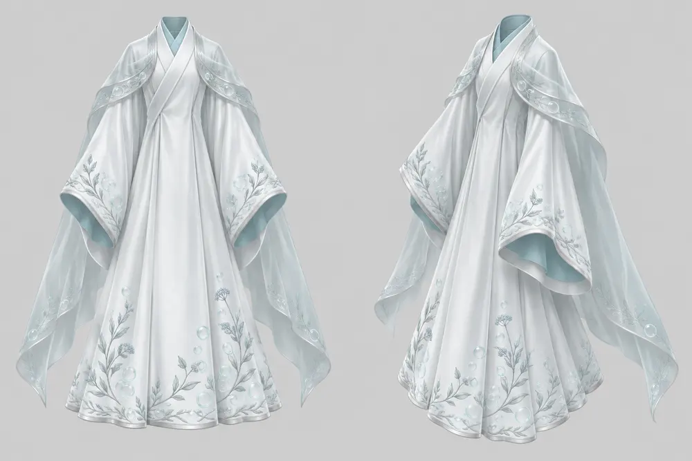

- **Lưu GLB:** `chr/set_luu_ly_dan_y/tripo/raw_ao_ngoai_v01.glb`
- **Xương gắn vào:** spine1/spine2, upperarm L/R, forearm L/R, neck. Voan choàng gắn spine2 và shoulder
- **Xương lò xo:** Tay áo rộng: 3 chuỗi × 3 xương mỗi bên. Voan choàng: 2 đuôi × 4 xương. Vạt sau: 2 chuỗi × 3 xương
- **Lưu ý khi dựng:** Đây là mảnh XUYÊN SÁNG thứ nhất của bộ (voan choàng). Dựng voan thành lớp mỏng riêng; worker dùng alpha-test hoặc dither. Phần đạo bào lụa thì đặc.

Prompt (tùy chọn, dán vào ô mô tả thêm):

```text
A wide white alchemist robe with crossed collar and very wide flowing sleeves, a pale glass-blue inner collar visible, herb-sprig and bubble-circle embroidery on the hem and cuffs, and a long translucent glass-like gauze mantle draped across both shoulders and falling behind in two soft tails with a thin silver-thread border. Single isolated costume piece for a game character, no person, no mannequin, no body, clean separated geometry, hand-painted PBR materials, semi-realistic cinematic style, colors #E9F1F2, #7FB9C4, #C9D0D6.
```

### Lớp dưới · `luu_ly_lop_duoi`

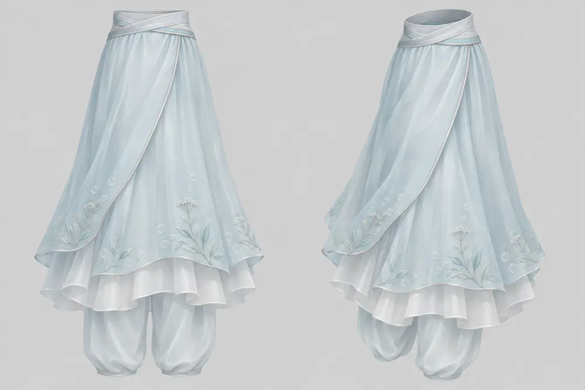

- **Lưu GLB:** `chr/set_luu_ly_dan_y/tripo/raw_lop_duoi_v01.glb`
- **Xương gắn vào:** pelvis/hips, thigh L/R, calf L/R
- **Xương lò xo:** Vạt trước và sau: 2 chuỗi × 3 xương
- **Lưu ý khi dựng:** Vạt dài tới mắt cá, hai lớp (lam ngắn hơn trắng). Cả hai đặc, không xuyên sáng.

Prompt (tùy chọn, dán vào ô mô tả thêm):

```text
A long pale glass-blue under-robe skirt with a soft wrap front, a white inner hem layer slightly longer than the blue layer, soft loose trousers underneath, herb-sprig embroidery in pale silver-blue thread along the lower hem. Single isolated costume piece for a game character, no person, no mannequin, no body, clean separated geometry, hand-painted PBR materials, semi-realistic cinematic style, colors #E9F1F2, #7FB9C4, #C9D0D6.
```

### Vai giáp (vai nhẹ) · `luu_ly_vai_giap`

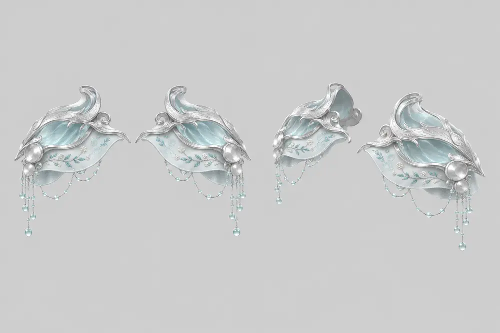

- **Lưu GLB:** `chr/set_luu_ly_dan_y/tripo/raw_vai_giap_v01.glb`
- **Xương gắn vào:** clavicle/shoulder L/R (cứng)
- **Xương lò xo:** Chuỗi hạt lưu ly: 1 chuỗi × 3 xương mỗi bên
- **Lưu ý khi dựng:** Vai của đan sư nhẹ nhất ba bộ: chỉ làm điểm nhấn, đỉnh không cao hơn vai quá 6 cm.

Prompt (tùy chọn, dán vào ô mô tả thêm):

```text
A light decorative shoulder piece pair: curved silver filigree shoulder caps shaped like frozen water ripples with pale glass-blue glass inlay, a few hanging strings of tiny glass beads, small round bubble-shaped silver plates, mirrored left and right; elegant and delicate, not heavy armor. Single isolated costume piece for a game character, no person, no mannequin, no body, clean separated geometry, hand-painted PBR materials, semi-realistic cinematic style, colors #E9F1F2, #7FB9C4, #C9D0D6.
```

### Đai, hồ lô và dải lụa · `luu_ly_dai_tua`

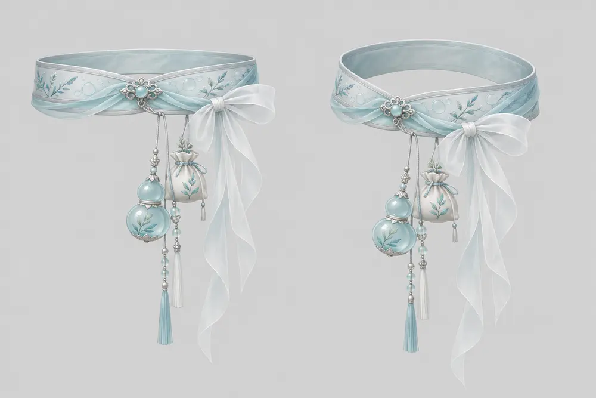

- **Lưu GLB:** `chr/set_luu_ly_dan_y/tripo/raw_dai_tua_v01.glb`
- **Xương gắn vào:** hips/spine (đai cứng). Hồ lô và túi neo ở đai
- **Xương lò xo:** Dải lụa: 1 chuỗi × 5 xương. Hồ lô và túi: 2 chuỗi × 3 xương. Tua: 1 chuỗi × 3 xương
- **Lưu ý khi dựng:** Đây là mảnh XUYÊN SÁNG thứ hai (dải lụa) và là mảnh cuối cùng được phép trong suốt cho cả bộ. Hồ lô lưu ly dựng đặc màu lam nhạt (worker làm bóng như thủy tinh), phần mesh riêng để gắn xương.

Prompt (tùy chọn, dán vào ô mô tả thêm):

```text
A pale glass-blue sash belt with a small silver clasp, a long thin translucent white silk ribbon tied in a soft bow hanging down one side, a small glazed glass-blue gourd (hu lu) and a tiny herb pouch hanging from silver cords at the hip, glass bead tassels. Single isolated costume piece for a game character, no person, no mannequin, no body, clean separated geometry, hand-painted PBR materials, semi-realistic cinematic style, colors #E9F1F2, #7FB9C4, #C9D0D6.
```

### Ủng · `luu_ly_ung`

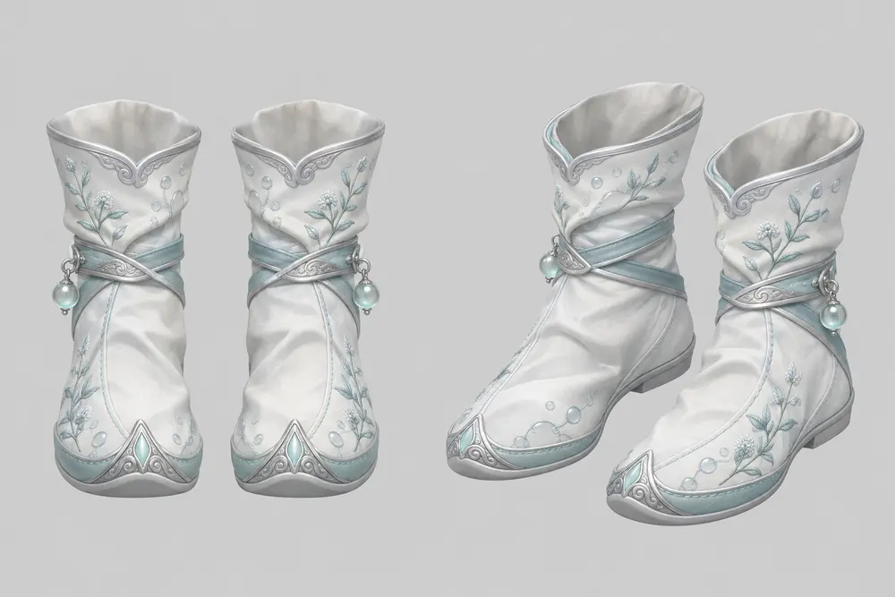

- **Lưu GLB:** `chr/set_luu_ly_dan_y/tripo/raw_ung_v01.glb`
- **Xương gắn vào:** foot L/R, toe L/R, calf L/R (cứng)
- **Xương lò xo:** Không
- **Lưu ý khi dựng:** Ủng thấp, nhẹ nhất ba bộ. Không có ống cao.

Prompt (tùy chọn, dán vào ô mô tả thêm):

```text
A pair of soft ankle-high ivory-white cloth-and-leather boots with silver trim bands and slightly upturned pointed toes, pale blue stitching, a tiny silver bubble ornament at the ankle. Single isolated costume piece for a game character, no person, no mannequin, no body, clean separated geometry, hand-painted PBR materials, semi-realistic cinematic style, colors #E9F1F2, #7FB9C4, #C9D0D6.
```

### Trang sức đầu · `luu_ly_trang_suc_dau`

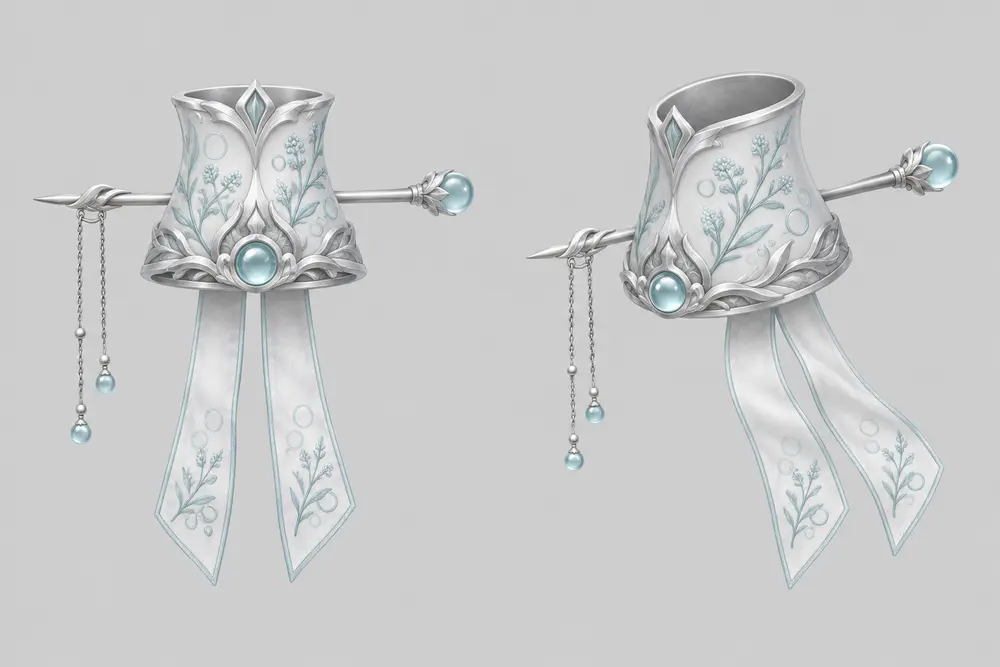

- **Lưu GLB:** `chr/set_luu_ly_dan_y/tripo/raw_trang_suc_dau_v01.glb`
- **Xương gắn vào:** head (cứng). Ô trang sức đầu là ô trang bị MỚI (thứ 9, có thể ẩn/hiện)
- **Xương lò xo:** Chuỗi hạt: 2 chuỗi × 3 xương. Dải sau: 1 chuỗi × 3 xương mỗi dải
- **Lưu ý khi dựng:** Chỉ quan, trâm và dây; không có đầu hay tóc. Hạt nhỏ, tổng không quá 12 hạt để giữ tam giác.

Prompt (tùy chọn, dán vào ô mô tả thêm):

```text
A silver hair crown (guan) holding a topknot: a small tapered silver cap with a pale blue glass bead at the front, one tall hairpin with a round glass-bead tip, two thin silver chains with tiny glass beads hanging on one side, two short white silk ribbon tails at the back. Single isolated costume piece for a game character, no person, no mannequin, no body, clean separated geometry, hand-painted PBR materials, semi-realistic cinematic style, colors #E9F1F2, #7FB9C4, #C9D0D6.
```


## Kính Quang Kiếm: dạng cuối +10 và vỏ

Dạng gốc dùng model #119 có sẵn (`prop_kiem_kinh_quang`), giữ nguyên cho +0…+9. Concept này chỉ là dạng cuối +10 và vỏ. Một kiếm chung cho cả ba công pháp (đã chốt 16/11).

### Dạng cuối +10 · `kiem_kinh_quang_cuoi`

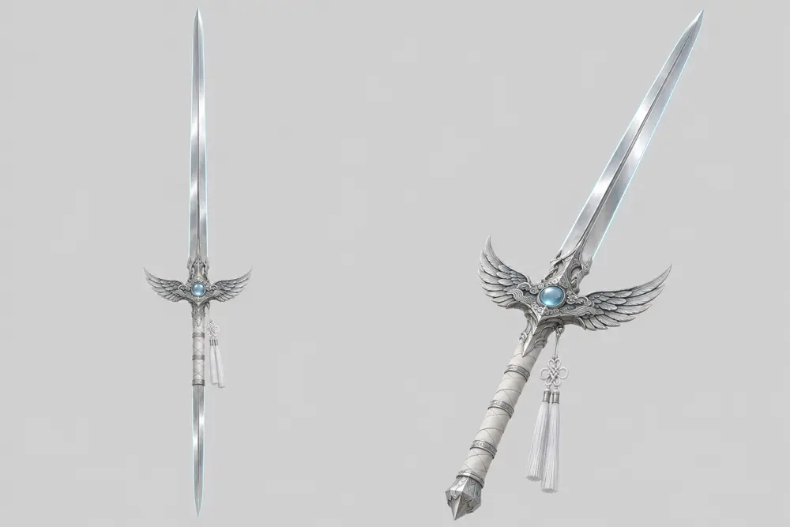

- **Lưu GLB:** `prop/prop_kiem_kinh_quang/tripo/raw_cuoi_v01.glb`
- **Gắn vào:** prop gắn bone `dtl_sword` (xương cầm kiếm); điểm gốc tại giữa chuôi, trục dọc theo lưỡi. Phát sáng là vật liệu riêng
- **Xương lò xo:** Không
- **Lưu ý khi dựng:** Lưỡi bạc gương là khối đặc có độ dày thật, mép xuyên sáng lạnh chỉ là viền mảnh dựng đặc (worker làm phát sáng bằng vật liệu riêng); KHÔNG dùng trong suốt thật. Chắn hình cánh mỏng phải có độ dày. Dạng gốc (#119) vẫn giữ cho +0…+9; dạng cuối thay lúc cường hóa +10.

```text
A single the final awakened form of a mirror sword: a SINGLE long slender double-edged blade (about 1.15 times longer than a normal sword), ONE blade tip only, the blade exists ONLY ABOVE the crossguard; below the crossguard there is ONLY a short pale leather-wrapped grip that ends in a faceted silver pommel at the very bottom (NO blade, NO spike, NO second blade below the grip, NOT a double-ended sword). The blade is of mirror-polished silver whose flat faces reflect like a mirror, razor edges with a thin cold translucent pale-blue rim glow, a shallow central fuller, a widened crossguard swept upward like a pair of thin wing-shaped feathered plates in dark aged silver-grey metal with engraved cloud-wave lines and a round blue-gem mirror eye at the center, a short white-wrapped grip with silver rings ending in the pommel, a faceted silver pommel at the bottom end, a white-silver jade-bead tassel hanging from the guard. Isolated game prop, no hand, no person, clean geometry, hand-painted PBR materials, semi-realistic cinematic style, mirror-polished silver, cold blue accents.
```

### Vỏ kiếm · `kiem_kinh_quang_vo`

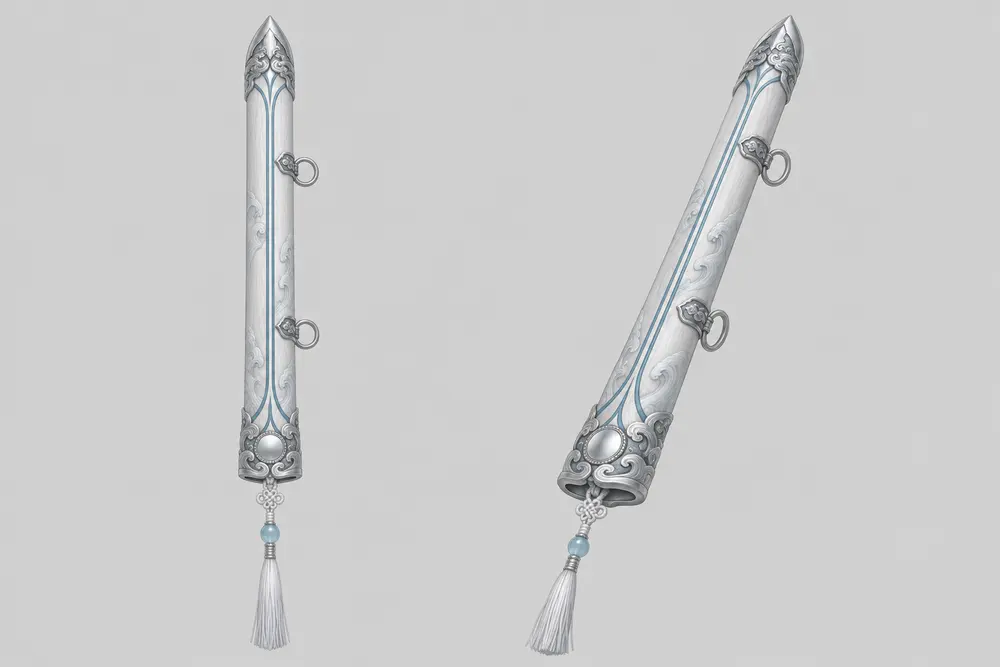

- **Lưu GLB:** `prop/prop_kiem_kinh_quang/tripo/raw_vo_v01.glb`
- **Gắn vào:** prop gắn ổ cắm lưng (`dtl_scabbard_back`, tạo bởi T-1/T-2); khi rút kiếm thì vỏ ở lại lưng
- **Xương lò xo:** Dây tua: 1 chuỗi × 3 xương
- **Lưu ý khi dựng:** Vỏ dài vừa khớp lưỡi dạng gốc (#119), kín hoàn toàn. Cửa vỏ ở ngang vai khi đeo chéo lưng.

```text
A single a matching scabbard for the Kinh Quang mirror sword: pale silver-white lacquered wood body, engraved polished silver mouth piece (chape) and tip with cloud-wave lines, two silver suspension rings, thin mirror-blue inlay lines running down the length, a small round silver mirror disc near the mouth, a short white-silver cord with a pale blue bead tassel, shown fully closed (no blade visible). Isolated game prop, no hand, no person, clean geometry, hand-painted PBR materials, semi-realistic cinematic style, mirror-polished silver, cold blue accents.
```
