# Concept trang phục bậc 4 Hóa Thần (gói P3-concept)

Gói concept để **bạn dựng từng mảnh trên Tripo web** (image-to-3D), không tốn credit API. Ba bộ bậc 4 của kế hoạch tổng trang phục và vũ khí (Thiên Khuyết Cổ Thành, Thần Tàng Điện), cộng dạng cuối +10 và vỏ của Tinh Khuyết Kiếm. Cùng định dạng gói bậc 2 ([T-3](../outfit-concepts/README.md)). Ảnh do Codex vẽ (`node tools/codex-assets/outfit-p3-gen.mjs`), dữ liệu và prompt ở `tools/codex-assets/outfit-p3-data.mjs`, hậu kỳ `outfit-p3-doc.mjs`.

**Chủ đề bậc 4:** hoàng giả cổ thành. Vàng cổ, sao đêm, choàng dài chấm đất, viền phân thân mờ (một đường chỉ nhạt chạy lệch ngoài mép vạt, như áo có bản sao; chỉ là họa tiết thêu, không dựng thành hình thứ hai). Bảng màu bậc: mực đêm + vàng cổ, tím sao chỉ là điểm nhỏ dưới 5% (đúng art bible 4.3). Cảm hứng lấy từ ảnh tham khảo bạn đã gửi (chỉ cấu trúc và tinh thần, không chép dáng, hoa văn, logo hay nhân vật nào; ảnh đó **không nằm trong repo**). Mẫu #119 Tinh Khuyết (`docs/asset-concepts/set_tinh_khuyet_kiem_bao.webp`) chỉ là bản tạm và tham chiếu dáng.

**Cần duyệt:** xem ảnh dưới đây. Bộ nào chưa ưng thì báo để vẽ lại trước khi bạn dựng. Mỗi mảnh dựng xong lưu GLB đúng nơi ở [huong-dan-tripo.md](huong-dan-tripo.md).

## Tổng quan

| Bộ | Công pháp, ngũ hành | Tổng tam giác 6 mảnh | Bảng thiết kế | Mảnh rời (ảnh nén) |
| --- | --- | --- | --- | --- |
| **Tinh Khuyết Kiếm Bào** | Kiếm tu, Kim/Thủy (sao đêm) | 11700 | [bảng thiết kế](tinh_khuyet/tinh_khuyet_sheet.webp) | [Áo ngoài (áo khoác + choàng dài)](tinh_khuyet/tinh_khuyet_ao_ngoai.webp), [Lớp dưới](tinh_khuyet/tinh_khuyet_lop_duoi.webp), [Vai giáp (cặp)](tinh_khuyet/tinh_khuyet_vai_giap.webp), [Đai và tua](tinh_khuyet/tinh_khuyet_dai_tua.webp), [Ủng (cặp)](tinh_khuyet/tinh_khuyet_ung.webp), [Trang sức đầu](tinh_khuyet/tinh_khuyet_trang_suc_dau.webp) |
| **Cổ Thành Huyền Giáp** | Hộ pháp, Thổ (cổ thành) | 12900 | [bảng thiết kế](co_thanh/co_thanh_sheet.webp) | [Áo ngoài (giáp thân + choàng dài)](co_thanh/co_thanh_ao_ngoai.webp), [Lớp dưới (váy giáp tầng tháp)](co_thanh/co_thanh_lop_duoi.webp), [Vai giáp (cặp)](co_thanh/co_thanh_vai_giap.webp), [Đai và tua](co_thanh/co_thanh_dai_tua.webp), [Ủng (cặp)](co_thanh/co_thanh_ung.webp), [Trang sức đầu](co_thanh/co_thanh_trang_suc_dau.webp) |
| **Thần Tàng Đan Bào** | Đan sư, Mộc/Thủy (kho tàng, ngọc) | 11800 | [bảng thiết kế](than_tang/than_tang_sheet.webp) | [Áo ngoài (đạo bào + choàng sao)](than_tang/than_tang_ao_ngoai.webp), [Lớp dưới](than_tang/than_tang_lop_duoi.webp), [Vai nhẹ (cặp)](than_tang/than_tang_vai_giap.webp), [Đai, hộp báu và dải lụa](than_tang/than_tang_dai_tua.webp), [Ủng (cặp)](than_tang/than_tang_ung.webp), [Trang sức đầu](than_tang/than_tang_trang_suc_dau.webp) |
| **Tinh Khuyết Kiếm** | dạng cuối +10 và vỏ, dùng chung ba công pháp | 4000 | – | [Dạng cuối +10](kiem/kiem_tinh_khuyet_cuoi.webp), [Vỏ kiếm](kiem/kiem_tinh_khuyet_vo.webp) |

Ô **trang sức đầu** là ô trang bị thứ 9 (ẩn/hiện được), mỗi bộ có một món. Hộ uyển không vẽ riêng (gộp vào áo ngoài nếu cần).

## Tinh Khuyết Kiếm Bào

Kiếm tu · Kim/Thủy (sao đêm) · cảm hứng: ref-04 (áo khoác dài, lót đậm, vai nhọn) + mẫu #119 Tinh Khuyết làm tham chiếu dáng (bản tạm).

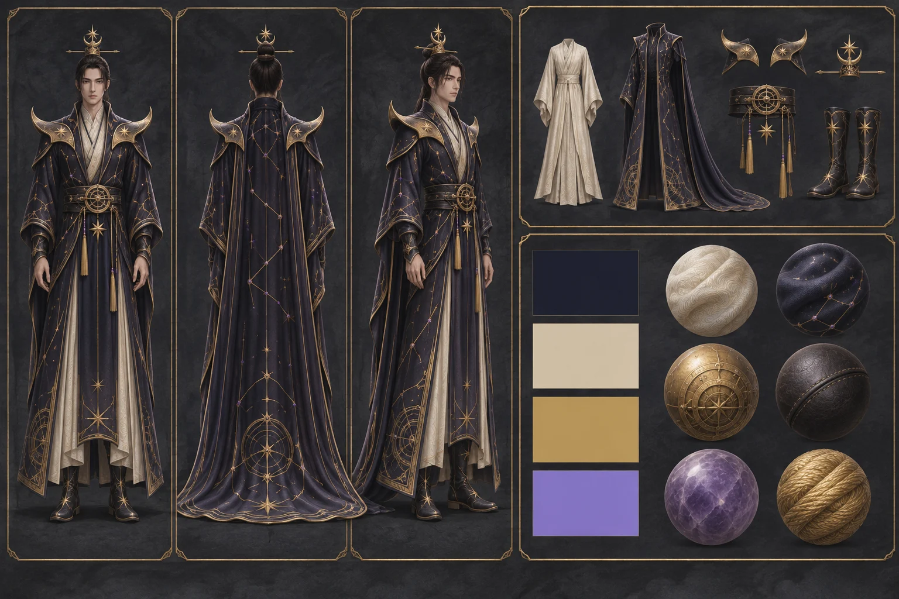

**Bảng màu 3 kênh** (mặt nạ nhuộm của shader T-5 dùng đúng 3 kênh đầu; kênh nhấn là vật liệu phát sáng riêng):

| Kênh | Mã | Tên |
| --- | --- | --- |
| Chính (áo ngoài, choàng) | `#1E2335` | mực đêm |
| Phụ (lớp lót, lớp dưới, ủng) | `#D9CFB6` | ngà trăng |
| Viền (kim loại, vai giáp, thêu) | `#B89B56` | vàng cổ |
| Nhấn phát sáng (chòm sao) | `#8E80D8` | tím sao, chỉ ở chấm sao |

**Chất liệu:** Lụa đen xanh mực dệt dày, ánh nhẹ (áo ngoài, choàng) · lụa ngà trăng (lớp lót, lớp dưới) · chỉ vàng cổ thêu chòm sao và viền · vàng cổ xỉn chạm khắc (vai trăng khuyết, khóa đai, trâm) · da thuộc đen (đai, ủng, hộ uyển) · tinh thạch tím sao nhỏ (chấm sao).

**Mảnh rời:**

| Mảnh | Ảnh | Tam giác | Xương gắn vào | Xương lò xo | Ghi chú |
| --- | --- | --- | --- | --- | --- |
| Áo ngoài (áo khoác + choàng dài) | [`tinh_khuyet_ao_ngoai`](tinh_khuyet/tinh_khuyet_ao_ngoai.webp) | 5000 | spine1/spine2 (thân), upperarm L/R, forearm L/R, neck. Choàng sau gắn spine2 và shoulder. Trọng số lấy từ thân nền | Tay áo: 2 chuỗi × 3 xương mỗi bên. Choàng dài sau: 3 chuỗi × 4 xương. Vạt xẻ tà hai bên: 1 chuỗi × 2 xương mỗi bên | Một mảnh liền, lụa dày KHÔNG xuyên sáng. Choàng dài là mảnh vải riêng thả từ vai tới đất. Viền phân thân mờ chỉ là thêu chỉ nhạt (texture), không dựng thành hình thứ hai. Mở thân dưới để lớp dưới thấy bên trong. |
| Lớp dưới | [`tinh_khuyet_lop_duoi`](tinh_khuyet/tinh_khuyet_lop_duoi.webp) | 2000 | pelvis/hips, thigh L/R, calf L/R. Trọng số từ thân nền | Vạt dưới trước và sau: 2 chuỗi × 2 xương | Quần và vạt trong tối giản để áo ngoài là điểm nhấn. Phủ kín đùi tới bắp chân để cắt vùng ẩn của thân nền. |
| Vai giáp (cặp) | [`tinh_khuyet_vai_giap`](tinh_khuyet/tinh_khuyet_vai_giap.webp) | 1500 | clavicle/shoulder L và R (cứng, không co giãn); một mảnh có hai nửa đối xứng | Không. Mảnh cứng | Hai nửa đối xứng gửi cùng một ảnh (dựng cặp là đúng). Sừng trăng cao hơn vai không quá 14 cm. Ngọc tím sao là vật liệu phát sáng riêng. |
| Đai và tua | [`tinh_khuyet_dai_tua`](tinh_khuyet/tinh_khuyet_dai_tua.webp) | 1200 | đai: hips/spine (cứng, quấn quanh eo). Tua: neo ở đai | Tua: 2 chuỗi × 4 xương. Dải thắt nút: 1 chuỗi × 3 xương | Đai là vòng kín quanh eo, dày ~2 cm để pipeline lồng đệm. Tua và dải để rời mesh gắn xương lò xo. |
| Ủng (cặp) | [`tinh_khuyet_ung`](tinh_khuyet/tinh_khuyet_ung.webp) | 1300 | foot L/R, toe L/R, calf L/R (cứng; ống ủng bám bắp chân) | Không | Đế phẳng, đặt chân đúng trục xương chân. Miệng ủng đủ rộng để lớp dưới chui vào. |
| Trang sức đầu | [`tinh_khuyet_trang_suc_dau`](tinh_khuyet/tinh_khuyet_trang_suc_dau.webp) | 700 | head (cứng). Ô trang sức đầu là ô trang bị thứ 9 (có thể ẩn/hiện) | Dải ruy băng sau: 1 chuỗi × 3 xương mỗi dải | Chỉ quan, trâm, dải. KHÔNG có đầu, tóc hay mặt. Nhìn từ trên xuống gọn trong vòng tròn ~8 cm. |

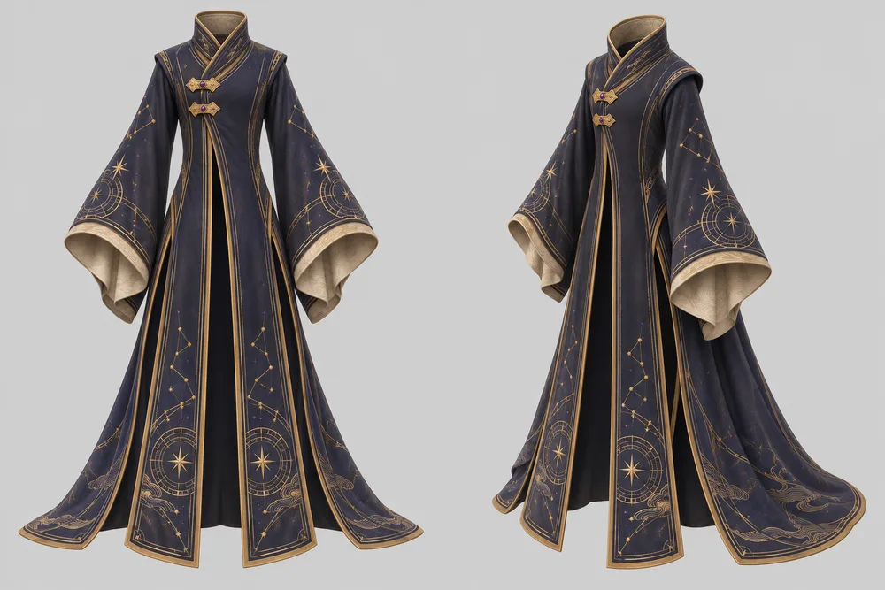

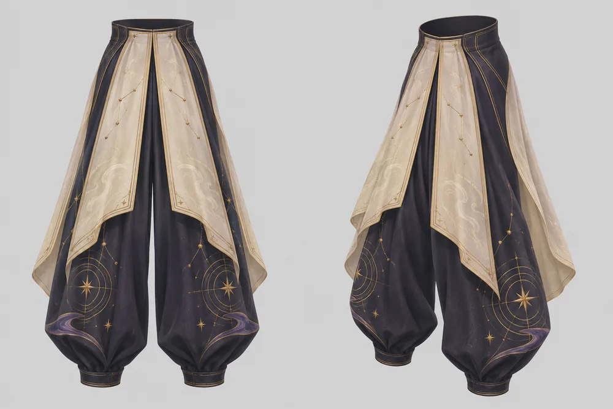

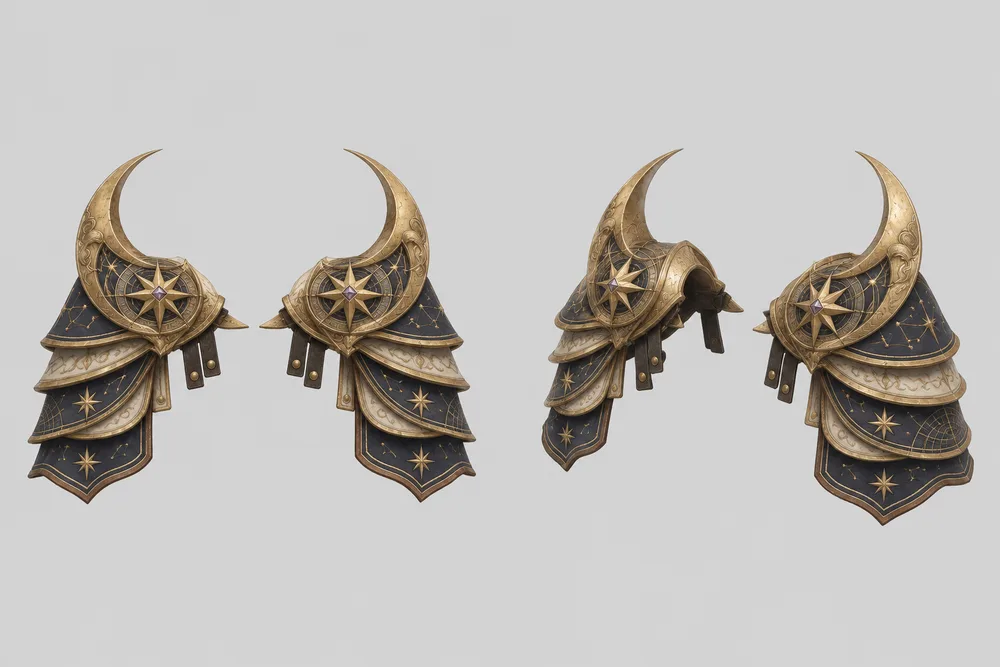

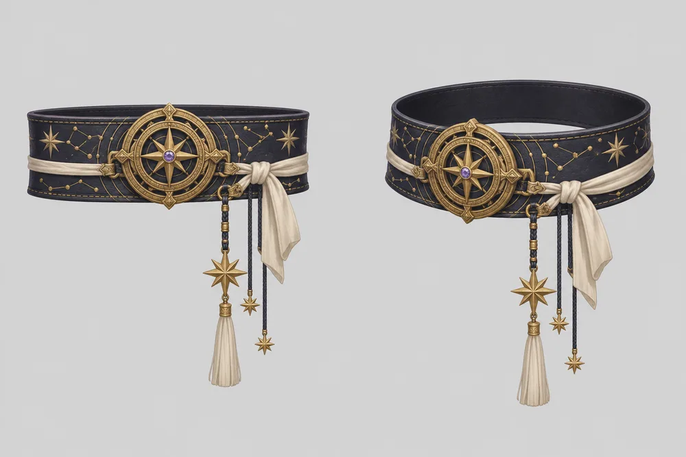

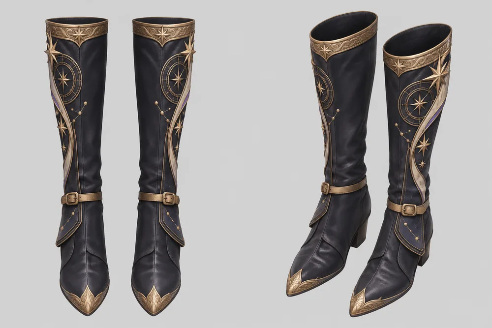

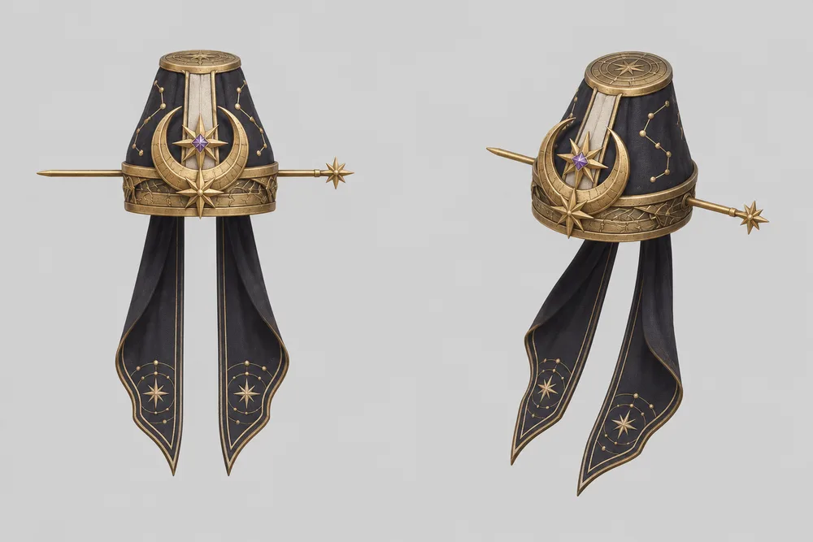

## Cổ Thành Huyền Giáp

Hộ pháp · Thổ (cổ thành) · cảm hứng: ref-05 (dáng nặng, vai to, váy nhiều tầng), nhưng là tường thành cổ thay vì lông vũ hay vảy.

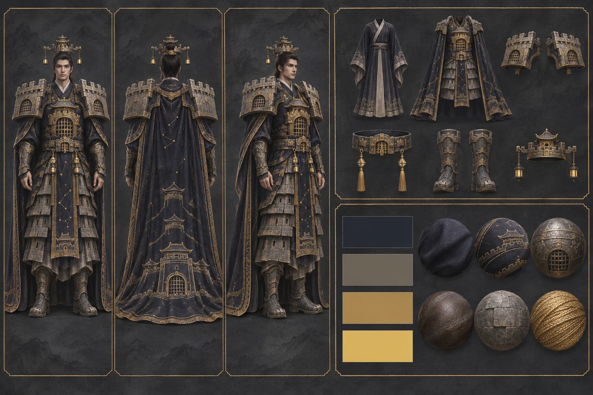

**Bảng màu 3 kênh** (mặt nạ nhuộm của shader T-5 dùng đúng 3 kênh đầu; kênh nhấn là vật liệu phát sáng riêng):

| Kênh | Mã | Tên |
| --- | --- | --- |
| Chính (giáp thân, choàng) | `#262B38` | mực đá đêm |
| Phụ (đá thành, lớp lót, ủng) | `#6F6A5E` | đá cổ thành |
| Viền (kim loại, thêu) | `#BA9A55` | vàng cổ |
| Nhấn phát sáng (đèn lồng, khe giáp) | `#E2BE62` | vàng đèn lồng trời, chỉ ở khe giáp và đèn |

**Chất liệu:** Thép đen rèn thủ công, bề mặt nhám (giáp thân, vai) · đá thành cổ xám sần (mảng ốp và váy giáp) · vàng cổ xỉn chạm khắc (viền, khóa cổng, quan) · vải len mực đá dày (lớp trong, choàng) · da thuộc tối (đai, ủng) · tinh thạch tím sao nhỏ (nhãn mắt khóa cổng).

**Mảnh rời:**

| Mảnh | Ảnh | Tam giác | Xương gắn vào | Xương lò xo | Ghi chú |
| --- | --- | --- | --- | --- | --- |
| Áo ngoài (giáp thân + choàng dài) | [`co_thanh_ao_ngoai`](co_thanh/co_thanh_ao_ngoai.webp) | 5000 | spine1/spine2 (giáp ngực cứng gắn spine2), upperarm L/R (tay áo ngắn), neck. Choàng gắn spine2/shoulder. Trọng số từ thân nền | Choàng dài: 3 chuỗi × 4 xương (nặng, biên độ nhỏ). Vạt vải dưới giáp ngực: 1 chuỗi × 2 xương | Giáp ngực là khối cứng, tunic dưới là phần mềm. Choàng là vải len dày riêng, không xuyên sáng. Hoa văn cổng thành phải nổi khối thật, không chỉ là họa tiết. Để nửa dưới thân hở cho lớp dưới. |
| Lớp dưới (váy giáp tầng tháp) | [`co_thanh_lop_duoi`](co_thanh/co_thanh_lop_duoi.webp) | 2000 | pelvis/hips, thigh L/R. Các tầng váy gắn pelvis, trọng số mềm về thigh | Mỗi tầng váy 1 xương treo (3 tầng × 2 bên, ~8 xương), biên độ nhỏ | Các tầng váy là tấm cứng đặt chồng lên nhau, có khe nhỏ giữa tầng để xương xoay. Không dùng vải xuyên sáng. |
| Vai giáp (cặp) | [`co_thanh_vai_giap`](co_thanh/co_thanh_vai_giap.webp) | 2200 | clavicle/shoulder L/R (cứng); tầng dưới nối upperarm L/R | Không. Tầng dưới có 1 xương xoay nhẹ theo cánh tay | Vai to nhất trong bộ, đỉnh cao hơn vai ~15 cm. Kiểm tra không đâm vào cổ khi giơ tay. Đèn lồng nhỏ là mảnh rời treo nhẹ. |
| Đai và tua | [`co_thanh_dai_tua`](co_thanh/co_thanh_dai_tua.webp) | 1500 | hips/spine (cứng). Tua và charm neo ở đai | Tua và charm: 2 chuỗi × 3 xương | Đai dày 3 cm vì giáp nặng. Khóa cổng thành là điểm nhận diện bộ. |
| Ủng (cặp) | [`co_thanh_ung`](co_thanh/co_thanh_ung.webp) | 1500 | foot L/R, toe L/R, calf L/R (cứng) | Không | Ủng nặng nhưng ống không to hơn bắp chân quá 30% để vừa dáng hai giới. |
| Trang sức đầu | [`co_thanh_trang_suc_dau`](co_thanh/co_thanh_trang_suc_dau.webp) | 700 | head (cứng). Ô trang sức đầu là ô trang bị thứ 9 (có thể ẩn/hiện) | Dây đèn lồng: 2 chuỗi × 2 xương mỗi bên | Chỉ có vòng quan, để hở mặt và tóc. Tổng chiều cao quan không quá 12 cm. |

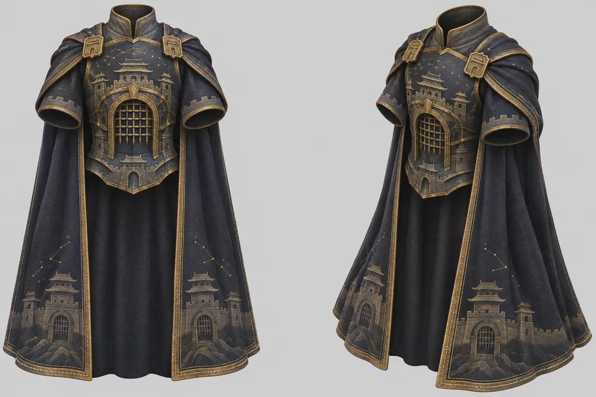

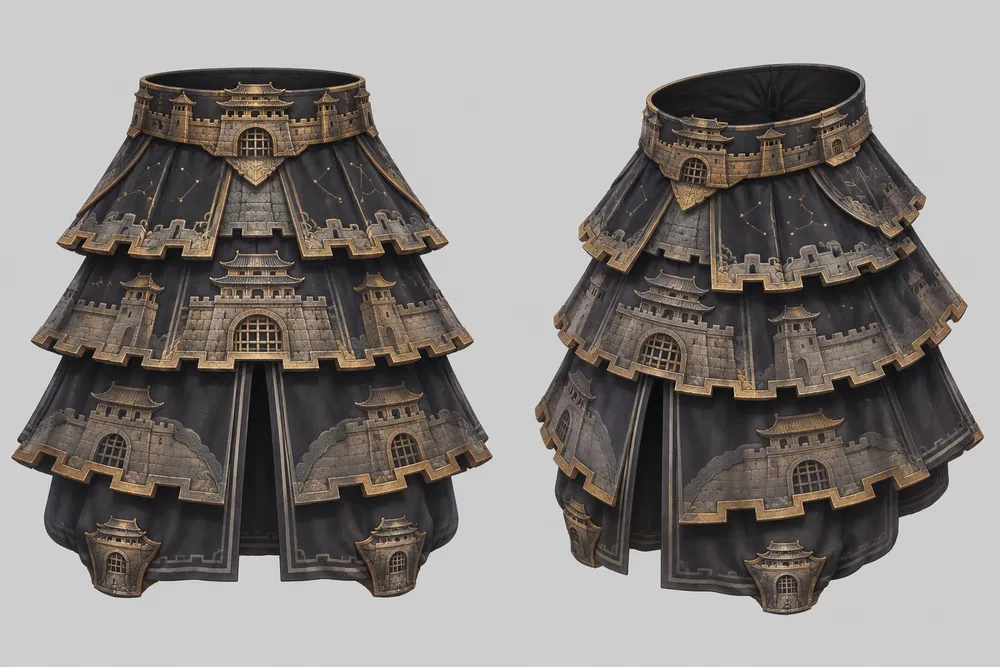

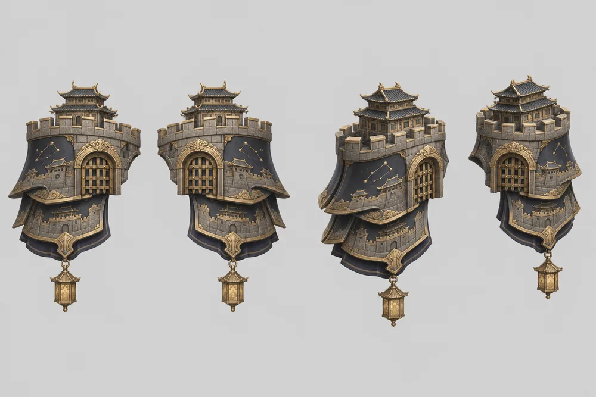

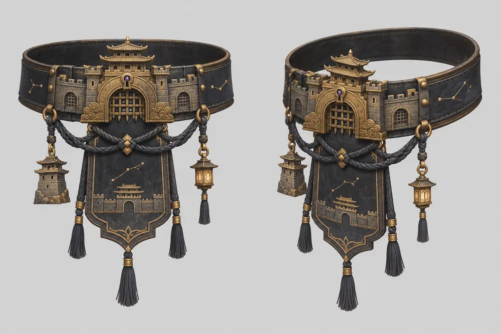

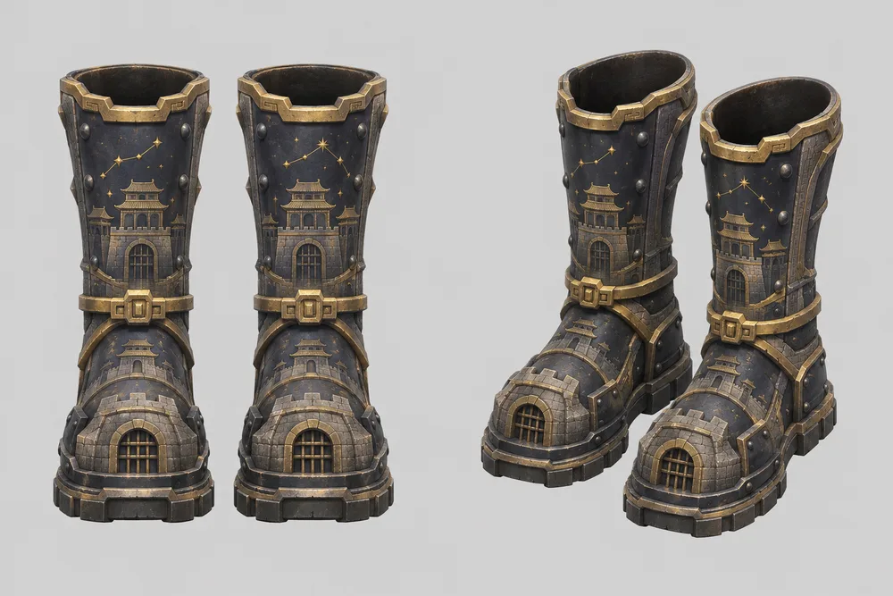

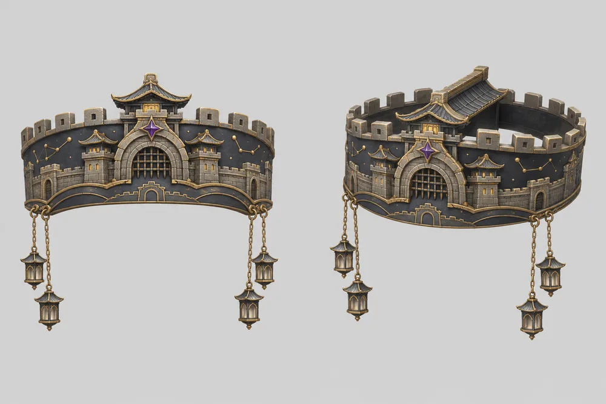

## Thần Tàng Đan Bào

Đan sư · Mộc/Thủy (kho tàng, ngọc) · cảm hứng: ref-01 và ref-06 (voan, tay áo lụa mỏng) nâng thành hoàng giả: vàng cổ, ngọc kho báu.

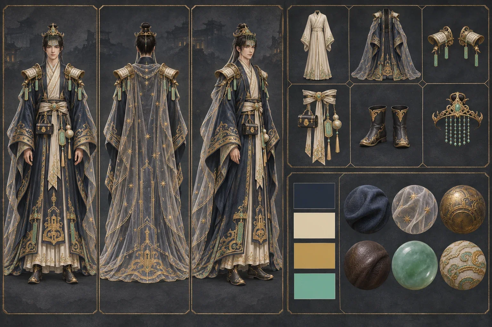

**Bảng màu 3 kênh** (mặt nạ nhuộm của shader T-5 dùng đúng 3 kênh đầu; kênh nhấn là vật liệu phát sáng riêng):

| Kênh | Mã | Tên |
| --- | --- | --- |
| Chính (áo ngoài, choàng sao) | `#212A38` | mực đêm xanh |
| Phụ (lớp lót, đai, lớp dưới) | `#DCD2B8` | ngà cổ |
| Viền (kim loại, trâm, thêu) | `#BC9C58` | vàng cổ |
| Nhấn (ngọc, thêu ấn) | `#6DB4A0` | lục ngọc thần tàng; thêm chấm tím sao rất nhỏ |

**Chất liệu:** Lụa mực đêm xanh bóng nhẹ (đạo bào) · voan mỏng xuyên sáng điểm sao vàng (choàng và dải lụa, tối đa 2 mảnh trong suốt cho cả bộ) · lụa ngà cổ thêu ấn kho (lớp lót) · vàng cổ chạm khắc (viền, khóa đai, trâm) · ngọc lục thần tàng (thẻ ngọc, hạt tua) · sơn mài đen viền vàng (hộp báu nhỏ) · tinh thạch tím sao nhỏ.

**Mảnh rời:**

| Mảnh | Ảnh | Tam giác | Xương gắn vào | Xương lò xo | Ghi chú |
| --- | --- | --- | --- | --- | --- |
| Áo ngoài (đạo bào + choàng sao) | [`than_tang_ao_ngoai`](than_tang/than_tang_ao_ngoai.webp) | 5000 | spine1/spine2, upperarm L/R, forearm L/R, neck. Choàng sao gắn spine2 và shoulder | Tay áo rộng: 3 chuỗi × 3 xương mỗi bên. Choàng sao: 2 đuôi × 5 xương. Vạt sau: 2 chuỗi × 3 xương | Mảnh XUYÊN SÁNG thứ nhất của bộ (choàng sao). Dựng choàng là lớp mỏng riêng; worker dùng alpha-test hoặc dither. Đạo bào lụa thì đặc. |
| Lớp dưới | [`than_tang_lop_duoi`](than_tang/than_tang_lop_duoi.webp) | 2000 | pelvis/hips, thigh L/R, calf L/R | Vạt trước và sau: 2 chuỗi × 3 xương | Vạt dài tới mắt cá, hai lớp, cả hai đặc, không xuyên sáng. |
| Vai nhẹ (cặp) | [`than_tang_vai_giap`](than_tang/than_tang_vai_giap.webp) | 1500 | clavicle/shoulder L/R (cứng) | Thẻ ngọc và chuỗi hạt: 1 chuỗi × 3 xương mỗi bên | Vai nhẹ, chỉ làm điểm nhấn, đỉnh không cao hơn vai quá 6 cm. |
| Đai, hộp báu và dải lụa | [`than_tang_dai_tua`](than_tang/than_tang_dai_tua.webp) | 1400 | hips/spine (đai cứng). Hộp báu, thẻ ngọc và hồ lô neo ở đai | Dải lụa: 1 chuỗi × 5 xương. Hộp báu, thẻ ngọc và hồ lô: 2 chuỗi × 3 xương. Tua: 1 chuỗi × 3 xương | Mảnh XUYÊN SÁNG thứ hai (dải lụa) và là mảnh cuối được phép trong suốt cho cả bộ. Hộp báu dựng riêng một phần mesh để dễ gắn xương. |
| Ủng (cặp) | [`than_tang_ung`](than_tang/than_tang_ung.webp) | 1200 | foot L/R, toe L/R, calf L/R (cứng) | Không | Ủng thấp, nhẹ nhất bộ. Không có ống cao. |
| Trang sức đầu | [`than_tang_trang_suc_dau`](than_tang/than_tang_trang_suc_dau.webp) | 700 | head (cứng). Ô trang sức đầu là ô trang bị thứ 9 (có thể ẩn/hiện) | Rèm hạt ngọc: 1 chuỗi × 2 xương cho cả rèm. Dải sau: 1 chuỗi × 3 xương mỗi dải | Chỉ diadem, trâm, dải; không có đầu, tóc hay mặt. Rèm hạt ngắn, không che mắt, tổng không quá 18 hạt. |

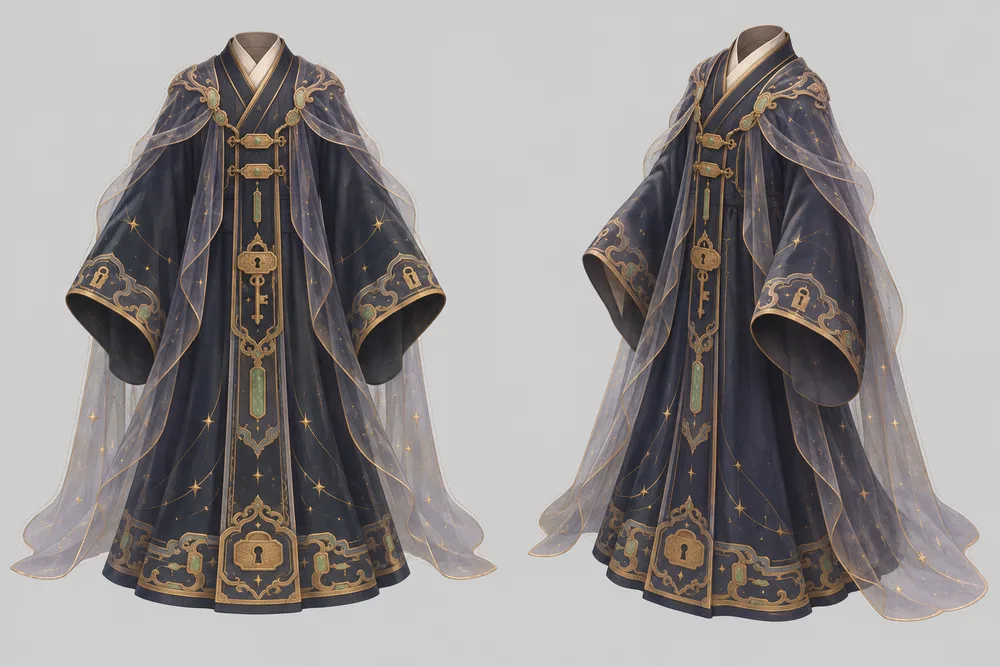

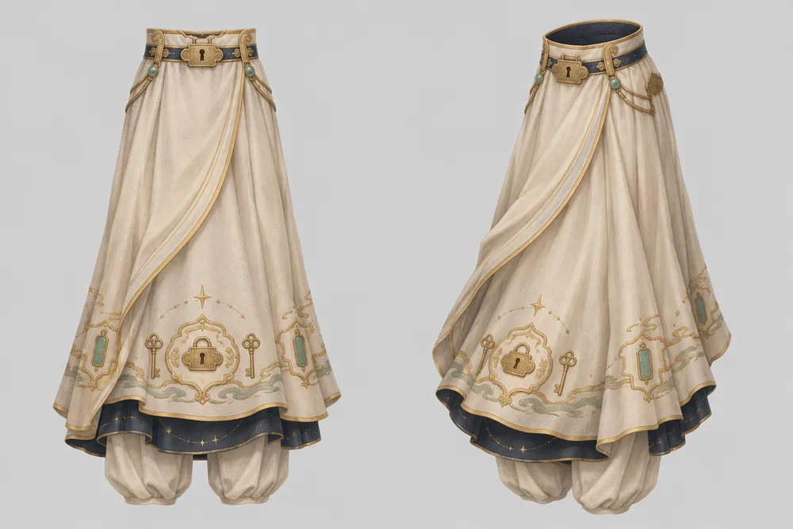

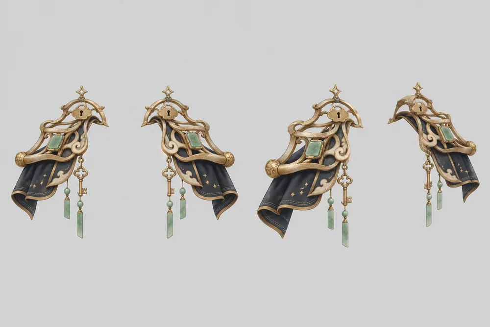

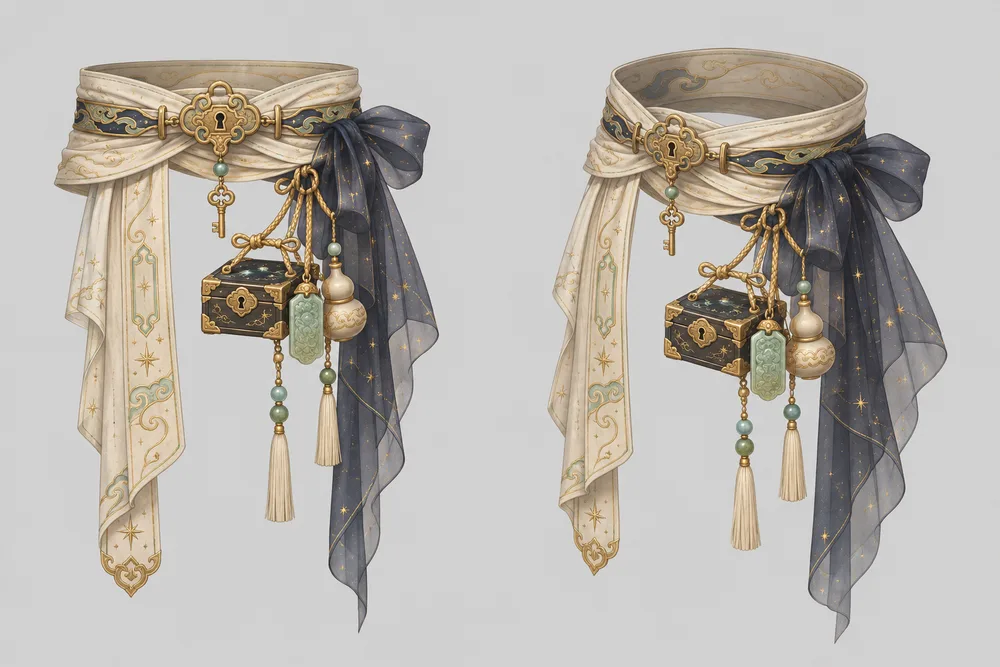

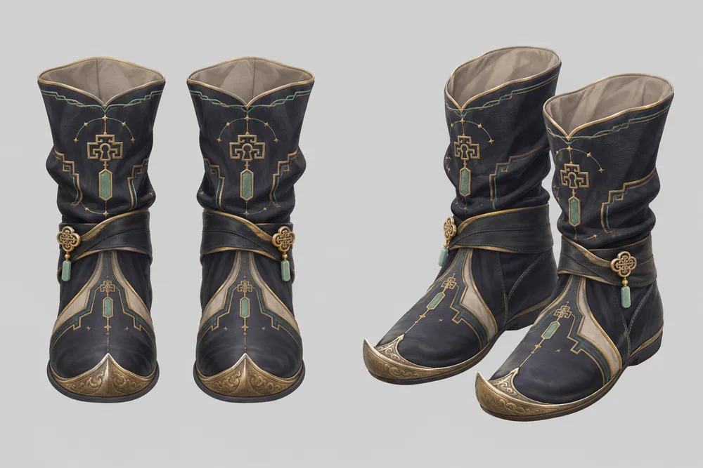

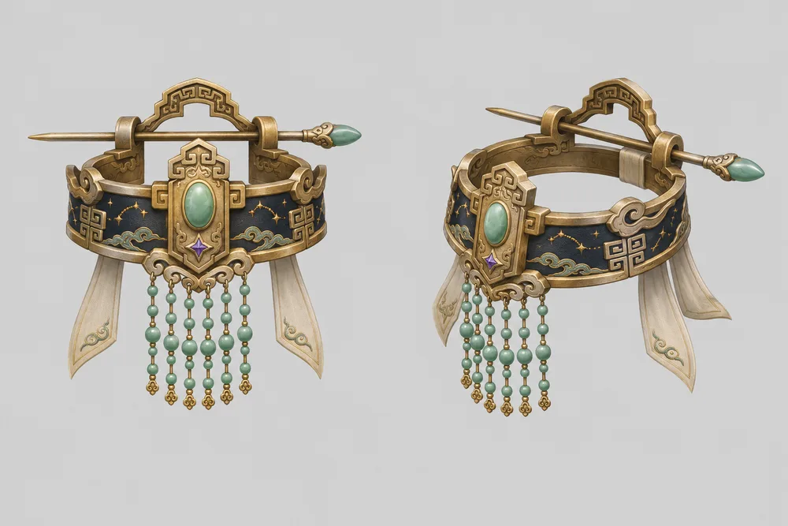

## Tinh Khuyết Kiếm: dạng cuối +10 và vỏ

Dạng gốc dùng model #119 có sẵn (`prop_kiem_tinh_khuyet`). Concept này chỉ là dạng cuối +10 và vỏ. Dùng chung cho cả ba công pháp (không làm kiếm riêng cho Hộ pháp/Đan sư).

| Mảnh | Ảnh | Tam giác | Gắn vào | Ghi chú |
| --- | --- | --- | --- | --- |
| Dạng cuối +10 | [`kiem_tinh_khuyet_cuoi`](kiem/kiem_tinh_khuyet_cuoi.webp) | 2500 | prop gắn bone `dtl_sword` (xương cầm kiếm); điểm gốc tại giữa chuôi, trục dọc theo lưỡi. Phát sáng là vật liệu riêng | Tinh thể thể hiện bằng khối đặc tối màu có rãnh vân; KHÔNG dùng trong suốt thật. Chấm sao, nhãn cầu sao và tia linh khí tách thành mặt nạ phát sáng để worker điều khiển. Tia linh khí là các sợi kim loại cong dựng cứng quanh chắn (không phải hạt). Dạng gốc (#119) giữ cho +0…+9; dạng cuối thay lúc cường hóa +10. Dùng chung cho Kiếm tu, Hộ pháp, Đan sư. |
| Vỏ kiếm | [`kiem_tinh_khuyet_vo`](kiem/kiem_tinh_khuyet_vo.webp) | 1500 | prop gắn ổ cắm lưng (`dtl_scabbard_back`, tạo bởi T-1/T-2); khi rút kiếm thì vỏ ở lại lưng | Vỏ dài vừa khớp lưỡi dạng gốc (#119), kín hoàn toàn. Cửa vỏ ở ngang vai khi đeo chéo lưng. |

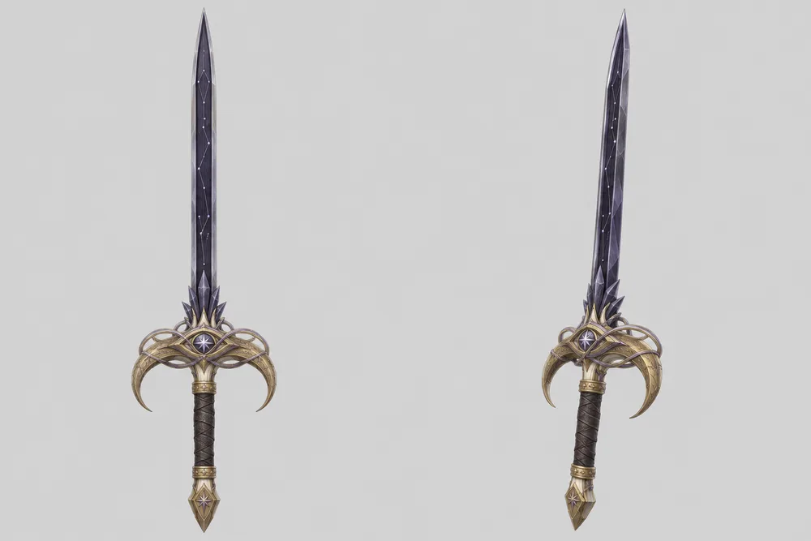

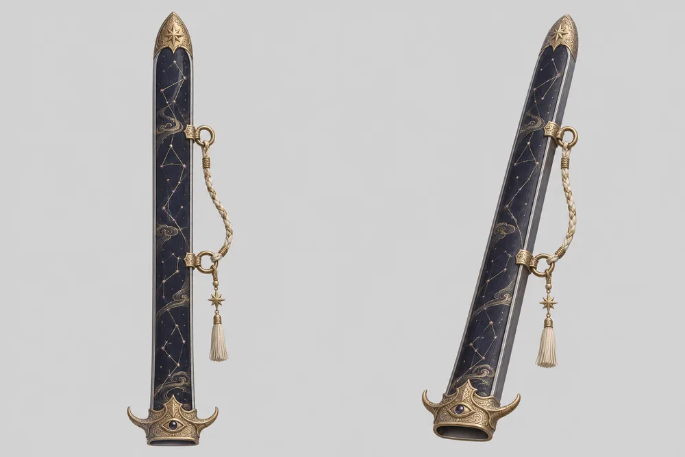

## Nơi lưu file nguồn (ngoài repo)

Ảnh gốc PNG, ảnh cắt chính diện và prompt nằm ở `D:\METAGRIT\dtl-asset-source\`:

| Bộ | Thư mục concept | Thư mục tripo (GLB sẽ lưu vào) |
| --- | --- | --- |
| Tinh Khuyết Kiếm Bào | `chr\set_tinh_khuyet_kiem_bao\concept` | `chr\set_tinh_khuyet_kiem_bao\tripo` |
| Cổ Thành Huyền Giáp | `chr\set_co_thanh_huyen_giap\concept` | `chr\set_co_thanh_huyen_giap\tripo` |
| Thần Tàng Đan Bào | `chr\set_than_tang_dan_bao\concept` | `chr\set_than_tang_dan_bao\tripo` |
| Tinh Khuyết Kiếm | `prop\prop_kiem_tinh_khuyet\concept` | `prop\prop_kiem_tinh_khuyet\tripo` |

## Dùng lại, không đụng tới

- Dạng gốc của Tinh Khuyết Kiếm là model #119 có sẵn (`prop_kiem_tinh_khuyet`), giữ nguyên cho +0…+9. Không làm kiếm riêng cho Hộ pháp và Đan sư (đã chốt 16/11).
- Concept cũ `docs/asset-concepts/set_tinh_khuyet_kiem_bao.webp` và ảnh `concept_34_v01.png` trong thư mục nguồn vẫn là bản tạm cho tới khi mảnh mới vào.
