# Concept trang phục Kết Đan (gói T-3)

Gói concept để **bạn dựng từng mảnh trên Tripo web** (image-to-3D), không tốn credit API. Ba bộ bậc 2 của kế hoạch tổng trang phục và vũ khí, cộng dạng cuối +10 và vỏ của Kiếm Liệt Mạch. Ảnh do Codex vẽ (`node tools/codex-assets/gen.mjs outfit`), dữ liệu và prompt ở `tools/codex-assets/outfit-data.mjs`.

Phong cách: áo nhiều lớp, viền kim loại chạm trổ, vai giáp, trang sức đầu, tay áo và vạt dài, tua ngọc; sáng và bắt mắt hơn tông môi trường. Cảm hứng lấy từ ảnh tham khảo bạn đã gửi (chỉ cấu trúc và tinh thần; không chép dáng, hoa văn, logo hay nhân vật nào, và các ảnh đó **không nằm trong repo**).

**Cần duyệt:** xem ảnh (README này, hoặc trang HTML xem nhanh ở artifact của phiên). Bộ nào chưa ưng, báo mình vẽ lại trước khi bạn dựng. Mỗi mảnh dựng xong lưu GLB đúng nơi ở dưới.

## Tổng quan

| Bộ | Công pháp, ngũ hành | Tổng tam giác 6 mảnh | Bảng thiết kế | Mảnh rời |
| --- | --- | --- | --- | --- |
| **Liệt Mạch Kiếm Y** | Kiếm tu, Thổ/Kim (mạch đất nứt) | 11700 | [3 góc](ket-dan/liet_mach_views.webp), [bóc lớp](ket-dan/liet_mach_layers.webp), [chi tiết](ket-dan/liet_mach_detail.webp) | [Áo ngoài](ket-dan/liet_mach_ao_ngoai.webp), [Lớp dưới](ket-dan/liet_mach_lop_duoi.webp), [Vai giáp](ket-dan/liet_mach_vai_giap.webp), [Đai và tua](ket-dan/liet_mach_dai_tua.webp), [Ủng](ket-dan/liet_mach_ung.webp), [Trang sức đầu](ket-dan/liet_mach_trang_suc_dau.webp) |
| **Địa Long Hộ Giáp** | Hộ pháp, Thổ | 12900 | [3 góc](ket-dan/dia_long_views.webp), [bóc lớp](ket-dan/dia_long_layers.webp), [chi tiết](ket-dan/dia_long_detail.webp) | [Áo ngoài](ket-dan/dia_long_ao_ngoai.webp), [Lớp dưới](ket-dan/dia_long_lop_duoi.webp), [Vai giáp](ket-dan/dia_long_vai_giap.webp), [Đai và tua](ket-dan/dia_long_dai_tua.webp), [Ủng](ket-dan/dia_long_ung.webp), [Trang sức đầu](ket-dan/dia_long_trang_suc_dau.webp) |
| **Phục Mạch Đan Bào** | Đan sư, Mộc | 11800 | [3 góc](ket-dan/phuc_mach_views.webp), [bóc lớp](ket-dan/phuc_mach_layers.webp), [chi tiết](ket-dan/phuc_mach_detail.webp) | [Áo ngoài](ket-dan/phuc_mach_ao_ngoai.webp), [Lớp dưới](ket-dan/phuc_mach_lop_duoi.webp), [Vai giáp](ket-dan/phuc_mach_vai_giap.webp), [Đai, hồ lô và dải lụa](ket-dan/phuc_mach_dai_tua.webp), [Ủng](ket-dan/phuc_mach_ung.webp), [Trang sức đầu](ket-dan/phuc_mach_trang_suc_dau.webp) |
| **Kiếm Liệt Mạch** | dạng cuối +10 và vỏ | 5500 | – | [dạng cuối](ket-dan/kiem_liet_mach_cuoi.webp), [vỏ](ket-dan/kiem_liet_mach_vo.webp) |

Ô **trang sức đầu** là ô trang bị mới (thứ 9, ẩn/hiện được), mỗi bộ có một món. Hộ uyển không vẽ riêng: nếu muốn, gộp vào áo ngoài.

## Liệt Mạch Kiếm Y

Kiếm tu · Thổ/Kim (mạch đất nứt) · cảm hứng: ref-04 (áo khoác dài nền sáng, lót đậm, viền kim loại chạm, vai nhọn).

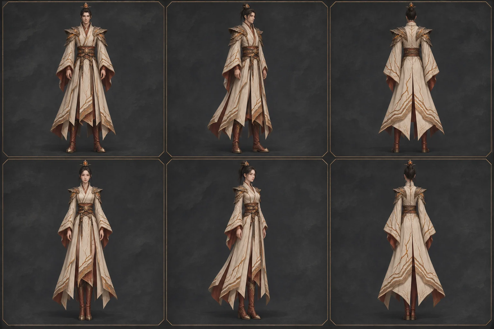

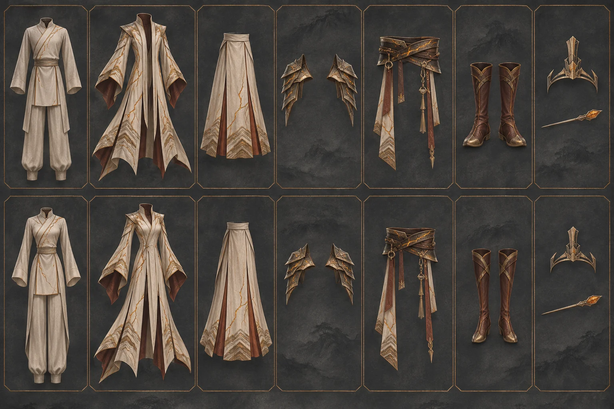

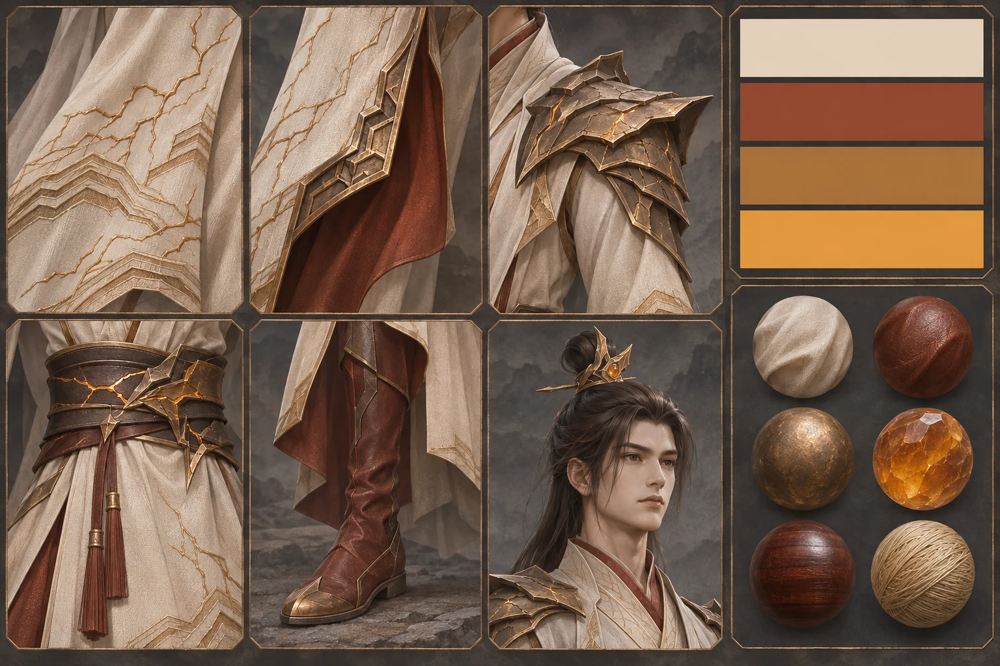

**Bảng màu 3 kênh** (mặt nạ nhuộm của shader T-5 dùng đúng 3 kênh này):

| Kênh | Mã | Tên |
| --- | --- | --- |
| Chính (áo ngoài, vạt) | `#E6DDCB` | ngà |
| Phụ (lớp lót, đai, ủng) | `#9A4A32` | đất son |
| Viền (kim loại, vai giáp) | `#B07A3C` | đồng cũ |
| Nhấn phát sáng (vân mạch) | `#E8A33D` | hổ phách, chỉ ở vân mạch |

**Chất liệu:** Lụa dày dệt chéo (áo ngoài, sheen nhẹ theo chiều sợi) · vải đay mịn (lớp lót) · da thuộc son (đai, ủng) · đồng cũ chạm khắc, rỉ xanh nhẹ ở khe (vai giáp, khóa đai, mũi ủng) · hổ phách sáng đục (vân mạch trên đai và vai).

**Mảnh rời:**

| Mảnh | Ảnh | Tam giác | Xương gắn vào | Xương lò xo |
| --- | --- | --- | --- | --- |
| Áo ngoài | [`liet_mach_ao_ngoai`](ket-dan/liet_mach_ao_ngoai.webp) | 5000 | spine1/spine2 (thân), upperarm L/R, forearm L/R, cổ áo gắn neck. Trọng số lấy từ thân nền | Tay áo: 2 chuỗi × 3 xương mỗi bên (cổ tay trở ra). Vạt sau: 3 chuỗi × 3 xương. Vạt xẻ tà hai bên: 1 chuỗi × 2 xương mỗi bên |
| Lớp dưới | [`liet_mach_lop_duoi`](ket-dan/liet_mach_lop_duoi.webp) | 2000 | pelvis/hips, thigh L/R, calf L/R. Trọng số từ thân nền | Vạt dưới trước và sau: 2 chuỗi × 2 xương (nhẹ, để vạt áo ngoài lướt lên) |
| Vai giáp | [`liet_mach_vai_giap`](ket-dan/liet_mach_vai_giap.webp) | 1500 | clavicle/shoulder L và R (cứng, không co giãn); một mảnh có hai nửa đối xứng | Không. Mảnh cứng |
| Đai và tua | [`liet_mach_dai_tua`](ket-dan/liet_mach_dai_tua.webp) | 1200 | đai: hips/spine (cứng, quấn quanh eo). Tua: neo ở đai | Tua: 2 chuỗi × 4 xương. Dải thắt nút: 1 chuỗi × 3 xương |
| Ủng | [`liet_mach_ung`](ket-dan/liet_mach_ung.webp) | 1300 | foot L/R, toe L/R, calf L/R (cứng; ống ủng bám bắp chân) | Không |
| Trang sức đầu | [`liet_mach_trang_suc_dau`](ket-dan/liet_mach_trang_suc_dau.webp) | 700 | head (cứng). Ô trang sức đầu là ô trang bị MỚI (thứ 9, có thể ẩn/hiện) | Dải ruy băng sau: 1 chuỗi × 3 xương mỗi dải |

## Địa Long Hộ Giáp

Hộ pháp · Thổ · cảm hứng: ref-05 (dáng nặng, vai to, váy nhiều tầng), nhưng bằng vảy đá thay lông vũ.

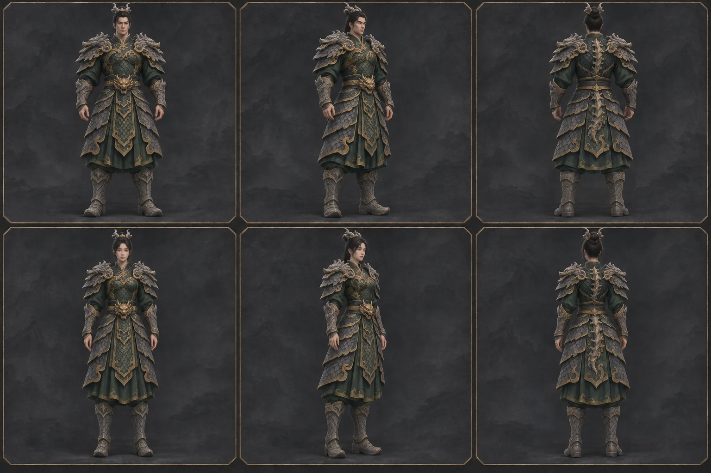

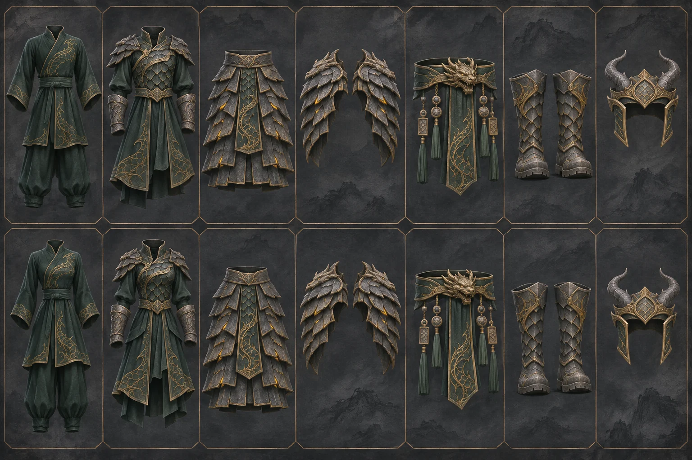

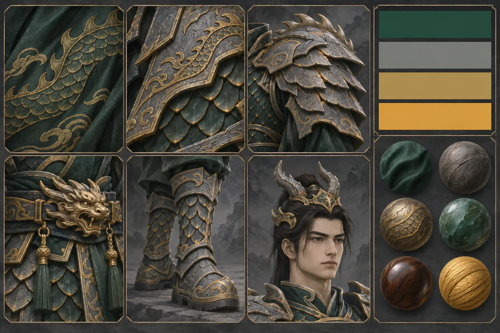

**Bảng màu 3 kênh** (mặt nạ nhuộm của shader T-5 dùng đúng 3 kênh này):

| Kênh | Mã | Tên |
| --- | --- | --- |
| Chính (giáp thân, váy giáp) | `#244A3E` | ngọc bích sẫm |
| Phụ (đá, lớp lót, ủng) | `#7B817D` | đá xám |
| Viền (kim loại, vảy) | `#B59A55` | vàng cổ |
| Nhấn phát sáng (khe vảy) | `#D9A441` | vàng đất, chỉ ở khe vảy |

**Chất liệu:** Vảy đá mài nhám (vai, giáp ngực) · thép đen rèn thủ công (khung giáp) · vàng cổ xỉn chạm khắc (viền vảy, khóa) · vải len dệt dày ngọc bích sẫm (lớp trong, váy) · da thuộc tối (đai, ủng) · đá nhám xám (sừng quan).

**Mảnh rời:**

| Mảnh | Ảnh | Tam giác | Xương gắn vào | Xương lò xo |
| --- | --- | --- | --- | --- |
| Áo ngoài (giáp thân) | [`dia_long_ao_ngoai`](ket-dan/dia_long_ao_ngoai.webp) | 5000 | spine1/spine2 (giáp ngực cứng gắn spine2), upperarm L/R (tay áo ngắn), neck. Trọng số từ thân nền | Gần như không: 1 chuỗi × 2 xương cho vạt vải dưới giáp ngực. Giáp ngực cứng |
| Lớp dưới (váy giáp) | [`dia_long_lop_duoi`](ket-dan/dia_long_lop_duoi.webp) | 2000 | pelvis/hips, thigh L/R. Các tầng váy gắn pelvis, trọng số mềm về thigh | Mỗi tầng váy 1 xương treo (3 tầng × 2 bên, tổng ~8 xương), biên độ nhỏ cho giáp nặng |
| Vai giáp | [`dia_long_vai_giap`](ket-dan/dia_long_vai_giap.webp) | 2200 | clavicle/shoulder L/R (cứng); tầng dưới nối upperarm L/R | Không. Tầng dưới có 1 xương xoay nhẹ theo cánh tay |
| Đai và tua | [`dia_long_dai_tua`](ket-dan/dia_long_dai_tua.webp) | 1500 | hips/spine (cứng). Tua và charm neo ở đai | Tua và charm: 2 chuỗi × 3 xương |
| Ủng | [`dia_long_ung`](ket-dan/dia_long_ung.webp) | 1500 | foot L/R, toe L/R, calf L/R (cứng) | Không |
| Trang sức đầu | [`dia_long_trang_suc_dau`](ket-dan/dia_long_trang_suc_dau.webp) | 700 | head (cứng). Ô trang sức đầu là ô trang bị MỚI (thứ 9, có thể ẩn/hiện) | Không |

## Phục Mạch Đan Bào

Đan sư · Mộc · cảm hứng: ref-01 và ref-06 (lớp voan, tay áo lụa mỏng), hồ lô bên hông.

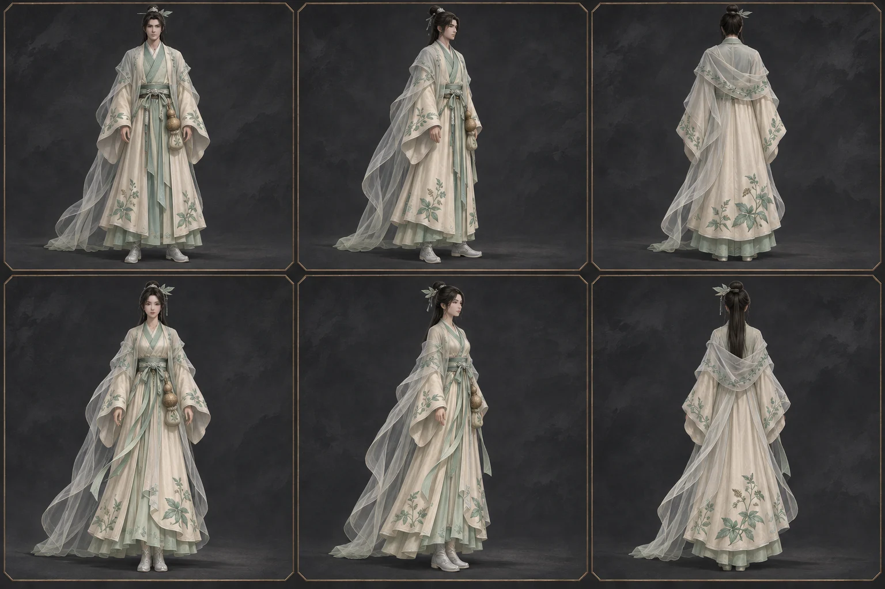

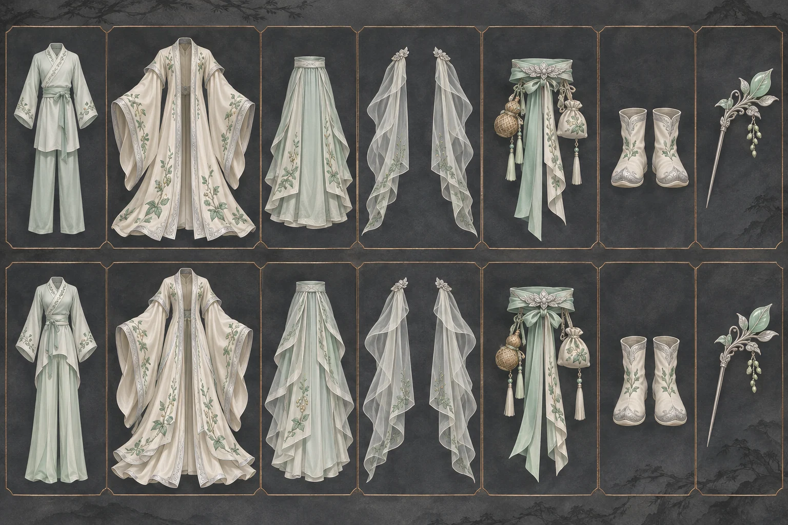

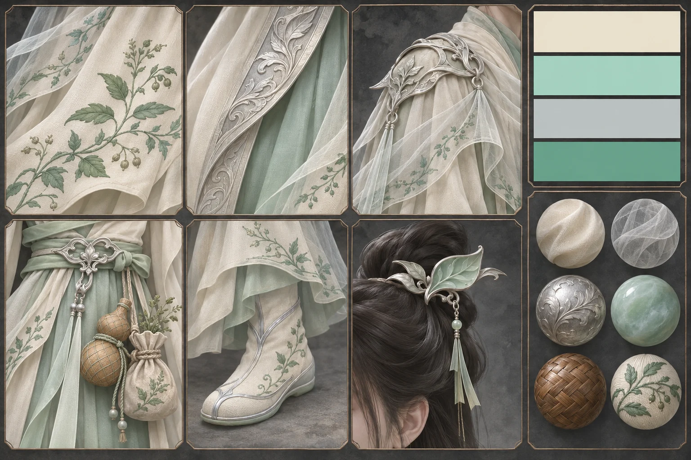

**Bảng màu 3 kênh** (mặt nạ nhuộm của shader T-5 dùng đúng 3 kênh này):

| Kênh | Mã | Tên |
| --- | --- | --- |
| Chính (áo ngoài, voan) | `#EDE6D2` | ngà |
| Phụ (lớp lót, đai) | `#A8D6C2` | xanh ngọc nhạt |
| Viền (kim loại, trâm) | `#C4CCCA` | bạc |
| Nhấn (thêu lá thuốc) | `#5FA58A` | lục thảo, chỉ ở họa tiết thêu |

**Chất liệu:** Lụa mịn bóng nhẹ (áo ngoài) · voan mỏng xuyên sáng (choàng và dải lụa, tối đa 2 mảnh trong suốt cho cả bộ) · vải đay thêu (lớp lót) · bạc chạm khắc (trâm, khóa đai, viền) · hồ lô đan tre phủ sơn (treo đai) · ngọc lục nhạt (hạt tua, lá trâm).

**Mảnh rời:**

| Mảnh | Ảnh | Tam giác | Xương gắn vào | Xương lò xo |
| --- | --- | --- | --- | --- |
| Áo ngoài (đạo bào + voan choàng) | [`phuc_mach_ao_ngoai`](ket-dan/phuc_mach_ao_ngoai.webp) | 5000 | spine1/spine2, upperarm L/R, forearm L/R, neck. Voan choàng gắn spine2 và shoulder | Tay áo rộng: 3 chuỗi × 3 xương mỗi bên. Voan choàng: 2 đuôi × 4 xương. Vạt sau: 2 chuỗi × 3 xương |
| Lớp dưới | [`phuc_mach_lop_duoi`](ket-dan/phuc_mach_lop_duoi.webp) | 2000 | pelvis/hips, thigh L/R, calf L/R | Vạt trước và sau: 2 chuỗi × 3 xương |
| Vai giáp (vai nhẹ) | [`phuc_mach_vai_giap`](ket-dan/phuc_mach_vai_giap.webp) | 1500 | clavicle/shoulder L/R (cứng) | Chuỗi hạt ngọc: 1 chuỗi × 3 xương mỗi bên |
| Đai, hồ lô và dải lụa | [`phuc_mach_dai_tua`](ket-dan/phuc_mach_dai_tua.webp) | 1400 | hips/spine (đai cứng). Hồ lô và túi neo ở đai | Dải lụa: 1 chuỗi × 5 xương. Hồ lô và túi: 2 chuỗi × 3 xương. Tua: 1 chuỗi × 3 xương |
| Ủng | [`phuc_mach_ung`](ket-dan/phuc_mach_ung.webp) | 1200 | foot L/R, toe L/R, calf L/R (cứng) | Không |
| Trang sức đầu | [`phuc_mach_trang_suc_dau`](ket-dan/phuc_mach_trang_suc_dau.webp) | 700 | head (cứng). Ô trang sức đầu là ô trang bị MỚI (thứ 9, có thể ẩn/hiện) | Chuỗi hạt: 2 chuỗi × 3 xương. Dải sau: 1 chuỗi × 3 xương mỗi dải |

## Kiếm Liệt Mạch: dạng cuối +10 và vỏ

Dạng gốc dùng model #119 có sẵn (`prop_kiem_liet_mach`). Concept này chỉ là dạng cuối và vỏ.

| Mảnh | Ảnh | Tam giác | Gắn vào | Ghi chú |
| --- | --- | --- | --- | --- |
| Dạng cuối +10 | [`kiem_liet_mach_cuoi`](ket-dan/kiem_liet_mach_cuoi.webp) | 4000 | prop gắn bone `dtl_sword` (xương cầm kiếm); điểm gốc tại giữa chuôi, trục dọc theo lưỡi. Phát sáng là vật liệu riêng | Tinh thể thể hiện bằng khối đặc tối màu có rãnh vân; KHÔNG dùng trong suốt thật. Vân hổ phách tách thành mặt nạ phát sáng để worker điều khiển. Dạng gốc (#119) vẫn giữ cho +0…+9; dạng cuối thay lúc cường hóa +10. |
| Vỏ kiếm | [`kiem_liet_mach_vo`](ket-dan/kiem_liet_mach_vo.webp) | 1500 | prop gắn ổ cắm lưng (`dtl_scabbard_back`, tạo bởi T-1/T-2); khi rút kiếm thì vỏ ở lại lưng | Vỏ dài vừa khớp lưỡi dạng gốc (#119), kín hoàn toàn. Cửa vỏ ở ngang vai khi đeo chéo lưng. |

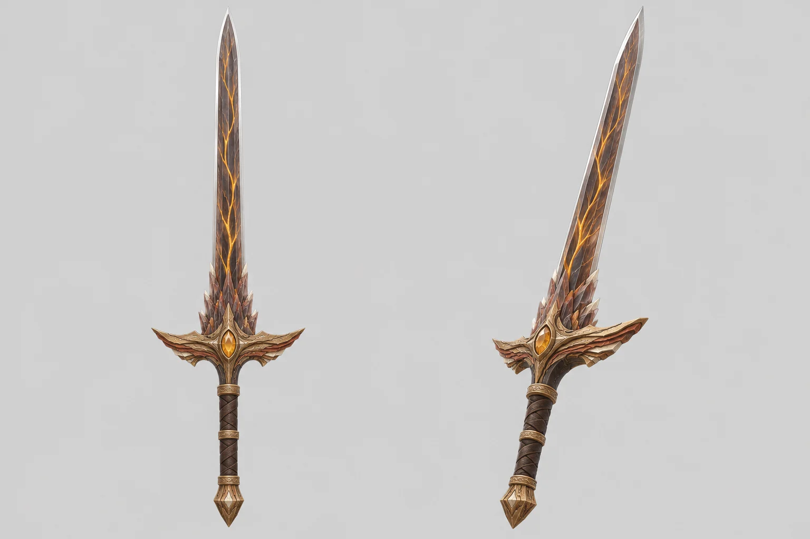

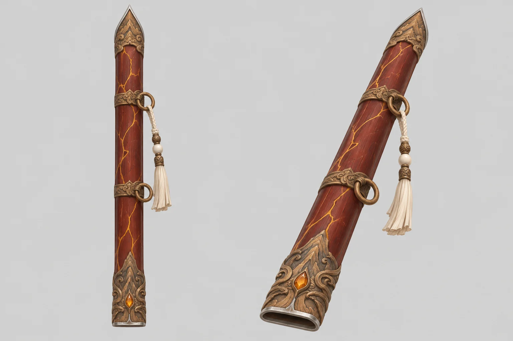

## Hướng dẫn dựng từng mảnh trên Tripo web

**Thứ tự:** làm trọn từng bộ rồi mới sang bộ sau (Liệt Mạch → Địa Long → Phục Mạch), rồi kiếm. Trong một bộ: 1) áo ngoài (quyết định dáng cả bộ; xong nên xem thử trước khi làm tiếp) → 2) lớp dưới → 3) vai giáp → 4) đai và tua → 5) ủng → 6) trang sức đầu.

Cho mỗi mảnh:

1. Mở ảnh nửa chính diện `<DTL_ASSET_SOURCE>/<chr|prop>/<id bộ>/concept/outfit_<id>_v01_front.png` (đã cắt sẵn; nửa 3/4 là `..._34.png`, ảnh nguyên là `..._v01.png`).
2. Tripo web → **Image to 3D**, tải ảnh lên. Thiết lập: model **H3.1**, texture **Detailed**, **PBR** bật, **Smart Low-poly** bật, **Polycount** theo bảng tam giác của mảnh, không quad, **không rig** (pipeline T-5 tự gắn xương).
3. Dán prompt tiếng Anh của mảnh (trong [ket-dan/prompts.md](ket-dan/prompts.md), mục từng mảnh) vào ô mô tả thêm nếu có.
4. Kiểm kết quả: xoay đủ mọi hướng. **Làm lại** nếu: mảnh là một tấm mỏng không có chiều dày; dính liền với người hoặc ma-nơ-canh; thủng ở đáy hoặc cổ tay; hoa văn bị nhòe thành loang; vai giáp hay ủng lệch trái phải. Tripo cho phép thử lại nên chọn phương án tốt nhất.
5. Tải **GLB** về, lưu: `<DTL_ASSET_SOURCE>/<chr|prop>/<id bộ>/tripo/raw_<mảnh>_v01.glb` (ví dụ `chr/set_liet_mach_kiem_y/tripo/raw_ao_ngoai_v01.glb`; kiếm: `prop/prop_kiem_liet_mach/tripo/raw_cuoi_v01.glb`, `raw_vo_v01.glb`). Lưu thêm task id Tripo vào file `.txt` cạnh GLB (để tải lại được).
6. Báo mình khi xong từng bộ; mình chạy pipeline T-5 (căn thân nền, trọng số xương, lồng đệm, xương lò xo, LOD, shader nhuộm 3 kênh) và gửi ảnh duyệt.

Id bộ và thư mục nguồn: `chr/set_liet_mach_kiem_y`, `chr/set_dia_long_ho_giap`, `chr/set_phuc_mach_dan_bao`, kiếm `prop/prop_kiem_liet_mach`. Các thư mục `concept/` đã chứa ảnh và prompt gốc.

**Mẹo:** mảnh xuyên sáng (voan, dải lụa của Phục Mạch) cứ dựng như vải mỏng đặc; worker sẽ đổi sang alpha-test hoặc dither. Đừng cố bắt Tripo làm trong suốt. Mảnh đối xứng (vai, ủng, bên trái và phải) chỉ cần dựng một cặp; không cần dựng riêng nam và nữ, pipeline fit theo từng thân nền.

## Dùng lại, không đụng tới

- Dạng gốc của Kiếm Liệt Mạch là model #119 có sẵn (`prop_kiem_liet_mach`), giữ nguyên cho +0…+9.
- Ảnh concept cũ `docs/asset-concepts/set_*` và các mẫu #119 vẫn dùng làm bản tạm cho tới khi mảnh mới vào (kế hoạch tổng mục 5).
