# Prompt Tripo và spec từng mảnh (bộ Kết Đan bậc 2)

Chung cho mọi mảnh: Image to 3D · model H3.1 · texture Detailed · PBR bật · Smart Low-poly bật · Polycount (face limit) **<xem từng mảnh>** · không quad · không rig. Ảnh đầu vào là **nửa chính diện** (`outfit_<id>_v01_front.png`, cắt sẵn trong thư mục nguồn); nửa 3/4 để đối chiếu hoặc dùng khi thử lại. Hướng dẫn từng bước: [../README.md](../README.md).

Ngân sách mỗi nhân vật ≤ 18k tam giác (thân nền 6k + các mảnh ≤ 12k). Texture 1024² mỗi mảnh (pipeline T-5 gộp atlas theo bộ). Tối đa 2 mảnh xuyên sáng mỗi bộ.


## Liệt Mạch Kiếm Y (Kiếm tu, Thổ/Kim (mạch đất nứt))

Tổng tam giác 6 mảnh: **11700**. Thư mục lưu: `<DTL_ASSET_SOURCE>/3d/nhan-vat/set_liet_mach_kiem_y/tripo/`.

### Áo ngoài · `liet_mach_ao_ngoai`

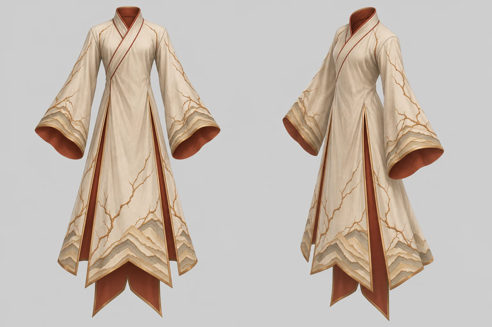

- **Tripo:** Image to 3D · model H3.1 · texture Detailed · PBR bật · Smart Low-poly bật · Polycount (face limit) **5000** · không quad · không rig
- **Lưu GLB:** `chr/set_liet_mach_kiem_y/tripo/raw_ao_ngoai_v01.glb`
- **Xương gắn vào:** spine1/spine2 (thân), upperarm L/R, forearm L/R, cổ áo gắn neck. Trọng số lấy từ thân nền
- **Xương lò xo:** Tay áo: 2 chuỗi × 3 xương mỗi bên (cổ tay trở ra). Vạt sau: 3 chuỗi × 3 xương. Vạt xẻ tà hai bên: 1 chuỗi × 2 xương mỗi bên
- **Lưu ý khi dựng:** Một mảnh liền, mặt ngoài lụa dày KHÔNG xuyên sáng. Phần lót cinnabar là lớp riêng thấy được ở cổ tay và xẻ tà. Mở thân dưới (hở) để lớp dưới thấy bên trong.

Prompt (tùy chọn, dán vào ô mô tả thêm):

```text
A long ivory outer swordsman coat (dao pao): crossed collar, wide sleeves with cinnabar-earth lining cuffs, high side slits, long back panel ending in a swallow-tail hem, bronze-thread crack-vein embroidery along the hem and sleeve edges, thin cinnabar piping on the collar. Single isolated costume piece for a game character, no person, no mannequin, no body, clean separated geometry, hand-painted PBR materials, semi-realistic cinematic style, colors #E6DDCB, #9A4A32, #B07A3C.
```

### Lớp dưới · `liet_mach_lop_duoi`

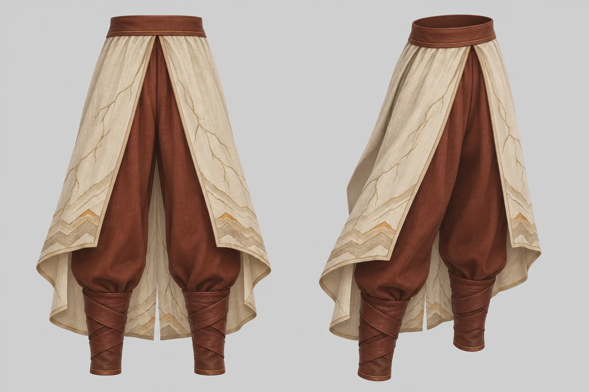

- **Tripo:** Image to 3D · model H3.1 · texture Detailed · PBR bật · Smart Low-poly bật · Polycount (face limit) **2000** · không quad · không rig
- **Lưu GLB:** `chr/set_liet_mach_kiem_y/tripo/raw_lop_duoi_v01.glb`
- **Xương gắn vào:** pelvis/hips, thigh L/R, calf L/R. Trọng số từ thân nền
- **Xương lò xo:** Vạt dưới trước và sau: 2 chuỗi × 2 xương (nhẹ, để vạt áo ngoài lướt lên)
- **Lưu ý khi dựng:** Quần và vạt áo trong tối giản để áo ngoài là điểm nhấn. Cần phủ kín đùi tới bắp chân để cắt vùng ẩn của thân nền.

Prompt (tùy chọn, dán vào ô mô tả thêm):

```text
Wide-leg trousers in plain dark cinnabar-brown linen, with a front-and-back long ivory under-skirt panel (inner robe hem) split at the middle, tucked cinnabar-leather leg wraps below the knees, simple stitched hem trim in bronze thread. Single isolated costume piece for a game character, no person, no mannequin, no body, clean separated geometry, hand-painted PBR materials, semi-realistic cinematic style, colors #E6DDCB, #9A4A32, #B07A3C.
```

### Vai giáp · `liet_mach_vai_giap`

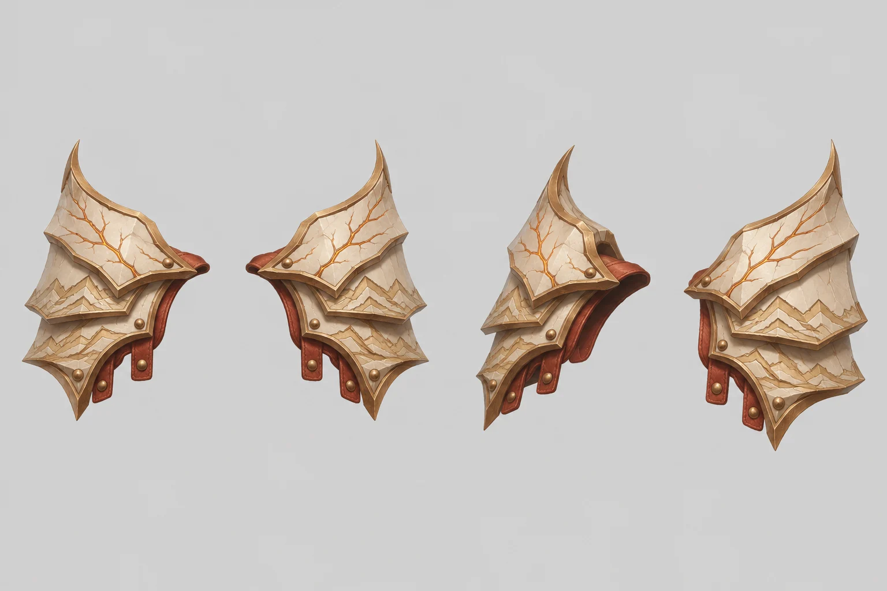

- **Tripo:** Image to 3D · model H3.1 · texture Detailed · PBR bật · Smart Low-poly bật · Polycount (face limit) **1500** · không quad · không rig
- **Lưu GLB:** `chr/set_liet_mach_kiem_y/tripo/raw_vai_giap_v01.glb`
- **Xương gắn vào:** clavicle/shoulder L và R (cứng, không co giãn); một mảnh có hai nửa đối xứng
- **Xương lò xo:** Không. Mảnh cứng
- **Lưu ý khi dựng:** Hai nửa đối xứng gửi cùng một ảnh (chỉ cần dựng một bên rồi lật). Vân hổ phách đặt làm vật liệu riêng (mặt nạ phát sáng) để worker bật theo cấp cường hóa.

Prompt (tùy chọn, dán vào ô mô tả thêm):

```text
A matching pair of angular bronze shoulder armor plates (pauldrons) shaped like cracked cliff strata: three stacked overlapping plates rising to a sharp upward point, engraved crack-vein lines inlaid with thin amber glow, small bronze rivets, cinnabar leather strap tabs underneath, mirrored left and right. Single isolated costume piece for a game character, no person, no mannequin, no body, clean separated geometry, hand-painted PBR materials, semi-realistic cinematic style, colors #E6DDCB, #9A4A32, #B07A3C.
```

### Đai và tua · `liet_mach_dai_tua`

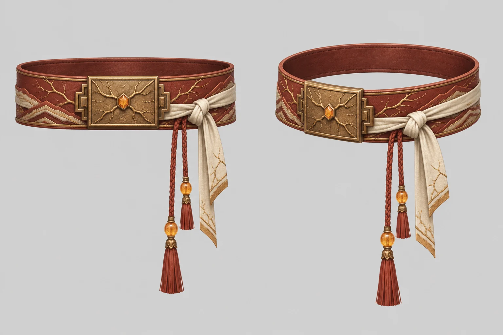

- **Tripo:** Image to 3D · model H3.1 · texture Detailed · PBR bật · Smart Low-poly bật · Polycount (face limit) **1200** · không quad · không rig
- **Lưu GLB:** `chr/set_liet_mach_kiem_y/tripo/raw_dai_tua_v01.glb`
- **Xương gắn vào:** đai: hips/spine (cứng, quấn quanh eo). Tua: neo ở đai
- **Xương lò xo:** Tua: 2 chuỗi × 4 xương. Dải thắt nút: 1 chuỗi × 3 xương
- **Lưu ý khi dựng:** Đai là vòng kín quanh eo, độ dày ~2 cm, để pipeline lồng đệm. Tua và dải để rời mesh để gắn xương lò xo.

Prompt (tùy chọn, dán vào ô mô tả thêm):

```text
A wide cinnabar leather belt with a large rectangular bronze buckle plate engraved with branching crack veins and a small amber stone in the center, a second thinner sash knot at the side, two hanging braided cords ending in amber-bead tassels of different lengths, no jade ring. Single isolated costume piece for a game character, no person, no mannequin, no body, clean separated geometry, hand-painted PBR materials, semi-realistic cinematic style, colors #E6DDCB, #9A4A32, #B07A3C.
```

### Ủng · `liet_mach_ung`

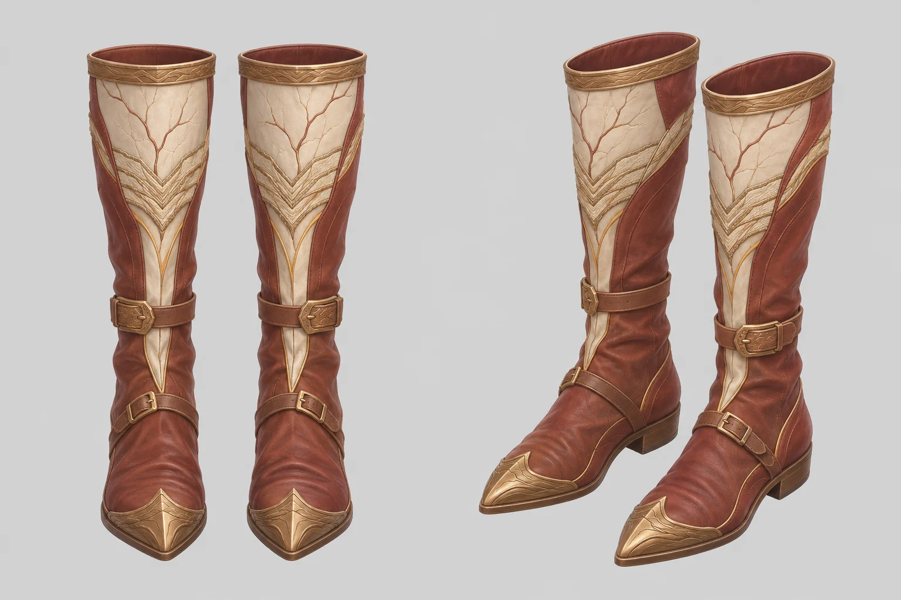

- **Tripo:** Image to 3D · model H3.1 · texture Detailed · PBR bật · Smart Low-poly bật · Polycount (face limit) **1300** · không quad · không rig
- **Lưu GLB:** `chr/set_liet_mach_kiem_y/tripo/raw_ung_v01.glb`
- **Xương gắn vào:** foot L/R, toe L/R, calf L/R (cứng; ống ủng bám bắp chân)
- **Xương lò xo:** Không
- **Lưu ý khi dựng:** Đế phẳng, đặt chân đúng trục xương chân. Phần miệng ủng đủ rộng để lớp dưới chui vào.

Prompt (tùy chọn, dán vào ô mô tả thêm):

```text
A pair of tall cinnabar leather riding boots reaching below the knee, bronze-capped pointed toes, bronze strap buckles and a thin engraved bronze band along the top edge, subtle stratified-stone stitching, stylish but practical for a swordsman. Single isolated costume piece for a game character, no person, no mannequin, no body, clean separated geometry, hand-painted PBR materials, semi-realistic cinematic style, colors #E6DDCB, #9A4A32, #B07A3C.
```

### Trang sức đầu · `liet_mach_trang_suc_dau`

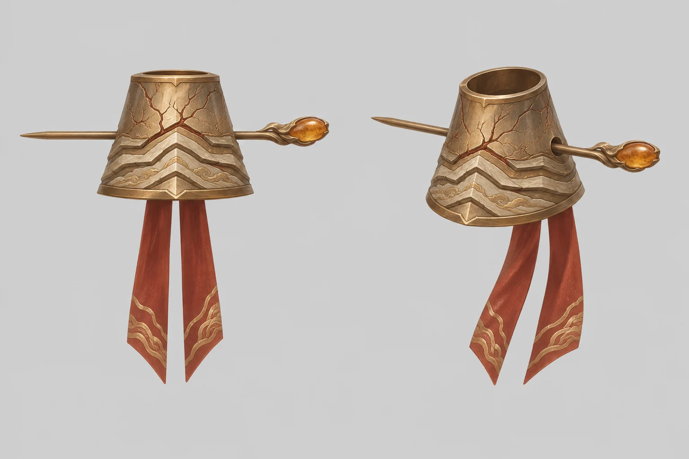

- **Tripo:** Image to 3D · model H3.1 · texture Detailed · PBR bật · Smart Low-poly bật · Polycount (face limit) **700** · không quad · không rig
- **Lưu GLB:** `chr/set_liet_mach_kiem_y/tripo/raw_trang_suc_dau_v01.glb`
- **Xương gắn vào:** head (cứng). Ô trang sức đầu là ô trang bị MỚI (thứ 9, có thể ẩn/hiện)
- **Xương lò xo:** Dải ruy băng sau: 1 chuỗi × 3 xương mỗi dải
- **Lưu ý khi dựng:** Chỉ có quan, trâm, dải. KHÔNG có đầu, tóc hay mặt: tóc thuộc model nhân vật gốc. Tâm quan đặt ở đỉnh đầu, nhìn từ trên xuống phải gọn trong vòng tròn đường kính ~8 cm.

Prompt (tùy chọn, dán vào ô mô tả thêm):

```text
A slim bronze hair crown (guan) that holds a topknot: a small tapered bronze cap with engraved crack-vein lines, one long bronze hairpin passing through it ending in an amber stone, two short cinnabar ribbon tails hanging at the back. Single isolated costume piece for a game character, no person, no mannequin, no body, clean separated geometry, hand-painted PBR materials, semi-realistic cinematic style, colors #E6DDCB, #9A4A32, #B07A3C.
```


## Địa Long Hộ Giáp (Hộ pháp, Thổ)

Tổng tam giác 6 mảnh: **12900**. Thư mục lưu: `<DTL_ASSET_SOURCE>/3d/nhan-vat/set_dia_long_ho_giap/tripo/`.

### Áo ngoài (giáp thân) · `dia_long_ao_ngoai`

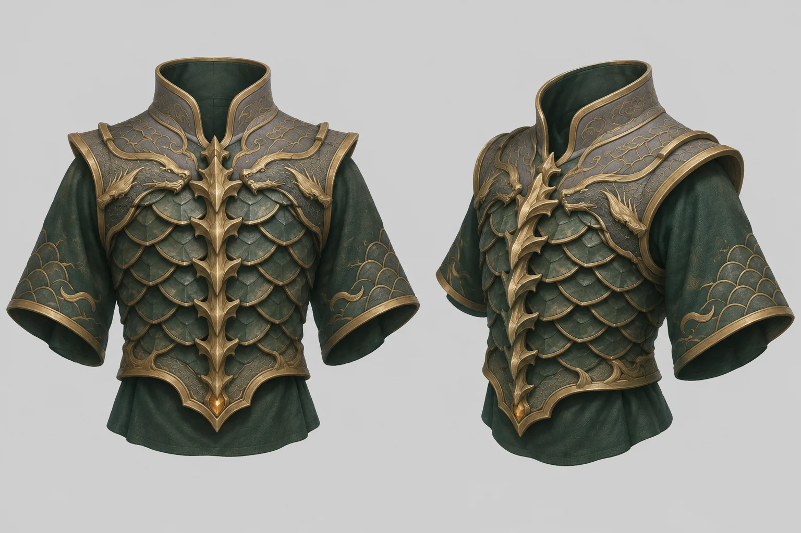

- **Tripo:** Image to 3D · model H3.1 · texture Detailed · PBR bật · Smart Low-poly bật · Polycount (face limit) **5000** · không quad · không rig
- **Lưu GLB:** `chr/set_dia_long_ho_giap/tripo/raw_ao_ngoai_v01.glb`
- **Xương gắn vào:** spine1/spine2 (giáp ngực cứng gắn spine2), upperarm L/R (tay áo ngắn), neck. Trọng số từ thân nền
- **Xương lò xo:** Gần như không: 1 chuỗi × 2 xương cho vạt vải dưới giáp ngực. Giáp ngực cứng
- **Lưu ý khi dựng:** Giáp ngực là khối cứng, vải tunic bên dưới là phần mềm. Để nửa dưới thân hở cho lớp dưới. Vảy phải là khối nổi thật, không phải họa tiết.

Prompt (tùy chọn, dán vào ô mô tả thêm):

```text
A heavy guardian chest armor over a thick dark jade-green tunic: a half-breastplate of overlapping dark jade scale plates with old gold edging and a central ridged spine line, gold-lined stone-grey collar, short wide dark jade sleeves, a gold dragon-spine ridge running down the center chest, no skirt included. Single isolated costume piece for a game character, no person, no mannequin, no body, clean separated geometry, hand-painted PBR materials, semi-realistic cinematic style, colors #244A3E, #7B817D, #B59A55.
```

### Lớp dưới (váy giáp) · `dia_long_lop_duoi`

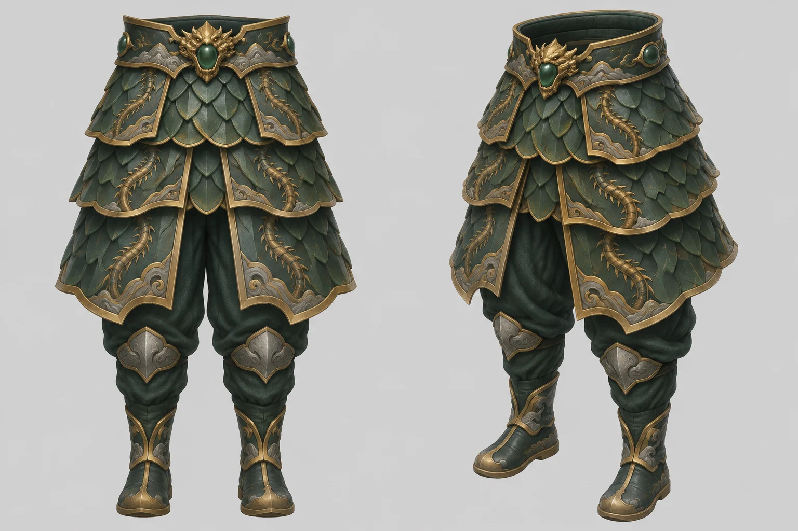

- **Tripo:** Image to 3D · model H3.1 · texture Detailed · PBR bật · Smart Low-poly bật · Polycount (face limit) **2000** · không quad · không rig
- **Lưu GLB:** `chr/set_dia_long_ho_giap/tripo/raw_lop_duoi_v01.glb`
- **Xương gắn vào:** pelvis/hips, thigh L/R. Các tầng váy gắn pelvis, trọng số mềm về thigh
- **Xương lò xo:** Mỗi tầng váy 1 xương treo (3 tầng × 2 bên, tổng ~8 xương), biên độ nhỏ cho giáp nặng
- **Lưu ý khi dựng:** Các tầng váy là tấm cứng đặt chồng lên nhau, có khoảng hở nhỏ giữa tầng để xương xoay. Không dùng vải xuyên sáng.

Prompt (tùy chọn, dán vào ô mô tả thêm):

```text
A tiered armored skirt: three overlapping rows of dark jade scale plates with old gold edging hanging from a belt line to the knees, split at the front and back for walking, thick dark jade wool trousers underneath tucked into the boots, small stone-grey knee guards. Single isolated costume piece for a game character, no person, no mannequin, no body, clean separated geometry, hand-painted PBR materials, semi-realistic cinematic style, colors #244A3E, #7B817D, #B59A55.
```

### Vai giáp · `dia_long_vai_giap`

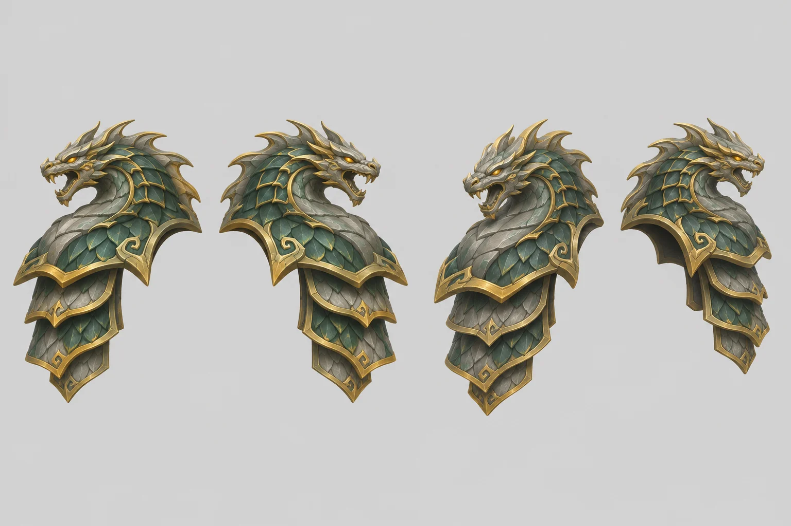

- **Tripo:** Image to 3D · model H3.1 · texture Detailed · PBR bật · Smart Low-poly bật · Polycount (face limit) **2200** · không quad · không rig
- **Lưu GLB:** `chr/set_dia_long_ho_giap/tripo/raw_vai_giap_v01.glb`
- **Xương gắn vào:** clavicle/shoulder L/R (cứng); tầng dưới nối upperarm L/R
- **Xương lò xo:** Không. Tầng dưới có 1 xương xoay nhẹ theo cánh tay
- **Lưu ý khi dựng:** Vai to nhất trong ba bộ, đỉnh cao hơn vai ~15 cm. Kiểm tra không đâm vào cổ khi giơ tay, để pipeline tạo lồng đệm.

Prompt (tùy chọn, dán vào ô mô tả thêm):

```text
A matching pair of huge shoulder guards built from overlapping stone dragon scales in dark jade and stone grey with old gold edging, rising in a sweeping crest like a coiled earth dragon head over each shoulder, three descending tiers hanging over the upper arm, mirrored left and right. Single isolated costume piece for a game character, no person, no mannequin, no body, clean separated geometry, hand-painted PBR materials, semi-realistic cinematic style, colors #244A3E, #7B817D, #B59A55.
```

### Đai và tua · `dia_long_dai_tua`

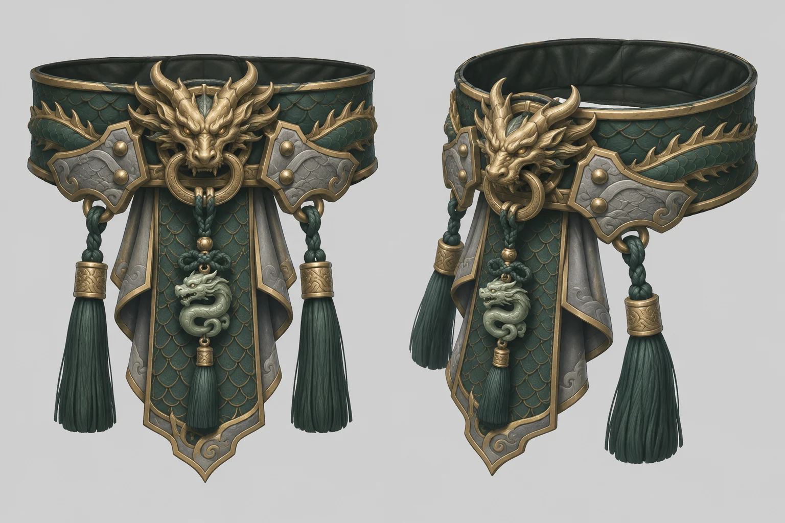

- **Tripo:** Image to 3D · model H3.1 · texture Detailed · PBR bật · Smart Low-poly bật · Polycount (face limit) **1500** · không quad · không rig
- **Lưu GLB:** `chr/set_dia_long_ho_giap/tripo/raw_dai_tua_v01.glb`
- **Xương gắn vào:** hips/spine (cứng). Tua và charm neo ở đai
- **Xương lò xo:** Tua và charm: 2 chuỗi × 3 xương
- **Lưu ý khi dựng:** Đai dày 3 cm vì giáp nặng. Đầu rồng ở khóa là điểm nhận diện bộ.

Prompt (tùy chọn, dán vào ô mô tả thêm):

```text
A broad dark leather belt with a large old-gold dragon-head clasp, studded stone-grey side plates, a hanging short apron tassel of braided cord with a small carved stone-dragon charm, thick cord tassels. Single isolated costume piece for a game character, no person, no mannequin, no body, clean separated geometry, hand-painted PBR materials, semi-realistic cinematic style, colors #244A3E, #7B817D, #B59A55.
```

### Ủng · `dia_long_ung`

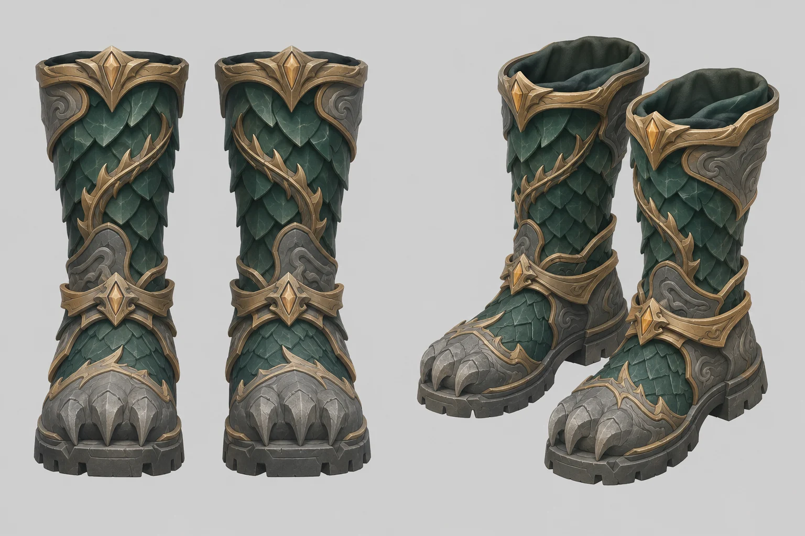

- **Tripo:** Image to 3D · model H3.1 · texture Detailed · PBR bật · Smart Low-poly bật · Polycount (face limit) **1500** · không quad · không rig
- **Lưu GLB:** `chr/set_dia_long_ho_giap/tripo/raw_ung_v01.glb`
- **Xương gắn vào:** foot L/R, toe L/R, calf L/R (cứng)
- **Xương lò xo:** Không
- **Lưu ý khi dựng:** Ủng nặng nhưng ống không được to hơn bắp chân quá 30% để vừa dáng hai giới.

Prompt (tùy chọn, dán vào ô mô tả thêm):

```text
A pair of heavy stone-grey boots with dark jade scale-plated shins, old gold trim bands at the ankle and top, thick reinforced toe caps carved like stone claws, wide sturdy sole. Single isolated costume piece for a game character, no person, no mannequin, no body, clean separated geometry, hand-painted PBR materials, semi-realistic cinematic style, colors #244A3E, #7B817D, #B59A55.
```

### Trang sức đầu · `dia_long_trang_suc_dau`

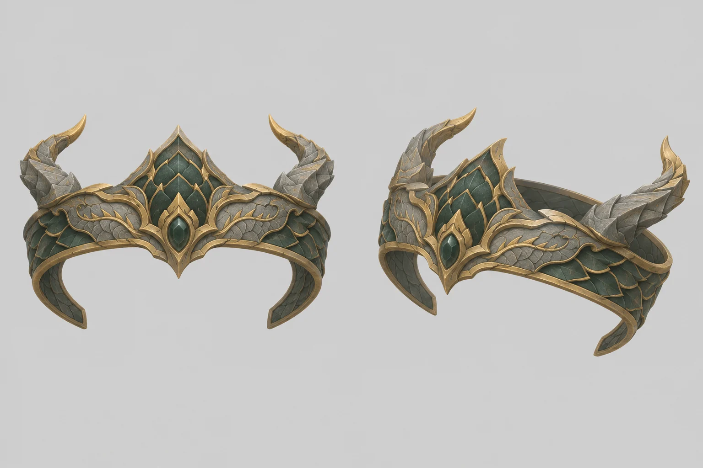

- **Tripo:** Image to 3D · model H3.1 · texture Detailed · PBR bật · Smart Low-poly bật · Polycount (face limit) **700** · không quad · không rig
- **Lưu GLB:** `chr/set_dia_long_ho_giap/tripo/raw_trang_suc_dau_v01.glb`
- **Xương gắn vào:** head (cứng). Ô trang sức đầu là ô trang bị MỚI (thứ 9, có thể ẩn/hiện)
- **Xương lò xo:** Không
- **Lưu ý khi dựng:** Chỉ có vòng quan và sừng, để hở mặt và tóc. Sừng ngắn, hướng ra sau, không vượt quá 12 cm.

Prompt (tùy chọn, dán vào ô mô tả thêm):

```text
A stone-grey helm-crown (circlet style, open face, no visor): a band with old gold edging and a center scale crest, two short swept-back stone dragon horns on the sides with gold tips, a small dark jade gem at the forehead. Single isolated costume piece for a game character, no person, no mannequin, no body, clean separated geometry, hand-painted PBR materials, semi-realistic cinematic style, colors #244A3E, #7B817D, #B59A55.
```


## Phục Mạch Đan Bào (Đan sư, Mộc)

Tổng tam giác 6 mảnh: **11800**. Thư mục lưu: `<DTL_ASSET_SOURCE>/3d/nhan-vat/set_phuc_mach_dan_bao/tripo/`.

### Áo ngoài (đạo bào + voan choàng) · `phuc_mach_ao_ngoai`

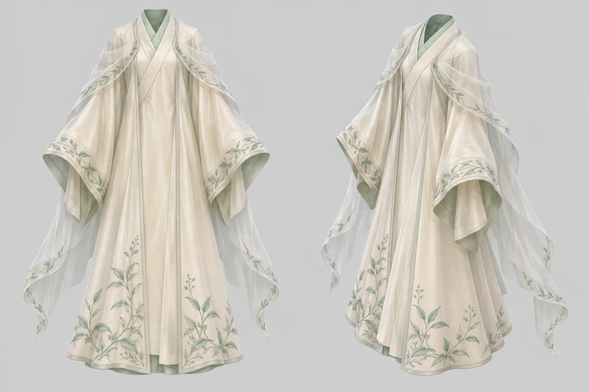

- **Tripo:** Image to 3D · model H3.1 · texture Detailed · PBR bật · Smart Low-poly bật · Polycount (face limit) **5000** · không quad · không rig
- **Lưu GLB:** `chr/set_phuc_mach_dan_bao/tripo/raw_ao_ngoai_v01.glb`
- **Xương gắn vào:** spine1/spine2, upperarm L/R, forearm L/R, neck. Voan choàng gắn spine2 và shoulder
- **Xương lò xo:** Tay áo rộng: 3 chuỗi × 3 xương mỗi bên. Voan choàng: 2 đuôi × 4 xương. Vạt sau: 2 chuỗi × 3 xương
- **Lưu ý khi dựng:** Đây là mảnh XUYÊN SÁNG thứ nhất của bộ (voan). Dựng voan là lớp mỏng riêng; worker dùng alpha-test hoặc dither. Phần đạo bào lụa thì đặc.

Prompt (tùy chọn, dán vào ô mô tả thêm):

```text
A wide ivory alchemist robe with crossed collar and very wide flowing sleeves, a pale jade-green inner collar visible, herb-leaf embroidery on the hem and cuffs, and a long translucent gauze shawl draped across both shoulders and falling behind in two soft tails with a thin silver-thread border. Single isolated costume piece for a game character, no person, no mannequin, no body, clean separated geometry, hand-painted PBR materials, semi-realistic cinematic style, colors #EDE6D2, #A8D6C2, #C4CCCA.
```

### Lớp dưới · `phuc_mach_lop_duoi`

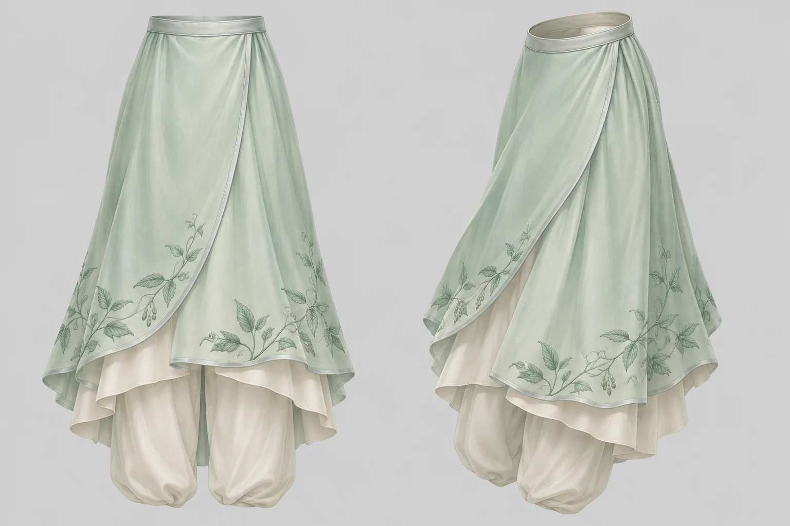

- **Tripo:** Image to 3D · model H3.1 · texture Detailed · PBR bật · Smart Low-poly bật · Polycount (face limit) **2000** · không quad · không rig
- **Lưu GLB:** `chr/set_phuc_mach_dan_bao/tripo/raw_lop_duoi_v01.glb`
- **Xương gắn vào:** pelvis/hips, thigh L/R, calf L/R
- **Xương lò xo:** Vạt trước và sau: 2 chuỗi × 3 xương
- **Lưu ý khi dựng:** Vạt dài tới mắt cá, hai lớp (xanh ngọc ngắn hơn ngà). Cả hai đặc, không xuyên sáng.

Prompt (tùy chọn, dán vào ô mô tả thêm):

```text
A long pale jade-green under-robe skirt with a soft wrap front, an ivory inner hem layer slightly longer than the jade layer, soft loose trousers underneath, herb-leaf embroidery in jade thread along the lower hem. Single isolated costume piece for a game character, no person, no mannequin, no body, clean separated geometry, hand-painted PBR materials, semi-realistic cinematic style, colors #EDE6D2, #A8D6C2, #C4CCCA.
```

### Vai giáp (vai nhẹ) · `phuc_mach_vai_giap`

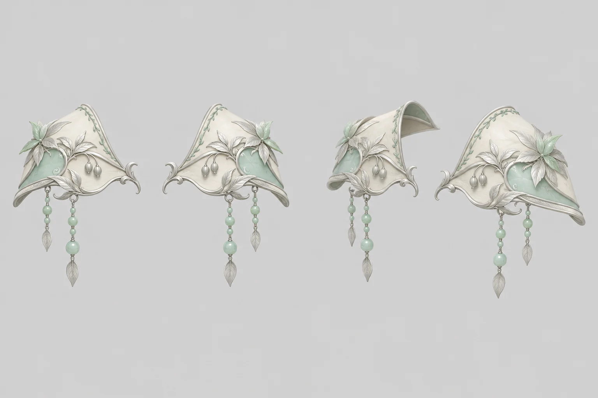

- **Tripo:** Image to 3D · model H3.1 · texture Detailed · PBR bật · Smart Low-poly bật · Polycount (face limit) **1500** · không quad · không rig
- **Lưu GLB:** `chr/set_phuc_mach_dan_bao/tripo/raw_vai_giap_v01.glb`
- **Xương gắn vào:** clavicle/shoulder L/R (cứng)
- **Xương lò xo:** Chuỗi hạt ngọc: 1 chuỗi × 3 xương mỗi bên
- **Lưu ý khi dựng:** Vai của đan sư nhẹ nhất ba bộ: chỉ làm điểm nhấn, đỉnh không cao hơn vai quá 6 cm.

Prompt (tùy chọn, dán vào ô mô tả thêm):

```text
A light decorative shoulder piece pair: curved silver filigree leaf-shaped shoulder caps with pale jade inlay, a few hanging jade bead strings, and small herb-leaf shaped silver plates, mirrored left and right; elegant and delicate, not heavy armor. Single isolated costume piece for a game character, no person, no mannequin, no body, clean separated geometry, hand-painted PBR materials, semi-realistic cinematic style, colors #EDE6D2, #A8D6C2, #C4CCCA.
```

### Đai, hồ lô và dải lụa · `phuc_mach_dai_tua`

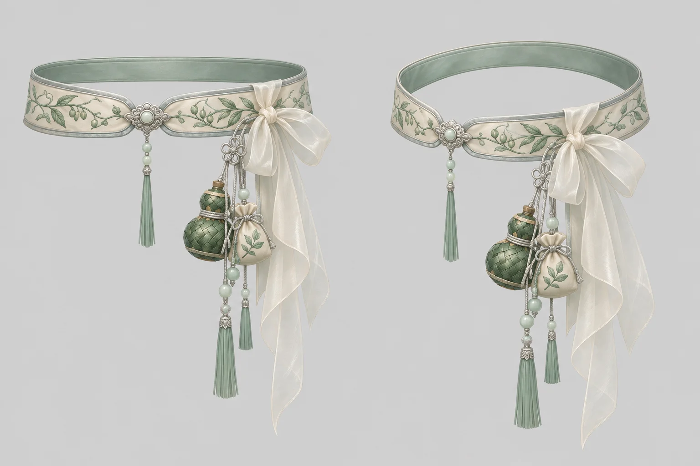

- **Tripo:** Image to 3D · model H3.1 · texture Detailed · PBR bật · Smart Low-poly bật · Polycount (face limit) **1400** · không quad · không rig
- **Lưu GLB:** `chr/set_phuc_mach_dan_bao/tripo/raw_dai_tua_v01.glb`
- **Xương gắn vào:** hips/spine (đai cứng). Hồ lô và túi neo ở đai
- **Xương lò xo:** Dải lụa: 1 chuỗi × 5 xương. Hồ lô và túi: 2 chuỗi × 3 xương. Tua: 1 chuỗi × 3 xương
- **Lưu ý khi dựng:** Đây là mảnh XUYÊN SÁNG thứ hai (dải lụa mỏng) và cũng là mảnh cuối cùng được phép trong suốt cho cả bộ. Hồ lô dựng riêng một phần mesh để dễ gắn xương.

Prompt (tùy chọn, dán vào ô mô tả thêm):

```text
A pale jade sash belt with a small silver clasp, a long thin silk ribbon tied in a soft bow hanging down one side (translucent ivory silk), a small woven bamboo gourd (hu lu) lacquered deep green and a tiny herb pouch hanging from silver cords at the hip, jade bead tassels. Single isolated costume piece for a game character, no person, no mannequin, no body, clean separated geometry, hand-painted PBR materials, semi-realistic cinematic style, colors #EDE6D2, #A8D6C2, #C4CCCA.
```

### Ủng · `phuc_mach_ung`

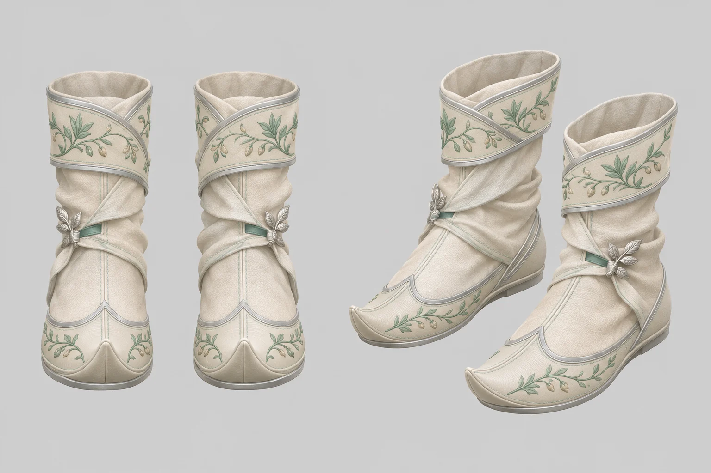

- **Tripo:** Image to 3D · model H3.1 · texture Detailed · PBR bật · Smart Low-poly bật · Polycount (face limit) **1200** · không quad · không rig
- **Lưu GLB:** `chr/set_phuc_mach_dan_bao/tripo/raw_ung_v01.glb`
- **Xương gắn vào:** foot L/R, toe L/R, calf L/R (cứng)
- **Xương lò xo:** Không
- **Lưu ý khi dựng:** Ủng thấp, nhẹ nhất ba bộ. Không có ống cao.

Prompt (tùy chọn, dán vào ô mô tả thêm):

```text
A pair of soft ankle-high ivory cloth-and-leather boots with silver trim bands and slightly upturned pointed toes, pale jade stitching, a tiny herb-leaf silver ornament at the ankle. Single isolated costume piece for a game character, no person, no mannequin, no body, clean separated geometry, hand-painted PBR materials, semi-realistic cinematic style, colors #EDE6D2, #A8D6C2, #C4CCCA.
```

### Trang sức đầu · `phuc_mach_trang_suc_dau`

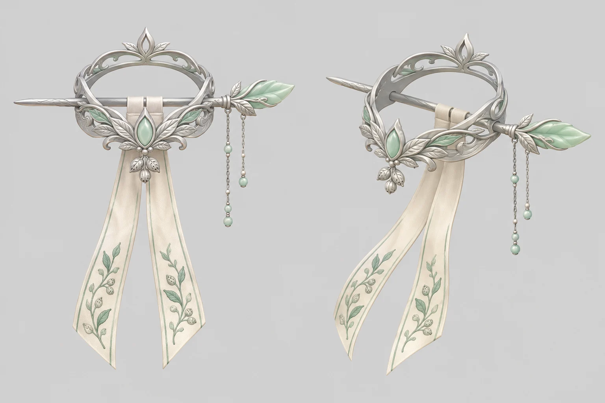

- **Tripo:** Image to 3D · model H3.1 · texture Detailed · PBR bật · Smart Low-poly bật · Polycount (face limit) **700** · không quad · không rig
- **Lưu GLB:** `chr/set_phuc_mach_dan_bao/tripo/raw_trang_suc_dau_v01.glb`
- **Xương gắn vào:** head (cứng). Ô trang sức đầu là ô trang bị MỚI (thứ 9, có thể ẩn/hiện)
- **Xương lò xo:** Chuỗi hạt: 2 chuỗi × 3 xương. Dải sau: 1 chuỗi × 3 xương mỗi dải
- **Lưu ý khi dựng:** Chỉ trâm, kẹp và dây; không có đầu hay tóc. Hạt ngọc nhỏ, tổng không quá 12 hạt để giữ tam giác.

Prompt (tùy chọn, dán vào ô mô tả thêm):

```text
A leaf-shaped hairpin and hair ornament set: a silver circlet-style hair clip holding a topknot, one tall hairpin with a leaf-shaped pale jade tip, two thin silver chains with tiny jade beads hanging on one side, two short ivory silk ribbon tails at the back. Single isolated costume piece for a game character, no person, no mannequin, no body, clean separated geometry, hand-painted PBR materials, semi-realistic cinematic style, colors #EDE6D2, #A8D6C2, #C4CCCA.
```


## Kiếm Liệt Mạch (dạng cuối +10 và vỏ)

Dạng gốc dùng model #119 có sẵn (`prop_kiem_liet_mach`). Concept này chỉ là dạng cuối và vỏ.

### Dạng cuối +10 · `kiem_liet_mach_cuoi`

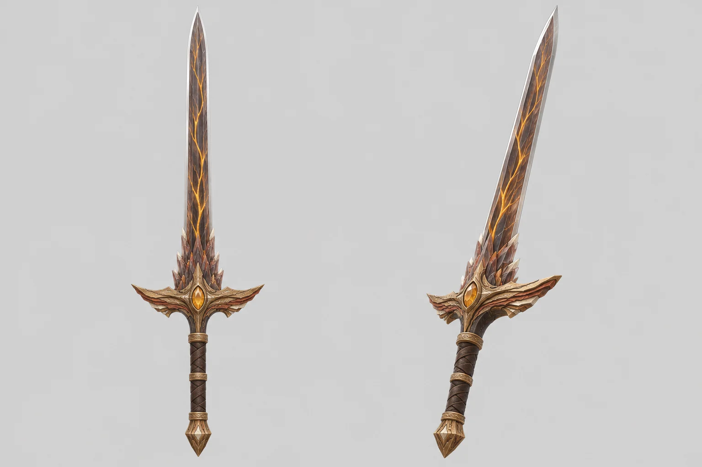

- **Tripo:** Image to 3D · model H3.1 · texture Detailed · PBR bật · Smart Low-poly bật · Polycount (face limit) **4000** · không quad · không rig
- **Lưu GLB:** `prop/prop_kiem_liet_mach/tripo/raw_cuoi_v01.glb`
- **Gắn vào:** prop gắn bone `dtl_sword` (xương cầm kiếm); điểm gốc tại giữa chuôi, trục dọc theo lưỡi. Phát sáng là vật liệu riêng
- **Xương lò xo:** Không
- **Lưu ý khi dựng:** Tinh thể thể hiện bằng khối đặc tối màu có rãnh vân; KHÔNG dùng trong suốt thật. Vân hổ phách tách thành mặt nạ phát sáng để worker điều khiển. Dạng gốc (#119) vẫn giữ cho +0…+9; dạng cuối thay lúc cường hóa +10.

```text
A single the final awakened form of an earth-vein sword: a long slender double-edged blade (about 1.15 times longer than a normal sword) made of dark translucent crystal with branching glowing amber crack-veins running inside along the fuller, a razor silver edge catching light, tiered crystal spikes near the base, a widened crossguard swept upward like cliff strata wings in dark aged bronze with engraved crack lines and an amber gem eye at the center, a dark leather-wrapped grip with bronze rings, a faceted bronze pommel. Isolated game prop, no hand, no person, clean geometry, hand-painted PBR materials, semi-realistic cinematic style, dark aged bronze, silver edge, amber accents.
```

### Vỏ kiếm · `kiem_liet_mach_vo`

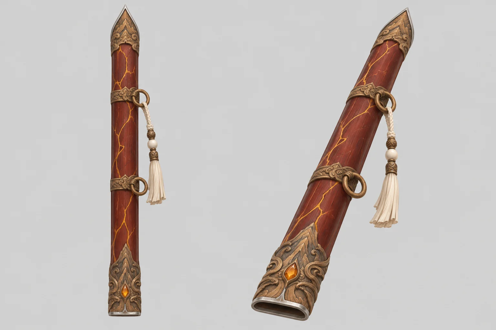

- **Tripo:** Image to 3D · model H3.1 · texture Detailed · PBR bật · Smart Low-poly bật · Polycount (face limit) **1500** · không quad · không rig
- **Lưu GLB:** `prop/prop_kiem_liet_mach/tripo/raw_vo_v01.glb`
- **Gắn vào:** prop gắn ổ cắm lưng (`dtl_scabbard_back`, tạo bởi T-1/T-2); khi rút kiếm thì vỏ ở lại lưng
- **Xương lò xo:** Dây tua: 1 chuỗi × 3 xương
- **Lưu ý khi dựng:** Vỏ dài vừa khớp lưỡi dạng gốc (#119), kín hoàn toàn. Cửa vỏ ở ngang vai khi đeo chéo lưng.

```text
A single a matching scabbard for the Liet Mach earth-vein sword: dark cinnabar-lacquered wood body, engraved bronze mouth piece (chape) and tip, two bronze suspension rings, thin amber-veined inlay lines running down the length like cracks in rock, a short ivory-and-bronze cord with a tassel, shown fully closed (no blade visible). Isolated game prop, no hand, no person, clean geometry, hand-painted PBR materials, semi-realistic cinematic style, dark aged bronze, silver edge, amber accents.
```
