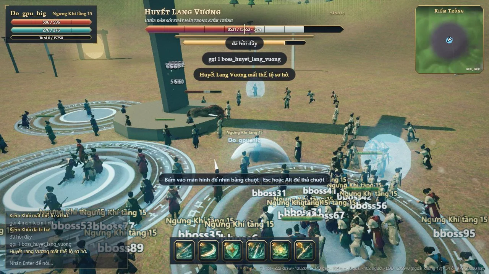
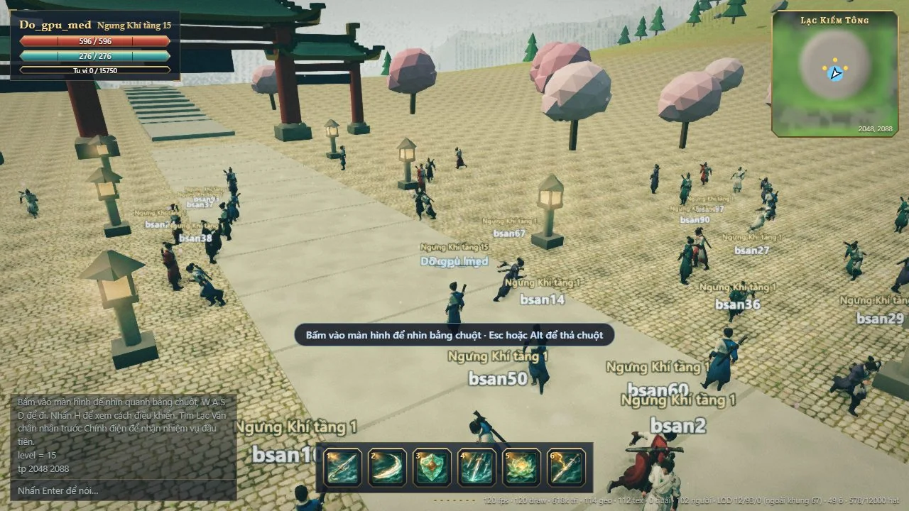

# Báo cáo hiệu năng M6-3: 50–100 người chơi

Ngày đo: 15/11/2026. Công cụ: `pnpm bench:crowd` (`tools/perf/src/crowd.ts`, xem skill `perf-budget`).

## Tóm tắt

- **Quy mô thật (≤ 50 người mỗi kênh, server tự mở kênh mới ở 50)**: sau khi sửa, mọi chỉ số dưới ngân sách ở sân tông môn, rừng, trận boss Kiếm Trủng và bí cảnh, trên cả WebGPU và WebGL2, preset Vừa và Cao; riêng **rừng WebGL2 Cao** CPU khung p95 9,6 ms (p50 6,8 ms) còn vượt 8 ms. Trước khi sửa, ở 50 người: draw call tới 374 và CPU p95 tới 11,5 ms.
- **Kiểm tra sức chịu: 100 người chung một kênh**: sân tông môn đạt hết (CPU p95 6,2–7,9 ms). Ở rừng và trận boss: draw call ≤ 304 (trước 505; chỉ boss WebGL2 Cao chạm 304), tam giác ≤ 1,73M, texture ≤ 331MB, heap ≤ 321MB, tick server p95 ≤ 8,4 ms; **CPU khung p95 còn 8,2–12,6 ms** (p50 5,1–8,5 ms). Lựa chọn ở mục cuối.
- **Tải đầu** (`pnpm size`, bản build đã merge main): 2,21MB / 30MB. **Băng thông** mỗi client: ~25–32 KB/s ở 50 người, ~40 KB/s ở 100 người cùng kênh. **Tick server** p95: ≤ 3,5 ms ở 50 người, ≤ 8,4 ms ở 100 người (ngưỡng 25 ms). `pnpm ledger:check` sau 84 bot (săn quái, đánh rừng, vào bí cảnh): sổ cái khớp.
- **Nguyên nhân chính tìm được và đã sửa**: three r178 upload lại toàn bộ bộ đệm `DynamicDrawUsage` ở mỗi lần vẽ (13–166 MB/s thừa); hiệu ứng chiêu của người khác chiếm 120–180 draw call; `skeleton.update()` tính lại mỗi khung dù xương không đổi. A/B xen kẽ cùng máy: CPU khung p50 −7…−37% và p95 −3…−33% (giảm nhiều nhất ở cảnh đông, nhiều VFX), phần `render` −13…−44%, draw call tối đa ở rừng/boss −18…−39%.

## Cách đo

- **Máy**: Intel i5-12400F (12 luồng), RTX 3060 Ti, Windows 11, Chrome 157 headless (`--mute-audio`, URL `?mute=1&debug=1&gputime=1`), 1280×720, dpr 1, Vite dev server (module chưa gộp, React dev: CPU khung cao hơn bản build).
- **Máy dùng chung**: trong lúc đo, các worktree khác cũng chạy server dev, trình duyệt và benchmark (CPU máy ~80%). Số tuyệt đối vì thế dao động mạnh giữa các lượt (thấy rõ ở tick server và p95/p99). Kết luận trước/sau dựa trên **A/B xen kẽ** (main và nhánh này chạy luân phiên, cùng công cụ, cùng điều kiện, lấy trung vị các vòng), không dựa trên một lượt đơn.
- **Server**: một tiến trình `pnpm dev` ở cặp cổng riêng, DB tạm, `RATE_LIMIT_EXEMPT=loopback`, `MAX_CLIENTS=128` để cả 100 bot và client đo **chung một kênh** (trường hợp nặng nhất cho client; server thật tách kênh ở 50 người).
- **Bot** (`pnpm bots`, thêm `--crowd`, `--fight`, `--level`, `--tp`, `--dungeon`): mỗi bot nối WebSocket riêng như client thật, gửi input 20 lần/giây.
- **Client đo**: mỗi renderer × preset nạp trang mới (preset đặt sẵn), `/gm level 15`, dịch chuyển tới tâm cảnh, chờ ô địa hình nạp xong và ấm máy 5 giây, rồi xoay camera trọn một vòng trong 10 giây (pitch 0,38, cách 13 m). Trong lúc đo, client tự `/gm heal` và gọi thêm quái/boss khi thiếu.
- **Cảnh**:
  - **Sân tông môn** (`san`): bot đi lại/đứng quanh chỗ hồi sinh, bán kính 25 m.
  - **Rừng** (`rung`): bot cấp 15 đánh quái thường bằng đủ 5 chiêu (≥ 10 quái quanh tâm).
  - **Kiếm Trủng, đánh boss** (`boss`): lòng chảo Kiếm Trủng trong room thế giới; bot cấp 15 đánh boss có xương (Thủ Mộ Thạch Tướng, Huyết Lang Vương, Kiếm Khôi luân phiên, chết thì gọi lại) cùng ≥ 4 Kiếm Linh. Cảnh nhiều VFX nhất.
  - **Bí cảnh** (`dungeon`): room bí cảnh thật (tối đa 5 người): client đo + 4 bot vào qua cổng, đánh đợt quái và boss gọi thêm.
- **Chỉ số**: CPU `Game.frame()` p50/p95/p99 và theo phần (`render`, `ents`, `matrix`…); GPU (timestamp query, tổng các pass chia số khung; trên WebGL2 Chrome có `EXT_disjoint_timer_query_webgl2` nên đo được); draw call và tam giác tối đa trong vòng xoay (cả khung gồm pass bóng, hậu kỳ); texture MB (ước tính từ lúc backend tạo texture); JS heap; băng thông WebSocket của client đo; tick p95 của room (đọc `/health` mỗi giây, lấy lớn nhất); pipeline tạo mới và khung > 12 ms.

## Kết quả trước khi sửa (main d502e92, một lượt đủ ma trận)

| Cảnh | Bot | Backend | Preset | CPU p50 / p95 / p99 (ms) | GPU p50 / p95 (ms) | Draw max | Tam giác max | Texture MB | Heap MB | ↓ KB/s | Tick p95 (ms) | Ngân sách |
| --- | ---: | --- | --- | --- | --- | --- | --- | ---: | ---: | ---: | ---: | --- |
| Sân tông môn | 50 | WebGPU | Vừa | 4.2 / 5.4 / 6.2 | 0.41 / 0.52 | 124 | 834k | 85 | 165.8 | 26.8 | 0.93 | đạt |
| Sân tông môn | 50 | WebGPU | Cao | 4.9 / 6.5 / 8.4 | 0.24 / 0.49 | 155 | 1142k | 117 | 168.3 | 26.8 | 0.78 | đạt |
| Sân tông môn | 50 | WebGL2 | Vừa | 6.3 / 38.4 / 71.2 | 2.42 / 13.71 | 132 | 890k | 67.6 | 170.3 | 19.9 | 1.14 | **vượt CPU** |
| Sân tông môn | 50 | WebGL2 | Cao | 5.3 / 7.1 / 14 | 2.82 / 3.69 | 153 | 1123k | 70.6 | 193.6 | 27.9 | 1.75 | đạt |
| Sân tông môn | 100 | WebGPU | Vừa | 6.6 / 9.2 / 12.8 | 0.3 / 0.7 | 162 | 1137k | 94.3 | 189.3 | 37.3 | 1.36 | **vượt CPU** |
| Sân tông môn | 100 | WebGPU | Cao | 6.3 / 8.4 / 10.4 | 0.27 / 0.54 | 181 | 1337k | 128 | 191.8 | 39.8 | 1.22 | **vượt CPU** |
| Sân tông môn | 100 | WebGL2 | Vừa | 6.9 / 9.6 / 12.2 | 2.54 / 3.67 | 161 | 1086k | 79.9 | 218 | 37.3 | 1.21 | **vượt CPU** |
| Sân tông môn | 100 | WebGL2 | Cao | 7.4 / 10.1 / 12.9 | 2.71 / 4.3 | 181 | 1350k | 81.6 | 216.1 | 36.5 | 1.91 | **vượt CPU** |
| Rừng | 50 | WebGPU | Vừa | 6 / 8.2 / 11 | 0.23 / 0.49 | 333 | 975k | 107.3 | 186.9 | 31 | 1.46 | **vượt draw, CPU** |
| Rừng | 50 | WebGPU | Cao | 6.7 / 9.2 / 11.5 | 0.29 / 0.56 | 374 | 1374k | 141.3 | 182.5 | 28.7 | 2.09 | **vượt draw, CPU** |
| Rừng | 50 | WebGL2 | Vừa | 6 / 9 / 13.1 | 2.75 / 3.68 | 306 | 1061k | 93.6 | 160.8 | 30.7 | 2.39 | **vượt draw, CPU** |
| Rừng | 50 | WebGL2 | Cao | 6.4 / 9.3 / 12.1 | 3.29 / 4.16 | 360 | 1544k | 94.6 | 198.2 | 29.9 | 2.34 | **vượt draw, CPU** |
| Rừng | 100 | WebGPU | Vừa | 8 / 11.9 / 15.9 | 0.2 / 0.49 | 415 | 1252k | 119.9 | 220.8 | 40 | 1.31 | **vượt draw, CPU** |
| Rừng | 100 | WebGPU | Cao | 7.8 / 10.9 / 13.8 | 0.36 / 0.62 | 505 | 1696k | 151.5 | 254.9 | 41.9 | 4.98 | **vượt draw, CPU** |
| Rừng | 100 | WebGL2 | Vừa | 8.1 / 12.1 / 17.4 | 2.95 / 4.77 | 377 | 1220k | 107.6 | 232.3 | 39.1 | 5.34 | **vượt draw, CPU** |
| Rừng | 100 | WebGL2 | Cao | 10.8 / 16.9 / 24.3 | 3.86 / 6.08 | 441 | 1754k | 103.6 | 209.2 | 42.2 | 5.82 | **vượt draw, CPU** |
| Kiếm Trủng (boss, thế giới) | 50 | WebGPU | Vừa | 6.2 / 8.9 / 11.4 | 0.16 / 0.26 | 282 | 848k | 162.6 | 147.4 | 27.8 | 1.8 | **vượt CPU** |
| Kiếm Trủng (boss, thế giới) | 50 | WebGPU | Cao | 6.8 / 10.1 / 14.4 | 0.26 / 0.55 | 333 | 1057k | 192.3 | 155.6 | 26.7 | 3.44 | **vượt draw, CPU** |
| Kiếm Trủng (boss, thế giới) | 50 | WebGL2 | Vừa | 6.8 / 9.4 / 12.2 | 3.2 / 4.83 | 237 | 823k | 116.2 | 169.7 | 25.7 | 3.82 | **vượt CPU** |
| Kiếm Trủng (boss, thế giới) | 50 | WebGL2 | Cao | 7.5 / 11.5 / 30.1 | 3.38 / 5.66 | 352 | 1143k | 180.6 | 194.2 | 27.6 | 4.39 | **vượt draw, CPU** |
| Kiếm Trủng (boss, thế giới) | 100 | WebGPU | Vừa | 8.1 / 11.8 / 15.4 | 0.24 / 0.64 | 427 | 1197k | 202.3 | 176.9 | 41.9 | 4.22 | **vượt draw, CPU** |
| Kiếm Trủng (boss, thế giới) | 100 | WebGPU | Cao | 9.5 / 14 / 17.4 | 0.26 / 0.54 | 452 | 1441k | 234.6 | 185.2 | 41.3 | 7.61 | **vượt draw, CPU** |
| Kiếm Trủng (boss, thế giới) | 100 | WebGL2 | Vừa | 9.2 / 14.3 / 21.8 | 3.52 / 5.4 | 400 | 1285k | 186.6 | 181.8 | 40.9 | 7.58 | **vượt draw, CPU** |
| Kiếm Trủng (boss, thế giới) | 100 | WebGL2 | Cao | 9.4 / 14.9 / 25.6 | 3.82 / 5.88 | 459 | 1467k | 181.6 | 162.2 | 44.3 | 11.03 | **vượt draw, CPU** |
| Bí cảnh Kiếm Trủng | 4 | WebGPU | Vừa | 3.9 / 5.4 / 7.5 | 0.12 / 0.24 | 113 | 340k | 86.2 | 116 | 1.5 | 0.51 | đạt |
| Bí cảnh Kiếm Trủng | 4 | WebGPU | Cao | 4.3 / 6.3 / 10.6 | 0.14 / 0.27 | 134 | 467k | 117.2 | 113.1 | 0.8 | 0.15 | đạt |
| Bí cảnh Kiếm Trủng | 4 | WebGL2 | Vừa | 3.7 / 5.1 / 6 | 2.24 / 3.02 | 114 | 403k | 63.1 | 123.1 | 0.8 | 0.18 | đạt |
| Bí cảnh Kiếm Trủng | 4 | WebGL2 | Cao | 4.3 / 5.6 / 6.5 | 2.41 / 3.19 | 128 | 561k | 62.8 | 120.9 | 0.8 | 0.2 | đạt |

Nhận xét: tam giác (≤ 1,75M), texture (≤ 235MB), heap (≤ 255MB) và tick server (≤ 11 ms) đều dưới ngưỡng. **Vượt**: draw call ở rừng/boss (306–505) và CPU khung p95 ở hầu hết cảnh rừng/boss và sân 100 người (tới 16,9 ms; p50 tới 10,8 ms; bỏ qua một lượt nhiễu 38 ms ở sân WebGL2). Bí cảnh 5 người đạt.

## Tìm nguyên nhân

Đo bằng `--profile` (CPU profile của Chrome trong lúc đo) và đầu dò của công cụ (draw call một khung theo `đích | loại | material | tên`, byte thuộc tính đẩy lên GPU mỗi giây, số node trong cảnh). Rừng, 100 bot, WebGPU Cao, 8 giây:

| Phát hiện | Bằng chứng | Mức |
| --- | --- | --- |
| **Upload bộ đệm thừa mỗi khung**: three r178 (`renderers/common/Attributes.update`) đẩy lại *toàn bộ* thuộc tính có `usage === DynamicDrawUsage` ở **mỗi lần vẽ** (mỗi pass, mỗi khung), bỏ qua `version` và update range (range bị xóa sau lần đầu). Ta đặt `DynamicDrawUsage` cho 10 bộ đệm: lưới địa hình thô (chỉ số 129² ô), cỏ (2 × 20000 × vec4, vẽ cả pass bóng), hạt (8 bộ 8–12k × vec4), thanh máu, vệt kiếm, sét, mưa kiếm. | Đầu dò upload: cỏ 40 + 26 MB/s (màu + bóng), địa hình thô 40 MB/s, hạt 30 MB/s; tổng 13–166 MB/s tùy cảnh; profile: `writeBuffer` ~0,6 ms/khung. | Lớn nhất |
| **Hiệu ứng của người khác**: mỗi hiệu ứng là vài lưới trong pool dùng chung material, mỗi lưới một draw call. 100 người cùng ra chiêu + ~45 quái cắn bot ⇒ 120–180 lưới `fx-glow`/`fx-slash`/`fx-inkpool` sống cùng lúc. | Đầu dò draw call: 122 `fx-glow` + 35 `fx-slash` + 18 `fx-inkpool` trên tổng 412 draw. | Lớn (draw call) |
| **Tính lại ma trận xương thừa**: `SkinningNode.update` gọi `skeleton.update()` (60 phép nhân mat4) mỗi khung cho mọi lưới có xương được vẽ, kể cả khi mixer không chạy khung đó (LOD1 12 Hz, LOD2 8 Hz). | Profile: `multiplyMatrices` 709 ms/8 s, 617 ms từ `SkinningNode.update → skeleton.update` (~1,5 ms/khung). | Vừa |
| **Compose ma trận cây GLB nhân vật**: mỗi nhân vật ~13 node (Scene, node trung gian, 3 lưới LOD); cảnh có ~1770 node trong nhóm thực thể. | Profile: `updateMatrixWorld` ~0,6–0,8 ms/khung. | Nhỏ |
| Khựng do biên dịch pipeline lần đầu: boss có xương nạp lười, LOD1 của NPC/boss lần đầu hiện. | 1–10 pipeline mới trong mỗi lượt đo, mỗi cái một khung 12–33 ms. | Đề xuất (mục cuối) |

## Sửa

1. **Bỏ `DynamicDrawUsage`** ở cả 10 chỗ (và node TSL `instancedDynamicBufferAttribute` của thanh máu): mọi chỗ đều đã tự đặt `needsUpdate = true` + `addUpdateRange` khi dữ liệu đổi, nên three chỉ đẩy đúng đoạn đã ghi, đúng lúc ghi. `src/no-dynamic-usage.test.ts` chặn dùng lại. Kiểm bằng mắt trên WebGPU và WebGL2: cỏ, thanh máu bám quái, hạt, mưa kiếm, sét, chém, nổ vẫn chạy đúng, không lỗi console.
2. **Ngân sách hiệu ứng không dính tới mình** (`game/fxBudget.ts`): hiệu ứng trang trí (chiêu người khác, quái cắn người khác) bị bỏ khi pool đã có ≥ 30 lưới sống hoặc ở xa hơn 45 m. Giữ nguyên: mọi hiệu ứng của mình và nhắm vào mình, niệm chú, độ kiếp, lên cấp, vùng nổ/đạn của quái và boss (đi đường `S.HAZARD`/`S.BOLT`), động tác chiêu, âm thanh. Chỉ là lớp hình.
3. **`skeleton.update()` chỉ khi xương đổi** (`skipUnchangedSkeletons` trong `character/skinned.ts`): đếm phiên bản khi `rig.updateMatrixWorld` chạy (mixer) và khi xương đổi ngoài mixer (lò xo vạt áo M3-10, kiếm đổi socket M3-2 qua `rigChanged()`); bản sao `skeleton.update` bỏ qua khi phiên bản chưa đổi. Đúng vì cây xương đã tách khỏi cảnh (M3-9): ma trận xương không phụ thuộc vị trí nhân vật. Có test cho mixer LOD xa, lò xo và kiếm.
4. **Cây GLB nhân vật không compose ma trận mỗi khung**: sau khi tách xương, các node còn lại có biến đổi cục bộ không đổi (rung, chìm, giật lùi ghi vào `inner`/`root`), nên `updateMatrix()` một lần rồi `matrixAutoUpdate = false`.

## Kết quả A/B (main → nhánh này, trung vị các vòng)

Main và nhánh này chạy luân phiên trên cùng máy, cùng công cụ (bản main lấy `origin/main` d502e92 + đúng công cụ đo). 100 bot, Cao, 3 vòng mỗi bên:

| Cảnh | Bot | Backend | Preset | Vòng | CPU p50 (ms) | CPU p95 (ms) | CPU p99 (ms) | `render` TB (ms) | Draw max | Upload thuộc tính (MB/s) | GPU p50 (ms) | Tick p95 (ms) |
| --- | ---: | --- | --- | ---: | --- | --- | --- | --- | --- | --- | --- | --- |
| Rừng | 100 | WebGPU | Cao | 3+3 | 12.5 → **7.9** | 17.7 → **11.9** | 24 → **15.1** | 10 → **5.6** | 456 → **294** | 75.5 → **0.1** | 0.7 → **0.4** | 4.8 → **4.9** |
| Rừng | 100 | WebGL2 | Cao | 3+3 | 11.5 → **8.6** | 18.3 → **13.7** | 32.8 → **22.2** | 10.5 → **7.9** | 443 → **279** | 66.3 → **0.1** | 4.4 → **3.1** | 4.6 → **5.1** |
| Kiếm Trủng (boss) | 100 | WebGPU | Cao | 3+3 | 11.4 → **7.7** | 17.8 → **12.3** | 21 → **15.4** | 9 → **5.6** | 451 → **302** | 35.6 → **0.2** | 0.6 → **0.3** | 3.7 → **4** |
| Kiếm Trủng (boss) | 100 | WebGL2 | Cao | 3+3 | 12.2 → **8.3** | 19.9 → **13.8** | 33.3 → **24.6** | 10.7 → **6.6** | 514 → **313** | 16.7 → **0.2** | 5 → **3.5** | 9.2 → **10.7** |

50 bot (đúng giới hạn một kênh), Vừa, 2 vòng mỗi bên:

| Cảnh | Bot | Backend | Preset | Vòng | CPU p50 (ms) | CPU p95 (ms) | CPU p99 (ms) | `render` TB (ms) | Draw max | Upload thuộc tính (MB/s) | GPU p50 (ms) | Tick p95 (ms) |
| --- | ---: | --- | --- | ---: | --- | --- | --- | --- | --- | --- | --- | --- |
| Sân tông môn | 50 | WebGPU | Vừa | 2+2 | 4.6 → **4.3** | 6 → **5.8** | 7 → **6.7** | 3.1 → **2.7** | 129 → **128** | 114 → **0** | 0.4 → **0.3** | 1.2 → **1** |
| Sân tông môn | 50 | WebGL2 | Vừa | 2+2 | 5 → **4.2** | 6.2 → **5.1** | 7.4 → **5.8** | 3.4 → **2.8** | 128 → **126** | 93.3 → **0** | 2.7 → **2.4** | 1 → **1** |
| Rừng | 50 | WebGPU | Vừa | 2+2 | 6.9 → **5.5** | 9.6 → **7.3** | 12.2 → **10** | 5.1 → **3.6** | 327 → **207** | 166.3 → **0.1** | 0.4 → **0.4** | 1.5 → **2.1** |
| Rừng | 50 | WebGL2 | Vừa | 2+2 | 6.8 → **6** | 10 → **8.6** | 14.4 → **12.5** | 5.6 → **4.6** | 338 → **208** | 127.6 → **0.1** | 3.3 → **2.9** | 2.6 → **2.8** |
| Kiếm Trủng (boss) | 50 | WebGPU | Vừa | 2+2 | 6.3 → **5** | 8.8 → **7.4** | 10.9 → **10.4** | 4.6 → **3.3** | 259 → **212** | 98.8 → **0.2** | 0.4 → **0.2** | 2.2 → **2.1** |
| Kiếm Trủng (boss) | 50 | WebGL2 | Vừa | 2+2 | 7.2 → **5.3** | 10.7 → **7.6** | 15.9 → **9.4** | 5.7 → **3.7** | 282 → **180** | 51.4 → **0.1** | 3.5 → **2.7** | 2.7 → **3.1** |

Upload thuộc tính lên GPU giảm từ 13–166 MB/s xuống ~0,1 MB/s ở mọi cảnh. GPU (timestamp) cũng giảm nhẹ vì ít lưới hiệu ứng hơn. Tick server không đổi (nằm trong nhiễu): sửa ở đây chỉ chạm client.

## Sau khi sửa và merge main mới nhất (một lượt đủ ma trận)

Bản đã merge `origin/main` mới nhất (có thêm mặt đất PBR, nước, đèn lồng point light, clip chung, lò xo vạt áo, kiếm qua socket, cảnh mở đầu: công cụ tắt bằng `?cine=0`). Một lượt, máy vẫn có tải ngoài nên p95/p99 dao động ±1–2 ms giữa các lượt; so trước/sau xem mục A/B. Texture tăng so với lượt "trước" vì main mới thêm texture mặt đất PBR.

| Cảnh | Bot | Backend | Preset | CPU p50 / p95 / p99 (ms) | GPU p50 / p95 (ms) | Draw max | Tam giác max | Texture MB | Heap MB | ↓ KB/s | Tick p95 (ms) | Ngân sách |
| --- | ---: | --- | --- | --- | --- | --- | --- | ---: | ---: | ---: | ---: | --- |
| Sân tông môn | 50 | WebGPU | Vừa | 3.6 / 4.6 / 5.2 | 0.86 / 1.84 | 129 | 778k | 183 | 220 | 27.4 | 0.67 | đạt |
| Sân tông môn | 50 | WebGPU | Cao | 4.1 / 5.1 / 5.7 | 1.26 / 2.07 | 155 | 1059k | 215.7 | 258.6 | 25.8 | 0.61 | đạt |
| Sân tông môn | 50 | WebGL2 | Vừa | 3.6 / 4.5 / 5.1 | 2.7 / 4.41 | 135 | 842k | 160.4 | 269.5 | 28.4 | 0.59 | đạt |
| Sân tông môn | 50 | WebGL2 | Cao | 5.9 / 7.7 / 9.2 | 3.5 / 4.4 | 157 | 1072k | 160.8 | 231.9 | 24.5 | 0.65 | đạt |
| Sân tông môn | 100 | WebGPU | Vừa | 4.7 / 6.2 / 7.3 | 0.77 / 1.33 | 164 | 1052k | 195.4 | 295.2 | 38.6 | 0.69 | đạt |
| Sân tông môn | 100 | WebGPU | Cao | 5.5 / 7.4 / 9 | 1.5 / 1.98 | 190 | 1326k | 228 | 220 | 39.3 | 0.98 | đạt |
| Sân tông môn | 100 | WebGL2 | Vừa | 5.6 / 7.6 / 9.8 | 3.46 / 4.34 | 167 | 1106k | 171.4 | 231.3 | 39.5 | 0.99 | đạt |
| Sân tông môn | 100 | WebGL2 | Cao | 6 / 7.9 / 9.6 | 3.93 / 4.63 | 185 | 1270k | 171.1 | 218 | 40.7 | 1.02 | đạt |
| Rừng | 50 | WebGPU | Vừa | 5.1 / 7 / 10.2 | 0.84 / 1.27 | 214 | 946k | 207.7 | 238.8 | 32.3 | 1.51 | đạt |
| Rừng | 50 | WebGPU | Cao | 5.8 / 8 / 10 | 1.08 / 1.74 | 234 | 1443k | 238 | 222.4 | 28.4 | 2.23 | đạt |
| Rừng | 50 | WebGL2 | Vừa | 4.9 / 6.5 / 8.9 | 3.31 / 3.93 | 207 | 1000k | 184.4 | 249.4 | 30.1 | 2.21 | đạt |
| Rừng | 50 | WebGL2 | Cao | 6.8 / 9.6 / 13 | 3.71 / 4.86 | 263 | 1446k | 183.1 | 256.7 | 29.9 | 2.08 | **vượt CPU** |
| Rừng | 100 | WebGPU | Vừa | 7.6 / 11.2 / 16.1 | 0.48 / 0.9 | 233 | 1162k | 217.3 | 248 | 39.7 | 2.09 | **vượt CPU** |
| Rừng | 100 | WebGPU | Cao | 6.7 / 9.5 / 13 | 0.97 / 1.48 | 288 | 1733k | 250.9 | 294.9 | 43.1 | 5.1 | **vượt CPU** |
| Rừng | 100 | WebGL2 | Vừa | 8.1 / 11.5 / 16.8 | 3.2 / 5.47 | 257 | 1291k | 194.1 | 296.8 | 40.9 | 4.13 | **vượt CPU** |
| Rừng | 100 | WebGL2 | Cao | 8.5 / 12.6 / 17.8 | 3.52 / 5.58 | 274 | 1708k | 196.4 | 321.2 | 40.5 | 4.07 | **vượt CPU** |
| Kiếm Trủng (boss, thế giới) | 50 | WebGPU | Vừa | 4.5 / 6 / 7.6 | 0.6 / 1.41 | 204 | 733k | 260.4 | 210.8 | 28.8 | 2.36 | đạt |
| Kiếm Trủng (boss, thế giới) | 50 | WebGPU | Cao | 4.7 / 6.2 / 7.2 | 0.73 / 1.74 | 227 | 1002k | 290 | 224.2 | 29 | 2.46 | đạt |
| Kiếm Trủng (boss, thế giới) | 50 | WebGL2 | Vừa | 4.8 / 6.3 / 8 | 2.96 / 3.9 | 257 | 758k | 270.1 | 252.1 | 28.7 | 2.93 | đạt |
| Kiếm Trủng (boss, thế giới) | 50 | WebGL2 | Cao | 5 / 6.7 / 9.2 | 3.7 / 4.46 | 269 | 1098k | 271.1 | 256.9 | 28.2 | 3.45 | đạt |
| Kiếm Trủng (boss, thế giới) | 100 | WebGPU | Vừa | 6.3 / 9.9 / 14.6 | 0.45 / 0.9 | 280 | 1121k | 301 | 218 | 39.8 | 5.32 | **vượt CPU** |
| Kiếm Trủng (boss, thế giới) | 100 | WebGPU | Cao | 7.3 / 11 / 14.1 | 0.76 / 1.32 | 294 | 1389k | 331 | 233.2 | 41.2 | 5.71 | **vượt CPU** |
| Kiếm Trủng (boss, thế giới) | 100 | WebGL2 | Vừa | 5.1 / 8.2 / 10.9 | 3.62 / 4.41 | 280 | 1200k | 276.4 | 249.4 | 41.1 | 8.36 | **vượt CPU** |
| Kiếm Trủng (boss, thế giới) | 100 | WebGL2 | Cao | 7.3 / 11.8 / 23.3 | 3.6 / 5.62 | 304 | 1360k | 275.8 | 250.2 | 41 | 7.5 | **vượt draw, CPU** |
| Bí cảnh Kiếm Trủng | 4 | WebGPU | Vừa | 2.6 / 3.3 / 3.9 | 0.65 / 0.71 | 107 | 341k | 175.6 | 194.1 | 1 | 0.2 | đạt |
| Bí cảnh Kiếm Trủng | 4 | WebGPU | Cao | 3.1 / 4 / 4.8 | 1.68 / 1.98 | 135 | 495k | 207.6 | 191.3 | 0.8 | 0.1 | đạt |
| Bí cảnh Kiếm Trủng | 4 | WebGL2 | Vừa | 3.2 / 5.5 / 7.9 | 2.45 / 4.2 | 117 | 375k | 153.3 | 188.4 | 0.8 | 0.14 | đạt |
| Bí cảnh Kiếm Trủng | 4 | WebGL2 | Cao | 3.4 / 4.7 / 5.6 | 2.95 / 3.68 | 137 | 560k | 153 | 202.5 | 0.8 | 0.09 | đạt |

Sau đó main có thêm #62 (chỉnh màu) và #64 (hit feel theo hạng thân, tách thân hiển thị, chân bám đất bằng IK ở LOD0). Đo lại rừng và boss, Vừa, trên bản đã merge cả hai (máy tải ~60%): phần `ents` tăng 0,1–0,5 ms/khung (IK chân + tách thân), draw call không đổi (196–281). 50 người: rừng WebGPU p95 6,5 ms, rừng WebGL2 8,1 ms, boss WebGL2 7,8 ms, boss WebGPU 11,1 ms (cùng lượt, boss 100 người WebGPU chỉ 7,8 ms: lượt nhiễu). Chân bám đất chạy trong nhánh mixer trước `rig.updateMatrixWorld`, nên tối ưu `skeleton.update` không làm sai IK.

Ảnh (WebGPU, chụp giữa vòng xoay camera):

## Server và mạng

Đọc ở client đo (byte WebSocket tới server game) và `/health` (tick p95 của room chứa client đo), lượt cuối, WebGPU Vừa:

| Cảnh | Người trong room | ↓ KB/s mỗi client | ↑ KB/s | Tick p95 (ms) |
| --- | ---: | ---: | ---: | ---: |
| Sân tông môn | 51 / 102 | 27,4 / 38,6 | 0,7 | 0,67 / 0,69 |
| Rừng (đánh quái) | 52 / 102 | 32,3 / 39,7 | 0,7 | 1,51 / 2,09 |
| Kiếm Trủng (boss) | 52 / 102 | 28,8 / 39,8 | 0,7 | 2,36 / 5,32 |
| Bí cảnh | 5 | 1,0 | 0,7 | 0,20 |

- Tick p95 cao nhất trong mọi lượt (kể cả lúc máy bị tải ngoài): 20 ms ở boss 100 người WebGL2 (lượt nhiễu), thường ≤ 8 ms; ngưỡng 25 ms. Server chạy chung máy với client đo, Chrome và các worktree khác, nên đây là cận trên.
- Không có AOI: mỗi client nhận trạng thái cả kênh. 50 client × ~30 KB/s ≈ 1,5 MB/s (~12 Mbit/s) ra từ server mỗi kênh đầy: VPS chịu được.
- Kiểm B: server riêng, DB tạm, 40 bot săn quái thường (nhặt đồ, linh thạch), 40 bot cấp 15 đánh ở rừng, 4 bot vào bí cảnh qua vé ở cổng, 150 giây, rồi `pnpm ledger:check`: 84 nhân vật, 415 dòng sổ cái, tổng linh thạch 1734, **sổ cái khớp**. Tick p95 trong lúc đó 1,4–1,7 ms (80 người thế giới) và 0,2 ms (bí cảnh).

## Còn vượt và đề xuất

| Vấn đề còn lại | Số đo | Đề xuất | Cỡ việc |
| --- | --- | --- | --- |
| CPU khung p95 > 8 ms khi **100 người chung một kênh** (rừng/boss, máy đo đang tải) | Lượt cuối: p50 5,1–8,5 ms, p95 8,2–12,6 ms (A/B dưới tải: p95 11,9–13,8 ms); `render` 4–6 ms với ~280 draw | Server thật đã tách kênh ở 50 người (MAX_CLIENTS) nên 100 người cùng chỗ chỉ là kiểm tra sức chịu. Nếu muốn đạt: (a) giới hạn số nhân vật người chơi vẽ đầy đủ (vd. 40 gần nhất; xa hơn chỉ vẽ LOD2 hoặc bóng mờ), có tùy chọn trong Cài đặt; (b) GPU skinning theo instancing cho LOD1/LOD2 (texture animation), gộp ~60 draw nhân vật thành vài draw. | (a) nhỏ–vừa, cần chốt cách hiển thị; (b) lớn |
| Draw call sát 300 ở boss 100 người (WebGL2) | 274–304 draw max (lượt cuối), 279–313 (A/B) | Gộp lưới VFX cùng kiểu thành `InstancedMesh` (một draw mỗi kiểu `fx-glow`/`fx-slash`/…), khi đó có thể nới ngân sách hiệu ứng người khác. Nhãn tên (16 sprite, mỗi cái một texture) → atlas + một lưới instanced. | Vừa |
| Khựng 12–33 ms khi boss có xương xuất hiện lần đầu hoặc một LOD lần đầu hiện | 1–10 pipeline mới/lượt | Sau khi GLB nạp lười về, dựng sẵn pipeline trước khi gắn vào cảnh (`compileAsync` một lưới ẩn theo đích của pass cảnh); trên WebGPU phải tránh vẽ lúc pipeline đang biên dịch dở (ràng buộc M6-1). Hoặc nạp trước GLB boss khi người chơi tới gần cổng Kiếm Trủng. | Vừa |
| Băng thông ~40 KB/s mỗi client khi 100 người chung kênh (~26 KB/s ở 50) | xem mục Server | Chưa cần. Khi mở rộng: AOI theo ô (đã ghi trong CLAUDE.md là chưa có). | Lớn |
| Chưa đo trên máy mục tiêu (Iris Xe / Radeon 680M) | GPU ở đây chỉ 0,2–0,7 ms (WebGPU) và 2–5 ms (WebGL2) | Chạy `pnpm bench:crowd --bots 50 --presets medium` trên laptop GPU tích hợp; pháp trận (`castSigil`) và cỏ là phần fragment nặng nhất cần xem. | Nhỏ |

## MAP-1 Lạc Kiếm Tông bản B (2026-11-19)

Chrome headless, Vân Lam, `pnpm shots lackiem --perf 1` (1080p, 6 góc cố định). Số liệu đầy đủ và cách đo: `docs/map1-art/README.md`.

| Chỉ số | Bản A (main trước #305) | Bản B |
| --- | --- | --- |
| Draw call đỉnh (Cao) | 184 | 188 |
| Tam giác đỉnh (Cao) | 1,48 triệu | 1,66 triệu |
| `arch_sect` (KTX2) | 2,3 MB, 142k tam giác | ~19 MB, ~280k tam giác |
| Bộ texture mặt đất Cao/Cực cao | 1024² (~56 MB VRAM) | 2K `terrain-lk` (~224 MB VRAM) |
| Bộ texture mặt đất Thấp/Vừa | 1024² | 1024² (không đổi) |
| Heap JS (Cao) | — | 443 MB (627 MB nếu giữ mảng nguồn texture; đã bỏ sau upload) |

Số `textures` của renderer 105 (Cao) / 103 (Vừa); chưa chạy `bench:client` đầy đủ.

## PERF: góc nặng nhất các bản đồ về dưới 300 draw call (2026-11-20, preset Cao, 1080p, `pnpm shots <map> --perf 1`)

Đo lại các góc nặng nhất của 5 bản đồ. Chỉ Lạc Kiếm Tông `trencao` vượt trần (330 draw call); Vân Hải sát trần (287). Sau thay đổi:

| Bản đồ · góc | draw call trước → sau | tam giác trước → sau |
| --- | --- | --- |
| Lạc Kiếm · trencao | 330 → **294** | 1,95M → **1,76M** |
| Lạc Kiếm · cong | 249 → 224 | 1,77M → 1,57M |
| Lạc Kiếm · san | 216 → 197 | 1,70M → 1,50M |
| Vân Hải · chandao | 287 → 269 | 1,49M → 1,49M |
| Vân Hải · tungdai | 277 → 259 | 1,46M → 1,46M |
| Thiên Khuyết · phongxa | 237 → 217 | 1,28M → 1,27M |
| Bắc Hoang · trencao | 227 → 213 | 0,81M → 0,81M |
| Đoạn Mạch · machtinh | 167 (không đổi đáng kể) | 0,59M |

**Nguồn draw call (đo bằng `pnpm shots lackiem --perf 1 --hide @props` v.v.)**: tổng 330 = ~159 prop (`PropLayer`), 44 mesh rừng thẻ (`cardForest`), 18 đảo trời + 23 pass bóng (kèm 0,56M tam giác), phần còn lại là địa hình, hậu kỳ. Prop PROP-1 mỗi món 3–6 vật liệu `arch_sect_*`, mỗi vật liệu × ô × mức LOD là một draw call; ở `trencao` ~90 draw call prop nằm cách camera 250–400 m (vài điểm ảnh).

**Thay đổi**:
1. `props.ts`: LOD 1 và 2 của prop (không phải cây) bỏ các mảnh có hộp bao nhỏ hơn 35% (LOD 1) / 50% (LOD 2) mảnh lớn nhất (đèn, nắp, vải nhỏ); theo **kích thước hộp bao**, không theo số tam giác (thẻ tán lá ít tam giác nhưng rộng nên giữ). LOD 0 không đổi. −25 draw call.
2. `lacKiemSky.ts`: lưới đảo trời (đá, vật trang trí, tán lá, kiếm đài) chỉ đổ bóng khi người chơi cách một đảo < bán kính + 110 m (bản đồ bóng chỉ ±70 m quanh người chơi, mà pass bóng vẽ cả lưới gộp). −4 draw call, −0,2M tam giác.
3. `cardForest.ts`: ô rừng thẻ 256 → 384 m: ít mesh hơn, số cây không đổi. −7 draw call.

**Thử và bỏ**: tăng ô gom prop 256 → 512 m làm tăng tam giác (+0,2M) mà chỉ giảm 6 draw call (ô lớn kéo cả ô ở mức LOD cao); co tầm theo bán kính ô × 0,5 chỉ −10 và hiện/ẩn lệch ở rìa tầm.

**Công cụ chẩn đoán** (kịch bản `lackiem`): `--draws 1` (mesh trong khung nhìn theo nhóm), `--tops 1` (mesh theo nhóm gốc của scene), `--props 1` / `--cells 1` / `--lodtri 1` (prop theo ô, khoảng cách camera, tam giác từng vật liệu), `--hide <tên|@props|@cardforest|@sky>`, `--noshadow <tên>`, `--shadowoff 1`.

**Còn lại**: Lạc Kiếm `trencao` 294 vẫn sát trần (phần lớn là prop PROP-1 nhiều vật liệu): bước tiếp theo đúng nghĩa là gộp vật liệu `arch_sect_*` thành atlas một vật liệu hoặc dùng `BatchedMesh`; các bí cảnh DUN-1 (Phục Mạch 246–262, Kính Nguyệt 195–236 có phản chiếu) chưa đổi.

## PERF-2: 7 bí cảnh DUN-1 + Lạc Kiếm `trencao` xuống ~260 (2026-11-20, Cao, 1080p)

**(1) Bí cảnh DUN-1** (góc nặng nhất mỗi cảnh, `pnpm shots dungeonart --level <id> --perf 1`): tất cả dưới 300 draw call và dưới 1,5M tam giác, không cần sửa.

| Bí cảnh | draw call | tam giác | góc |
| --- | --- | --- | --- |
| Phục Mạch | 248 | 1,34–1,41M | 01-vao / 03-mach-tinh-bac |
| Kiếm Trủng | 247 | 1,25M | 06-vanh-cu-kiem |
| Kính Nguyệt (có phản chiếu) | 207 | 0,88M | 01-vao |
| Độ Kiếp | 175 | 0,28M | 05-dinh-dong |
| Kim Dạ Cung | 170 | 0,80M | 03-ngai-bac |
| Thần Tàng | 156 | 0,97M | 06-tuong-da |
| Xích Tẫn Khích | 154 | 0,47M | 06-doc-hem |

Phục Mạch và Kiếm Trủng (~250) là hai cảnh gần trần nhất; lý do là hàng trăm vật GLB gộp theo biến thể (~75 draw call) cộng vách/trần hang, chưa cần động tới.

**(2) Prop PROP-1 gộp mảnh ở LOD xa** (`props.ts`, `mergePlainMeshes`): ở LOD 1 và 2 của prop không phải cây, các mảnh "đặc" của một món (không alpha, không phát sáng thật, không tán lá/đèn/ngọc; vải đung đưa chỉ ở món `sway`) gộp thành **một hình học màu đỉnh + một vật liệu chung** (`prop_far_flat`): màu đỉnh × 0,85 (độ sáng trung bình của texture) và giảm bão hòa 18% để khớp màu cũ (kit PROP-1 để màu đỉnh quyết định sắc, texture chỉ cho chi tiết). Mỗi món 3–6 vật liệu thành 1–2 draw call. LOD 0 không đổi. Đã so ảnh `cong`, `trencao`, `san` trước/sau cùng góc: không khác biệt nhìn thấy (ban đầu mái quầy chợ bị lệch sắc nên mới thêm bước giảm bão hòa).

**Kết quả (Cao, 1080p)**: Lạc Kiếm trencao 330 (main) → 294 (#383) → **261**, tam giác 1,95M → 1,76M; cong 249 → 205; san 216 → 185. Các bản đồ khác: Vân Hải chandao 287 → 252, Thiên Khuyết phongxa 237 → 199, Bắc Hoang trencao 227 → 193.

**Không làm được tới ~250**: còn 261 ở `trencao`. `BatchedMesh` (một draw call mỗi vật liệu cho mọi prop) có hỗ trợ ở WebGPU r178 (`BatchNode`) nhưng cần cấp trước dung lượng đỉnh/chỉ số/instance cho từng vật liệu và thêm/xóa instance khi đổi LOD: thay đổi lớn trong `PropLayer` (dùng ở mọi level), nên để riêng. Atlas một vật liệu "uber" cho PROP-1 bị loại vì mỗi vật liệu có 3 texture (albedo, normal, MR) riêng. Còn lại ở `trencao`: ~103 draw call prop (tre/cổ thụ L2 mỗi ô 2 draw call vì thẻ lá alpha tách riêng), 14 đảo trời, 10 rừng thẻ, 9 vườn, 18 pass bóng. Thử và bỏ: rút tầm vẽ rừng thẻ 800 → 640 m chỉ giảm 2 draw call.

**MAP-DEBT 3: LOD và tầm vẽ prop theo camera (đạt < 250).** Nguyên nhân thật của 261 draw call ở `trencao` không phải thiếu BatchedMesh: `eng.props.update` được gọi với vị trí NGƯỜI CHƠI (`frameLoop.ts`) trong khi mọi chú thích của `PropLayer` nói "khoảng cách tới camera". Ảnh `trencao` đặt camera tự do ở xa/cao 300 m còn người chơi đứng giữa tông môn nên mọi ô quanh tông môn ở LOD 0 (mỗi món 5–6 vật liệu `arch_sect_*`), dù camera chỉ thấy vài điểm ảnh. Nay truyền `eng.camera.position`: camera xa dùng LOD xa (đã gộp một vật liệu `prop_far_flat`), ô ngoài tầm camera bị ẩn; khi chơi thường camera sát sau lưng người chơi nên không đổi. Đã thử thêm pool LOD xa chung giữa các ô (một draw call mỗi mesh cho mọi ô ở mức 2): chỉ giảm ~2 draw call trong khung hình (ô ngoài tầm nhìn vốn đã bị cắt hình theo từng ô, gộp thì mất cắt hình) nên bỏ, giữ thay đổi một dòng. Cao, 1080p, WebGPU, trước → sau: `trencao` 262 → 185 draw call (1,73M → 1,53M tam giác), `cong` 209 → 195, `san` 189 → 176; Vân Lam `points` max 293 → 291, Vân Hải 183 → 186 (nhiễu). Hình `trencao` trước/sau cùng góc: không khác biệt nhìn thấy.

**PERF-2 vòng 2 (review): chỉ gộp mảnh có màu đỉnh.** `mergePlainMeshes` trước đó coi mảnh không có thuộc tính `color` là màu (1,1,1) × 0,85 (xám sáng) và bỏ qua `material.color`/texture, đúng với kit PROP-1 nhưng sai với prop Tripo/CC0 cũ (màu từ texture). Nay `isPlain` yêu cầu hình học có thuộc tính `color` (không có thì giữ nguyên, không gộp) và màu gộp nhân thêm `material.color`. Test mới: mảnh không có màu đỉnh không gộp; `material.color` được nhân vào. Đã chụp trước (`main` sau #383) / sau cùng góc ở Vân Hải (chandao, tungdai), Bắc Hoang (trencao, tram), Thiên Khuyết (phongxa, tram) và Lạc Kiếm: hình không khác biệt nhìn thấy; draw call: Vân Hải 269→252 / 259→242, Bắc Hoang 214→189 / 199→175, Thiên Khuyết 217→199 / 201→183, Lạc Kiếm trencao 261.
