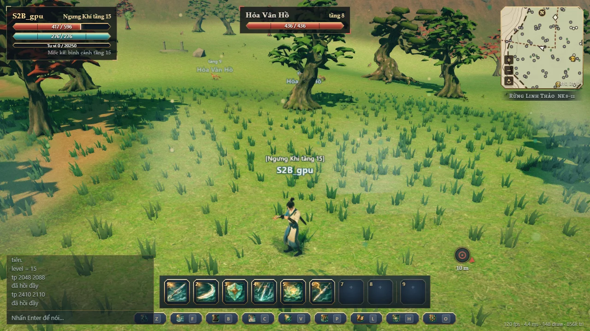
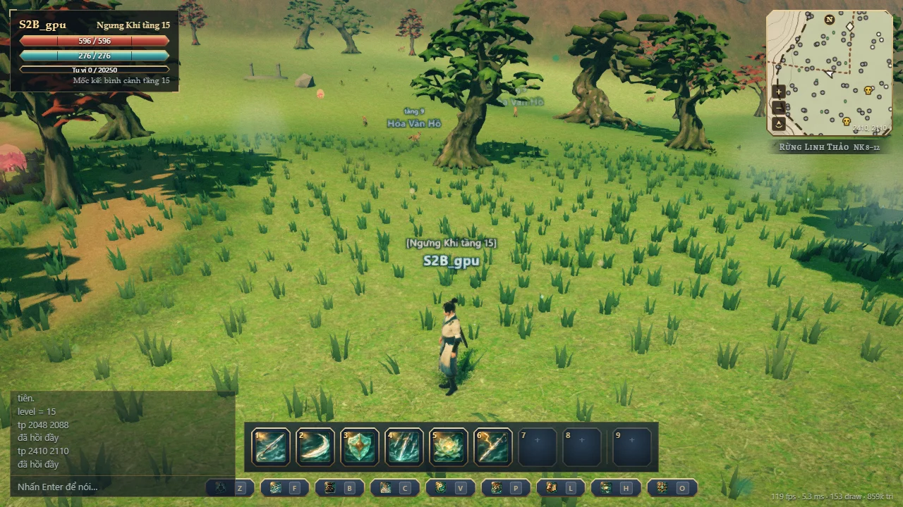
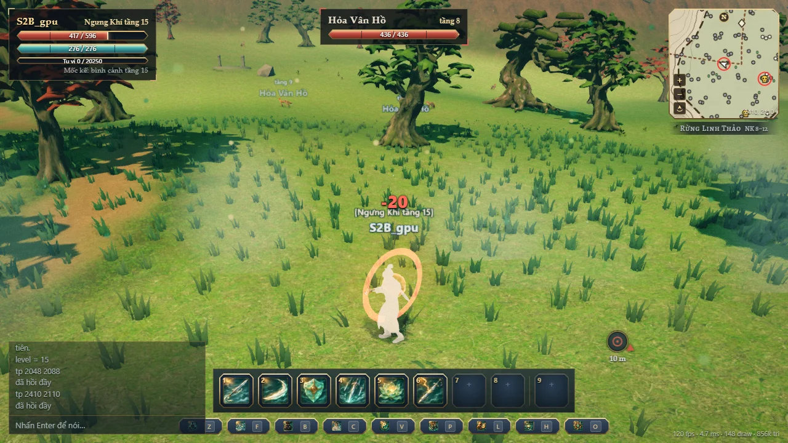
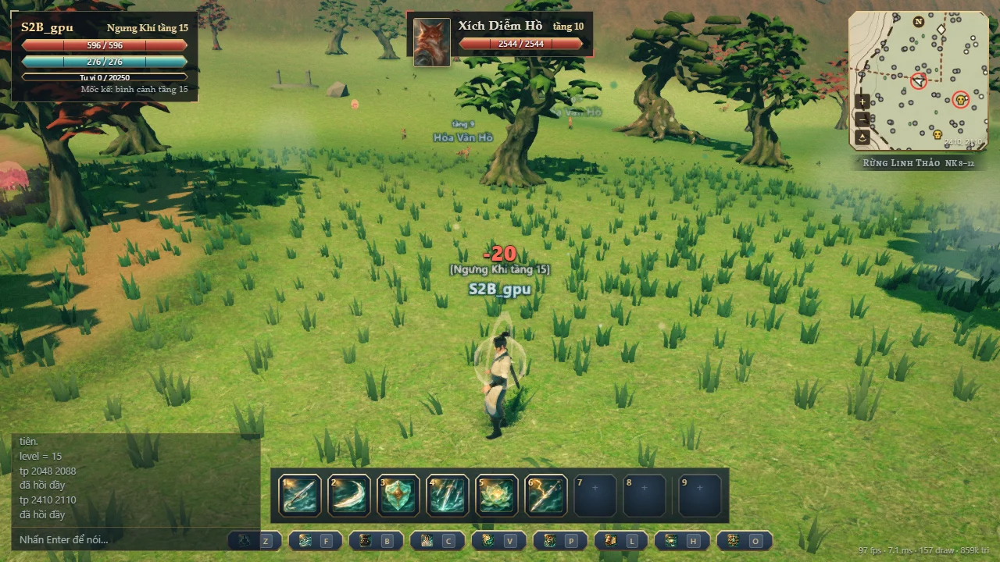

# Sprint 2 · S2-B: hiệu năng + hình client

Đo bằng `pnpm bench:client` và `pnpm bench:crowd --bots 50 --scenes san,rung,boss --presets medium,high` (Chrome, RTX 3060 Ti, 1280×720), trước = `origin/main` `9b72723`.

| Việc | Trước | Sau |
| --- | --- | --- |
| L2 texture, boss, WebGPU Cao | 506 MB | **380 MB** |
| L2 texture, hồ, WebGPU Cao (bench:client) | 494 MB | **366 MB** (mọi preset ≤ 381 MB) |
| L2 texture, boss, WebGPU Vừa | 474 MB | 372 MB |
| T5 pipeline mới khi boss hiện (WebGPU Vừa/Cao, WebGL2 Vừa/Cao) | 19 / 17 / 11 / 13 | 8 / 6 / 6 / 3 (lượt cuối 9 / 6) |
| T5 p99 CPU khung ở cảnh boss, WebGL2 | 66 / 154 ms | 14 / 14 ms |
| T6 WebGL2 Cao, sân (bench:crowd, 50 bot) | 25,7 fps | **88–90 fps** |
| T6 WebGL2 Cao, rừng / boss | 52 / 78 fps | 95 / 103 fps |
| T7 bảng icon nạp trước khi vào game | 695 KB | **334 KB** (bảng vật phẩm 376 KB nạp lười) |
| T8 draw call sân (WebGPU Cao) | 224 | 197–199 |

Ghi chú:

- **L2**: không có `toktx` trên máy dựng nên chưa KTX2. Hạ cỡ theo `assets/budgets.json`: prop normal/ORM 1024 → 512, boss màu 2048 → 1536. `tools/asset-pipeline/src/shrink.ts` hạ texture của GLB đã build mà không cần dựng lại từ Blender (`assets:build` cho cùng cỡ vì `import_tripo.py` đọc cùng ngân sách). KTX2 vẫn là hướng tiếp theo khi có `toktx`.
- **T5**: `MonsterSkins.warm` dựng một bản sao tạm (mọi LOD hiện) ngay khi skin nạp xong, `PostPipeline.compileObject` đưa vào cảnh để `compileAsync` biên dịch, `Game.warmObject` giữ `compiling` để không vẽ khi pipeline dở (M6-1). "10 khung > 12 ms" của `bench:crowd` là trần đếm; cảnh boss còn 2–6 khung.
- **T6**: thủ phạm là đèn lồng point light thật ở WebGL2 (tắt: 42 → 89 fps), nên `lanterns` chỉ bật ở WebGPU; thêm trần `WEBGL2_MAX_PIXELS` = 4 triệu điểm ảnh trên WebGL2 (bằng preset Vừa).
- **T7**: `tools/icons/build.mjs` ra hai bảng `icons-hud.*.webp` (chiêu, nút HUD, buff, dấu nhiệm vụ, pháp bảo trên thanh) và `icons-items.*.webp` (vật phẩm, trang bị, linh ngọc); `ContentIcon` nạp bảng vật phẩm khi ô vật phẩm đầu tiên cần vẽ (hiện ký hiệu dự phòng tới khi xong). Bỏ nhánh KTX2 và `--preview` vì client chỉ dùng WebP.
- **T8**: `game/labelBatch.ts`: `Label` là `Object3D` rỗng giữ chỗ trong cây cảnh, `LABELS.update()` mỗi khung gom nhãn đang hiện vào một `InstancedMesh`; atlas chữ 2048×1024 (32 ô 512×128), ô cấp theo nội dung chữ (nhiều quái cùng tên chung một ô), ô lâu không dùng bị thay. Hiển thị giữ nguyên PR C (`fitLabel`).
- **Hit react**: quả cầu khi bị cắn chỉ còn viền mờ (`burst(..., alpha 0,25)`, màu kem), chớp thân 0,05 s màu kem sẫm `0x9c8f76`. Ảnh: `truoc-*`/`sau-*` (`pnpm shots:s2b --out <thư mục>`).
- `pnpm bench:switch` báo "RÒ" ở cả `origin/main` lẫn nhánh này với cùng mức tăng (nạp lười sau khi đổi preset, không phải rò), nên không tính là hồi quy.

| Nhãn tên rừng, trước | sau |
| --- | --- |
|  |  |

| Trúng đòn (cắn), trước | sau |
| --- | --- |
|  |  |
