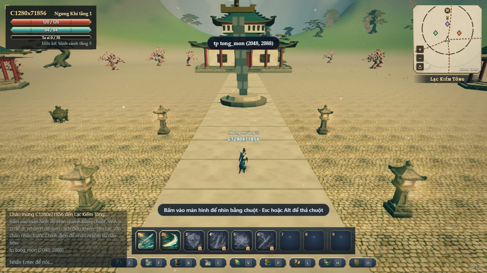
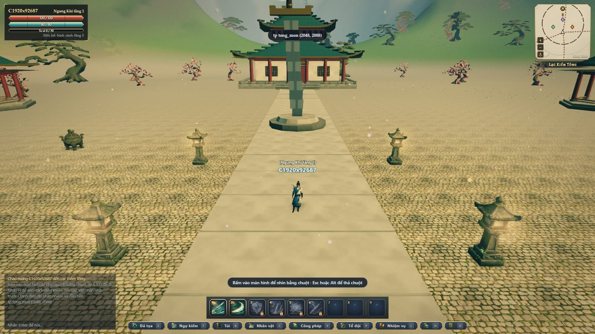
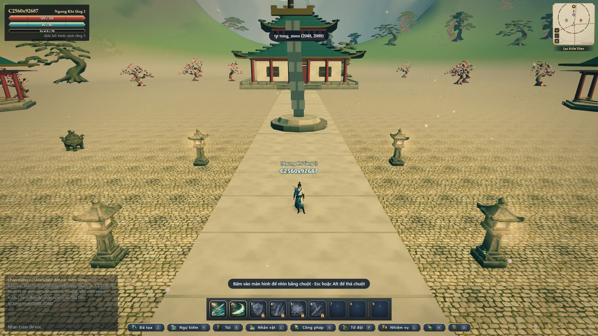
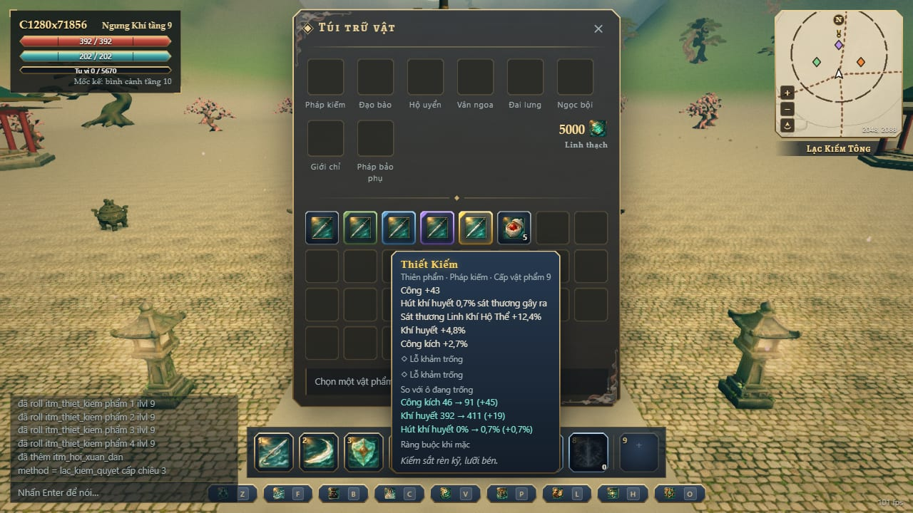
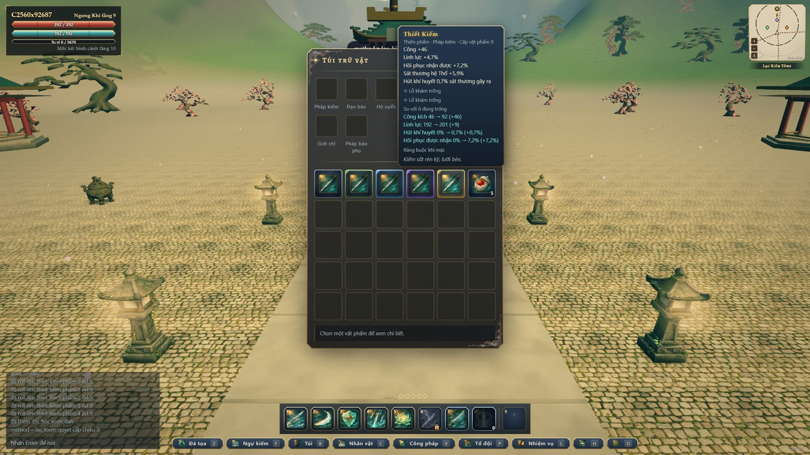
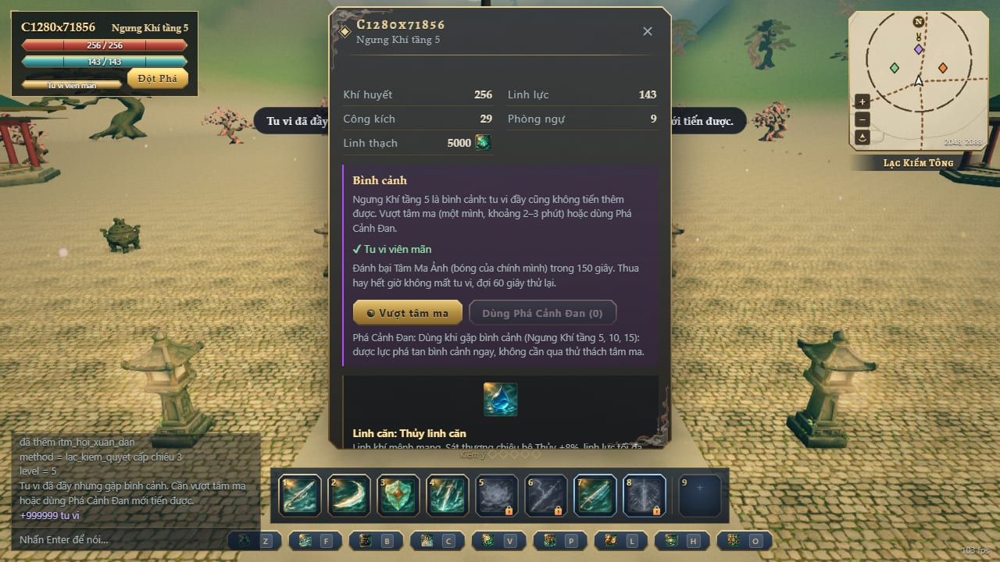
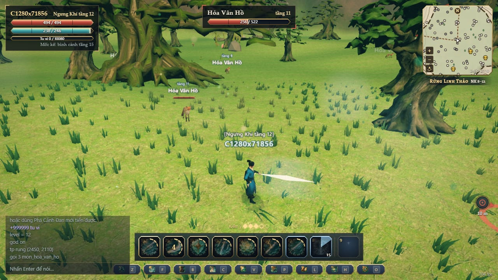
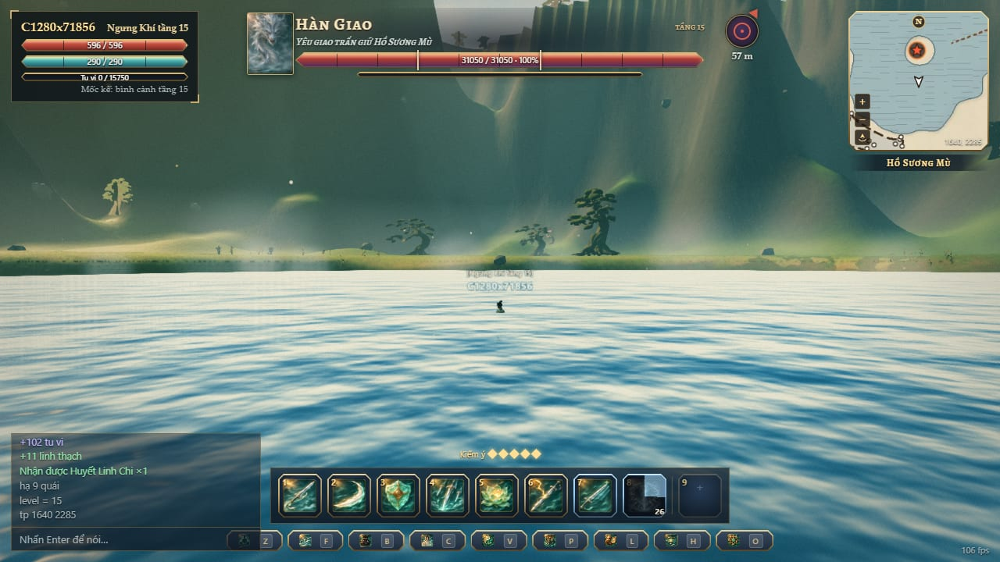
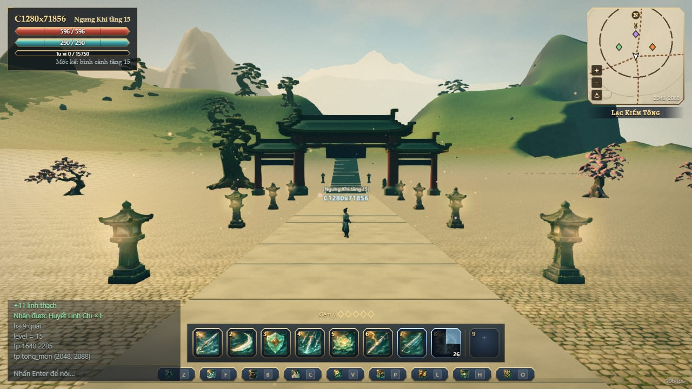
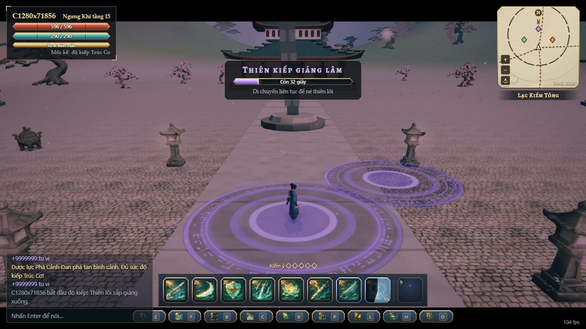

# Rà UI/UX tu tiên (PR C)

Đợt rà theo `docs/AUDIT_AND_ROADMAP.md` mục 4. Không đụng bản đồ nhỏ, bản đồ lớn (M-4) và ảnh nền bảng/màn tải (#95; chất liệu Codex của #95 vẫn phủ lên bảng như cũ).

## Lỗi đã sửa

| # | Lỗi | Nguyên nhân | Sửa |
| --- | --- | --- | --- |
| U1 | Ở 1280×720 hàng nút Đả tọa/Ngự kiếm/Túi… co còn 3×3 px mỗi nút | `@media (max-width: 1366px) .action-row .k-btn span { display: none }` ẩn luôn lớp bọc `.k-btn-in` và icon | Chỉ ẩn chữ nhãn: `.k-btn-in > span:not(.content-icon)` |
| U2 | UI không phóng ở 2560×1440; bảng Nhân vật cao hơn khung nhìn và bị thanh chiêu đè ở 720p | Mọi kích thước là px cố định; `.k-window` cao tới 82vh, canh giữa cả màn hình | `ui/uiScale.ts` + `zoom: var(--ui-scale)` cho từng khối HUD; `.k-window` canh giữa phần phía trên thanh chiêu, cao tối đa `100vh − 152px` (đã chia hệ số), thân bảng cuộn |
| U3 | Thanh máu boss kẹt lại khi đã cách boss 448 m | `bossFor` trả boss đang chọn bất kể khoảng cách; mục tiêu là quái không tự bỏ | `game/targetRange.ts`: bỏ mục tiêu khi quái rời state (AOI) hoặc xa hơn 90 m (boss 140 m); thanh boss chỉ hiện trong 140 m |
| U4 | Bảng tên 3D của boss lộ ra sau thanh máu boss | Nhãn 3D của boss phóng 1,8 lần, nằm đúng vùng thanh HUD khi camera thấp | Boss đang có thanh HUD thì ẩn nhãn 3D (`EntityManager.hudBossId`) |
| T9 | Thanh chiêu dựng lại mỗi lần vị trí đổi | `SkillBar` đăng ký `x`, `y`, `z` của store chỉ để biết đang lơ lửng | Engine tính một cờ `airborne` |
| | Thanh đếm độ kiếp, dòng chữ có gạch dài và emoji | | HUD độ kiếp theo bộ khung: tiêu đề serif, thanh đếm `ProgressBar`, một dòng gợi ý |

## Thêm mới

- **Nút Đột Phá** trên khung nhân vật: sáng khi tu vi đầy ở bình cảnh (tầng 5/10/15) hoặc ở tầng 15 viên mãn. Bấm thì mở bảng Nhân vật; khối bình cảnh/độ kiếp đã được đưa lên ngay dưới thanh tu vi. Nút **không** tự bắt đầu độ kiếp: độ kiếp tốn Trúc Cơ Đan nên vẫn cần bấm trong bảng. Logic ở `ui/breakGoal.ts` (hàm thuần, có test); server vẫn kiểm mọi điều kiện.
- **Mốc kế tiếp** dưới thanh tu vi: "Mốc kế: bình cảnh tầng 10", "Mốc kế: độ kiếp Trúc Cơ".
- **Bảng tên** người chơi dạng `[Ngưng Khí tầng 9]` (chuỗi `ui.nameplate.realm`), dòng cảnh giới màu ngà ở Ngưng Khí và kim ở Trúc Cơ; cỡ trên màn hình kẹp 160–240 px × hệ số UI; mờ dần từ 45 m, tắt ở 70 m (mình và mục tiêu luôn rõ).
- **Số sát thương** ba cấp: đòn thường (ngà, 19 px), bạo kích (kim, serif 30 px, quầng), mình trúng đòn (son đỏ 22 px); hồi phục màu ngọc; đòn người khác nhỏ và mờ. Cỡ theo hệ số UI. Cấp "khắc chế" chưa làm vì `DmgMsg` chưa có cờ (việc của 3-10).
- **Hồi chiêu dạng vòng linh văn**: lòng ô tối, vành kim chạy theo phần đã hồi, 12 khấc. Chỉ CSS (gradient + mask), không thêm phần tử hay ảnh.
- **Phẩm chất**: viền ô 2 px, quầng trong cho cả Linh và Huyền phẩm, khấc tam giác màu phẩm ở góc trên trái. Tên phẩm lấy từ glossary (Phàm/Linh/Huyền/Địa/Thiên phẩm, đã có sẵn).
- **Chat tự thu gọn**: 12 giây không có dòng mới và không gõ thì nhật ký mờ đi; rê chuột, có dòng mới hoặc mở chat thì hiện lại.
- **Gợi ý khóa chuột** tự mờ sau 6 giây và dời xuống sát thanh chiêu.
- **Tên**: "Túi đồ" → "Túi trữ vật" (thêm `bag` vào `glossary.json`; nút HUD dùng nhãn ngắn "Túi"); `ui.zone.valley` "Thung lũng Thanh Khê" → "Thung Lũng Thanh Phong" cho khớp `zone.thung_lung`.

## Ngôn ngữ thị giác

| Thứ | Giá trị | Biến |
| --- | --- | --- |
| Nền khung HUD và bảng | mực `#0D1117` ở 80% | `--k-ink-bg` |
| Viền | kim `#C8A96E` | `--k-bronze` |
| Focus bàn phím, ô đang focus | ngọc `#38BDF8` | `--k-ngoc` |
| Tiêu đề, tên, cảnh giới | font có chân (`--k-font-title`, `--k-font-serif`) | |
| Chỉ số | sans (`--k-font-body`), số đều cột | |

Đã cập nhật `docs/art-bible.md` mục 7 và nhật ký thay đổi.

## Phóng theo màn hình

`uiScaleFor(w, h)` = `min(w/1920, h/1080)`, làm tròn 0,05, kẹp trong [1, 2].

| Màn hình | Hệ số | HUD thường trực / màn hình |
| --- | ---: | ---: |
| 1280×720 | 1 | dưới 15% (đo: khung nhân vật, bản đồ nhỏ, hàng chiêu, hàng nút, ô chat) |
| 1920×1080 | 1 | 7,3% |
| 2560×1440 | 1,35 | 6,6% |
| 3840×2160 | 2 | chưa chụp |

Giới hạn đã biết: bản đồ nhỏ không phóng (thuộc M-4; ở 2560×1440 nó nhỏ hơn phần HUD còn lại). `zoom` có trên Chrome, Edge, Safari và Firefox 126 trở lên; trình duyệt cũ hơn thì UI giữ hệ số 1.

## Kiểm

Script Playwright (Chrome headless có GPU, `?mute=1`, `--mute-audio`) ở ba độ phân giải: nút hàng hành động ≥ 30×22 px và nằm trong màn hình; bảng Túi và bảng Nhân vật không vượt khung nhìn, không đè thanh chiêu; tooltip Thiên phẩm nằm trọn trong màn hình; nút Đột Phá hiện đúng lúc và mở đúng khối; boss có thanh HUD thì nhãn 3D ẩn; rời xa thì thanh boss tắt và bỏ mục tiêu; HUD độ kiếp hiện. 1280: 13/13, 1920: 9/9, 2560: 10/11 (mục còn lại là script gửi lệnh GM quá nhanh nên thiếu Trúc Cơ Đan, không phải lỗi game). 0 lỗi console.

## Ảnh

